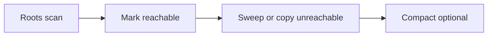

# GC Fundamentals

> **Status:** Completed  
> **Module:** 27 — Garbage Collection  
> **Target Java version:** 21  
> **Last reviewed:** 2026-11-11  
> **Chapter profile:** Deep-dive  
> **Depth target:** Levels 3–4 (reachability, GC roots, generational hypothesis, phases)  
> **Examples verified with:** Temurin JDK 21.0.12.1 (javac 21.0.12.1)

## 1. Learning Objectives *(mandatory)*

- Define **reachability** and why Java has no portable `free()` for instances (**JVMS** automatic storage management).
- Enumerate **GC root** categories at conceptual and HotSpot-oriented levels.
- Explain the **generational hypothesis** and why **HotSpot** splits the heap.
- Describe mark/sweep/copy/compact phases and **stop-the-world** vs **concurrent** work without inventing pause times.
- Read **heap** hints via `Runtime` / **MemoryMXBean** and **GarbageCollectorMXBean** names on your JVM.

## 2. Prerequisites *(mandatory)*

- Module **25** heap references; Module **26** runtime data areas.

## 3. Why This Concept Exists *(mandatory)*

Manual memory management trades control for **use-after-free** and **leak** bugs at scale. **JVMS** requires automatic reclamation of unreachable objects while preserving type safety. **Collectors** implement that policy with different **throughput vs latency** trade-offs — none mandated by **JVMS**.

Operators who only know “GC runs sometimes” misread **latency spikes**, blame the wrong tier, or invoke **`System.gc()`** as ritual.

## 4. Conceptual Explanation *(mandatory)*

### 4.1 Reachability model (**JVMS / JLS reasoning**)

An object is **eligible for collection** when it is **unreachable** via any chain of references from **GC roots**. The language does not guarantee prompt collection — only that you cannot dereference freed memory unsafely.

**Strong reachability:** object reachable from roots by strong references. **Soft/weak/phantom** references (Java SE API) participate in specialized lifecycle rules — Module 25/27 tuning context.

### 4.2 GC roots (conceptual inventory)

Roots are starting points for tracing. Typical categories (**conceptual**, exact set **implementation-dependent**):

| Root kind | Intuition |
|-----------|-----------|
| **Stack locals** in running frames | Parameters and locals holding references |
| **Static fields** | Class statics in method area / metaspace |
| **JNI global refs** | Native code holding object handles |
| **Synchronizer / JVM internal tables** | Monitors, JDNI pinned objects, etc. |
| **Class loaders** (indirect) | Keep metadata and sometimes class members alive |

**Label:** HotSpot documents specific root types in GC logging and `jhsdb` — treat as **product detail**.

### 4.3 Phases of tracing collectors (Level 4)

Many collectors share abstract phases:



- **Mark** — traverse graph from roots, mark live objects.
- **Sweep** — reclaim unmarked slots in place.
- **Copy** — copy live objects to new space (evacuation).
- **Compact** — move objects to reduce fragmentation.

Some phases run **concurrent** with mutators (application threads); some require **stop-the-world (STW)** pauses when roots or heaps must be consistent snapshots.

### 4.4 Generational hypothesis (**engineering + HotSpot**)

**Observation:** most objects die young. **Generational collectors** divide heap:

| Generation | Typical role |
|------------|--------------|
| **Young** | Eden + survivor spaces — frequent, fast minor collections |
| **Old (tenured)** | Long-lived objects — less frequent, heavier collections |

**Label:** Generation names and sizing are **HotSpot G1 / Parallel / ZGC** product layouts; **JVMS** does not name “Eden.”

On **G1** (Temurin 21 default — verified flag in Ch.02 collectors chapter), regions replace classic fixed young/old layout but **hypothesis still applies**.

### 4.5 What `System.gc()` does (**API + HotSpot**)

`System.gc()` is a **hint** (`Runtime.gc()`). **HotSpot** may trigger a **full** or **concurrent** collection depending on flags and ergonomics. **JVMS** does not require immediate collection.

**Production:** avoid explicit `gc()` except controlled benchmarks; rely on collector ergonomics and tuning with logs.

### 4.6 GC and the Java Memory Model

GC is **not** a synchronization mechanism. Do not use finalization or `Cleaner` for critical lifecycle — use **`try-with-resources`** and explicit ownership (Module 21).

## 5. Mechanism and Execution Flow *(mandatory)*

### 5.1 Minor collection (generational sketch)

1. **STW** (often) — snapshot or scan roots including **remembered sets** tracking old→young references.
2. **Evacuate** live young objects to survivor or promote to old.
3. **Update** references — must preserve program semantics (**JVMS safety**).

### 5.2 When GC does **not** collect your “logical garbage”

Object still referenced from:

- Static `List` cache never cleared.
- Thread-local map entry.
- GUI listener not unregistered.

**Not GC failure — retention bug** (Ch.03).

### 5.3 JMX observation path

1. `ManagementFactory.getGarbageCollectorMXBeans()`
2. Each bean: `getName()`, `getCollectionCount()`, `getCollectionTime()`

Names expose **product strings** like `G1 Young Generation` — map to collector policy, not JVMS law.

## 6. Terminology *(mandatory)*

| Term | Meaning |
|------|---------|
| **Mutator** | Application thread allocating/changing heap |
| **Promotion** | Survivor object moved to old generation |
| **Remembered set** | Tracks cross-generation pointers |
| **STW pause** | All mutators paused for GC work |
| **Concurrent GC** | Some work overlaps mutators (still may have STW phases) |

## 7. Examples *(mandatory)*

### 7.1 Heap and GC beans (Verified)

Demo: [gc-fundamentals-demo](../../examples/jvm/gc-fundamentals-demo/).

**Verified output (Temurin 21.0.12.1, 2026-11-11):**

```text
heapTotalBytes=268435456
heapFreeBytes=265876736
collector=G1 Young Generation
collector=G1 Concurrent GC
collector=G1 Old Generation
gcBeanCount=3
```

| Line | Note |
|------|------|
| `heapTotalBytes=268435456` | 256 MiB default ergo heap total at snapshot — **your `-Xmx` may differ** |
| `heapFreeBytes=…` | Hint before/after implicit GC — not a capacity plan |
| `collector=G1 …` | **HotSpot G1** registers multiple MX beans |
| `gcBeanCount=3` | Bean count matches named collectors on this JDK |

### 7.2 Enable unified GC logging (procedure, not fabricated log)

Run workload with:

```text
-Xlog:gc*:gc.log:time,uptime,level,tags
```

Analyze **your** pause lines and allocation rates — never cite handbook pause tables.

## 8. Common Mistakes *(mandatory)*

### Incorrect

“GC roots are only static fields.”

### Corrected

**Stacks**, JNI, JVM internals, and class metadata all matter — missed roots explain “unexpected” retention.

### Incorrect

Citing “always &lt; 10 ms” pauses without measurement.

### Corrected

**Measure** with GC logs/JFR for **your** heap, object graph, and SLA.

## 9. Internal Behavior *(conditional)*

- **JVMS:** memory safety; finalizer legacy (deprecated terminally — prefer `Cleaner` / try-with-resources).
- **HotSpot G1:** regionalized heap, **Mixed** collections, **`MaxGCPauseMillis` goal** (not guarantee).
- **Parallel GC** (`UseParallelGC`): throughput-oriented older default — still available via flags.

## 10. Performance *(conditional)*

- **Allocation rate** drives young GC frequency — reduce allocation churn in hot paths (profiling, Module 28).
- **Large arrays / humongous objects** — G1 treats above half-region specially (**HotSpot**).

## 11. Design Trade-offs

| Strategy | Wins | Losses |
|----------|------|--------|
| Generational | Cheap young collections | Remembered set maintenance |
| Concurrent marking | Shorter STW | Complexity, CPU overhead |
| Compaction | Less fragmentation | Longer moves |

## 12. Real-World Use Cases

- Micrometer `jvm.gc` metrics from MX beans for dashboards.
- Autoscaling on **GC allocation rate** anomalies (JFR).

## 13. Edge Cases

- **`OutOfMemoryError` after GC** — genuinely no heap for new object — fix size or leaks.
- **Finalizer resurrection** — anti-pattern; objects reachable again briefly.

## 14. Revision and Mastery *(Deep-dive)*

1. Draw root → static → list → element chain for leak demo (Ch.03).
2. Why three G1 MX beans?
3. Difference unreachable vs finalized-but-resurrected?

## 15. Chapter Summary *(mandatory)*

**GC** traces **reachability** from **roots**; **generational** collectors exploit short object lifetimes on **HotSpot**. **JVMS** mandates automatic management, not a specific algorithm. Use **MX beans** for collector identity; use **GC logs/JFR** for pauses — never invent timings.

## 16. GC Roots and Generational Hypothesis *(Level 4 deep-dive)*

### 16.1 Root scanning in generational collectors

Young collections must find **all references into the young generation** from old generation. **Remembered sets** or **card tables** record **old→young** pointer stores. Write barriers on reference stores maintain remembered sets (**HotSpot** detail). Without this, young GC would need to scan entire old gen — defeating generational benefit.

### 16.2 Generational hypothesis failure modes

| Workload | Symptom | Insight |
|----------|---------|---------|
| Long-lived cache | High old gen occupancy | Promotion, mixed GC pressure |
| Allocation flood | Frequent young GC | Fix allocation in hot loop |
| Humongous allocations | G1 special path | Split buffers, pooling caution |

### 16.3 Reference types and reachability (Java SE API)

| Reference | Reachability |
|-----------|--------------|
| Strong | Normal — never collected while strong chain exists |
| Soft | Cleared under memory pressure before OOME |
| Weak | Cleared when only weakly reachable |
| Phantom | Enqueued after finalization semantics for cleaners |

**Phantom/Weak** do not solve **strong static leaks**.

### 16.4 Finalization legacy

**Finalizers** and `Object.finalize()` are deprecated terminally. Do not rely on them for resource closure — **try-with-resources** and **Cleaner** with clear ownership.

### 16.5 `OutOfMemoryError` variants (teaching)

| Message | Typical meaning |
|---------|-----------------|
| `Java heap space` | No heap for allocation |
| `Metaspace` | Class metadata cap |
| `GC overhead limit exceeded` | Mostly GC, little progress |
| `unable to create native thread` | Thread/stack limits |

### 16.6 Safepoints and STW (HotSpot)

Some GC phases require **safepoints** where all threads paused at known locations. **Long safepoint** times correlate with **big stacks**, **many threads**, or **heavy JNI**. JFR **safepoint** events help diagnosis (Ch.05).

### 16.7 Throughput formula (conceptual)

Mutator utilization ≈ `(wall - sum(GC pause)) / wall`. Improving **allocation rate** can matter more than shaving individual young GC milliseconds.

### 16.8 Worked reasoning: static leak chain

```text
GC Root (static field)
  → HashMap
    → Entry[]
      → Entry key/value
        → byte[] (payload)
```

Until map entry removed, entire chain **reachable**.

### 16.9 Flag probe exercise (Verified pattern)

```text
java -XX:+PrintFlagsFinal -version 2>&1 | findstr UseG1GC
```

Expect `UseG1GC=true` ergonomic on Temurin 21.0.12.1 — aligns with MXBean names in demo.

### 16.10 Interview questions

1. Can GC collect an object still referenced from a **stack local** of a blocked thread?  
2. Why is **prompt finalization** not guaranteed?  
3. Does **JVMS** require generational collectors?

### 16.11 Object age and tenuring (HotSpot G1)

Objects surviving young collections increment **age** toward **tenuring threshold**. Long-lived survivors **promote** to old regions — increasing mixed GC work. Churny short objects never promote — ideal generational case.

### 16.12 `Runtime.getRuntime().totalMemory()` vs MXBean

`totalMemory()` / `freeMemory()` reflect **heap hint** APIs with implementation-defined refresh; **MemoryMXBean** preferred for monitoring. Neither replaces GC logs for pause analysis.

### 16.13 Concurrent vs parallel naming trap

**Concurrent** collectors run **some** work with mutators alive; they still have **STW** episodes. **Parallel** describes **multiple GC worker threads** during a phase — orthogonal axis. Read collector docs carefully.

### 16.14 Teaching diagram: unreachable island

```text
Roots → [live] → [live] → [dead island no path from roots]
                              ↑
                         eligible for GC
```

If a reference from live object to dead island exists, island is **not** dead — common bug in custom cache "cleanup."

## 17. Further Reading

- JVMS — automatic storage management (high level)  
- HotSpot GC Tuning Guide Java 21  
- Jones & Lins — *The Garbage Collection Handbook* (authoritative survey)

## 18. Next Steps

[02-collectors-g1-zgc-shenandoah.md](02-collectors-g1-zgc-shenandoah.md)

## Review Checklist

- [x] Deep-dive; generational + phase mechanism
- [x] Verified demo Temurin 21.0.12.1
- [x] JVMS vs HotSpot G1 labeled
