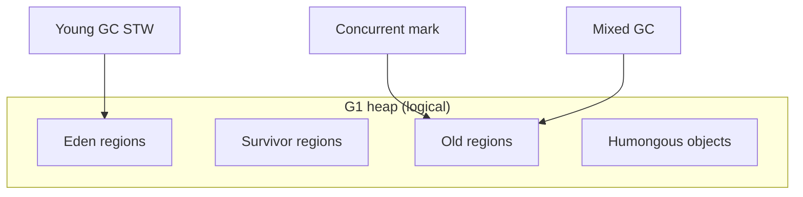
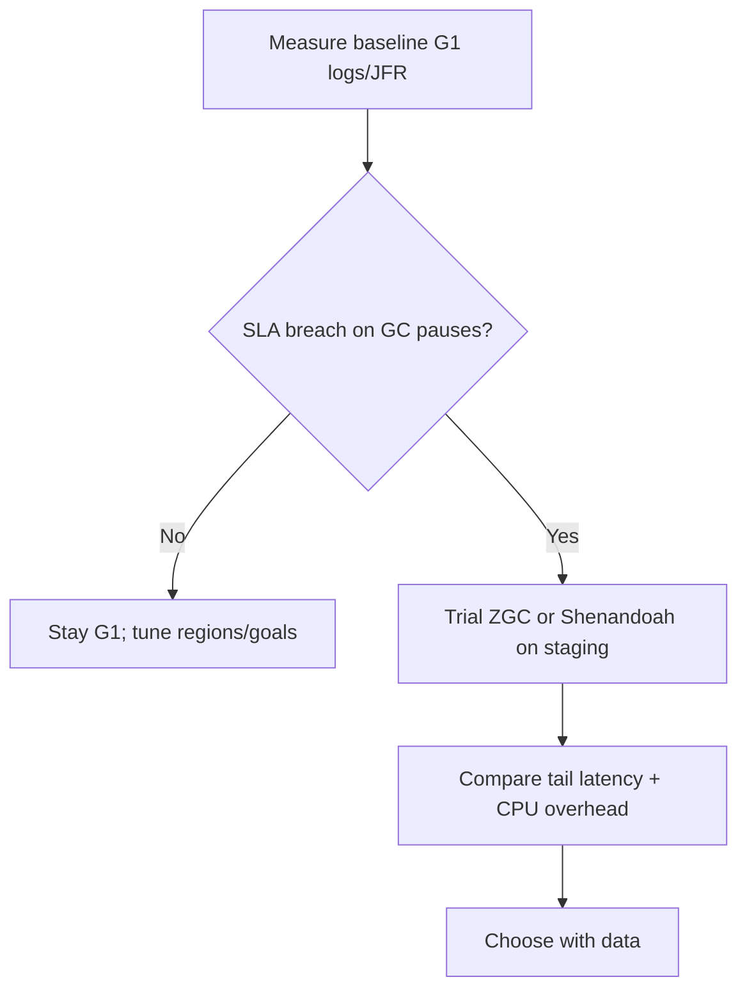

# Collectors: G1, ZGC, Shenandoah

> **Status:** Completed  
> **Module:** 27 — Garbage Collection  
> **Target Java version:** 21  
> **Last reviewed:** 2026-11-11  
> **Chapter profile:** Deep-dive  
> **Depth target:** Levels 3–4 (collector algorithms at engineering depth, pause trade-offs, flag verification)  
> **Examples verified with:** Temurin JDK 21.0.12.1 (javac 21.0.12.1)

## 1. Learning Objectives *(mandatory)*

- Compare **G1**, **ZGC**, and **Shenandoah** goals, heap organization, and concurrency models at **Level 3–4**.
- Verify **which collector is active** with **HotSpot flags**, not blog defaults.
- Articulate **latency vs throughput** selection criteria tied to **measurement**, not marketing tables.
- Relate collector behavior to **JVMS** (“implementation not specified”) vs **OpenJDK HotSpot** products.

## 2. Prerequisites *(mandatory)*

- Ch.01 GC fundamentals — roots, generations/regions, phases.

## 3. Why This Concept Exists *(mandatory)*

One size does not fit all workloads: batch ETL wants **throughput**; interactive APIs want **predictable tail latency** on large heaps. **OpenJDK** ships multiple **HotSpot** collectors; vendors may add or package others. Choosing without profiling wastes hardware or violates SLAs.

## 4. Conceptual Explanation *(mandatory)*

### 4.1 JVMS vs product collectors

**JVMS:** Automatic storage management — **algorithm unspecified**.  
**HotSpot on Temurin 21:** Ships **G1** (default ergonomic), **ZGC**, **Parallel**, **Serial**, **Shenandoah** (build-dependent), **Epsilon** (testing).

### 4.2 G1 (Garbage-First) — default on many Java 21 builds

**Design intent (**HotSpot**):** regionalized heap, target pause times via **evacuation priorities**.

| Idea | Detail |
|------|--------|
| **Regions** | Heap split into equal-sized regions (default ~1–32 MB ergonomically) |
| **Young collections** | Evacuate Eden/survivors STW |
| **Concurrent marking** | Mark live objects between pauses |
| **Mixed GC** | Reclaim parts of old gen regions with most garbage |
| **Pause goal** | `-XX:MaxGCPauseMillis=` is a **goal**, not guarantee |



**When teams pick G1:** general Java 21 services without extreme heap sizes needing sub-millisecond pauses — **starting default**, tune with logs.

### 4.3 ZGC

**Design intent (**HotSpot**):** scalability to **multi-TB heaps** with **low pause** targets via **colored pointers** / load barriers (implementation detail **HotSpot**).

| Aspect | Sketch |
|--------|--------|
| **Concurrency** | Most work concurrent; short STW phases for root processing |
| **Compaction** | Concurrent relocation |
| **Flag** | `-XX:+UseZGC` |
| **Generations** | Generational ZGC evolving across JDK versions — check **your** release notes for 21.0.12 |

**When teams pick ZGC:** large heaps, strict tail latency after **proof** on staging — compare against tuned G1 with real traffic.

### 4.4 Shenandoah

**Design intent (**OpenJDK collector**, Red Hat–led):** concurrent compaction with **Brooks pointers** / barriers (**HotSpot** when enabled).

| Aspect | Sketch |
|--------|--------|
| **Flag** | `-XX:+UseShenandoahGC` — availability depends on **distribution build** |
| **Pause profile** | Aims concurrent compaction; measure vs ZGC/G1 |
| **Use case** | Latency-sensitive heaps where Shenandoah is packaged and tested on your OS |

**Label:** Temurin builds may differ from vendor JDKs in which collectors are pre-built and tested.

### 4.5 Parallel / Serial (brief)

| Collector | Positioning |
|-----------|-------------|
| **Parallel** (`UseParallelGC`) | Throughput on batch, smaller services |
| **Serial** | Single-threaded collections — embedded/CLI tiny heaps |

Included for completeness when flags show non-G1 ergonomics.

### 4.6 Comparison matrix (conceptual — not pause numbers)

| Dimension | G1 | ZGC | Shenandoah |
|-----------|----|-----|------------|
| **JVMS mandated** | No | No | No |
| **Default Temurin 21** | Yes (ergonomic) | No | No (unless enabled) |
| **Concurrent compaction focus** | Partial via mixed | Strong | Strong |
| **Tuning culture** | Mature logs/flags | Growing | Build-dependent |
| **Proof required** | Always | Always | Always |

**No pause milliseconds in this table** — measure.

## 5. Mechanism and Execution Flow *(mandatory)*

### 5.1 Verifying active collector (HotSpot)

1. `java -XX:+PrintFlagsFinal -version 2>&1 | findstr UseG1GC` (Windows) or `grep` on Unix.
2. Confirm mutually exclusive collector flags (`UseZGC`, `UseShenandoahGC`, …).
3. Cross-check `GarbageCollectorMXBean` names (Ch.01 demo).

### 5.2 Decision workflow



### 5.3 What to log for comparisons

- **Pause times** distribution (p50, p99, max)
- **Allocation rate**
- **GC CPU overhead** %
- **Application throughput** (requests/sec) — collector changes can add barriers

## 6. Terminology *(mandatory)*

| Term | Meaning |
|------|---------|
| **Evacuation** | Copy live objects to fresh regions |
| **Mixed GC** | G1 collects some old regions with young |
| **Load barrier** | Compiler/runtime hook for concurrent collectors |
| **Ergonomic default** | HotSpot picks flag from environment |

## 7. Examples *(mandatory)*

### 7.1 VM identity (Verified)

Demo: [collectors-overview-demo](../../examples/jvm/collectors-overview-demo/).

**Verified output (Temurin 21.0.12.1, 2026-11-11):**

```text
vmName=OpenJDK 64-Bit Server VM
vmVendor=Eclipse Adoptium
note=See chapter for verifying default collector flags on your JDK
```

### 7.2 Flag check (Verified)

**Recorded 2026-11-11:**

```text
bool UseG1GC = true {product} {ergonomic}
bool UseZGC = false {product} {default}
```

Also observed on same machine:

```text
bool TieredCompilation = true {pd product} {default}
```

(linked to Module 28 — unrelated to GC choice but same flag dump session)

### 7.3 Switching collectors (procedure — do not invent results)

Example trial command sketch (**measure yourself**):

```text
java -XX:+UseZGC -Xlog:gc*:file=zgc.log MyApp
```

Compare `zgc.log` to G1 baseline on **identical** load test.

## 8. Common Mistakes *(mandatory)*

### Incorrect

“ZGC is always faster than G1.”

### Corrected

**CPU barrier cost** and workload allocation patterns may favor G1 at moderate heaps — **benchmark staging**.

### Incorrect

Enabling Shenandoah on a build that does not ship it.

### Corrected

Watch for **Unrecognized VM option** — use `java -XX:+PrintFlagsFinal` or docs for **your** distribution.

## 9. Internal Behavior *(conditional)*

- **G1** **IHOP** / **InitiatingHeapOccupancyPercent** — when concurrent cycle starts (**HotSpot**).
- **ZGC** **double mapping** details — platform/architecture sensitive.
- **Humongous** objects in G1 — avoid accidental giant `byte[]` spikes.

## 10. Real-World Use Cases

- **Kafka brokers / large caches** — ZGC trials on TB-scale heaps in financial services (always validate).
- **Spring microservices on 2–4 GB heap** — often remain **G1** after tuning young gen / metaspace.

## 11. Design Trade-offs

Concurrent collectors trade **application CPU** and **code complexity** for **shorter STW**. Throughput-oriented **Parallel** may win batch windows.

## 12. Revision and Mastery *(Deep-dive)*

1. Why does handbook avoid pause tables?
2. Name two G1 phases that can be concurrent.
3. What flag proves G1 ergonomic default on Temurin 21?

## 13. Chapter Summary *(mandatory)*

**G1** is the **HotSpot ergonomic default** on verified Temurin 21.0.12.1; **ZGC** and **Shenandoah** target low-pause concurrent compaction at the cost of barriers and build support. **JVMS** does not choose among them — your **measurements** do.

## 14. Collector Internals Survey *(HotSpot — engineering depth)*

### 14.1 G1 pause anatomy (conceptual STW parts)

| Phase | Often STW? | Purpose |
|-------|------------|---------|
| Young evacuation | Yes | Copy survivors |
| Root region scan | Short STW | Scan selected roots |
| Concurrent marking | Mostly concurrent | Mark live old regions |
| Remark | Often STW | Finish marking at safepoint |
| Cleanup / mixed | Mixed | Reclaim sparse old regions |

Exact names and concurrency evolve by JDK minor version — trust **GC logs** for your build.

### 14.2 ZGC colored pointers (intuition)

ZGC tracks **object state** in pointer metadata so concurrent threads can detect when a reference is stale and heal via **load barrier**. This enables **concurrent compaction** but adds **barrier cost** on reference reads — throughput trade-off measurable on CPU-bound apps.

### 14.3 Shenandoah vs ZGC selection (process)

1. Confirm collector ships in **your** JDK package on **your** OS/arch.
2. Run identical load test with unified GC logging enabled.
3. Compare **p99 latency**, **mean throughput**, **GC CPU %**.
4. Document decision with log artifacts in runbooks.

### 14.4 When **not** to switch collectors

- Application is **I/O bound** — pauses from network, not GC.
- Heap **&lt; few GB** with healthy G1 logs — flag churn noise.
- Untested collector on **vendor JDK** without support matrix.

### 14.5 Container ergonomics

`-XX:MaxRAMPercentage=75.0` (HotSpot) sizes heap from cgroup limit. ZGC/G1 both respect container memory; still account for **metaspace**, **code cache**, **direct buffers**.

### 14.6 GC logging fields to capture (JDK unified logging)

Parse locally:

- `pause` duration  
- `gc` cause (`G1 Evacuation Pause`, `G1 Humongous Allocation`, …)  
- `heap` before/after  

Build regression dashboards from **your** log schema.

### 14.7 Collector + JIT interaction

Concurrent GC **barriers** affect generated code. After collector switch, re-run **JMH** or staging throughput tests — not only pause metrics.

### 14.8 Epsilon collector footnote

`-XX:+UseEpsilonGC` allocates until OOME — **testing GC overhead**, not production. Useful to separate **allocation cost** from **reclamation cost** in experiments.

### 14.9 Regulatory / batch workloads

Nightly **Parallel GC** on batch Windows may maximize **throughput** when pause targets irrelevant — still verify with **flag dump**; defaults shift across JDK eras.

### 14.10 Mastery scenarios

| Scenario | Suggested first action |
|----------|------------------------|
| Sudden p99 after deploy | Diff allocation paths; GC logs |
| Old gen monotonic growth | Heap dump dominators |
| Full GC every minute | Metaspace? leak? `-Xlog:gc` cause |

## 15. Next Steps

[03-tuning-and-memory-leaks.md](03-tuning-and-memory-leaks.md)

## Review Checklist

- [x] Deep-dive collector comparison without fake pauses
- [x] Verified flag lines
- [x] HotSpot labeled
