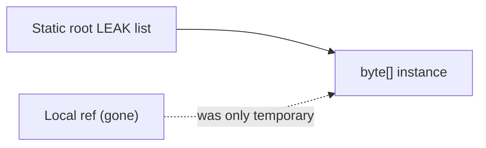

# Tuning and Memory Leaks

> **Status:** Completed  
> **Module:** 27 — Garbage Collection  
> **Target Java version:** 21  
> **Last reviewed:** 2026-11-11  
> **Chapter profile:** Deep-dive  
> **Depth target:** Levels 3–4 (retention, tuning knobs, logging, dump workflow)  
> **Examples verified with:** Temurin JDK 21.0.12.1 (javac 21.0.12.1)

## 1. Learning Objectives *(mandatory)*

- Define **memory leak** in Java as **unintended reachability**, not missing `free()`.
- Set **`-Xmx` / `-Xms`** and key **HotSpot** goals with evidence from GC logs.
- Recognize **static collections**, **thread locals**, **listeners**, and **class loader leaks**.
- Outline **heap dump** capture and analysis without fabricating MAT screenshots.

## 2. Prerequisites *(mandatory)*

- Ch.01–02 collectors; Module **25** references and visibility.

## 3. Why This Concept Exists *(mandatory)*

GC cannot reclaim objects your program still references. **Tuning** without fixing retention only delays `OutOfMemoryError`. Conversely, **premature flag churn** without logs obscures real allocation bugs.

## 4. Conceptual Explanation *(mandatory)*

### 4.1 Leak = reachable garbage

| C/C++ mental model | Java reality |
|--------------------|--------------|
| Forgot to `free` | Object unreachable → collectible |
| “Leak” | Still reachable from a root → **never eligible** |

**Example patterns:**

- `static final List<byte[]> CACHE` grows without eviction.
- `ThreadLocal` map entries after pool reuse without `remove()`.
- OSGi / hot-reload **class loaders** pinned by singletons → **metaspace OOM**.

### 4.2 Tuning knobs (HotSpot survey)

| Knob | Role |
|------|------|
| `-Xmx` / `-Xms` | Heap cap / initial size |
| `-XX:MaxGCPauseMillis` | G1 pause **goal** |
| `-XX:MaxMetaspaceSize` | Cap class metadata (**HotSpot**) |
| `-Xlog:gc*` | Unified logging (JDK 9+) |
| `-XX:+HeapDumpOnOutOfMemoryError` | Automatic dump on OOME |

**JVMS** does not define these flags — **HotSpot**.

### 4.3 `-Xms` = `-Xmx` debate

Equal values avoid heap resize work on some workloads but **commit memory upfront**. Container limits must exceed committed heap + metaspace + threads + native memory.

### 4.4 When **not** to tune GC first

Fix **allocation hotspots** (Module 28 profiling) and **retention** before exotic collector switches.

## 5. Mechanism and Execution Flow *(mandatory)*

### 5.1 Leak demonstration path

1. Static structure holds reference (`LEAK.add(bytes)`).
2. Local variable goes out of scope — **irrelevant** if static still references object.
3. GC marks object reachable from static root → **not collected**.



### 5.2 Incident workflow

1. **Symptom:** growing heap, frequent GC, `OutOfMemoryError`.
2. **GC logs:** allocation rate, pause growth, failed GC.
3. **Heap dump:** `jcmd <pid> GC.heap_dump` (Ch.05).
4. **MAT / JMC:** dominator tree — who holds references?
5. **Code fix:** remove path from roots; weak refs only when semantics allow.

## 6. Terminology *(mandatory)*

| Term | Meaning |
|------|---------|
| **Retained size** | Memory freed if object collected |
| **Dominator** | Object above others in retention graph |
| **Floating garbage** | Unreachable but not yet collected — not a “leak” |
| **GC overhead limit** | `OutOfMemoryError: GC overhead limit exceeded` — spends most time in GC |

## 7. Examples *(mandatory)*

### 7.1 Static retention (Verified)

Demo: [memory-leak-pattern-demo](../../examples/jvm/memory-leak-pattern-demo/).

**Verified output (Temurin 21.0.12.1, 2026-11-11):**

```text
leakListBefore=0
leakListAfter=1
reachable=true
```

| Line | Meaning |
|------|---------|
| `leakListBefore=0` | Empty static list before add |
| `leakListAfter=1` | One element retained |
| `reachable=true` | Instance still reachable via static — **pattern**, not timed OOME demo |

### 7.2 Logging recipe (procedure)

```text
-Xlog:gc*,safepoint:file=gc.log:time,uptime,level,tags
```

Interpret **your** file for pause distribution after deploy.

## 8. Common Mistakes *(mandatory)*

### Incorrect

Calling `System.gc()` in request path to “fix” memory.

### Corrected

Increases pause risk; hides retention bugs; **fix references**.

### Incorrect

Raising `-Xmx` indefinitely in Kubernetes without node headroom.

### Corrected

Pod OOMKilled by cgroup — size heap to **container limit** minus native overhead (`MaxRAMPercentage`).

## 9. Internal Behavior *(conditional)*

- **WeakHashMap** keys collected when weakly reachable — **not** a general cache fix.
- **Cleaner / PhantomReference** — resource cleanup, not leak prevention for strong refs.
- **G1** **to-space exhaustion** during evacuation — may need heap headroom or tuning after fixing leaks.

## 10. Performance *(conditional)*

- **Object pooling** often loses to generational GC on modern JVMs — measure before pooling complex DTOs.
- **String deduplication** (`-XX:+UseStringDeduplication`) — G1 adjunct for duplicate char arrays (**HotSpot**).

## 11. Security *(conditional)*

Heap dumps contain **PII** — protect dump files in incident response.

## 12. Real-World Use Cases

- Spring **@Cacheable** without bounds → unbounded map leak pattern.
- JDBC connection not closed — native + heap pressure (Module 21 try-with-resources).

## 13. Revision and Mastery *(Deep-dive)*

1. Difference floating garbage vs leak?
2. Three tuning changes before switching to ZGC?
3. Why static `List` defeats generational hypothesis benefits?

## 14. Chapter Summary *(mandatory)*

**Leaks** are **reachable** objects you no longer need. **Tuning** follows **GC logs** and **heap analysis**; flags are **HotSpot** knobs, not JVMS law. Verified demo shows static retention; production fixes cut reference paths.

## 15. Tuning Playbook *(evidence-first)*

### 15.1 Baseline capture checklist

Before changing flags:

1. Record **heap max**, **live data** estimate, **allocation rate** (JFR).
2. Save **GC log** for 24h representative traffic.
3. Capture **thread count** and **metaspace** usage.
4. Note **JDK vendor/build** and **container limits**.

### 15.2 Knobs that need justification

| Flag | When to touch |
|------|----------------|
| `-Xmx` | OOME or headroom evidence |
| `MaxGCPauseMillis` | G1 missing pause goal in logs |
| `InitiatingHeapOccupancyPercent` | Concurrent mark starting late |
| `MaxMetaspaceSize` | Metaspace OOME after loader leak **fixed** |

### 15.3 Thread-local leak pattern (detailed)

```java
private static final ThreadLocal<byte[]> BUF = ThreadLocal.withInitial(() -> new byte[1_000_000]);
```

Thread pools reuse threads — **BUF** survives across requests unless `BUF.remove()` in `finally`. Symptoms: stable heap growth correlating with pool size.

### 15.4 Listener leak pattern

GUI or event bus: register listener without unregister when short-lived owner dies — owner retained via listener list **if** listener holds owner reference.

### 15.5 Classpath duplicate classes

Shading errors can load **two** `com.acme.Model` classes with different loaders — bizarre `ClassCastException`, metaspace bloat — fix packaging before GC witchcraft.

### 15.6 Heap dump analysis steps (procedure)

1. `jcmd <pid> GC.heap_dump dump.hprof`
2. Open in Eclipse MAT / JMC — **dominator tree**
3. Sort by **retained heap**
4. Find path to GC root — map to field in source
5. Fix code; verify with second dump under load

No fabricated dominator percentages in handbook.

### 15.7 Kubernetes limits

```yaml
resources:
  limits:
    memory: 2Gi
```

Set `MaxRAMPercentage` so **heap + native + threads** &lt; 2Gi. Pod OOMKill leaves no Java heap dump.

### 15.8 `System.gc()` in libraries

Some JDBC drivers or caches call `gc()` — search dependencies if mysterious full GC spikes appear in logs.

### 15.9 Weak/soft caches

`WeakHashMap` keys collected when weakly reachable — **not** size-bounded LRU. Use **Caffeine** / **Guava** with explicit `maximumWeight` for production caches.

### 15.10 Post-fix validation

After leak fix:

- Old gen plateau under sustained load  
- Collection count rate drops  
- MXBean `used` heap stable after full GC cycle  

## 16. Revision and Mastery *(extended)*

**Design exercise:** You have static `Map<String, Session>` for auth. What bounded eviction policy prevents leak while keeping security?

## 17. Case Studies *(conceptual — measure locally)*

### 17.1 Session map without TTL

**Symptom:** Old gen grows until weekly restart. **Cause:** `ConcurrentHashMap` of sessions never evicted. **Fix:** TTL cache or framework session timeout. **Verify:** old gen plateaus in GC log after 24h soak.

### 17.2 Per-request `byte[]` buffer

**Symptom:** Young GC every few hundred ms. **Cause:** `new byte[65536]` in parser. **Fix:** bounded reuse with try/finally clear or smaller buffer. **Verify:** allocation rate drop in JFR.

### 17.3 Metaspace after hot redeploy

**Symptom:** `OutOfMemoryError: Metaspace` in dev. **Cause:** class loader retained by singleton holding redeployed app classes. **Fix:** break reference from container to old loader. **Verify:** metaspace used stabilizes across redeploys.

### 17.4 Logging level DEBUG in production

**Symptom:** GC overhead high, many char arrays. **Cause:** massive string allocation in logging. **Fix:** guard `isDebugEnabled()` or structured logging sampling.

### 17.5 `-Xmx` oversize in container

**Symptom:** random pod kills. **Cause:** heap 8Gi in 8Gi limit ignoring native. **Fix:** `MaxRAMPercentage` 50–75 with headroom test.

### 17.6 Off-heap leak mistaken for heap leak

**Symptom:** OS memory climbs, heap MXBean flat. **Cause:** direct buffers / native lib. **Fix:** NMT summary, library audit.

## 18. Flag reference card (HotSpot — verify)

| Flag | Meaning |
|------|---------|
| `-Xlog:gc*:file=gc.log` | Unified GC log |
| `-XX:+HeapDumpOnOutOfMemoryError` | Dump on OOME |
| `-XX:HeapDumpPath=/var/log` | Dump location |
| `-XX:NativeMemoryTracking=summary` | NMT summary at exit |

Run `java -XX:+PrintFlagsFinal` for authoritative list on your build.

## 19. Next Steps

Module **28** — JIT and Performance.

## Review Checklist

- [x] Deep-dive retention mechanism
- [x] Verified demo
- [x] No fabricated heap dump analysis
