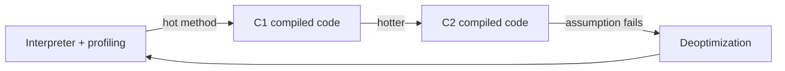

# HotSpot and Tiered Compilation

> **Status:** Completed  
> **Module:** 28 — JIT and Performance  
> **Target Java version:** 21  
> **Last reviewed:** 2026-11-11  
> **Chapter profile:** Deep-dive  
> **Depth target:** Levels 3–4 (tiered JIT, OSR, deoptimization, escape analysis concepts)  
> **Examples verified with:** Temurin JDK 21.0.12.1 (javac 21.0.12.1)

## 1. Learning Objectives *(mandatory)*

- Explain **interpreter → C1 → C2** **tiered compilation** on **HotSpot** with **`TieredCompilation=true`** on Temurin 21.
- Describe **warmup**, **invocation counters**, and **on-stack replacement (OSR)** without inventing compile thresholds.
- Summarize **escape analysis** and **scalar replacement** as **HotSpot optimizations** (not JLS guarantees).
- Run the tiered demo and record **wall-clock** with explicit non-portability warning.

## 2. Prerequisites *(mandatory)*

- Module **26** Ch.03 bytecode; Module **00** performance mindset.

## 3. Why This Concept Exists *(mandatory)*

Pure interpretation is predictable but slow on hot paths. **Ahead-of-time compile everything** wastes startup and code cache. **Tiered JIT** balances **fast startup** (C1) with **peak speed** (C2) while **profiling** guides decisions.

**JVMS** only requires bytecode semantics — **JIT is optional product behavior**.

## 4. Conceptual Explanation *(mandatory)*

### 4.1 Execution modes (**HotSpot**)

| Mode | Role |
|------|------|
| **Template interpreter** | Bytecode execution with profiling hooks |
| **C1 (client) compiler** | Fast compile, lighter optimizations |
| **C2 (server) compiler** | Aggressive optimizations, slower compile |

**Temurin 21.0.12.1 verified:** `TieredCompilation = true`.

### 4.2 Tiered compilation pipeline (Level 4)



1. Method starts in **interpreter**; **invocation counter** increments.
2. Threshold crossed → **compile at tier 1 (C1)** or **tiered strategy** schedules C1 then C2 (**exact thresholds HotSpot flags** — e.g. `CompileThreshold`, `Tier3InvocationThreshold` — verify with docs, do not memorize folklore numbers as universal).
3. **C2** applies inlining, loop unrolling, vectorization, **escape analysis**.
4. **Deoptimization:** if class hierarchy changes (new subclass), uncommon trap → back to interpreter/JIT recompile.

### 4.3 On-stack replacement (OSR)

Long-running **loops** may compile before method returns — **OSR** patches running frame to jump into compiled loop body. Explains “first outer call slow, inner loop fast” paradox in microbenchmarks.

### 4.4 Escape analysis (HotSpot concept)

**Question:** Can an allocated object’s references **escape** the method/thread?

| Outcome | Optimization opportunity (**HotSpot**) |
|---------|----------------------------------------|
| **No escape** | **Scalar replacement** — allocate fields in registers/stack instead of heap |
| **Arg escape only** | Stack allocation / sync elision possibilities |
| **Global escape** | Full heap object, normal GC |

**Label:** EA behavior is **not** observable guaranteed semantics — **disabled** by debugging, unpredictable reflection, or insufficient analysis.

### 4.5 Code cache

Compiled native code lives in **CodeCache** — bounded. **CodeCache full** → stop compiling, stay interpreted — rare in well-sized servers, possible in huge generated code apps.

## 5. Mechanism and Execution Flow *(mandatory)*

### 5.1 Hot loop demo mental model

`TieredCompilationDemo` sums integers in a tight loop:

1. Early iterations: interpreted.
2. After counters fire: C1/C2 compile `loop` or enclosing method.
3. Wall-clock drops on long runs — **first run still misleading** for micro timing.

### 5.2 Why first-run `elapsedMs` lies

| Factor | Effect |
|--------|--------|
| Interpreter | Slow baseline |
| Class loading | One-time cost |
| GC | Random pause |
| C2 compile | CPU spike during compile |
| OS scheduling | Jitter |

## 6. Terminology *(mandatory)*

| Term | Meaning |
|------|---------|
| **JIT** | Just-in-time native code generation |
| **Inlining** | Paste callee body into caller native code |
| **Uncommon trap** | Deopt point to interpreter |
| **Biased locking** | Legacy lock optimization — largely removed/neutered in modern JDKs; check release notes |
| **CHA** | Class hierarchy analysis for devirtualization |

## 7. Examples *(mandatory)*

### 7.1 Tiered demo (Verified)

Demo: [tiered-compilation-demo](../../examples/jvm/tiered-compilation-demo/).

**Verified output (Temurin 21.0.12.1, 2026-11-11):**

```text
result=124750
elapsedMs=6
note=Wall-clock time varies by machine; not a benchmark
```

| Field | Note |
|-------|------|
| `result=124750` | Sum 1..500 deterministic arithmetic check |
| `elapsedMs=6` | **This machine, one run** — repeat locally |
| `note=…` | Policy against publishing single-run timings |

### 7.2 Optional diagnostic (**HotSpot**, verbose)

```text
-XX:+PrintCompilation
```

Logs compile events — use sparingly; output volume high. **Not recorded here** — run locally when studying a hotspot method.

## 8. Common Mistakes *(mandatory)*

### Incorrect

“JIT guarantees my short-lived `new Point()` avoids heap.”

### Corrected

**Escape analysis** is optimization, not spec — never rely on it for correctness.

### Incorrect

Comparing two commits using one `main` timing print.

### Corrected

Use **JMH** (Ch.02) or production metrics.

## 9. Internal Behavior *(conditional)*

- **CompileBroker** queues compile tasks on **compiler threads** (**HotSpot**).
- **Inlining heuristics** use bytecodes size and call site type profile.
- **JVMS** bytecode semantics unchanged when optimized.

## 10. Real-World Use Cases

- Serverless **cold start:** C1-only modes (`-XX:TieredStopAtLevel=1`) — trade peak perf for startup (**HotSpot**).
- Latency SLO breaches after deploy: check **recompilation storms** after code change.

## 11. Revision and Mastery *(Deep-dive)*

1. JVMS requires JIT? (No.)
2. OSR vs normal entry compile?
3. What assumption failure triggers deoptimization?

## 12. Chapter Summary *(mandatory)*

**HotSpot** **tiered compilation** profiles hot bytecode, compiles with **C1/C2**, and may **deoptimize** when assumptions break. **Escape analysis** can eliminate allocations — **not** a language guarantee. Record **`elapsedMs` locally**; use JMH for comparisons.

## 13. Optimization Catalog *(HotSpot concepts)*

### 13.1 Inlining heuristics

C2 inlines **small hot callees** when bytecode size limits allow. **Megamorphic** call sites (many receiver types) reduce inlining benefit — reason to prefer **final** classes or stable interfaces in hot paths when profiling shows devirtualization failures.

### 13.2 Loop optimizations

| Optimization | Idea |
|--------------|------|
| Unrolling | Reduce branch overhead |
| Range check elimination | Prove array bounds in loop |
| Auto-vectorization | SIMD for numeric loops |

Triggered only when profiler proves hotness — **not** guaranteed for every loop.

### 13.3 Escape analysis worked example (Illustrative)

```java
static int sumOfLocals() {
    Point p = new Point(1, 2); // candidate: might not escape
    return p.x + p.y;
}
```

If `Point` does not escape, C2 may **scalar replace** `p.x` / `p.y` without heap allocation. **Do not rely** on this for correctness or microbenchmark claims without JMH + `-XX:+PrintInlining` expert analysis.

### 13.4 Deoptimization triggers (survey)

- New class loaded invalidating CHA assumption  
- **Reflection** / **debugger** breakpoints  
- **Intrinsic** fallback on unsupported CPU feature  
- Code cache pressure  

After deopt, counters reset toward recompilation.

### 13.5 Compiler threads and queues

`-XX:CICompilerCount` tunes compiler threads (**HotSpot**). CPU starvation from too few compilers during bulk deploy can prolong interpreted windows.

### 13.6 Native image contrast (GraalVM)

**Native Image** AOT-compiles subset — different trade-offs (startup vs JIT peak). Not HotSpot; mentioned so readers do not generalize this chapter to every “Java runtime.”

### 13.7 `-XX:TieredStopAtLevel` staging

Stop at level 1 for faster startup experiments — measure **p99 latency after warmup** separately; microservices with burst traffic may still need C2 for CPU-bound sections.

### 13.8 Practical warmup guidance

| Context | Warmup approach |
|---------|-----------------|
| Microbench | JMH built-in |
| Load test | soak traffic ≥ typical tier promotion time |
| Serverless | cold start budget — may accept C1-only |

### 13.9 Interaction with GC

Allocations eliminated by EA reduce young GC pressure — second-order performance win visible only under allocation profiling.

### 13.10 Mastery checklist

- [ ] Explain interpreter vs C1 vs C2 on one diagram  
- [ ] State why OSR matters for `while(true)` loops  
- [ ] Name one non-guaranteed optimization  

## 14. Further Reading

- OpenJDK HotSpot VM source introductions (compiler subsystem)  
- Aleksey Shipilёv blog articles on JIT (verify against your JDK)

## 15. Warmup Measurement Lab *(procedure)*

1. Run `tiered-compilation-demo` five times; record `elapsedMs` each run.
2. Observe variance — if spread is large, OS jitter dominates; single-run docs are invalid.
3. Optional: add `-XX:+PrintCompilation` and grep method name from demo — confirm compile event after repeated runs in a **longer** custom loop.
4. Optional: `-XX:+UnlockDiagnosticVMOptions -XX:+PrintInlining` — expert only; voluminous.

### 15.1 Compiler queue saturation

Bulk deploy of many new code paths can fill **compiler queue** — temporary interpreter regression cluster-wide — watch CPU **compiler threads** in OS top during rollout.

### 15.2 `compile threshold` folklore vs flags

Instead of memorizing default invocation thresholds, use:

```text
-XX:+PrintFlagsFinal | findstr CompileThreshold
```

Record **your** values; they change with **tiered** level and JDK minor releases.

### 15.3 Intrinsic methods

`Math.sqrt`, `System.arraycopy`, `String.indexOf` may be **intrinsics** — replace bytecode with optimized native/SIMD (**HotSpot**). Microbenchmarking intrinsics without JMH compares JDK releases, not app code.

### 15.4 Graal compiler (JDK note)

Some builds offer **JVMCI** / Graal as tier — enterprise/experimental paths. Temurin 21 default remains **C1/C2 HotSpot** unless explicitly configured.

## 16. Next Steps

[02-jmh-and-benchmarking.md](02-jmh-and-benchmarking.md)

## Review Checklist

- [x] Deep-dive tiers + EA concepts
- [x] Verified demo + variability note
- [x] HotSpot vs JVMS
