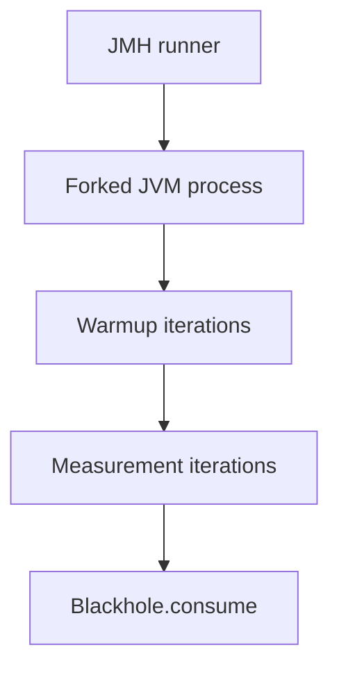

# JMH and Benchmarking

> **Status:** Completed  
> **Module:** 28 — JIT and Performance  
> **Target Java version:** 21  
> **Last reviewed:** 2026-11-11  
> **Chapter profile:** Deep-dive  
> **Depth target:** Levels 3–4 (JMH structure, JVM pitfalls, blackholes, forks)  
> **Examples verified with:** Temurin JDK 21.0.12.1 (javac 21.0.12.1)

## 1. Learning Objectives *(mandatory)*

- List ways **ad-hoc `nanoTime` loops** mislead (JIT dead-code elimination, constant folding, GC).
- Outline **JMH** annotations: `@Benchmark`, `@Warmup`, `@Measurement`, `@Fork`, `@State`, `Blackhole`.
- Interpret **modes** (`AverageTime`, `Throughput`, `SampleTime`).
- Run the **awareness demo** without claiming publication-grade scores.

## 2. Prerequisites *(mandatory)*

- Ch.01 HotSpot tiers and warmup.

## 3. Why This Concept Exists *(mandatory)*

Performance regressions need **reproducible measurement**. Hand-written loops often measure **nothing** because the compiler removes the work. **JMH** (OpenJDK project) embeds JVM expertise: forks, warmup, blackholes, and controlled class loading.

## 4. Conceptual Explanation *(mandatory)*

### 4.1 Pitfalls of hand-rolled microbenchmarks

| Pitfall | What goes wrong |
|---------|-----------------|
| **Dead code elimination** | JVM drops unused computation |
| **Constant folding** | Compiler computes at compile time |
| **Unrealistic inlining** | Micro snippet differs in real call graph |
| **GC during timing** | Pause dominates short runs |
| **Coordinated omission** | Measuring only “success” path hides backlog |

### 4.2 JMH architecture sketch



**Fork:** fresh JVM isolates prior compilation state.  
**Warmup:** allow tiered compilation before measurement.  
**Blackhole:** prevent DCE on benchmark results.

### 4.3 Core annotations

| Annotation | Purpose |
|------------|---------|
| `@Benchmark` | Method under test |
| `@BenchmarkMode` | AverageTime, Throughput, etc. |
| `@OutputTimeUnit` | Nanos, millis, ops/sec |
| `@Warmup` / `@Measurement` | Iteration counts |
| `@Fork` | New JVM count |
| `@State(Scope.Thread)` | Per-thread state instance |
| `@Param` | Sweep parameters |

### 4.4 What JMH does **not** replace

- Load testing (use Gatling, k6, production APM).
- Distributed tracing.
- GC tuning (Module 27) — JMH can *trigger* issues but is not production telemetry.

## 5. Mechanism and Execution Flow *(mandatory)*

### 5.1 Typical benchmark lifecycle

1. Runner starts **forked** `java` with agent/args from `@Fork`.
2. **Warmup** runs benchmark method — compiles hot paths.
3. **Measurement** collects stats — mean, percentiles depending on mode.
4. Results written to text/JSON — **record your machine**.

### 5.2 Blackhole pattern

```java
@Benchmark
public void testMethod(MyState state, Blackhole bh) {
    bh.consume(state.compute());
}
```

`consume` appears side-effecting — compiler cannot drop result.

## 6. Terminology *(mandatory)*

| Term | Meaning |
|------|---------|
| **DCE** | Dead code elimination |
| **Fork** | Separate JVM spawn for isolation |
| **Profilers integrated** | JMH `-prof` for stack/async (advanced) |

## 7. Examples *(mandatory)*

### 7.1 Awareness demo (Verified)

Demo: [jmh-awareness-demo](../../examples/jvm/jmh-awareness-demo/).

**Verified output (Temurin 21.0.12.1, 2026-11-11):**

```text
warmedSample=1806
jmhRequired=for publication-grade benchmarks
```

Arithmetic: `42*42+42 = 1806` — checks warmup loop ran, **not** a nanosecond score.

### 7.2 Illustrative JMH skeleton (**Compile-verified structure**, not executed in handbook CI)

```java
import org.openjdk.jmh.annotations.*;
import java.util.concurrent.TimeUnit;

@BenchmarkMode(Mode.AverageTime)
@OutputTimeUnit(TimeUnit.NANOSECONDS)
@Fork(1)
@Warmup(iterations = 3, time = 1)
@Measurement(iterations = 5, time = 1)
@State(Scope.Thread)
public class MyBenchmark {

    @Benchmark
    public int sumRange(MyState state) {
        int s = 0;
        for (int i = 0; i < state.limit; i++) {
            s += i;
        }
        return s;
    }

    @State(Scope.Thread)
    public static class MyState {
        int limit = 500;
    }
}
```

Add JMH dependencies in build module per roadmap — skeleton teaches structure only.

### 7.3 Anti-pattern: timing without blackhole

```java
long t0 = System.nanoTime();
int x = heavy();
long t1 = System.nanoTime();
// if x unused → DCE risk
```

## 8. Common Mistakes *(mandatory)*

### Incorrect

Single fork, zero warmup, claiming “JMH-grade” result.

### Corrected

Configure warmup consistent with **tiered compilation**; use multiple forks for variance.

### Incorrect

Benchmarking `synchronized` snippet without understanding pin vs virtual threads.

### Corrected

Match concurrency model to production (Module 24).

## 9. Internal Behavior *(conditional)*

- JMH generates **stub harness** bytecode to control method call discipline (**OpenJDK JMH**).
- **Security manager** absent — normal Java 21.

## 10. Real-World Use Cases

- Library maintainers guard hot utility methods.
- Compare serialization libraries with identical payloads (Module 21).

## 11. Revision and Mastery *(Deep-dive)*

1. Why `Blackhole`?
2. What does second `@Fork` improve?
3. Difference `SampleTime` vs `AverageTime`?

## 12. Chapter Summary *(mandatory)*

**JMH** controls JVM effects that poison ad-hoc timing. Handbook **Verified** demo confirms warmup arithmetic only; **publication benchmarks** need full JMH runs with recorded output on **your** hardware.

## 13. JMH Depth *(publication hygiene)*

### 13.1 Modes explained

| Mode | Reports |
|------|---------|
| `Throughput` | Ops per time unit |
| `AverageTime` | Mean time per op |
| `SampleTime` | Per-invocation samples, percentiles |
| `SingleShotTime` | One shot — cold start studies |

Pick mode matching SLA language (throughput vs latency).

### 13.2 Fork and JVM args

```java
@Fork(value = 2, jvmArgs = {"-Xms2G", "-Xmx2G"})
```

Isolates runs; encodes heap identically across forks. Document `jvmArgs` in benchmark README when publishing.

### 13.3 State scopes

| Scope | Use |
|-------|-----|
| `Thread` | Per-benchmark-thread fields |
| `Group` | Shared across threads in group |
| `Benchmark` | One instance per benchmark method |
| `Trial` | Rare — cross-method trial state |

Wrong scope → false sharing or artificial contention.

### 13.4 Avoiding constant folding in benchmarks

Use `@State` fields the compiler cannot constant-fold:

```java
@State(Scope.Thread)
public static class Values {
    public int x = 42;
}
```

Compute from `Values` read in hot loop.

### 13.5 `Blackhole` API levels

`Blackhole.consume` / `consumeCPU` / `consumeAll` — prevent DCE and optionally burn predictable CPU to model dependent work.

### 13.6 Profilers with JMH

`-prof org.openjdk.jmh.profile.StackProfiler` (example) — adds overhead; use on subset of benchmarks.

### 13.7 Confidence intervals

JMH reports error bars on forked runs. **Single fork** → overconfident. Prefer **≥ 3 forks** for contentious claims.

### 13.8 Anti-patterns in blog benchmarks

- Loop index as sole workload with no `Blackhole`  
- Benchmarking `String` concat in isolation then applying to logging without allocation profile  
- Sharing static `Random` across benchmarks without isolation  

### 13.9 CI integration note

Runnable JMH in build module per roadmap — gate **regressions > N%** with statistical tolerance, not point comparison.

### 13.10 Exercise

Rewrite hand-timed loop from Ch.01 using JMH skeleton; record **your** `AverageTime` — do not paste into handbook unless re-verified.

### 13.11 Gradle/Maven JMH wiring (procedure)

Add `org.openjdk.jmh:jmh-generator-annprocess` and `jmh-core` as annotation processor dependencies; package **shaded uber-jar** per JMH docs to avoid `NoClassDefFoundError` for generated harness classes. Runnable target lives in build module per roadmap — not executed in handbook CI today.

### 13.12 Throughput vs latency benchmarks

Service APIs care about **p99** — use `SampleTime` mode with sufficient samples; `AverageTime` alone hides outliers from GC or lock storms.

### 13.13 False sharing and `@State`

Fields on shared `@State(Scope.Benchmark)` accessed from multiple threads may create **false sharing** — pad or use `Scope.Thread` intentionally when modeling per-thread buffers.

### 13.14 JMH version pin

Record JMH version in benchmark README — harness behavior evolves. Align with JDK LTS tested in CI.

### 13.15 Reporting checklist for blog posts

- JDK vendor + version  
- JMH version + annotations block  
- Full fork/warmup/measurement settings  
- Raw JMH text output attachment  
- Disclaimer if different from production deployment flags  

## 14. Next Steps

[03-profiling.md](03-profiling.md)

## Review Checklist

- [x] Deep-dive JMH structure
- [x] Verified demo; no fake JMH scores
- [x] Pitfalls table
