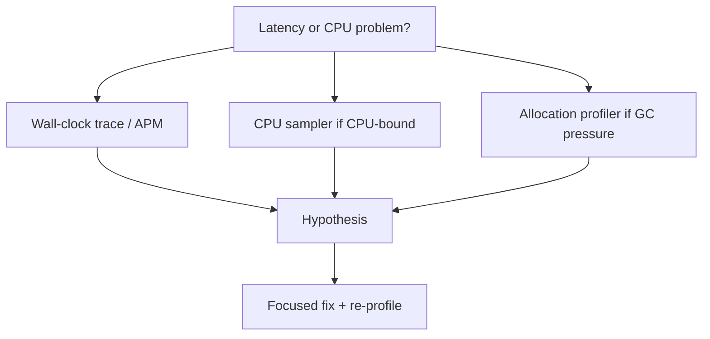

# Profiling

> **Status:** Completed  
> **Module:** 28 — JIT and Performance  
> **Target Java version:** 21  
> **Last reviewed:** 2026-11-11  
> **Chapter profile:** Deep-dive  
> **Depth target:** Levels 3–4 (CPU vs allocation vs wall-clock, JMX probes, tooling map)  
> **Examples verified with:** Temurin JDK 21.0.12.1 (javac 21.0.12.1)

## 1. Learning Objectives *(mandatory)*

- Distinguish **CPU time**, **wall-clock time**, and **allocation** profiling.
- Use **`ThreadMXBean`** CPU time support as a minimal probe (**Java SE API**).
- Map **JFR**, **async-profiler**, **VisualVM** to questions they answer (**HotSpot ecosystem**).
- Connect profiling findings to **GC** (Module 27) and **JIT** (Ch.01) without invented flame graphs.

## 2. Prerequisites *(mandatory)*

- Ch.01–02; Module **26** Ch.05 diagnostics.

## 3. Why This Concept Exists *(mandatory)*

Optimizing unmeasured code wastes effort. **Profiling** identifies **hot methods**, **lock contention**, and **allocation storms**. Wrong profiler type (CPU sampler during I/O wait) misleads — **wall-clock blocked** threads may show low CPU.

## 4. Conceptual Explanation *(mandatory)*

### 4.1 Three clocks

| Measure | Answers |
|---------|---------|
| **Wall-clock** | How long user waited (includes sleep, I/O, lock wait) |
| **CPU time** | Time on CPU executing bytecode/native code |
| **Allocation** | Bytes/objects allocated per stack trace (JFR / profilers) |

Demo (Verified) shows **sleep** not increasing CPU time.

### 4.2 Profiling styles

| Style | Mechanism | Bias |
|-------|-----------|------|
| **Sampling** | Periodic stack capture | Low overhead, misses short methods |
| **Instrumentation** | Method entry/exit hooks | Higher overhead, precise counts |
| **JFR events** | Kernel-like ring buffer | Tunable event sets |

**Label:** async-profiler uses **perf** / **WallClock** modes — **HotSpot/Linux** common.

### 4.3 Profiling mindset (Level 4)



1. **Reproduce** under realistic load.
2. **Profile** with correct signal type.
3. **Fix** hottest frame or allocation site.
4. **Verify** with same workload + GC logs if heap-related.

### 4.4 Observer effect

Heavy instrumentation changes timing and **disables some JIT** opts — use sampling first in prod-like staging.

## 5. Mechanism and Execution Flow *(mandatory)*

### 5.1 ThreadMXBean CPU path

1. `getCurrentThreadCpuTime()` if supported.
2. Do work vs `Thread.sleep`.
3. Re-read — **CPU** may be flat while **wall** increases.

### 5.2 Escalation toolchain

| Step | Tool |
|------|------|
| Health | JMX, Micrometer |
| Sample CPU | async-profiler, JFR `jdk.ExecutionSample` |
| Allocations | JFR `jdk.ObjectAllocationInNewTLAB` |
| I/O wait | APM traces, `jfr` socket/block events |

## 6. Terminology *(mandatory)*

| Term | Meaning |
|------|---------|
| **Flame graph** | Aggregated stack visualization |
| **Self time** | Time in method body excluding callees |
| **Total time** | Includes children |
| **Coordinated omission** | Benchmarking artifact when queue backs up |

## 7. Examples *(mandatory)*

### 7.1 CPU vs sleep (Verified)

Demo: [profiling-awareness-demo](../../examples/jvm/profiling-awareness-demo/).

**Verified output (Temurin 21.0.12.1, 2026-11-11):**

```text
cpuTimeSupported=true
cpuTimeNanos=62500000
cpuTimeAfterSleep=62500000
```

| Line | Teaching point |
|------|----------------|
| `cpuTimeSupported=true` | Bean exposes per-thread CPU on this JVM |
| Equal CPU before/after sleep | **Sleep** consumes **wall** time, not CPU |
| Absolute nanos | **Run-specific** — compare relative deltas on same machine |

### 7.2 What not to fabricate

Flame graph PNGs, JFR JSON excerpts, and **“top frame was foo() 38%”** lines must come from **your** profiling session.

## 8. Common Mistakes *(mandatory)*

### Incorrect

Profiling production at **instrumentation** level always-on.

### Corrected

Use **JFR default** or short **sample** windows with overhead budgets.

### Incorrect

Optimizing cold startup path seen in dev profiler attaching late.

### Corrected

Profile from **process start** or use startup-specific traces.

## 9. Internal Behavior *(conditional)*

- **JFR** thread sampling safepoint bias — samples at safepoints historically; modern JDK improves — read release notes (**HotSpot**).
- **JVMS** does not define profilers.

## 10. Real-World Use Cases

- **Allocation profiling** reveals per-request `new byte[1_000_000]` in logging.
- **Lock profiling** ties to Module 24 contention.

## 11. Revision and Mastery *(Deep-dive)*

1. When is CPU profiling misleading?
2. First tool for GC allocation rate?
3. Difference self vs total time in flame graph?

## 12. Chapter Summary *(mandatory)*

Match profiler to **bottleneck type**. **ThreadMXBean** separates **CPU** from **sleep**. **JFR** and **async-profiler** deepen analysis on **HotSpot** — capture real artifacts. Optimize after measurement; coordinate with **GC tuning**.

## 13. Profiling Playbook *(operations)*

### 13.1 CPU-bound service

1. JFR **60s** recording under load (`JFR.start`).
2. Sort **hot methods** by sample count.
3. If top frames are `java.util.HashMap.get` — investigate **algorithm** before `-XX` flags.
4. If frames are `sun.nio.ch` — network bounds; profiling CPU misleading.

### 13.2 GC-bound symptoms

| Symptom | Profiler |
|---------|----------|
| High `gc` CPU in JFR | GC logs + allocation profiler |
| Allocation rate spike | TLAB / object allocation events |
| Promotion failure logs | Heap sizing / leak (Module 27) |

### 13.3 Lock contention

JFR `jdk.JavaMonitorWait` / `Thread Park` events — correlate with Module 24 lock design.

### 13.4 async-profiler modes (Linux HotSpot)

| Mode | Meaning |
|------|---------|
| `cpu` | On-CPU stacks |
| `wall` | Includes blocked time |
| `alloc` | Allocation stacks |

Choose `wall` when threads wait on I/O; `cpu` when cores saturated.

### 13.5 VisualVM attach workflow

1. JMX enable on controlled staging (not wide-open production).
2. Sample CPU 30s during peak.
3. Save snapshot artifact with timestamp.

### 13.6 Micrometer + Prometheus

Production **p95 latency** complements profiler snapshots — continuous vs point-in-time.

### 13.7 Before/after optimization doc template

| Field | Content |
|-------|---------|
| Hypothesis | e.g. "JSON parsing dominates" |
| Evidence | JFR sample % or allocation rate |
| Change | code diff summary |
| Verification | same profiler config post-fix |

### 13.8 False optimizations

- `String.intern()` everywhere — metaspace/GC pressure  
- `@Contended` padding without measurement  
- Pooling small short-lived objects — often loses to GC improvements  

### 13.9 JDK Flight Recorder overhead

Default **10 MB** buffer — low overhead for short recordings. Continuous production JFR needs sizing policy from vendor docs.

### 13.10 Cross-module closure

| Finding | Action module |
|---------|---------------|
| Accidental retention | 27 Ch.03 |
| Megamorphic call | 28 Ch.01 inlining |
| Bad microbench | 28 Ch.02 JMH |
| Missing thread dump | 26 Ch.05 jcmd |

## 14. Sampling Bias and Safepoints *(HotSpot nuance)*

Execution sampling historically occurred at **safepoints** — methods without frequent safepoints could be **underrepresented**. Modern JDKs reduce bias — still read **release notes** when comparing profiles across versions.

### 14.1 Wall vs CPU profile divergence table

| Profile | High `read` in `socket` | High `HashMap.get` |
|---------|-------------------------|---------------------|
| CPU | Low if blocked | High if CPU-bound map |
| Wall | High | High if on hot path |

### 14.2 Allocation profiling interpretation

Top allocating frame may be **factory** not **leak** — correlate with **object survival** (heap dump dominators). Short-lived garbage is normal; **tenured** growth is concern.

### 14.3 Production sampling policy

| Tier | Approach |
|------|----------|
| Staging | JFR continuous light |
| Production | Triggered 5-min recordings on SLO breach |
| Laptop | VisualVM attach dev only |

### 14.4 Developer hygiene

Log **build git sha** and **JDK version** in profile filenames — `app-abc123-temurin21.jfr`.

### 14.5 Observer effect mitigation

Warm up profiler attachment: discard first 60s after attach before capturing.

## 15. Next Steps

Continue roadmap **Module 29** per `LEARNING-ROADMAP.md`.

## Review Checklist

- [x] Deep-dive profiling mindset
- [x] Verified demo
- [x] No invented flame graphs
