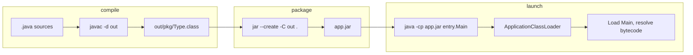

# Classpath, JARs, and Modules

> **Status:** Completed  
> **Module:** 29 — Build Tools and Dependency Management  
> **Target Java version:** 21  
> **Last reviewed:** 2026-11-11  
> **Chapter profile:** Technical  
> **Depth target:** Levels 2–3 (classpath model, JAR packaging, launcher flow)  
> **Examples verified with:** Temurin JDK 21.0.12.1 (javac 21.0.12.1)

**Section policy:** Omissions recorded in Review Checklist.

## 1. Learning Objectives *(mandatory)*

After completing this chapter, you should be able to:

- Explain **classpath** vs **module path** at a level you can debug `ClassNotFoundException` and `NoClassDefFoundError`.
- Compile multiple packages into one output tree, package a **JAR**, and run with `-cp`.
- Read **`MANIFEST.MF`** metadata (`Main-Class`, `Class-Path`) and compare **fat** vs **thin** JAR deployment.
- Trace how the JVM launcher and class loaders resolve a type name at startup.

## 2. Prerequisites *(mandatory)*

- **Module 01** Ch.05 — packages, folder layout, and `-cp` / `-classpath`.
- **Module 26** Ch.01–02 — class loading overview (bootstrap → platform → application loaders).
- **Refresh:** `javac -d <dir>` places `.class` files in a mirror of package folders; `java` needs the directory or JAR *root* that contains those packages on the classpath.

## 3. Why This Concept Exists *(mandatory)*

Real applications span dozens of packages and third-party libraries. Without a repeatable way to name **where bytecode lives**, neither `javac` nor `java` can resolve types. **JAR files** (Java ARchive, ZIP format) bundle `.class` files and resources; the **classpath** is the ordered search list the compiler and launcher use on the classic (non-modular) application model.

Build tools (Maven/Gradle in Ch.02–03) automate downloading JARs and assembling classpaths. Understanding raw `javac`/`jar`/`java` prevents mystifying “it works in the IDE” failures on CI or in containers.

## 4. Conceptual Explanation *(mandatory)*

| Mechanism | Role |
|-----------|------|
| Classpath (`-cp` / `CLASSPATH`) | Directories and JARs searched for packages and classes (default for classic apps). |
| JAR | ZIP archive containing `.class` files and optional `META-INF/MANIFEST.MF`. |
| Module path (`--module-path`) | JPMS modules (Ch.04); explicit dependencies and exports. |
| Fat (uber) JAR | One JAR containing your app **and** dependency classes (simple deploy; merge/shading conflicts possible). |
| Thin JAR | Your code only; dependencies resolved separately at runtime or via manifest `Class-Path`. |

**JLS / JVMS:** The launcher must load the initial class named on the command line. User-defined classes are located via classpath or module resolution depending on launch mode—not via implicit magic in the language.

**HotSpot (implementation, not universal JVM law):** Application classes on the classpath load through the **application class loader**; JDK classes use bootstrap/platform loaders. Module layers use a different graph when you launch on `--module-path`.

### Classpath vs module path (preview)

On **classpath**, any public type in any JAR may be referenced if its package is reachable—encapsulation is conventional (package-private) only. On **module path**, only **exported** packages are readable to `requires` consumers. Ch.04 owns JPMS depth; this chapter establishes the classpath foundation most Spring Boot and library-centric projects still use.

### 4.1 What the compiler classpath and runtime classpath share

`javac` and `java` are separate tools but must agree on **which bytecode defines a type**. At compile time, `javac` records symbolic references in `.class` files (superclass name, field types, method descriptors). At runtime, the JVM **links** those references by loading the named classes. If you compile against `util/Greeter` revision A but accidentally run against stale revision B on the classpath, you can pass compilation yet fail at runtime with `NoSuchMethodError`.

| Phase | Who sets classpath | Typical contents |
|-------|-------------------|------------------|
| `javac` | `-cp` / `--module-path` + boot classes | Sources’ dependencies + JDK |
| `java` | `-cp` / `-jar` manifest / `--module-path` | Compiled app + runtime libraries |
| Maven `compile` | Plugin computes from POM | Main dependencies |
| Maven `test` | Adds `test` scope | JUnit, H2, test fixtures |

### 4.2 JAR innards (ZIP, not magic)

A JAR is a **ZIP archive**. You can inspect with `jar tf greeter-app.jar` or any ZIP tool. Required layout:

```text
META-INF/MANIFEST.MF
app/App.class
util/Greeter.class
```

Resources such as `application.properties` sit at paths mirrored from classpath roots (`config/app.properties` → `getResourceAsStream("config/app.properties")`). **META-INF** can also carry `services/` for `ServiceLoader`, signature files for signed JARs, and multi-release versioning metadata—topics for library authors.

### 4.3 Exception triage on the classpath

| Exception | Typical cause on classpath |
|-----------|---------------------------|
| `ClassNotFoundException` | Explicit `Class.forName` or `ClassLoader.loadClass` could not find bytecode |
| `NoClassDefFoundError` | Class was known at compile time but missing or failed to initialize at runtime |
| `NoSuchMethodError` / `NoSuchFieldError` | Binary mismatch—wrong library version on runtime classpath |
| `LinkageError` subclasses | Class loader constraints, duplicate loaders (advanced) |

When Maven “works in CI” but fails locally, compare **effective runtime classpath** (`mvn -q dependency:build-classpath`) against IDE “Run” configuration.

## 5. Mechanism and Execution Flow *(mandatory)*

### 5.1 Compile → package → run (classic classpath)



1. **Compile:** `javac` resolves types against the compile classpath (boot classpath + `-cp`). Output lands under `-d`.
2. **Package:** `jar` zips the output tree; optional `--main-class` writes `Main-Class:` into `MANIFEST.MF`.
3. **Launch:** `java` reads `Main-Class` when using `-jar`, or loads the class named on the command line when using `-cp`.
4. **Load:** The application class loader searches each classpath entry in order; **first match wins** for duplicate fully qualified class names.

### 5.2 How `java -jar` differs from `java -cp`

| Launch style | Classpath source | Initial class |
|--------------|------------------|---------------|
| `java -cp lib/* app.Main` | Explicit `-cp` | `app.Main` on command line |
| `java -jar app.jar` | JAR + optional manifest `Class-Path` | `Main-Class` in manifest |

**Important:** `java -jar app.jar` **ignores** `-cp` on the command line (unless you use workarounds). Many beginners set `-cp` and wonder why dependencies are missing when they also pass `-jar`.

### 5.3 Resource lookup

Non-class files (properties, images) load via `ClassLoader.getResourceAsStream("relative/path")` relative to the classpath entry root inside the JAR or directory—not relative to the `.java` file path.

## 6. Terminology *(mandatory)*

| Term | Meaning |
|------|---------|
| Entry point | Class with `public static void main(String[])` selected to start the JVM application thread. |
| Manifest | `META-INF/MANIFEST.MF` — metadata (`Main-Class`, `Class-Path`, modular attributes in JPMS JARs). |
| Coordinates | Maven-style `groupId:artifactId:version` (Ch.02); raw `jar` does not use coordinates. |
| Code source | Origin of loaded bytecode (`ProtectionDomain.getCodeSource()` — non-null when loaded from JAR or directory). |
| Classpath entry | One directory or one `.jar` file on the search path. |

## 7. Syntax and Language Rules *(include when the topic is language/API surface)*

Common commands (Temurin 21):

```bash
javac -d out pkg/A.java pkg/B.java
jar --create --file=lib/app.jar --main-class=pkg.Main -C out .
java -cp lib/app.jar pkg.Main
java -jar lib/app.jar
```

Environment variable `CLASSPATH` applies when `-cp` is omitted (avoid relying on it in production scripts—explicit `-cp` is clearer).

## 8. Step-by-Step Examples *(mandatory)*

### 8.1 Minimal — single package

**Compile-verified** on Temurin 21.0.12.1 (no separate handbook demo folder).

```bash
javac Hello.java
java Hello
```

One public class per file matching the filename; default package only suitable for learning snippets.

### 8.2 Realistic — multi-package compile + JAR

Demo: [classpath-jars-demo](../../examples/build-tools/classpath-jars-demo/).

Packages `app` and `util` compile into one tree, package into `greeter-app.jar`, and run with an argument.

**Verified output (Temurin JDK 21.0.12.1, 2026-11-11):**

```text
greet=Hello, Handbook!
fromJar=true
```

`fromJar=true` — `App.class.getProtectionDomain().getCodeSource()` is non-null when loaded from the JAR (contrasts with loose `.class` in a directory in some setups).

Commands:

```bash
cd examples/build-tools/classpath-jars-demo
mkdir -p out lib
javac -d out app/App.java util/Greeter.java
jar --create --file=lib/greeter-app.jar -C out .
java -cp lib/greeter-app.jar app.App Handbook
```

**Important lines:**

- `javac -d out` — single output root preserves package directories.
- `jar ... -C out .` — archive contents of `out` with `.` as JAR root (so `app/App.class` path inside ZIP is correct).
- `Greeter` in another package requires no import beyond `import util.Greeter` because both are on the same compile classpath.

| Output key | Teaching point |
|------------|----------------|
| `greet=Hello, Handbook!` | CLI arg `Handbook` flows to `Greeter.greet` |
| `fromJar=true` | `getCodeSource()` non-null ⇒ loaded from JAR artifact, not loose `out/` directory |

**Source tree (handbook demo):**

```text
classpath-jars-demo/
  app/App.java
  util/Greeter.java
  out/          ← generated
  lib/greeter-app.jar
```

`App` prints `ProtectionDomain` origin so you can distinguish “I ran from IDE output folder” vs “I ran `java -cp lib/...jar`”.

### 8.3 Runnable JAR with manifest

**Compile-verified** pattern (equivalent flags on handbook host):

```bash
jar --create --file=app.jar --main-class=app.App -C out .
java -jar app.jar
```

`--main-class` writes `Main-Class: app.App` into the manifest so `java -jar` knows the entry point without naming the class on the command line.

### 8.4 Incorrect variation (teaching)

**Incorrect:** Compile only `app/App.java` while `util/Greeter.java` changed—`javac` may use stale `util/Greeter.class` or fail at runtime with `NoClassDefFoundError`.

**Corrected:** Always compile **all** affected sources into one `-d out` tree before packaging; in real projects Maven/Gradle track source timestamps.

## 9. Real-World Use Cases *(conditional)*

- Shipping a CLI tool as a single `-jar` artifact to operators or cron jobs.
- **Docker** images that `COPY app.jar` and `ENTRYPOINT java -jar app.jar` (Ch.48 containers).
- Diagnosing **classpath conflicts** when two JARs contain the same package (wrong version wins depending on order).
- Contrasting **thin JAR + lib/** layout vs **Spring Boot repackaged fat JAR** (Module 37).

## 10. Internal Behavior *(conditional)*

**JVMS — loading:** Resolution links symbolic references to concrete types; linking may trigger loading of superclasses and interfaces. Failure appears as `NoClassDefFoundError` when a previously successful load later fails at link time.

**HotSpot — classpath delegation:** Application class loader delegates JDK classes to platform loader, then searches user JARs. Wrong order on manifest `Class-Path` entries causes subtle `NoClassDefFoundError` at **first use** of a type, not at JVM startup.

**Not guaranteed on all JVMs:** Exact loader class names and delegation details—behavior described here matches HotSpot as shipped in Temurin 21.

## 11. Edge Cases and Limitations *(strongly encouraged)*

- **Duplicate classes** on the classpath: first match wins—undefined which version is “correct.”
- **`java -jar`** ignores command-line `-cp` (manifest `Class-Path` only, with length limits).
- **Very long classpaths** on Windows hit command-line length limits—use argument files or fat JARs.
- **Signed JARs** and security policy (legacy `SecurityManager` removed in modern JDK—awareness for ancient docs).
- **Multi-release JARs** (`META-INF/versions/`) — bytecode version-specific overrides (library feature).

## 12. Common Mistakes *(mandatory)*

### Incorrect

```text
java app.App
```

from a directory containing only sources, not `out/app/App.class`.

### Corrected

```text
java -cp out app.App
```

or package and run from the JAR as in §8.2.

### Incorrect

Expecting `getResource("/com/foo/config.properties")` while file lives at wrong path inside JAR.

### Corrected

Path is classpath-relative: often `com/foo/config.properties` without leading slash depending on API used—test with `ClassLoader.getResource`.

## 13. Best Practices *(include when guidance adds value)*

- Prefer **Maven/Gradle** for dependency graphs; use raw tools to understand what build plugins automate.
- One **output directory per compile**; never commit `out/` or stray `.class` files.
- Name deliverable JARs with **version** in the filename for operators (`greeter-1.2.0.jar`).
- Document **minimum Java version** in manifest or release notes; match `javac --release` (Ch.02).

## 14. Design Trade-offs *(strongly encouraged)*

| Approach | Pros | Cons |
|----------|------|------|
| Fat JAR | One file to deploy | Large artifact; duplicate `META-INF`; may need shading |
| Thin JAR + `lib/` | Smaller app artifact | Must assemble runtime classpath correctly |
| JPMS modular JAR | Strong encapsulation | Ecosystem migration cost (Ch.04) |

## 15. Performance and Operational Notes *(conditional)*

- **Classpath length:** Thousands of JARs slow startup (class path scanning in some frameworks). Fat JARs reduce entries but increase redeploy size.
- **Layered Docker images:** Copy `lib/` dependencies as a separate image layer so app JAR changes reuse cached dependency layers (Module **48**).
- **Wildcards:** `java -cp "lib/*"` expands to all JARs in `lib` (order not guaranteed—avoid when duplicate classes exist).

## 16. Security *(conditional)*

Classpath is a **trust boundary**: any JAR on the path can define classes in **any package** (classic model). A malicious JAR placed **earlier** on the classpath can shadow legitimate classes (“classpath attack”). Mitigations: verify dependency checksums, use dependency locking, minimal images, and JPMS encapsulation where feasible (Ch.04).

Never put untrusted directories first on `CLASSPATH`. Production builds should pull dependencies from audited repositories (Module **29** Ch.02, Module **43**).

## 17. Compatibility and Version Notes *(conditional)*

- **Multi-release JARs** (Java 9+): vendor libraries may ship version-specific class files under `META-INF/versions/`.
- **`--release N`** at compile time (Maven `release` property) prevents accidentally calling APIs newer than your deployment JDK.
- **JPMS automatic modules** rename legacy JARs—see Ch.04 before mixing modular and non-modular deployables.

## 18. Revision and Mastery *(Track B / Technical)*

- What is the difference between `ClassNotFoundException` and `NoClassDefFoundError`? When does each typically appear?
- Why does `fromJar=true` in the demo matter for debugging class origin?
- If two JARs both contain `com.acme.Util`, how does HotSpot choose?
- When would you choose module path over classpath for a new service?

## 19. Chapter Summary *(mandatory)*

Classpath and JARs are the non-modular packaging model every Java developer meets. You compile into a mirrored package tree, archive with `jar`, and launch with explicit classpath or manifest-driven `java -jar`. Build tools layer coordinates and transitive resolution on top of this foundation.

## 20. Next Steps

[02-maven.md](02-maven.md)

## 21. Compare with Maven assembly *(conditional)*

When `mvn package` completes, inspect:

```text
target/classes/          ← compile output (like `out/`)
target/maven-archiver/   ← build metadata
target/*.jar             ← packaged artifact
```

Maven Surefire uses `target/test-classes` + `target/classes` + resolved JARs—same classpath idea as raw `java -cp`, assembled by resolver. Ch.02 owns POM; this chapter explains **what** is being assembled.

`mvn dependency:build-classpath -Dmdep.outputFile=cp.txt` emits a machine-local path list equivalent to manual `-cp` construction—useful when reproducing CI failures on a laptop without the IDE.

## 22. Manifest `Class-Path` attribute *(conditional)*

Thin JARs may reference dependency JARs relatively:

```text
Class-Path: lib/dep1.jar lib/dep2.jar
```

`java -jar` loads those entries; paths must be relative to the JAR file location. Long manifests hit line length limits—another fat-JAR motivation.

## 22. `jar` multi-release and indexing *(awareness)*

`jar --create --release 11 -C out11 .` builds version-specific section. Index (`META-INF/INDEX.LIST`) is legacy—rarely used in modern Spring Boot layouts.

## 23. Worked example — shadowing two JAR versions *(Illustrative)*

Imagine `lib-a.jar` and `lib-b.jar` both contain `com.acme.Util` with different method signatures. Classpath order:

```text
java -cp lib-a.jar;lib-b.jar com.acme.App
```

HotSpot loads `com.acme.Util` from **lib-a.jar** first. Changing order swaps behavior without compile-time warning if you compiled against one version but run with another—classic “works on my machine” when IDE module path differs from fat JAR repackage order.

**Mitigation:** Maven/Gradle enforce single version; `java -verbose:class` traces first load (verbose—use sparingly).

### Classpath wildcard semantics (Java 6+)

```text
java -cp "lib/*" com.acme.Main
```

Every `.jar` in `lib` joins the path. **Order is undefined**—never place conflicting artifacts in one wildcard directory.

### Executable JAR vs classpath launch in containers

| Launch | Dockerfile pattern |
|--------|-------------------|
| `java -jar app.jar` | `ENTRYPOINT ["java","-jar","/app.jar"]` |
| Classpath | `ENTRYPOINT ["java","-cp","/app/lib/*","com.acme.Main"]` |

Spring Boot repackaged JAR nests dependencies inside—different layout from classic `lib/` image.

### Signing and sealing (awareness)

Signed JARs verify integrity at load; sealed packages restrict which JAR may define a package. Enterprise applets legacy—modern supply-chain uses repository signing and SBOM instead.

## 24. IDE vs command-line classpath *(conditional)*

IDEs compute classpath from Maven/Gradle import. Command-line demos in this module **intentionally** bypass IDE to show what CI runs. When output differs, compare **Effective POM** / Gradle dependencies view with `java -verbose:class` (noisy) only in local debug.

## Review Checklist

- [x] EXPAND-PRESERVE 2026-11-11 (Technical L2–3, template + mechanism)
- [x] Technical profile; Levels 2–3 mechanism + classpath flow
- [x] Verified `classpath-jars-demo` on Temurin 21.0.12.1 (2026-11-11)
- [x] JLS launcher vs HotSpot class loading labeled
- [x] Omissions: Language comparisons (none added)
