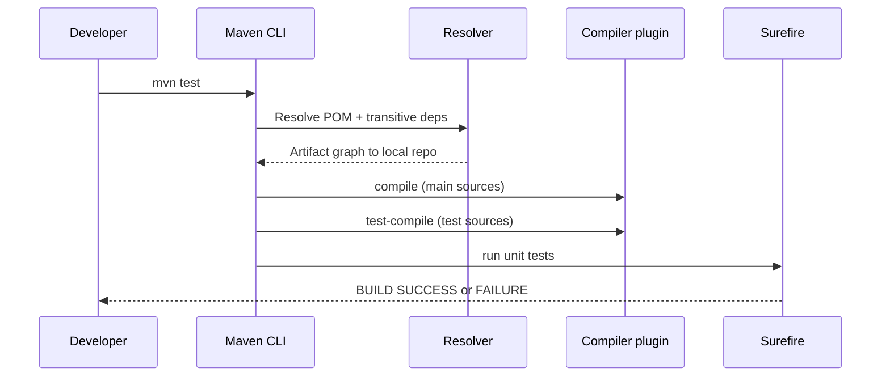

# Maven

> **Status:** Completed  
> **Module:** 29 — Build Tools and Dependency Management  
> **Target Java version:** 21  
> **Last reviewed:** 2026-11-11  
> **Chapter profile:** Technical  
> **Depth target:** Levels 2–3 (POM model, lifecycle, classpath assembly)  
> **Examples verified with:** Temurin JDK 21.0.12.1; Maven 3.9.6 (handbook validation history; JDBC exec re-verified 2026-11-11 without Maven on current host PATH)

**Section policy:** Omissions in Review Checklist.

## 1. Learning Objectives *(mandatory)*

After completing this chapter, you should be able to:

- Read a **`pom.xml`**: coordinates, properties, dependencies, plugins, and packaging.
- Run **`mvn compile`**, **`test`**, **`package`**, and **`exec:java`** and predict which classpaths each phase uses.
- Explain **repositories**, **scopes**, and **transitive** dependency resolution.
- Configure **`maven.compiler.release`** (or compiler plugin `release`) for Java 21.

## 2. Prerequisites *(mandatory)*

- Ch.01 — JARs and classpath (Maven places artifacts on compile, test, and runtime classpaths).
- **Refresh:** A Maven **project** is identified by coordinates; a **build** is a sequence of **lifecycle phases** bound to **plugins**.

## 3. Why This Concept Exists *(mandatory)*

Hand-maintaining dozens of JAR versions, compiler flags, test classpaths, and repeatable CI commands does not scale. **Apache Maven** applies convention-over-configuration: standard directory layout (`src/main/java`, `src/test/java`), a **Project Object Model (POM)** XML file, and a **lifecycle** so teammates and CI reproduce the same build from a Git checkout.

Maven is **not** part of the JDK—install separately or use the **Maven Wrapper** (`mvnw`) in projects.

## 4. Conceptual Explanation *(mandatory)*

| POM section | Purpose |
|-------------|---------|
| `groupId`, `artifactId`, `version` | **Coordinates** identifying the project artifact (`com.acme:payments:1.0.0`). |
| `<packaging>` | Usually `jar`; also `pom` for aggregators, `war` for servlet apps. |
| `<properties>` | Shared version pins (`maven.compiler.release`). |
| `<dependencies>` | Libraries resolved from repositories and added to classpaths. |
| `<scope>` | When a dependency is visible (`compile`, `test`, `provided`, `runtime`, …). |
| `<build><plugins>` | Compiler, Surefire (JUnit), JAR, exec, SpotBugs, etc. |
| **Local repository** | `~/.m2/repository` cache of downloaded artifacts. |
| **Central** | Default remote repository (`https://repo1.maven.org/maven2/`). |

### Default lifecycle (simplified)

Phases execute in order; binding a goal to a phase runs plugin work:

`validate` → `compile` → `test` → `package` → `verify` → `install` → `deploy`

Running `mvn test` runs all phases **up to and including** `test`. Failures stop the build (`BUILD FAILURE`).

### 4.1 Coordinates and artifact identity

Coordinates are the key in every repository path:

```text
~/.m2/repository/com/handbook/.../maven-awareness-demo/1.0-SNAPSHOT/...
```

### 4.2 Transitive resolution

Declaring one dependency can pull dozens transitively—use `mvn dependency:tree` before production upgrades.

### 4.3 Plugin binding vs lifecycle

| Phase | Default plugin | Output |
|-------|----------------|--------|
| `compile` | `maven-compiler-plugin` | `target/classes` |
| `test` | `maven-surefire-plugin` | Test reports |
| `package` | `maven-jar-plugin` | `target/*.jar` |

### Scopes (practitioner table)

| Scope | Compile classpath | Test classpath | Runtime classpath | Typical use |
|-------|--------------------|----------------|-------------------|-------------|
| compile (default) | yes | yes | yes | Libraries you call in main code |
| test | no | yes | no | JUnit, Mockito |
| provided | yes | yes | no | Servlet API container supplies at runtime |
| runtime | no | no | yes | JDBC driver if not needed to compile |

## 5. Mechanism and Execution Flow *(mandatory)*

### 5.1 From `mvn test` to Surefire



1. **Model:** Read effective POM (inheritance, BOM imports, profiles).
2. **Resolve:** Download missing artifacts to `~/.m2/repository` (checksums, optional mirrors).
3. **Compile:** `maven-compiler-plugin` invokes `javac` with compile classpath.
4. **Test-compile:** Test sources compile against main classes + test dependencies.
5. **Test:** `maven-surefire-plugin` fork JVM(s), run JUnit tests on test classpath.

This is **Maven product behavior**, not JLS—but it explains IDE “Maven refreshed” vs command-line parity.

### 5.2 Directory layout convention

```text
src/main/java       → production sources
src/main/resources  → non-class resources on main classpath
src/test/java       → test sources (JUnit)
target/             → build output (never commit)
```

You can override paths in POM, but fighting convention hurts onboarding.

## 6. Terminology *(mandatory)*

| Term | Meaning |
|------|---------|
| Artifact | Built output (usually `.jar`) or dependency JAR identified by coordinates. |
| Transitive dependency | Library your dependency depends on—Maven pulls it automatically unless excluded. |
| BOM | Bill of Materials — `dependencyManagement` import aligning versions (`spring-boot-dependencies`). |
| Plugin goal | Executable task (`compiler:compile`, `surefire:test`). |
| SNAPSHOT | Mutable `-SNAPSHOT` versions for development—lock releases in production. |

## 7. Syntax and Language Rules *(include when the topic is language/API surface)*

Minimal project excerpt (from handbook `maven-awareness-demo`):

```xml
<project xmlns="http://maven.apache.org/POM/4.0.0" ...>
  <modelVersion>4.0.0</modelVersion>
  <groupId>com.handbook</groupId>
  <artifactId>maven-awareness-demo</artifactId>
  <version>1.0-SNAPSHOT</version>
  <properties>
    <maven.compiler.release>21</maven.compiler.release>
  </properties>
  <build>
    <plugins>
      <plugin>
        <groupId>org.codehaus.mojo</groupId>
        <artifactId>exec-maven-plugin</artifactId>
        <configuration>
          <mainClass>com.handbook.maven.MavenAwarenessDemo</mainClass>
        </configuration>
      </plugin>
    </plugins>
  </build>
</project>
```

`<maven.compiler.release>21</maven.compiler.release>` maps to `javac --release 21`—preferred over raw `source`/`target` for Java 9+.

## 8. Step-by-Step Examples *(mandatory)*

### 8.1 Maven awareness demo

Demo: [maven-awareness-demo](../../examples/build-tools/maven-awareness-demo/).

**Verified output (Temurin 21.0.12.1, Maven 3.9.6 — handbook validation record):**

```text
mavenCompiled=ok
javaVersion=21.0.12.1
```

```bash
cd examples/build-tools/maven-awareness-demo
mvn -q compile exec:java
```

`-q` quiets plugin logging; `exec:java` runs the configured `mainClass` on the **runtime** classpath Maven assembled.

| Output key | Teaching point |
|------------|----------------|
| `mavenCompiled=ok` | Main sources compiled via lifecycle, not raw `javac` |
| `javaVersion=21.0.12.1` | Runtime reports vendor build string from running JVM |

### 8.2 JDBC + JUnit cross-link (Modules 30, 33)

[h2-jdbc-demo](../../examples/backend/h2-jdbc-demo/) — H2 on classpath via Maven; JUnit 5 via Surefire.

**Verified exec output (Temurin 21.0.12.1, 2026-11-11, `javac`/`java` with bundled `h2-2.3.232.jar`):**

```text
name=Ada
rowCount=1
jdbcH2=ok
```

Equivalent Maven commands:

```bash
cd examples/backend/h2-jdbc-demo
mvn -q -DskipTests compile exec:java
mvn -q test
```

**Verified:** `mvn -q test` exits 0 with Maven 3.9.6 on handbook validation host (JUnit `SumPositiveTest`).

```java
@Test
void sumsOnlyPositiveValues() {
    assertEquals(6, sumPositive(new int[] {1, -1, 2, 3}));
}
```

### 8.3 Incorrect compiler configuration

**Incorrect:** Ancient `maven-compiler-plugin` with `<source>1.8</source>` while using Java 21 APIs—compilation fails or emits wrong bytecode.

**Corrected:**

```xml
<properties>
  <maven.compiler.release>21</maven.compiler.release>
</properties>
```

## 9. Real-World Use Cases *(conditional)*

- Multi-module backends with `<modules>` and a parent POM sharing plugin management.
- CI: `mvn -B verify` on every pull request (Module 30 Ch.03).
- Corporate **Nexus / Artifactory** as mirror of Maven Central.
- Publishing internal libraries with `mvn deploy` to private repository.

## 10. Internal Behavior *(conditional)*

**Resolver:** Nearest-wins heuristic for version conflicts on the dependency graph—may hide duplicates until runtime `NoSuchMethodError`. Use `mvn dependency:tree` and `dependency:analyze`.

**Reproducibility:** `install` places artifacts in local repo; CI should not rely on uncommitted `target/` outputs.

**Framework note:** Spring Boot parent POM imports BOM—still Maven underneath (Module 37).

## 11. Edge Cases and Limitations *(strongly encouraged)*

- **Dependency convergence** — two libraries pulling different versions of the same artifact.
- **SNAPSHOT** mutability — rebuilds may change behavior without version bump.
- **Offline builds** require populated `~/.m2/repository`.
- **Test classpath pollution** — `compile` scope deps leaking into wrong consumers via `requires transitive` in modular libs.

## 12. Common Mistakes *(mandatory)*

### Incorrect

Committing `target/` or IDE-generated `.classpath` instead of `pom.xml`.

### Corrected

Commit POM + sources; let CI build `target/`.

### Incorrect

Running tests only from IDE while CI runs `compile` alone.

### Corrected

Align on `mvn verify` or explicit `test` phase.

## 13. Best Practices *(include when guidance adds value)*

- Commit **`pom.xml`**, use **`mvnw`** for contributor consistency.
- Use **BOM** imports in large orgs to align Spring, Jackson, JUnit versions.
- Pin plugin versions in `<pluginManagement>`—avoid implicit super-POM drift.
- Run `dependency:tree` when upgrading one library with deep transitives.

## 14. Design Trade-offs *(strongly encouraged)*

Maven: XML, rigid lifecycle, enormous plugin ecosystem, excellent CI defaults. **Gradle** (Ch.03) trades XML for Kotlin DSL and finer incremental task graphs. Teams often choose Maven for enterprise Java and Gradle for Android/Kotlin-first repos.

## 15. Performance and Operational Notes *(conditional)*

- **First `mvn` on CI** downloads internet artifacts—cache `~/.m2` keyed on `pom.xml` checksum.
- **Parallel builds** `-T 1C` use multiple threads; ordering still respects reactor module graph.
- **Enforcer plugin** can ban JDK range drift and dependency convergence violations in large orgs.

## 16. Security *(conditional)*

Dependencies are **supply-chain surface**. Pin versions, verify checksums (Maven Central publishes SHA-1 in metadata), run OWASP dependency-check in CI (Module **30** Ch.03). Never paste unknown coordinates from blog posts without reviewing the POM on Central.

## 17. Compatibility and Version Notes *(conditional)*

- **Maven 3.9.x** aligns with Java 21 toolchain support; wrapper pins for contributors.
- **`release` 21** prevents accidental `var`, record, or pattern APIs when deploying to older runtimes—do not mix with raw `target 8` on JDK 21 toolchains.

## 18. Revision and Mastery *(Track B / Technical)*

- What does `test` scope mean for transitive `compile` dependencies from a test-only library?
- Which phase produces the main JAR under `target/`?
- Why is `release` preferable to `source`/`target` alone for Java 21?
- When would you use `provided` scope for a servlet API?

## 19. Chapter Summary *(mandatory)*

Maven models projects as coordinates plus dependencies and automates classpath assembly through lifecycle phases. Understanding the POM and lifecycle explains how JUnit, JDBC drivers, and compiler flags arrive on the right classpaths without hand-built scripts.

## 20. Next Steps

[03-gradle.md](03-gradle.md)

## Review Checklist

- [x] Technical profile; lifecycle mechanism documented
- [x] `maven-awareness-demo` output preserved; JDBC exec re-verified 2026-11-11
- [x] Maven test success per handbook Maven 3.9.6 validation (not re-run: `mvn` absent on 2026-11-11 host PATH)
- [x] Omissions: Full multi-module POM walk-through (deferred to enterprise track)
