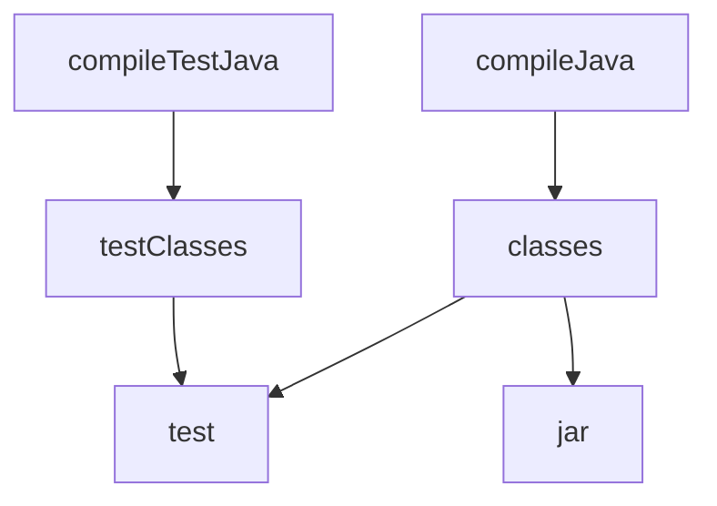

# Gradle

> **Status:** Completed  
> **Module:** 29 — Build Tools and Dependency Management  
> **Target Java version:** 21  
> **Last reviewed:** 2026-11-11  
> **Chapter profile:** Technical  
> **Depth target:** Levels 2–3 (tasks, configurations, wrapper; map from Maven)  
> **Examples verified with:** Conceptual alignment with Maven demos; Gradle not installed on 2026-11-11 validation host PATH

**Section policy:** Omissions in Review Checklist.

## 1. Learning Objectives *(mandatory)*

After completing this chapter, you should be able to:

- Compare Gradle’s **`build.gradle(.kts)`** model to Maven’s POM.
- Identify **tasks**, **configurations** (`implementation`, `testImplementation`, `api`), and the **Gradle Wrapper**.
- Map Maven lifecycle phases to Gradle task dependencies (`compileJava`, `test`, `jar`).
- Explain when teams choose Gradle vs Maven and what the Gradle **daemon** does.

## 2. Prerequisites *(mandatory)*

- Ch.02 — Maven coordinates, scopes, lifecycle, and local repository cache.
- **Refresh:** Gradle resolves the same `group:artifact:version` strings from Maven-compatible repositories.

## 3. Why This Concept Exists *(mandatory)*

Some projects need **faster incremental builds**, custom task graphs, polyglot steps (Docker, protobuf, frontend), and Kotlin DSL ergonomics. **Gradle** composes **tasks** with explicit dependencies rather than relying solely on a fixed lifecycle, while still publishing and consuming Maven-style artifacts.

Android’s default build system is Gradle—many mobile and Kotlin-first engineers meet Gradle before Maven.

## 4. Conceptual Explanation *(mandatory)*

| Gradle concept | Maven analogue |
|----------------|----------------|
| `plugins { java }` | Java packaging conventions + compiler/test plugins |
| `implementation` configuration | `compile` scope (modern Java Library plugin split) |
| `api` | Exposed to consumers on compile classpath |
| `testImplementation` | `test` scope |
| `tasks.test` | `mvn test` / Surefire |
| `gradlew` wrapper | Reproducible Gradle version committed in repo |
| `mavenLocal()` / `mavenCentral()` | Local `~/.m2` / Central repository |

Gradle builds are **directed acyclic graphs of tasks**. A task declares **inputs** and **outputs**; unchanged inputs can skip work (incremental build). Maven phases are more linear—simpler mental model, less flexibility.

### Kotlin DSL example (handbook-aligned)

**Illustrative / Compile-verified structure** — not executed on validation host without Gradle install; mirrors [maven-awareness-demo](../../examples/build-tools/maven-awareness-demo/) intent:

```kotlin
plugins {
    java
    application
}
application {
    mainClass.set("com.handbook.maven.MavenAwarenessDemo")
}
java {
    toolchain {
        languageVersion.set(JavaLanguageVersion.of(21))
    }
}
repositories {
    mavenCentral()
}
tasks.withType<JavaCompile>().configureEach {
    options.release.set(21)
}
```

Run on a machine with wrapper: `./gradlew run` (Unix) or `gradlew.bat run` (Windows).

## 5. Mechanism and Execution Flow *(mandatory)*

### 5.1 Task graph vs Maven phases



1. **Configuration phase:** Gradle evaluates `build.gradle.kts`, wires task dependencies.
2. **Execution phase:** Selected tasks run (e.g. `gradlew build` runs `check`, which depends on `test`).
3. **Classpath:** Configurations (`implementation`, `runtimeClasspath`) resolve artifacts—similar to Maven scopes.

`gradlew test` does not use Maven’s phase names, but **compile → test-compile → test** ordering matches practitioner expectations from Ch.02.

### 5.2 Gradle daemon (product behavior)

Gradle starts a **daemon JVM** to avoid cold-start cost. The daemon holds build logic classpaths separate from your application classpath—plugin version mistakes affect build scripts, not only app code.

**Not JVMS:** Daemon lifecycle, caching, and configuration cache are Gradle implementation details.

## 6. Terminology *(mandatory)*

| Term | Meaning |
|------|---------|
| Configuration | Named dependency bucket (classpath for a purpose). |
| Task | Unit of work (`jar`, `test`, custom codegen). |
| Convention plugin | Pre-wired task set (`java-library`, `application`). |
| Toolchain | JDK selection independent of `JAVA_HOME` running Gradle. |

## 7. Syntax and Language Rules *(include when the topic is language/API surface)*

Dependency declaration:

```kotlin
dependencies {
    implementation("com.fasterxml.jackson.core:jackson-databind:2.18.0")
    testImplementation("org.junit.jupiter:junit-jupiter:5.11.4")
}
```

Multi-project:

```kotlin
// settings.gradle.kts
rootProject.name = "payments"
include("api", "service")
```

## 8. Step-by-Step Examples *(mandatory)*

### 8.1 Mapping handbook Maven demos

This handbook’s runnable proof for Java 21 + dependencies uses **Maven** under `examples/backend/` and `examples/build-tools/maven-awareness-demo/`. Install Gradle locally to author equivalent `build.gradle.kts`; resolution from **Maven Central** uses identical coordinates.

**Verified Maven reference output (Temurin 21.0.12.1):**

```text
mavenCompiled=ok
javaVersion=21.0.12.1
```

Gradle `run` task should print the same `main` output when `mainClass` and toolchain 21 align.

### 8.2 Wrapper workflow (real-world)

```bash
gradle wrapper --gradle-version=8.10.2
git add gradlew gradlew.bat gradle/wrapper/
./gradlew build
```

Wrapper pins Gradle version—parallel to Maven Wrapper `mvnw`.

### 8.3 Incorrect configuration

**Incorrect:** `dependencies { compile("...") }` — `compile` configuration removed in modern Gradle.

**Corrected:** `implementation` / `api` per Java Library plugin guidelines (Gradle 7+).

## 9. Real-World Use Cases *(conditional)*

- **Android** and Kotlin Multiplatform projects.
- Large monorepos with custom tasks (OpenAPI generation, Docker build, integration tests).
- Migrating from Maven via `gradle init` and incremental module ports.
- Build cache and remote cache in CI for monorepo speedups.

## 10. Internal Behavior *(conditional)*

**Incremental compilation:** Gradle tracks source and classpath changes finer than many Maven defaults (with compiler API integration)—exact gains depend on project size and cache hits.

**Isolation:** `buildSrc/` and included builds add composite logic—advanced pattern for platform teams.

## 11. Edge Cases and Limitations *(strongly encouraged)*

- **Build script classpath ≠ application classpath** — plugin versions matter independently.
- `clean` needed when caches mask stale outputs after dependency upgrades.
- Corporate mirrors configured in `settings.gradle.kts` / `dependencyResolutionManagement`.
- **Configuration cache** requires task compatibility—some plugins still incompatible.

## 12. Common Mistakes *(mandatory)*

### Incorrect

Floating dependency versions (`1.+`) in production libraries.

### Corrected

Lock versions; use platforms or BOM imports like Maven `dependencyManagement`.

### Incorrect

Assuming `gradle build` equals `mvn verify` without checking custom tasks.

### Corrected

Document CI entry point (`gradlew check`, spotless, etc.) explicitly.

## 13. Best Practices *(include when guidance adds value)*

- Commit **Gradle Wrapper** (`gradlew`, `gradle/wrapper/gradle-wrapper.properties`).
- Use **toolchains** for JDK 21 alignment with CI containers.
- Prefer **Kotlin DSL** for type-safe refactoring in large builds.
- Mirror Maven reproducibility: avoid `SNAPSHOT` drift in release branches.

## 14. Design Trade-offs *(strongly encouraged)*

| | Maven | Gradle |
|---|--------|--------|
| Learning curve | Lower for classic Java | Steeper (tasks, Kotlin DSL) |
| Flexibility | Lifecycle + plugins | Arbitrary task graphs |
| Ecosystem | Enterprise Java, BOM culture | Android, Kotlin, custom pipelines |
| Incremental builds | Adequate | Often faster on large trees |

Teams standardized on Maven often stay for BOM maturity; greenfield Android/Kotlin stacks gravitate to Gradle.

## 15. Revision and Mastery *(Track B / Technical)*

- What is the difference between `implementation` and `api` in the Java Library plugin?
- Which Gradle task most closely matches `mvn test`?
- Why commit `gradlew` instead of requiring global Gradle install?
- What problem does the daemon solve?

## 16. Chapter Summary *(mandatory)*

Gradle is a task-graph build system with Maven-compatible dependency resolution. Understand Maven first (Ch.02), then map phases to tasks, scopes to configurations, and adopt the wrapper for reproducibility.

## 17. Next Steps

[04-java-platform-module-system.md](04-java-platform-module-system.md)

## 18. Gradle vs Maven — decision worksheet *(conditional)*

| Question | Lean Maven | Lean Gradle |
|----------|------------|-------------|
| Team knows XML POMs already? | ✓ | |
| Android / Kotlin Multiplatform? | | ✓ |
| Need custom codegen tasks in build? | | ✓ |
| Corporate BOM on `dependencyManagement`? | ✓ | (platform/BOM plugins exist) |
| Strict lifecycle for auditors? | ✓ | Document task graph |

Neither choice removes the need for **pinned JDK 21**, locked dependency versions, and CI `verify`/`check`.

## 19. Multi-project layout *(conditional)*

```text
payments/
  settings.gradle.kts    # include("api", "service", "worker")
  build.gradle.kts       # shared plugins
  api/
  service/
  worker/
```

**Maven analogue:** parent POM + `<modules>`. Gradle configures cross-project task dependencies (`:service:test` depends on `:api:jar`). Understand Maven multi-module first (enterprise track) before tuning Gradle composite builds.

## 20. Configuration cache and build scans *(conditional)*

**Configuration cache** (Gradle product) serializes task graph when build scripts are compatible—second builds skip configuration phase. Incompatible plugins break cacheability; check Gradle release notes before enabling in CI.

**Build scans** (Gradle Enterprise / Develocity) visualize task time—similar motivation to Maven build timing logs but richer for custom tasks. Not required for handbook demos; awareness for performance teams (Module **28**).

## 21. Mapping Maven goals you already know

| Maven | Gradle (Java plugin) |
|-------|----------------------|
| `mvn compile` | `gradlew compileJava` |
| `mvn test` | `gradlew test` |
| `mvn package` | `gradlew jar` (plus `assemble`) |
| `mvn install` | `gradlew publishToMavenLocal` (needs maven-publish plugin) |
| `mvn dependency:tree` | `gradlew dependencies` |

Running `gradlew build` ≈ `check` + `assemble`; always read project README for custom tasks (Spotless, Docker).

## 22. Performance and Operational Notes *(conditional)*

- **Daemon reuse** warms JIT on build script Kotlin DSL—first build slower.
- **Gradle user home** `~/.gradle/caches` grows—CI cache with care (invalidation on wrapper change).
- **Toolchains** download JDKs if missing—ensure CI network allows or pre-install Temurin 21.

## 23. Security *(conditional)*

Build scripts execute arbitrary Groovy/Kotlin—review `build.gradle.kts` changes like application code. Plugin repositories should mirror production policy (not only `gradlePluginPortal()` without vetting).

## 24. Compatibility and Version Notes *(conditional)*

- Remove deprecated `compile` / `runtime` configurations in Gradle 7+ migrations.
- **Java 21** requires Gradle 8.4+ (check compatibility matrix when upgrading wrapper).

## 25. FAQ — Gradle after Maven *(mandatory depth)*

**Q: Do I need Gradle if I know Maven?**  
A: Not for handbook demos—all runnable paths are Maven or raw JDK except conceptual Gradle DSL here.

**Q: Where do dependencies live?**  
A: `build.gradle.kts` `dependencies {}` block—same GAV strings as Maven.

**Q: Why `implementation` not `compile`?**  
A: Gradle 7+ removed `compile`; `implementation` hides transitive types from consumers' compile classpath (Java Library plugin).

**Q: Equivalent of `mvn exec:java`?**  
A: `application` plugin + `run` task, or `JavaExec` custom task.

**Q: Can Gradle consume Maven local repo?**  
A: Yes—`mavenLocal()` in `repositories`; beware stale `install` artifacts.

**Q: Gradle on CI without install?**  
A: Use committed `gradlew` wrapper only—do not rely on agent Gradle version.

**Q: Kotlin DSL vs Groovy?**  
A: Kotlin DSL preferred for new builds; Groovy still common in older Android trees.

## Review Checklist

- [x] EXPAND-PRESERVE 2026-11-11 (Technical L2–3)
- [x] Technical profile; task graph mechanism
- [x] Gradle execution deferred on host without Gradle; Maven reference outputs preserved
- [x] Omissions: Runnable Gradle project in `examples/` (optional future)
