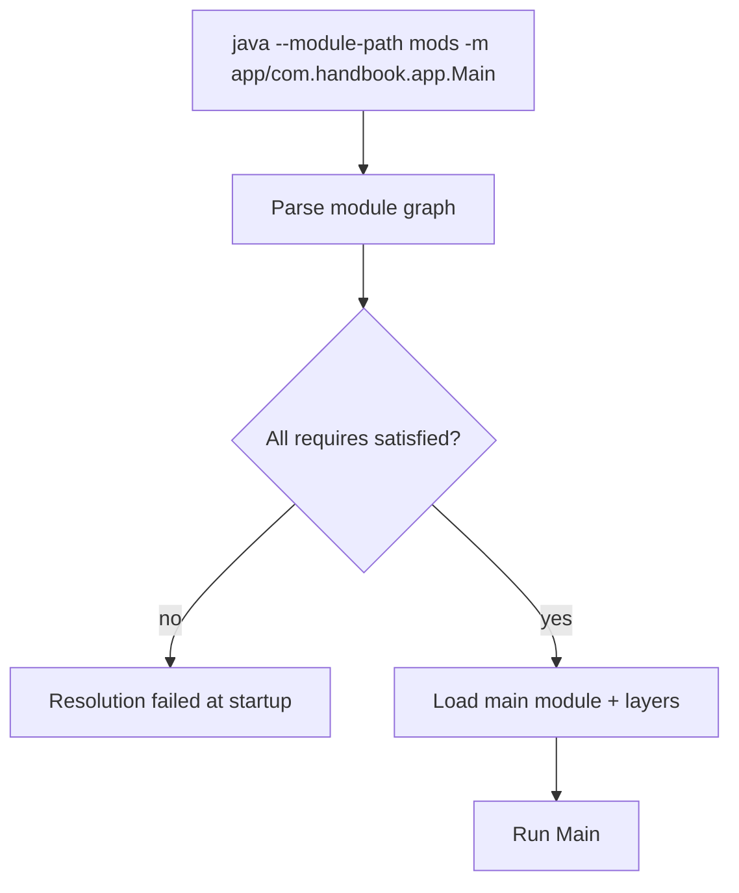

# Java Platform Module System (JPMS)

> **Status:** Completed  
> **Module:** 29 — Build Tools and Dependency Management  
> **Target Java version:** 21  
> **Last reviewed:** 2026-11-11  
> **Chapter profile:** Technical  
> **Depth target:** Levels 2–3 (module graph, launch, encapsulation)  
> **Examples verified with:** Temurin JDK 21.0.12.1 (javac 21.0.12.1)

**Section policy:** Omissions in Review Checklist.

## 1. Learning Objectives *(mandatory)*

After completing this chapter, you should be able to:

- Read **`module-info.java`**: `requires`, `exports`, `opens`, `provides` / `uses`.
- Launch with **`--module-path`** and **`-m module/mainClass`**.
- Contrast **strong encapsulation** with classpath “every public type on the path is fair game.”
- Describe **automatic modules** and why split packages break module resolution.

## 2. Prerequisites *(mandatory)*

- Module **09** — access control (`public` vs package-private).
- Module **26** — class loading; Ch.01 classpath vs module path preview.
- **Refresh:** A **module** is a named set of packages with explicit dependencies, not merely a Maven `<module>` aggregator POM (different word).

## 3. Why This Concept Exists *(mandatory)*

Before Java 9, any public type on the classpath was visible to every other JAR. That made **JDK internals** (`sun.misc.*`) and large applications fragile—libraries depended on implementation details. **JPMS** (Project Jigsaw) adds explicit **modules** with exports and `requires`, enabling the **module path** and tools like **jlink** for trimmed runtimes.

Most Spring Boot services remain classpath-first in practice; JPMS still explains JDK layout, library `module-info` metadata, and future deployment options.

## 4. Conceptual Explanation *(mandatory)*

| Directive | Meaning |
|-----------|---------|
| `module name { }` | Named unit declared in `module-info.java` at module root |
| `requires other.mod;` | Compile-time and runtime dependency on readable module |
| `requires transitive other;` | Re-export readability to consumers of your module |
| `exports pkg;` | Other modules may read public types in `pkg` |
| `exports pkg to friend;` | Qualified export to named modules |
| `opens pkg;` | Allows deep reflection (frameworks, serialization) |
| `provides` / `uses` | ServiceLoader integration (Module **20**) |

**Classpath vs module path:** You may mix them, but beginners should treat application code as **either** classic classpath **or** explicit modules on `--module-path`. Non-modular JARs placed on the module path become **automatic modules** (name derived from JAR filename unless `Automatic-Module-Name` manifest entry exists).

**JLS §7.7** — module declarations; **JVMS §5.3** — module resolution at launch (language vs VM specification).

## 5. Mechanism and Execution Flow *(mandatory)*

### 5.1 Launch resolution



1. Launcher discovers **root modules** from `-m` / `--module`.
2. Resolver reads each `module-info.class`, builds readability graph.
3. **Encapsulation:** Code in module A may only access exported packages of module B if `A requires B`.
4. **Split packages** (same package in two modules) → resolution failure on module path.

Failures often appear at **startup** (`java.lang.module.ResolutionException`), earlier and clearer than some classpath `NoClassDefFoundError` cases.

### 5.2 Two-module handbook layout

```text
mods/com.handbook.greeting/   ← library module
mods/app/                     ← application module requires greeting
```

Library exports API package; application `requires` library and reads only exported types.

## 6. Terminology *(mandatory)*

| Term | Meaning |
|------|---------|
| Named module | Declares `module-info.java` |
| Automatic module | Non-modular JAR on module path |
| Unnamed module | Classpath code without module-info |
| Readable | Module A can read module B’s exports |
| Qualified export | `exports pkg to specificModule` |

## 7. Syntax and Language Rules *(include when the topic is language/API surface)*

Library `module-info.java`:

```java
module com.handbook.greeting {
    exports com.handbook.greeting;
}
```

Application `module-info.java`:

```java
module app {
    requires com.handbook.greeting;
}
```

Launch:

```bash
java --module-path mods -m app/com.handbook.app.Main
```

## 8. Step-by-Step Examples *(mandatory)*

### 8.1 jpms-hello-demo

Demo: [jpms-hello-demo](../../examples/build-tools/jpms-hello-demo/).

**Verified output (Temurin JDK 21.0.12.1, 2026-11-11):**

```text
greeting=jpms-ok
module=app
```

```bash
cd examples/build-tools/jpms-hello-demo
javac -d mods/com.handbook.greeting com.handbook.greeting/module-info.java \
  com.handbook.greeting/com/handbook/greeting/Greeting.java
javac --module-path mods -d mods/app app/module-info.java app/com/handbook/app/Main.java
java --module-path mods -m app/com.handbook.app.Main
```

**Important lines:**

- Compile library **before** app with `--module-path mods` so `requires` resolves.
- `-m app/com.handbook.app.Main` — module name + fully qualified main class (slash-separated in `-m` form).

### 8.2 Incorrect encapsulation

**Incorrect:** Export `com.handbook.greeting.internal` containing mutable singletons—API boundary leaks implementation.

**Corrected:** Export narrow API package; keep internals package-private or in non-exported packages.

### 8.3 Reflective frameworks (awareness)

Spring/Hibernate on modular classpath may need `opens` packages for reflection. Many deployments keep framework apps on **classpath** until libraries publish stable `module-info`—Module **35** discusses ORM boundaries.

## 9. Real-World Use Cases *(conditional)*

- Hiding implementation packages while exporting a stable API JAR for internal platforms.
- **jlink** custom runtimes including only required JDK modules (CLI tools, appliances).
- Libraries publishing `module-info` for JPMS-aware consumers (`requires transitive` for API deps).

## 10. Internal Behavior *(conditional)*

**Module layers:** JVM can stack layers (containers, some agents)—advanced; default apps use one application layer.

**HotSpot:** Enforces package accessibility at compile time (javac) and runtime for module boundaries.

## 11. Edge Cases and Limitations *(strongly encouraged)*

- **Split packages** forbidden on module path.
- **Automatic module names** from JAR filenames can surprise (`commons-lang3-3.14.0.jar` → awkward name unless manifest override).
- Not all third-party libraries ship `module-info` yet.
- Mixing unnamed module (classpath) and named modules requires discipline.

## 12. Common Mistakes *(mandatory)*

### Incorrect

Putting modular and non-modular copies of same library on both paths.

### Corrected

Single coherent layout; use build tool `modulePath` / `classpath` separation.

### Incorrect

Using `requires` on a package name (illegal syntax).

### Corrected

`requires` names **modules**, imports name **packages**.

## 13. Best Practices *(include when guidance adds value)*

- Add `module-info` when you control the application boundary and dependencies support it.
- Use `requires transitive` sparingly—expands consumers’ readability graph.
- Test modular launch in CI: `java --module-path ... -m ...`.
- Prefer `Automatic-Module-Name` manifest for library JARs before full modularization.

## 14. Design Trade-offs *(strongly encouraged)*

Full modularization improves encapsulation and enables jlink, but migration cost is real. Classpath-first Spring Boot remains valid; JPMS knowledge still clarifies JDK structure and library metadata.

## 15. Revision and Mastery *(Track B / Technical)*

- What happens if two JARs define the same package on the module path?
- Difference between `exports` and `opens`?
- How is an automatic module named from `my-lib-1.0.jar`?
- When is `requires transitive` appropriate?

## 16. Chapter Summary *(mandatory)*

JPMS replaces implicit classpath visibility with an explicit module graph. The handbook demo shows minimal `requires`/`exports` and modular launch; build tools generate `module-info` and module paths in larger projects.

## 17. Next Steps

Module **30** — Testing and Code Quality.

## 18. Unnamed module and migration path *(conditional)*

Classpath JARs without `module-info` load as members of the **unnamed module** when any named module exists in the runtime. They can read **all exported packages** of named modules (with warnings in some configurations)—migration teams gradually add `module-info` to libraries they control while keeping legacy JARs on classpath until replaced.

**Spring Boot default:** executable JAR runs classic classpath inside a custom launcher; JPMS optional. Knowing JPMS still clarifies JDK module boundaries (`java.base`, `java.sql`).

## 19. Qualified exports and service loading *(conditional)*

```java
module com.acme.api {
    exports com.acme.api to com.acme.impl, com.acme.test;
    uses com.acme.spi.Plugin;
}
module com.acme.impl {
    requires com.acme.api;
    provides com.acme.spi.Plugin with com.acme.impl.DefaultPlugin;
}
```

`provides`/`uses` replace ad-hoc `META-INF/services` classpath discovery with explicit module statements—`ServiceLoader` still loads implementations at runtime per Java SE API.

## 20. jlink awareness (no fabricated output)

**jlink** assembles a trimmed runtime image from resolved modules:

```bash
jlink --module-path mods:jmods --add-modules app --launcher app=com.handbook.app.Main -o image/
```

Output layout and size depend on your module graph—run locally when packaging appliances; do not invent image megabyte counts in docs.

## 21. JPMS vs Maven "module" disambiguation

| Term in Maven | Term in JPMS |
|---------------|----------------|
| Multi-module POM `<module>` | Not the same as JPMS `module` |
| `module-info.java` | Java language module |
| Automatic module name from JAR | Derived module name for non-modular JAR |

Confusing the two causes broken `--module-path` arguments in ops runbooks.

## 22. Performance and Operational Notes *(conditional)*

Module resolution happens at **startup**—failures are fast. Runtime access checks add negligible overhead versus classpath for most services; benefits are encapsulation and jlink, not raw speed.

## 23. Security *(conditional)*

Strong encapsulation blocks illegal deep reflection unless `opens` granted—reduces accidental reliance on JDK internals. Attackers with classpath control remain a supply-chain problem (Ch.01 security).

## 24. Compatibility and Version Notes *(conditional)*

- Java 9+ required for JPMS; Java 21 LTS is baseline for this handbook.
- Libraries without `module-info` remain ubiquitous—test automatic module names before enforcing `jlink` deploys.

## 25. Line-by-line demo walkthrough *(mandatory depth)*

### 25.1 Compile library module first

The greeting library must publish `module-info.class` before the app module compiles against it:

```bash
javac -d mods/com.handbook.greeting \
  com.handbook.greeting/module-info.java \
  com.handbook.greeting/com/handbook/greeting/Greeting.java
```

`exports com.handbook.greeting` allows any module that `requires com.handbook.greeting` to read public types in that package only.

### 25.2 Compile application module on module path

```bash
javac --module-path mods -d mods/app \
  app/module-info.java \
  app/com/handbook/app/Main.java
```

`--module-path mods` must include the directory containing **both** module roots (`com.handbook.greeting` and will include `app` output).

### 25.3 Launch form

```bash
java --module-path mods -m app/com.handbook.app.Main
```

| Flag part | Meaning |
|-----------|---------|
| `--module-path mods` | Directory of module roots |
| `-m app/com.handbook.app.Main` | Initial module `app`, main class FQCN |

**Verified output (Temurin 21.0.12.1):**

```text
greeting=jpms-ok
module=app
```

The second line typically calls `Main.class.getModule().getName()`—confirms you are not on unnamed module classpath.

### 25.4 Failure you should try once

Remove `requires com.handbook.greeting` from app `module-info` but keep `import com.handbook.greeting.Greeting` in `Main.java`—`javac` error explains unreadable package. This is clearer than classpath `ClassNotFoundException` at runtime.

### 25.5 IDE workspace note

Handbook JPMS demo folder is excluded from whole-workspace Java import to avoid false errors in other demos—open `jpms-hello-demo` alone for IDE module support (demo README).

## Review Checklist

- [x] Technical profile; resolution mechanism diagram
- [x] Verified `jpms-hello-demo` Temurin 21.0.12.1 (2026-11-11)
- [x] JLS/JVMS citations labeled
- [x] Omissions: jlink hands-on lab (optional)
