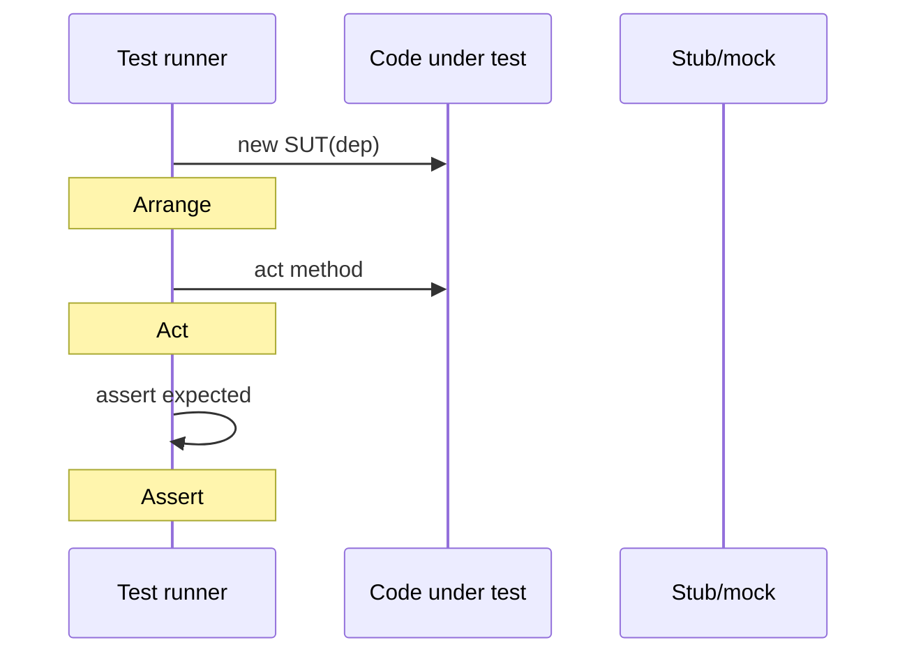

# Testing Fundamentals

> **Status:** Completed  
> **Module:** 30 — Testing and Code Quality  
> **Target Java version:** 21  
> **Last reviewed:** 2026-11-11  
> **Chapter profile:** Technical  
> **Depth target:** Levels 2–3 (test types, AAA, determinism, testability)  
> **Examples verified with:** Temurin JDK 21.0.12.1 (javac 21.0.12.1)

**Section policy:** Omissions in Review Checklist.

## 1. Learning Objectives *(mandatory)*

After completing this chapter, you should be able to:

- Apply **Arrange–Act–Assert (AAA)** consistently in unit tests.
- Distinguish **unit**, **integration**, and **end-to-end** tests by scope, speed, and boundaries.
- Implement a minimal **assertion harness** without a framework (then adopt JUnit in Ch.02).
- Design code for **testability**: dependency injection, pure functions, controllable time.

## 2. Prerequisites *(mandatory)*

- Modules **04–06** — methods, OOP, encapsulation.
- Module **14** — exceptions (`assertThrows` patterns preview in Ch.02).
- **Refresh:** Tests encode **specifications** as executable checks—not optional documentation.

## 3. Why This Concept Exists *(mandatory)*

Software changes constantly. Refactors, dependency upgrades, and bug fixes risk **regressions**—behavior that used to work silently breaks. **Automated tests** pin expectations so failures surface in seconds on a laptop or in CI (Ch.03) instead of in production at 3 a.m.

Tests also communicate intent: a well-named test (`rejectsNegativeAmount`) documents edge policy better than a comment alone.

## 4. Conceptual Explanation *(mandatory)*

| Test type | Scope | Typical speed | Boundaries |
|-----------|--------|---------------|------------|
| Unit | One class or small cluster; collaborators **replaced** | Milliseconds | No real DB/network |
| Integration | Real JDBC, HTTP, message broker, filesystem | Seconds | Systems you do not own in unit tests |
| End-to-end (E2E) | Full deployed stack, UI or API journey | Minutes | Closest to user reality |

**Test pyramid (practitioner):** Many fast unit tests, fewer integration tests, handful of E2E smoke paths—invert the pyramid and CI becomes slow and flaky.

**Test double** — umbrella term for fakes: **stub** (canned answers), **mock** (behavior verification—Mockito in Ch.02), **fake** (working lightweight implementation), **spy** (partial real object).

**Flaky test** — non-deterministic pass/fail (race, wall clock, shared port, live network). Treat flakiness as **production bug in the test suite**—quarantine and fix.

### AAA pattern

1. **Arrange** — construct inputs, collaborators, system under test (SUT).
2. **Act** — invoke the method or workflow under test **once** per test when possible.
3. **Assert** — check outcomes: return values, thrown exceptions, object state, side effects.

One logical **theme** per test method aids failure diagnosis.

## 5. Mechanism and Execution Flow *(mandatory)*

### 5.1 Unit test execution (conceptual)



Without JUnit, `main` or a small loop throws `AssertionError` on failure—the same failure signal JUnit maps to red bars in the IDE.

### 5.2 Failure signals

| Signal | Meaning |
|--------|---------|
| `AssertionError` | Expectation violated (JUnit assertions wrap this) |
| Uncaught exception | Unexpected failure path or missing assertion |
| Timeout | Blocked I/O, deadlock, or missing async completion |

## 6. Terminology *(mandatory)*

| Term | Meaning |
|------|---------|
| SUT | System under test — the behavior you specify |
| Fixture | Shared setup data or objects for tests |
| Hermetic test | No external network/time dependencies |
| Regression test | Test added after a bug to prevent recurrence |
| Characterization test | Captures current behavior before refactor |

## 7. Syntax and Language Rules *(include when the topic is language/API surface)*

Minimal assertion helper (handbook style):

```java
static void assertEquals(int expected, int actual) {
    if (expected != actual) {
        throw new AssertionError("expected=" + expected + " actual=" + actual);
    }
}
```

Real projects use JUnit `Assertions.assertEquals` with overloads and richer messages.

## 8. Step-by-Step Examples *(mandatory)*

### 8.1 Handbook demo — sum positive integers

Demo: [testing-fundamentals-demo](../../examples/testing/testing-fundamentals-demo/).

**Verified output (Temurin JDK 21.0.12.1, 2026-11-11):**

```text
pass:mixed
pass:empty
pass:allNegative
allTests=ok
```

```bash
cd examples/testing/testing-fundamentals-demo
javac AssertDemo.java && java AssertDemo
```

**Important lines:** Each `runCase` arranges an `int[]`, acts on `sumPositive`, asserts expected sum—three scenarios (mixed signs, empty, all negative) plus sentinel `allTests=ok`.

The demo throws `AssertionError` on failure—same mechanism JUnit uses internally.

### 8.2 Progressive scenario table

| Input | Expected | Teaches |
|-------|----------|---------|
| `{1,-1,2,3}` | `6` | Ignores non-positive |
| `{}` | `0` | Empty boundary |
| `{-5,-1}` | `0` | All rejected |

### 8.3 Incorrect test design

**Incorrect:** One `@Test` asserts database, HTTP client, and email in sequence.

**Corrected:** Split: unit tests with doubles for boundaries; integration test with H2 or Testcontainers (Module **33**).

## 9. Real-World Use Cases *(conditional)*

- Payment fee calculation with table-driven cases (tax regions, rounding).
- Password policy validators (length, charset, breach list integration in integration tier).
- CI gates blocking merge when tests fail (Ch.03).
- Contract tests between microservices (consumer-driven contracts—awareness).

## 10. Internal Behavior *(conditional)*

JUnit 5 (Ch.02) uses **reflection** and annotation metadata to discover test methods—framework behavior, not JLS. Surefire forks JVMs with isolated classpaths (Maven Ch.02).

## 11. Edge Cases and Limitations *(strongly encouraged)*

- **Order-dependent tests** sharing static mutable state — fix with `@BeforeEach` reset or isolation.
- **Testing private methods** via reflection — brittle; test public behavior.
- **Overfitting tests** to implementation details — refactor breaks tests without user-visible regression.
- **Time-dependent logic** without injectable `Clock` (Module **22**) — flaky near midnight/DST.

## 12. Common Mistakes *(mandatory)*

### Incorrect

```java
static int counter; // mutated across tests
```

### Corrected

Instance fields per test class or explicit reset in `@BeforeEach`.

### Incorrect

Assertions with no message and opaque failure:

```java
assertEquals(6, result); // fails as "expected 6 but was 5" only in JUnit 5+
```

### Corrected

Include context: `assertEquals(6, result, "sumPositive mixed array")`.

## 13. Best Practices *(include when guidance adds value)*

- Name tests as specifications: `rejectsNegativeAmount`, `emptyArrayReturnsZero`.
- Keep tests **independent** — no execution order assumptions.
- Prefer **constructors or factories** over enormous `@BeforeEach` chains.
- Run tests with the **same JDK** as production (21 LTS).

## 14. Design Trade-offs *(strongly encouraged)*

| More mocks | Fewer mocks |
|------------|-------------|
| Faster, hermetic | Catches wiring mistakes |
| Couples to call sequence | Slower, needs fixtures |

Balance: mock **ports** at system boundaries; use real value objects.

## 15. Design for testability *(from original chapter, expanded)*

- Prefer **pure functions** where possible—same inputs → same outputs, no hidden I/O.
- **Inject** repositories, clocks, and random sources via constructors (Module **05** composition).
- Avoid **static mutable globals** (Module **24** concurrency hazards).
- Extract **ports** (interfaces) for external systems—Mockito (Ch.02) replaces implementations.

## 16. Revision and Mastery *(Track B / Technical)*

- Why is E2E insufficient as the only test layer?
- How does AAA map to the handbook `AssertDemo` structure?
- What makes a test flaky, and what is the fix order (isolate → reproduce → stabilize)?
- When is a fake better than a mock?

## 17. Chapter Summary *(mandatory)*

Testing fundamentals—AAA, test types, determinism, and testable design—underpin JUnit/Mockito and CI pipelines. The handbook demo proves assertions without a framework; Ch.02 upgrades ergonomics and Maven integration.

## 18. Next Steps

[02-junit-and-mockito.md](02-junit-and-mockito.md)

## 19. Test doubles — when to use which *(conditional)*

| Double | Use when |
|--------|----------|
| Stub | Return canned data; no interaction verification |
| Mock | Assert collaborator was called with expected args |
| Fake | In-memory repository with real behavior (e.g. `Map` backed store) |
| Spy | Partial real object with selective stubbing |

Handbook demo uses **real** `sumPositive` logic—no doubles needed. Ch.02 adds Mockito for boundary ports.

## 20. Property-based and table-driven tests *(awareness)*

Table-driven tests enumerate rows:

```java
// Illustrative — not a separate handbook demo
static Stream<Arguments> sumCases() {
    return Stream.of(
        Arguments.of(new int[] {1, 2}, 3),
        Arguments.of(new int[] {}, 0));
}
```

JUnit 5 `@ParameterizedTest` reduces copy-paste; keep case names in `@DisplayName` or CSV source labels.

## 21. Test coverage — what it does not prove

High **line coverage** does not imply correct behavior—only that lines executed. Branch coverage closer but still blind to missing assertions. Use coverage to find **untested code**, not as sole quality metric (Sonar in Ch.03).

## 22. Performance and Operational Notes *(conditional)*

- Unit suite should finish in seconds on laptop—slow suite → developers skip locally.
- Parallel Surefire (`junit.jupiter.execution.parallel.enabled`) can expose shared-state bugs—enable deliberately.
- Flaky tests in CI waste more time than missing tests—quarantine with ticket.

## 23. Security *(conditional)*

Tests must not embed production secrets. Use test fixtures with fake credentials; scan test resources in secret scanners same as main.

## 24. Compatibility and Version Notes *(conditional)*

JUnit 5 requires Jupiter on classpath; Vintage bridge only when migrating JUnit 4 suites incrementally.

## 25. FAQ — testing discipline *(mandatory depth)*

**Q: How many assertions per test?**  
A: One logical theme; multiple `assertEquals` on fields of one result object is fine.

**Q: Should tests use random data?**  
A: Only with fixed `Random` seed for reproduction unless property-based framework controls shrinking.

**Q: Test private methods?**  
A: No—test public API; refactor if untestable (code smell).

**Q: Integration test without Docker?**  
A: Handbook uses H2 in-memory via Maven/`javac` path—realistic JDBC boundary at small cost.

**Q: What fails CI if I only run `AssertDemo`?**  
A: Ch.03 expects `mvn verify` including Surefire—handbook demo is pre-JUnit pedagogy.

**Q: Difference between regression and characterization?**  
A: Regression pins correct behavior after bug; characterization pins legacy behavior before refactor.

**Q: Flaky test quarantine policy?**  
A: `@Disabled` with ticket link max 48h—fix or delete, never ignore silently.

**Q: TDD required?**  
A: Not mandated by language—AAA and fast feedback are; write tests when behavior is specified.

## Review Checklist

- [x] EXPAND-PRESERVE 2026-11-11 (Technical L2–3)
- [x] Technical profile; AAA mechanism flow
- [x] Verified `testing-fundamentals-demo` Temurin 21.0.12.1 (2026-11-11)
- [x] Omissions: Parameterized test deep dive (Ch.02 awareness only)
