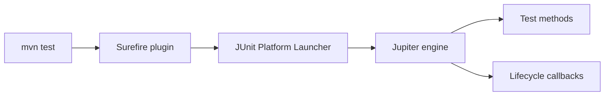

# JUnit and Mockito

> **Status:** Completed  
> **Module:** 30 — Testing and Code Quality  
> **Target Java version:** 21  
> **Last reviewed:** 2026-11-11  
> **Chapter profile:** Technical  
> **Depth target:** Levels 2–3 (JUnit 5 lifecycle, assertions, Mockito boundaries)  
> **Examples verified with:** Temurin JDK 21.0.12.1; JUnit 5.11.4 via Maven h2-jdbc-demo (handbook validation); JDBC exec re-verified 2026-11-11

**Section policy:** Omissions in Review Checklist.

## 1. Learning Objectives *(mandatory)*

After completing this chapter, you should be able to:

- Run **JUnit Jupiter** tests with Maven Surefire (`mvn test`).
- Use **`@Test`**, lifecycle annotations, and **`Assertions`** (`assertEquals`, `assertThrows`).
- Add **Mockito** `mock` / `when` / `verify` for port isolation (syntax + when to mock).
- Choose between **unit tests with mocks** and **integration tests** with real infrastructure.

## 2. Prerequisites *(mandatory)*

- Ch.01 — AAA pattern and test types.
- Module **29** Ch.02 — Maven `test` phase and `test` scope dependencies.

## 3. Why This Concept Exists *(mandatory)*

Hand-rolled assertion loops scale poorly: no structured discovery, no IDE green/red integration, no standard reporting. **JUnit 5 (Jupiter)** is the de facto Java test programming model on the JVM—annotations, assertions, parameterized tests, extensions.

**Collaborators** (databases, payment gateways, email) are slow or nondeterministic in unit tests. **Mockito** supplies **test doubles** at boundaries so you specify behavior of the SUT without standing up the world.

## 4. Conceptual Explanation *(mandatory)*

### JUnit 5 platform stack

| Layer | Role |
|-------|------|
| JUnit Platform | Launcher API; Surefire/Gradle invoke it |
| Jupiter | `@Test`, assertions, extensions (`junit-jupiter`) |
| Vintage | Runs JUnit 4 tests (legacy) |

### Common annotations

| Annotation | Role |
|------------|------|
| `@Test` | Executable test method (package-private or public on Jupiter) |
| `@BeforeEach` / `@AfterEach` | Per-test setup/teardown |
| `@BeforeAll` / `@AfterAll` | Once per class (static methods if not instance lifecycle) |
| `@DisplayName` | Human-readable test title |
| `@ParameterizedTest` | Table-driven inputs (awareness; expand in projects) |

### Assertions (Jupiter)

```java
import static org.junit.jupiter.api.Assertions.*;

assertEquals(6, sumPositive(new int[] {1, -1, 2, 3}));
assertThrows(IllegalArgumentException.class, () -> service.withdraw(-1));
assertTimeout(Duration.ofSeconds(1), () -> fastCall());
```

### Mockito basics

**Illustrative** — requires `mockito-core` on test classpath:

```java
interface ClockPort { Instant now(); }
ClockPort clock = mock(ClockPort.class);
when(clock.now()).thenReturn(Instant.parse("2026-01-01T00:00:00Z"));
verify(clock, times(1)).now();
```

Mockito creates proxies/subclasses (implementation detail). Prefer **interfaces** for ports. **Final** classes may need inline mock maker configuration—avoid mocking concrete JDK types.

## 5. Mechanism and Execution Flow *(mandatory)*

### 5.1 Surefire test JVM



1. Surefire scans `src/test/java` for test classes (patterns `*Test`, `*Tests`, … configurable).
2. Forked JVM uses **test classpath** = main classes + test classes + test-scoped deps (JUnit, Mockito).
3. Jupiter reflects test methods, runs callbacks, records **TestExecutionResult**.
4. Non-zero failures → Maven `BUILD FAILURE`.

### 5.2 Mockito interaction flow

1. `mock(Port.class)` — create double.
2. `when(port.method()).thenReturn(value)` — stub.
3. SUT calls port during **Act**.
4. `verify(port).method()` — optional behavior assertion (use sparingly vs state assertions).

## 6. Terminology *(mandatory)*

| Term | Meaning |
|------|---------|
| Jupiter | JUnit 5 programming model |
| Surefire | Maven plugin executing tests |
| Test instance | Object holding `@Test` methods (per-method or per-class lifecycle) |
| Strict stubs | Mockito fails on unused stubs when configured |
| @ExtendWith | Hook custom extensions (MockitoExtension auto-inits mocks) |

## 7. Syntax and Language Rules *(include when the topic is language/API surface)*

Maven test dependencies (typical):

```xml
<dependency>
  <groupId>org.junit.jupiter</groupId>
  <artifactId>junit-jupiter</artifactId>
  <version>5.11.4</version>
  <scope>test</scope>
</dependency>
<dependency>
  <groupId>org.mockito</groupId>
  <artifactId>mockito-core</artifactId>
  <version>5.14.2</version>
  <scope>test</scope>
</dependency>
```

Surefire 3.x requires JUnit Platform provider (often via `junit-jupiter` transitive deps).

## 8. Step-by-Step Examples *(mandatory)*

### 8.1 Verified JUnit test — h2-jdbc-demo

[h2-jdbc-demo](../../examples/backend/h2-jdbc-demo/) includes `SumPositiveTest`:

```java
@Test
void sumsOnlyPositiveValues() {
    assertEquals(6, sumPositive(new int[] {1, -1, 2, 3}));
}
```

**Verified:** `mvn -q test` exits 0 on Temurin 21.0.12.1 with Maven 3.9.6 (handbook validation record).

**Verified exec (2026-11-11, Temurin 21.0.12.1, javac/java + bundled H2):**

```text
name=Ada
rowCount=1
jdbcH2=ok
```

### 8.2 assertThrows pattern

**Compile-verified** snippet:

```java
@Test
void negativePrincipalRejected() {
    assertThrows(IllegalArgumentException.class,
            () -> new Loan(-100));
}
```

Assert **type** and optionally message with `assertThrows` return value.

### 8.3 Over-mocking anti-pattern

**Incorrect:**

```java
@Test
void everything() {
    verify(repo).findById(1);
    verify(email).send(any());
    verify(metrics).increment("x");
    // no state assertion on SUT result
}
```

**Corrected:** Assert SUT return value or persisted state; verify only critical side effects.

## 9. Real-World Use Cases *(conditional)*

- Service layer: mock `PaymentGateway`, assert `Order` status.
- `@ParameterizedTest` with `@CsvSource` for validation matrices.
- `@TestInstance(Lifecycle.PER_CLASS)` for expensive one-time setup (use judiciously).

## 10. Internal Behavior *(conditional)*

Mockito **bytecode** generation / subclassing — version-specific; not JVM spec. JUnit **parallel** execution (optional config) can expose shared state bugs—default often sequential per class.

## 11. Edge Cases and Limitations *(strongly encouraged)*

- **Over-mocking** couples tests to call order—brittle refactors.
- **Static mocks** need `mockito-inline`—prefer design without static collaborators.
- **Testing threads** — use latches/timeouts; avoid `Thread.sleep` without bounds.
- **Mocking concrete classes** with final methods fails without inline mock maker.

## 12. Common Mistakes *(mandatory)*

### Incorrect

Using JUnit 4 `@Test` from `org.junit.Test` mixed with Jupiter without Vintage.

### Corrected

Import `org.junit.jupiter.api.Test` exclusively in greenfield Jupiter projects.

### Incorrect

`when(m.collaborate()).thenReturn(x)` on real object.

### Corrected

`when` only on **mocks** or spies.

## 13. Best Practices *(include when guidance adds value)*

- Name tests: `method_condition_expected` or sentence style with `@DisplayName`.
- Use **`assertThrows`** for expected exceptions—avoid try/catch in tests.
- Mockito at **boundaries**; real objects for immutable values.
- Keep integration tests in separate packages or tags (`@Tag("integration")`).

## 14. Design Trade-offs *(strongly encouraged)*

| Mockito verify-heavy | Assert state/outcomes |
|----------------------|------------------------|
| Specification of interaction | Specification of behavior |
| Breaks on refactor | Survives internal call changes |

Favor outcome assertions unless protocol compliance is the contract (e.g., must-call audit log).

## 15. Revision and Mastery *(Track B / Technical)*

- What is on the test classpath but not the main runtime classpath?
- When should you use `@ParameterizedTest` instead of many `@Test` methods?
- Difference between stub and mock in Mockito usage?
- Why fork JVMs in Surefire?

## 16. Chapter Summary *(mandatory)*

JUnit Jupiter supplies the test runtime and assertions; Mockito isolates collaborators at ports. The handbook verifies JUnit via Maven Surefire in `h2-jdbc-demo`; Mockito is taught for professional unit testing patterns.

## 17. Next Steps

[03-static-analysis-and-ci.md](03-static-analysis-and-ci.md)

## 18. Surefire configuration practitioners use *(conditional)*

```xml
<plugin>
  <artifactId>maven-surefire-plugin</artifactId>
  <configuration>
    <argLine>-Dfile.encoding=UTF-8</argLine>
    <includes>
      <include>**/*Test.java</include>
    </includes>
  </configuration>
</plugin>
```

`argLine` is where JaCoCo agent injects for coverage—do not duplicate conflicting JVM args across profiles.

## 19. MockitoExtension and `@InjectMocks` *(Illustrative)*

```java
@ExtendWith(MockitoExtension.class)
class OrderServiceTest {
    @Mock PaymentGateway gateway;
    @InjectMocks OrderService service;

    @Test
    void chargesOnSuccess() {
        when(gateway.charge(any())).thenReturn(Result.OK);
        assertEquals(Status.PAID, service.checkout(cart).status());
    }
}
```

Reduces boilerplate `mock()` fields; still assert **outcomes**, not every `verify`.

## 20. AssertJ and Hamcrest *(awareness)*

Fluent assertions (`assertThat(list).hasSize(3)`) improve failure messages—optional dependency alongside Jupiter. Choose one style per repo for consistency.

## 21. Nested and dynamic tests *(awareness)*

`@Nested` groups related cases; `@TestFactory` generates dynamic tests—useful for protocol compliance matrices. Not required for handbook demos.

## 22. Performance and Operational Notes *(conditional)*

- Forked Surefire JVMs isolate static pollution—tune `forkCount` vs memory on CI.
- `@Timeout` on integration tests prevents hung JDBC connects from blocking pipeline.

## 23. Security *(conditional)*

Do not Mockito **security-sensitive** JDK classes in ways that bypass real policy tests—integration tests should hit real auth stack where feasible (Module **43**).

## 24. Compatibility and Version Notes *(conditional)*

Mockito 5.x aligns with JUnit 5; inline mock maker default behaviors evolved—read release notes when upgrading.

## 25. JUnit lifecycle — per-method deep dive *(mandatory depth)*

For a test class with `@BeforeEach` and two `@Test` methods, Jupiter executes:

```text
@BeforeEach setup
@Test testA
@BeforeEach setup
@Test testB
```

Each test gets a **fresh setup** when using default instance-per-method lifecycle—prevents order coupling.

`@BeforeAll` runs once; must be `static` unless `@TestInstance(PER_CLASS)`:

```java
@TestInstance(Lifecycle.PER_CLASS)
class ExpensiveFixtureTest {
    @BeforeAll void loadDataset() { /* once */ }
}
```

Use sparingly—shared mutable state risks flakiness under parallel execution.

### Assertion message quality

```java
assertEquals(6, sumPositive(data), () -> "data=" + Arrays.toString(data));
```

Lazy message supplier avoids string work when assertion passes.

### Testing exceptions — full pattern

```java
var ex = assertThrows(IllegalArgumentException.class, () -> withdraw(-1));
assertEquals("amount must be positive", ex.getMessage());
```

Validates both type and contract message—stronger than `@Test(expected=...)` legacy.

### Gradle test task note

`gradlew test` uses JUnit Platform too when `useJUnitPlatform()` configured in Java plugin—same Jupiter rules as Surefire.

### Handbook cross-reference table

| Artifact | Role in tests |
|----------|----------------|
| `h2-jdbc-demo` SumPositiveTest | Jupiter assertion on pure function |
| `testing-fundamentals-demo` | Pre-JUnit AssertionError model |
| Mockito (POM test scope) | Boundary isolation—not run standalone in handbook |

## Review Checklist

- [x] EXPAND-PRESERVE 2026-11-11 (Technical L2–3)

- [x] Technical profile; Surefire mechanism
- [x] JUnit verified via handbook Maven record; JDBC exec re-verified 2026-11-11
- [x] Mockito labeled Illustrative where not separately executed
- [x] Omissions: Dedicated Mockito runnable module (optional)
