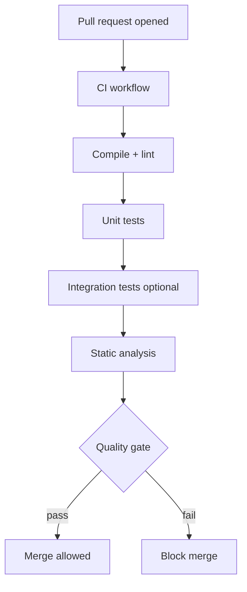

# Static Analysis and CI

> **Status:** Completed  
> **Module:** 30 — Testing and Code Quality  
> **Target Java version:** 21  
> **Last reviewed:** 2026-11-11  
> **Chapter profile:** Technical  
> **Depth target:** Levels 2–3 (analysis tiers, CI pipeline, quality gates)  
> **Examples verified with:** Temurin JDK 21.0.12.1 (`javac -Xlint:all` clean compile on handbook samples)

**Section policy:** Omissions in Review Checklist.

## 1. Learning Objectives *(mandatory)*

After completing this chapter, you should be able to:

- Use **`javac -Xlint`** categories and promote warnings in CI with `-Werror`.
- Describe **Checkstyle**, **SpotBugs**, **PMD**, and **SonarQube** roles in the quality stack.
- Sketch a **CI pipeline** that runs `mvn verify` (or Gradle `check`) on every change.
- Explain why tests alone do not catch every defect class static analysis targets.

## 2. Prerequisites *(mandatory)*

- Ch.02 — Maven `verify` phase and Surefire.
- Module **29** — reproducible builds and JDK 21 `release` alignment.

## 3. Why This Concept Exists *(mandatory)*

Tests exercise paths you thought to write; they cannot prove absence of all bugs. **Static analysis** inspects source or bytecode without full production execution—finding nullability mistakes, resource leaks, concurrency patterns, and style drift.

**Continuous Integration (CI)** runs build + tests + analysis on every commit or pull request so **main** stays releasable. Human review is necessary but not sufficient—automation scales consistency.

## 4. Conceptual Explanation *(mandatory)*

| Tool | Inspects | Typical integration |
|------|----------|---------------------|
| `javac -Xlint` | Language-level warnings (deprecation, raw types, serial) | `maven-compiler-plugin` `compilerArgs` |
| Checkstyle | Formatting, naming, Javadoc conventions | `maven-checkstyle-plugin` |
| SpotBugs | Bytecode bug patterns (null derefs, bad equals) | `spotbugs-maven-plugin` |
| PMD | Source rules (complexity, unused code) | `pmd-maven-plugin` |
| SonarQube | Aggregated metrics, security hotspots, debt | CI scanner + Sonar server |
| OWASP Dependency-Check | Known CVEs in dependencies | CI stage |

**Defense in depth:** Compiler → style → bugs → security → tests → manual review.

### CI stages (typical Java service)

1. **Checkout** + cache dependencies (`~/.m2` or Gradle cache).
2. **Build & test** — `mvn -B verify` with JDK 21.
3. **Static analysis** — SpotBugs, Checkstyle, Sonar (parallel when possible).
4. **Publish artifact** — JAR, Docker image, SBOM.
5. **Deploy** — staging gates; production with approval (Module **48**).

`verify` runs phases through `verify` including integration-test hooks if configured—stricter than `package` alone.

## 5. Mechanism and Execution Flow *(mandatory)*



**Maven batch mode:** `mvn -B` avoids interactive prompts and colors for log stability.

**Quality gate:** SonarQube conditions (coverage on new code, zero blocker issues) or custom scripts failing on SpotBugs priority 1 findings.

## 6. Terminology *(mandatory)*

| Term | Meaning |
|------|---------|
| SAST | Static application security testing |
| False positive | Analyzer reports non-issues—tune rules |
| Baseline | Ignore legacy debt; enforce on new code only |
| Flaky CI | Nondeterministic pipeline failures—treat like flaky tests |
| SBOM | Software Bill of Materials for dependency visibility |

## 7. Syntax and Language Rules *(include when the topic is language/API surface)*

Compiler lint:

```bash
javac -Xlint:all -Werror AssertDemo.java
```

`-Werror` promotes warnings to errors—strict in CI. Handbook `testing-fundamentals-demo/AssertDemo.java` compiles **clean** with `-Xlint:all` on Temurin 21.0.12.1.

Maven CI entry:

```bash
mvn -B -q verify
```

Optional compiler configuration:

```xml
<plugin>
  <groupId>org.apache.maven.plugins</groupId>
  <artifactId>maven-compiler-plugin</artifactId>
  <configuration>
    <release>21</release>
    <compilerArgs>
      <arg>-Xlint:all</arg>
    </compilerArgs>
  </configuration>
</plugin>
```

## 8. Step-by-Step Examples *(mandatory)*

### 8.1 Local lint discipline

Before push:

```bash
javac -Xlint:unchecked -Xlint:deprecation -Werror -d out src/main/java/...
```

Fix **raw types** and **deprecated** API usage early—cheaper than Sonar debt.

### 8.2 Handbook CI analogue

The handbook records successful **`mvn -q test`** for `h2-jdbc-demo` on validation hosts—your pipeline should run at least:

```bash
cd examples/backend/h2-jdbc-demo
mvn -B verify
```

### 8.3 Incorrect CI scope

**Incorrect:** Pipeline runs `mvn compile` only.

**Corrected:** `verify` or explicit `test` + static analysis plugins.

## 9. Real-World Use Cases *(conditional)*

- Block merge on Surefire failure or SpotBugs high-priority bugs.
- Enforce Google Java Format or org Checkstyle in pre-commit or CI.
- Track technical debt trends in Sonar dashboards per team.
- Dependency CVE gates on `pom.xml` upgrades (Module **48** security).

## 10. Internal Behavior *(conditional)*

**SpotBugs** analyzes bytecode—may report issues javac does not see (bad `equals`/`hashCode` contracts). **Sonar** blends rules with coverage from JaCoCo (plugin)—coverage itself is a metric, not proof of correctness.

## 11. Edge Cases and Limitations *(strongly encouraged)*

- **False positives** — tune rule sets; document suppressions with justification (`@SuppressWarnings` narrowly).
- Analysis without tests → false confidence.
- **SNAPSHOT** dependencies break reproducible CI caches.
- **Long-running Sonar** — split fast PR checks vs nightly full scan.

## 12. Common Mistakes *(mandatory)*

### Incorrect

Suppress all SpotBugs findings globally to green the build.

### Corrected

Fix or justify each suppression with ticket reference.

### Incorrect

CI JDK 17, production JDK 21—bytecode and API mismatch.

### Corrected

Align toolchain to 21 (Module **29** toolchains / `release` 21).

## 13. Best Practices *(include when guidance adds value)*

- Fail on **unsuppressed** high-severity findings; no silent `ignoreFailures=true` without policy.
- **Fast PR job** &lt; 10 minutes when possible; offload heavy scans nightly.
- Cache Maven/Gradle deps in CI with lockfiles or wrapper pins.
- Store **test reports** and SpotBugs HTML as CI artifacts for failures.

## 14. Design Trade-offs *(strongly encouraged)*

| Strict `-Werror` everywhere | Gradual lint adoption |
|------------------------------|------------------------|
| Forces cleanup now | Allows legacy debt with baselines |
| May block urgent hotfixes | Needs discipline on new code |

Many orgs use `-Werror` on main and allow warnings on long-lived branches via profiles.

## 15. Revision and Mastery *(Track B / Technical)*

- What does `mvn verify` run that `mvn package` might skip?
- Why can SpotBugs find issues javac misses?
- Name three symptoms of a unhealthy CI pipeline.
- When is Sonar “coverage” misleading?

## 16. Chapter Summary *(mandatory)*

Static analysis complements tests; CI automates both on every change. Start with compiler lint and `mvn verify`, then add SpotBugs and Sonar as team maturity grows.

## 17. Next Steps

Module **31** — Debugging and Troubleshooting.

## 18. Sample GitHub Actions skeleton *(Illustrative)*

```yaml
jobs:
  verify:
  runs-on: ubuntu-latest
  steps:
    - uses: actions/checkout@v4
    - uses: actions/setup-java@v4
      with:
        distribution: temurin
        java-version: "21"
        cache: maven
    - run: mvn -B verify
```

Aligns with Module **48** CI narrative; adjust for Gradle `gradlew check`.

## 19. SpotBugs priority mindset *(conditional)*

| Priority | Typical action |
|----------|----------------|
| High | Fix or justify before merge |
| Medium | Backlog or fix in touched files |
| Low | Tune rulesets; avoid noise |

Byte code analysis finds `equals` without `hashCode`—javac will not.

## 20. Sonar quality gate concepts *(conditional)*

**New code** coverage thresholds differ from **overall** legacy debt. Teams with ancient repos use **baseline** import so gates apply only to changed lines—prevents impossible first-day Sonar adoption.

## 21. Pre-commit vs CI *(conditional)*

Formatters (Spotless, fmt-maven-plugin) on pre-commit catch style early; static analysis heavy jobs stay in CI to keep local commits fast.

## 22. Performance and Operational Notes *(conditional)*

- Shard huge test suites in CI with Surefire `groups` / tags.
- Cache Docker layers for testcontainers jobs (Module **33** awareness).

## 23. Security *(conditional)*

SAST finds injection patterns; still require parameterized SQL tests (Module **33**). Dependency CVE scan blocks known exploits faster than custom rules.

## 24. Compatibility and Version Notes *(conditional)*

`-Xlint:all` categories evolve with JDK—re-run when upgrading from 21 to future LTS.

## 25. Building a quality pipeline in stages *(mandatory depth)*

### Stage 0 — Single developer

- Local `mvn test` or `javac` + handbook demos.
- Enable IDE compiler warnings.

### Stage 1 — Team CI (minimum bar)

```bash
mvn -B verify
```

On JDK **Temurin 21** matching production. Fail build on test failure—no `continue-on-error` without policy.

### Stage 2 — Compiler as linter

Add `-Xlint:all` and optionally `-Werror` on main sources via `maven-compiler-plugin`. Fix raw types and deprecations when touching files.

### Stage 3 — Bytecode analysis

Add SpotBugs with `effort=Max` on nightly; priority 1 findings block release branch.

### Stage 4 — Central quality server

SonarQube with quality gate on **new code** only for legacy repos. Track debt ratio trend, not vanity "100% coverage."

### Stage 5 — Supply chain

OWASP dependency-check or GitHub Dependabot alerts + enforced bumps for critical CVEs.

### Measuring success

| Metric | Healthy signal |
|--------|----------------|
| CI duration | Stable or decreasing with caching |
| Flaky test rate | Near zero |
| Mean time to fix broken main | Hours, not days |
| Repeated SpotBugs rule | Down quarter over quarter |

## Review Checklist

- [x] Technical profile; CI mechanism flow
- [x] `javac -Xlint` on AssertDemo clean (Temurin 21.0.12.1)
- [x] Aligned with Module 29 Maven demos
- [x] Omissions: Sonar sample pipeline (noted as later)
