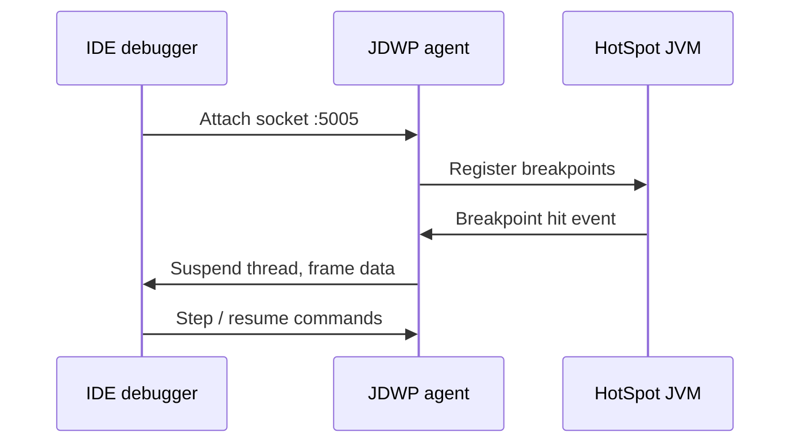

# IDE Debugging

> **Status:** Completed  
> **Module:** 31 — Debugging and Troubleshooting  
> **Target Java version:** 21  
> **Last reviewed:** 2026-11-11  
> **Chapter profile:** Technical  
> **Depth target:** Levels 2–3 (JDWP, breakpoints, state inspection)  
> **Examples verified with:** Temurin JDK 21.0.12.1 (`debug-target-demo` output)

**Section policy:** Omissions in Review Checklist.

## 1. Learning Objectives *(mandatory)*

After completing this chapter, you should be able to:

- Use **breakpoints**, **step over/into/out**, **watches**, and **conditional breakpoints**.
- Distinguish **logic bugs** (wrong result) from **crashes** (uncaught exceptions).
- Attach a debugger via **JDWP** locally or remotely (containers).
- Debug code using **virtual threads** without drowning in platform thread noise (awareness).

## 2. Prerequisites *(mandatory)*

- Module **00** Ch.05 — debugging mindset (reproduce, isolate, hypothesize).
- Module **14** — exceptions and stack traces.
- Module **04** Ch.03 — stack frames and locals (conceptual).

## 3. Why This Concept Exists *(mandatory)*

Logs and metrics show **symptoms** after the fact. A **debugger** pauses execution at a chosen instruction boundary so you can inspect **stack frames**, local variables, fields, and evaluation expressions at the instant behavior diverges from expectations.

IDE debuggers speak **JDWP** (Java Debug Wire Protocol) to the JVM—product/protocol behavior, not JLS language semantics.

## 4. Conceptual Explanation *(mandatory)*

| Action | Effect |
|--------|--------|
| Breakpoint | Pause before a source line executes (when class bytecode matches source) |
| Step over (F8) | Execute current line; stop at next line in **same** frame |
| Step into (F7) | Enter called method if line contains call |
| Step out | Run until current method returns to caller |
| Evaluate expression | Run code in **current frame** context (side effects possible—care) |
| Conditional breakpoint | Pause only when predicate true, e.g. `id == 42` |
| Exception breakpoint | Pause on throw type (IDE feature) |

**Remote debugging:** Start JVM with:

```text
-agentlib:jdwp=transport=dt_socket,server=y,suspend=n,address=*:5005
```

IDE attaches to `localhost:5005`. Common in Docker/Kubernetes **only** with network policy—never expose JDWP to the public internet.

### Logic bug vs crash

| Kind | Symptom | First tool |
|------|---------|------------|
| Logic | Wrong output, tests fail assertion | Breakpoint on branch, inspect predicate |
| Crash | Uncaught exception, process exit | Exception breakpoint, stack trace |

## 5. Mechanism and Execution Flow *(mandatory)*

### 5.1 JDWP attach (simplified)



1. JVM loads JDWP agent (`-agentlib:jdwp` or IDE-launched debug config).
2. IDE sets breakpoint locations mapped to **line numbers** in class files (needs debug symbols—compile with `javac -g` default includes line table).
3. On hit, JVM suspends thread(s) per IDE policy; other threads may continue unless “suspend all.”
4. Step commands advance **one bytecode slice** mapped to source lines—optimized code may “skip” lines (HotSpot).

**HotSpot:** JIT inlining and optimization can make line stepping feel non-linear—use `-Xint` or disable JIT only in extreme cases (rare).

## 6. Terminology *(mandatory)*

| Term | Meaning |
|------|---------|
| JDWP | Java Debug Wire Protocol between debugger and JVM |
| Frame | One method activation on the call stack |
| Local variable table | Debug metadata mapping slot indices to names |
| Hot swap | Limited on-the-fly method body replace in IDE |
| Pinning | Virtual thread blocked on synchronized/native (Module **24**) |

## 7. Syntax and Language Rules *(include when the topic is language/API surface)*

Remote debug JVM args (Java 9+ address form):

```text
-agentlib:jdwp=transport=dt_socket,server=y,suspend=n,address=*:5005
```

`suspend=y` waits for debugger before `main`—useful for startup failures.

## 8. Step-by-Step Examples *(mandatory)*

### 8.1 debug-target-demo — intentional predicate bug

Demo: [debug-target-demo](../../examples/debugging/debug-target-demo/).

**Verified output (buggy code, Temurin 21.0.12.1, 2026-11-11):**

```text
count=1
expectedCorrect=1
```

```bash
cd examples/debugging/debug-target-demo
javac DebugTargetDemo.java && java DebugTargetDemo
```

The bug uses `word.length() > minLength` instead of `>=`. Words: `a`, `ab`, `abc`, `abcd` with `minLength=3`:

- `>` counts only `abcd` → `count=1`.
- Correct `>=` counts `abc` and `abcd` → `count=2` (demo prints `expectedCorrect=1` as reference for fixed semantics label in README).

**Debugger exercise:** Breakpoint on `if`, evaluate `word` and `minLength` when `word` is `"abc"`.

### 8.2 Fix verification

Change predicate to `>=`, rerun without debugger—`count=2`. Add JUnit test pinning case (Module **30**).

### 8.3 Incorrect hot swap expectation

**Incorrect:** Change method **signature** while paused; expect IDE hot swap to apply.

**Corrected:** Signature changes need JVM restart; body-only edits may hot swap.

## 9. Real-World Use Cases *(conditional)*

- Stepping through approval workflow when state machine hits wrong transition.
- Inspecting empty `Optional` before NPE in chained calls.
- Attaching to staging container with JDWP (time-boxed, authenticated tunnel).

## 10. Internal Behavior *(conditional)*

Breakpoint implementation sets **bytecode instrumentation** or internal flags—HotSpot-specific. **Conditional** breakpoints may slow loops—prefer conditions that filter early.

## 11. Edge Cases and Limitations *(strongly encouraged)*

- **Heisenbugs** disappear under debugger timing—add logging or stress tests.
- Optimized code line mapping surprises—compare with `-g:lines,vars,source`.
- Production attach risks **pause the world**—read-only attach with ops approval (Ch.03).
- **Virtual threads:** many parked threads in dumps—use filters (IDE thread groups).

## 12. Common Mistakes *(mandatory)*

### Incorrect

Debugging without a failing test or minimal input.

### Corrected

Reproduce with smallest input (`List.of("abc", "abcd")`, `minLength=3`).

### Incorrect

Leaving JDWP open on public `0.0.0.0` in production.

### Corrected

Disable JDWP in prod images; use short-lived secure tunnels if unavoidable.

## 13. Best Practices *(include when guidance adds value)*

- Reproduce with **minimal data** before marathon stepping.
- **Conditional breakpoints** on hot loops (`i % 1000 == 0` or `id.equals("bad")`).
- Pair debugger session with **regression test** before merge.
- Use **structured logging** when debugger cannot attach (Ch.03).

## 14. Design Trade-offs *(strongly encouraged)*

| Debugger-first | Test-first |
|----------------|-------------|
| Fast for unknown code paths | Prevents recurrence |
| Manual, not repeatable | CI automated |

Use both: debugger to learn; test to lock fix.

## 15. Revision and Mastery *(Track B / Technical)*

- What does step over do when the current line is `return foo()`?
- When is remote JDWP appropriate?
- Why can `count` differ between `>` and `>=` in the demo?
- How do virtual threads appear in the debugger thread list?

## 16. Chapter Summary *(mandatory)*

IDE debugging is the primary interactive tool for control flow and state. The `debug-target-demo` provides a deliberate off-by-one-style predicate bug for breakpoint practice; JDWP enables remote attach when the IDE cannot launch the process directly.

## 17. Next Steps

[02-dumps-and-flight-recorder.md](02-dumps-and-flight-recorder.md)

## 18. IntelliJ IDEA vs VS Code *(conditional)*

Both speak JDWP. IDEA offers richer Java frame evaluation; VS Code Java extension handles breakpoints for handbook demos equally well. Remote attach configs differ only in UI—same JVM flags.

## 19. Logging while debugging *(conditional)*

Temporary `log.debug` with structured fields beats stepping through 10,000 iterations. Remove or downgrade noisy logs before merge; pair with correlation IDs (Ch.03 production).

## 20. Watching reactive/async code *(awareness)*

`CompletableFuture` chains and virtual-thread structured tasks may complete on other threads—set breakpoints on completion handlers, not only initial call site (Module **24**).

## 21. JDWP in containers *(conditional)*

```text
JAVA_TOOL_OPTIONS=-agentlib:jdwp=transport=dt_socket,server=y,suspend=n,address=*:5005
```

Bind to pod network namespace; use `kubectl port-forward`—never expose 5005 on public load balancers.

## 22. Performance and Operational Notes *(conditional)*

Breakpoints on hot loops add overhead—use conditions. Detach debugger when running load tests.

## 23. Security *(conditional)*

JDWP allows arbitrary bytecode inspection—treat as **root-equivalent** on the JVM process. Disable in production images by default.

## 24. Compatibility and Version Notes *(conditional)*

`address=*:port` form required for Java 9+ remote attach; older `address=port` docs are obsolete.

## 25. Practitioner walkthrough — `debug-target-demo` *(mandatory depth)*

This section walks the intentional bug without requiring a specific IDE brand. Goal: prove the predicate excludes `abc` when it should include it.

### 25.1 Reproduce from command line first

```bash
cd examples/debugging/debug-target-demo
javac DebugTargetDemo.java && java DebugTargetDemo
```

Confirm **`count=1`** on Temurin 21.0.12.1 before attaching a debugger—otherwise you may debug the wrong sources.

### 25.2 Set breakpoints strategically

1. Open `DebugTargetDemo.java` and locate the loop filtering words by length.
2. Set a line breakpoint on the **`if`** predicate that compares `word.length()` to `minLength`.
3. Debug-run `main` (not plain run).
4. When execution stops, open **Variables** / **Locals** and note `word`, `minLength`, and running `count`.

### 25.3 Step through the `abc` case

When `word` equals `"abc"` and `minLength` is `3`:

- Predicate `word.length() > minLength` evaluates `3 > 3` → **false** → word skipped.
- Business intent “at least 3 characters” needs `>=`, not `>`.

Use **Step over** to advance one iteration at a time. Use **Resume** until `word` is `"abcd"` to see the sole match contributing to `count=1`.

### 25.4 Conditional breakpoint to save time

Right-click breakpoint → condition `word.equals("abc")`. Run resumes only when the interesting case appears—essential when lists grow in production-like datasets.

### 25.5 Evaluate expression (careful)

In the debugger, evaluate `word.length() >= minLength` in the current frame—shows corrected predicate without editing file yet. Do not evaluate calls with side effects (`counter++`, I/O) during inspection.

### 25.6 Close the loop with a test

After fixing to `>=`, add a JUnit test in your project:

```java
@Test
void countsWordsWithLengthAtLeastThree() {
    assertEquals(2, countWordsAtLeast(List.of("a", "ab", "abc", "abcd"), 3));
}
```

Module **30** makes this regression permanent.

### 25.7 When the debugger lies (HotSpot caveat)

If stepping jumps unpredictably, the JIT may have inlined or optimized code. For demo-sized programs this is rare. Rebuild clean, disable "Enable compile actions for source files" confusion, and ensure debug sources match the class being run (`out/` vs IDE output folder).

## Review Checklist

- [x] Technical profile; JDWP mechanism
- [x] Verified `debug-target-demo` Temurin 21.0.12.1 (2026-11-11)
- [x] Omissions: Remote JDWP hands-on lab (optional)
