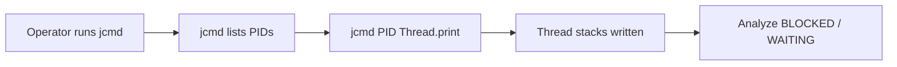

# Dumps and Flight Recorder

> **Status:** Completed  
> **Module:** 31 — Debugging and Troubleshooting  
> **Target Java version:** 21  
> **Last reviewed:** 2026-11-11  
> **Chapter profile:** Technical  
> **Depth target:** Levels 2–3 (jcmd, thread/heap dumps, JFR overview)  
> **Examples verified with:** Temurin JDK 21.0.12.1 (`diagnostics-awareness-demo`; `jcmd` shape documented, not fabricated)

**Section policy:** Omissions in Review Checklist.

## 1. Learning Objectives *(mandatory)*

After completing this chapter, you should be able to:

- List JVMs with **`jcmd`** and capture **thread dump** / **heap dump** safely.
- Describe **JFR** (JDK Flight Recorder) events vs always-on logging.
- Know operational constraints: disk, PII, attach permissions.
- Relate dumps to Module **27** leak analysis and Module **28** profiling.

## 2. Prerequisites *(mandatory)*

- Module **26** Ch.05 — JDK diagnostic tools overview.
- Module **24** — threads, states (`BLOCKED`, `WAITING`, …).
- Module **01** — `jps`, `java` process identity.

## 3. Why This Concept Exists *(mandatory)*

IDE debuggers need attachment and acceptable pause times. In **staging** or **production**, you often capture evidence from a running JVM: what every thread is doing, what objects dominate the heap, what GC and CPU samples looked like before failure.

**JDK tools** (`jcmd`, `jmap` legacy paths, JFR) ship with Temurin 21—no extra agent for basic dumps on HotSpot.

## 4. Conceptual Explanation *(mandatory)*

| Tool / command | Output |
|----------------|--------|
| `jcmd` | List JVMs + invoke diagnostic commands |
| `jcmd <pid> Thread.print` | Thread dump to stdout |
| `jcmd <pid> GC.heap_dump <file>` | Heap snapshot (`.hprof`) |
| `jcmd <pid> JFR.start ...` | Start flight recording |
| `jcmd <pid> JFR.dump ...` | Write `.jfr` file |
| **JDK Mission Control** | GUI for JFR analysis |

**JVMS** does not mandate JFR; it ships with HotSpot-based JDKs (Temurin, Oracle). Behavior described here is **HotSpot/JDK product**, not language guarantee.

**Thread dump** — stack traces for all threads at one instant; good for deadlocks and pool exhaustion.

**Heap dump** — object graph snapshot; heavy; used after `OutOfMemoryError` or suspected leaks.

**JFR** — low-overhead event buffer (when configured) for post-incident timeline: GC, allocations, method samples, socket I/O (event sets vary).

## 5. Mechanism and Execution Flow *(mandatory)*

### 5.1 Capture thread dump



1. Identify correct PID (`jcmd` or `jps -l`—multiple JVMs common on dev machines).
2. `Thread.print` stops threads briefly to walk stacks (pause proportional to thread count).
3. Compare **several** dumps minutes apart for stuck threads vs transient waits.

### 5.2 Heap dump flow

1. Ensure **free disk** ≥ heap size (often compressed but plan generously).
2. `GC.heap_dump` writes `heap.hprof`.
3. Open in Eclipse MAT, VisualVM, or similar—find dominators, leak suspects.

**Never commit** real heap dumps to Git—PII and secrets in object fields.

## 6. Terminology *(mandatory)*

| Term | Meaning |
|------|---------|
| PID | Operating-system process ID for JVM |
| Safepoint | Point where JVM can pause for GC/diagnostics |
| Dominator tree | Heap analysis: largest retained sets |
| JFR recording | Time-bounded event capture to `.jfr` |
| Attach API | Mechanism allowing `jcmd` to control running JVM |

## 7. Syntax and Language Rules *(include when the topic is language/API surface)*

List JVMs:

```bash
jcmd
```

Thread dump:

```bash
jcmd <pid> Thread.print
```

Heap dump (example path):

```bash
jcmd <pid> GC.heap_dump heap-$(date +%Y%m%d).hprof
```

JFR (HotSpot):

```bash
jcmd <pid> JFR.start name=handbook settings=profile duration=60s filename=run.jfr
jcmd <pid> JFR.dump name=handbook filename=run.jfr
```

On Windows PowerShell, use explicit filename without shell substitution in docs—pass a fixed path.

## 8. Step-by-Step Examples *(mandatory)*

### 8.1 diagnostics-awareness-demo

Demo: [diagnostics-awareness-demo](../../examples/debugging/diagnostics-awareness-demo/).

**Verified output (Temurin JDK 21.0.12.1, 2026-11-11):**

```text
jvmName=OpenJDK 64-Bit Server VM
inputArgsCount=0
threadCount=7
note=Use jcmd/jfr for dumps; see Module 31
```

```bash
cd examples/debugging/diagnostics-awareness-demo
javac DiagnosticsAwarenessDemo.java && java DiagnosticsAwarenessDemo
```

Uses JMX/runtime beans for awareness before hands-on `jcmd`.

### 8.2 Live jcmd practice

With demo running in another terminal:

```bash
jcmd
jcmd <pid> Thread.print
```

**Example excerpt shape only** (live process; line contents vary—**do not treat as Verified output**):

```text
"main" #1 prio=5 ... runnable
   java.lang.Thread.sleep(...)
```

Capture on your machine when practicing; do not paste fabricated full dumps into runbooks.

### 8.3 JFR awareness

Start a short recording during load test; open `.jfr` in JDK Mission Control to correlate GC pauses with latency spikes.

## 9. Real-World Use Cases *(conditional)*

- Many threads `BLOCKED` on same monitor → lock contention.
- `OutOfMemoryError: Java heap space` → heap dump + dominator analysis.
- Latency SLO breach → JFR CPU and method sample events.
- JDBC pool exhaustion → threads blocked in `getConnection()` (Module **33**).

## 10. Internal Behavior *(conditional)*

**Safepoints:** Thread dump and some JFR events require threads at safepoints—very long `critical section` without safepoint may delay dumps (rare HotSpot tuning topic).

**Attach:** On Windows, attaching to JVM run by another user may require elevation; same user as service account typical in prod.

## 11. Edge Cases and Limitations *(strongly encouraged)*

- Heap dumps **huge**; scrub before sharing; legal/privacy review.
- Dumps may contain **PII** in `String` fields.
- **Single dump** may miss races—take series.
- **Container** PID namespace—attach to container Java process, not only host views.

## 12. Common Mistakes *(mandatory)*

### Incorrect

`kill -9` on hung JVM with no prior `Thread.print`.

### Corrected

Runbook: snapshot diagnostics, then controlled restart.

### Incorrect

Storing `.hprof` in ticket attachments without redaction.

### Corrected

Summarize dominators and offending type names; keep file in secure incident bucket.

## 13. Best Practices *(include when guidance adds value)*

- Automate **rate-limited** thread dumps during incidents (not every second).
- Correlate dumps with **deploy version** and **traffic** graphs.
- Practice locally on `diagnostics-awareness-demo` before prod.
- Enable **unified GC logging** (`-Xlog:gc*`) alongside JFR.

## 14. Design Trade-offs *(strongly encouraged)*

| Thread dump | JFR |
|-------------|-----|
| Instant stacks | Timeline, lower overhead at scale |
| Low prep | Requires planning event settings |
| Poor for micro-spikes | Better trend analysis |

Use dumps for “who is stuck now”; JFR for “what led here.”

## 15. Revision and Mastery *(Track B / Technical)*

- Difference between thread dump and heap dump?
- When is JFR preferable to thread dumps?
- Why is `threadCount` machine-specific in the demo?
- What permission issues appear on Windows attach?

## 16. Chapter Summary *(mandatory)*

`jcmd` thread and heap dumps plus JFR extend Module 26 diagnostics into production troubleshooting. The handbook demo orients you to JVM name and thread count; full dumps must be captured live, never invented in documentation.

## 17. Next Steps

[03-production-incidents.md](03-production-incidents.md)

## 18. Reading thread dumps — BLOCKED vs WAITING *(conditional)*

| State | Often means |
|-------|-------------|
| `RUNNABLE` | Executing or runnable, check stack frame |
| `BLOCKED` | Waiting for monitor another thread holds |
| `WAITING` / `TIMED_WAITING` | `Object.wait`, park, join, socket read |

Many threads in same `BLOCKED` frame → lock contention; many in `socketRead0` → slow dependency or missing timeout.

## 19. Heap dump analysis workflow *(conditional)*

1. Open `.hprof` in Eclipse MAT or similar.
2. **Dominator tree** — largest retained sets.
3. **Leak suspects** report — common paths.
4. Map dominator class to application cache/singleton/static collection (Module **27**).

## 20. JFR event categories *(HotSpot awareness)*

| Event family | Teaches |
|--------------|---------|
| `jdk.GarbageCollection` | Pause times vs allocation rate |
| `jdk.CPUSample` | Hot methods without full profiler attach |
| `jdk.ThreadStart` | Thread churn |

Settings file `profile` vs `default` changes overhead—start short recordings in staging.

## 21. `jstack` legacy *(conditional)*

`jstack <pid>` on JDK still works on many builds; `jcmd Thread.print` preferred unified interface. Output format similar—practice both if ops runbooks differ.

## 22. Performance and Operational Notes *(conditional)*

- Heap dump during full GC pause lengthens pause—schedule during maintenance if heap is huge.
- Automate dump upload to secured bucket, not ticket attachments.

## 23. Security *(conditional)*

Heap dumps contain passwords in `char[]`, session tokens in strings—classify as confidential data.

## 24. Compatibility and Version Notes *(conditional)*

JFR availability on non-HotSpot JVMs varies—label product when sharing recordings across vendors.

## Review Checklist

- [x] Technical profile; capture mechanism flow
- [x] Verified `diagnostics-awareness-demo` Temurin 21.0.12.1 (2026-11-11)
- [x] jcmd/JFR labeled HotSpot/JDK tooling
- [x] Omissions: Live `jcmd` excerpt in appendix (not fabricated here)
