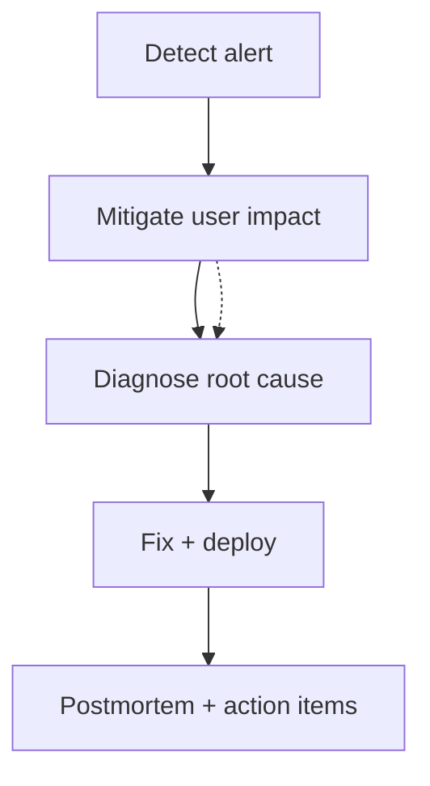

# Production Incidents

> **Status:** Completed  
> **Module:** 31 — Debugging and Troubleshooting  
> **Target Java version:** 21  
> **Last reviewed:** 2026-11-11  
> **Chapter profile:** Technical  
> **Depth target:** Levels 2–3 (triage loop, JVM symptom map, runbooks)  
> **Examples verified with:** Conceptual runbook; ties to Ch.02 dumps and Module **32** resilience

**Section policy:** Omissions in Review Checklist.

## 1. Learning Objectives *(mandatory)*

After completing this chapter, you should be able to:

- Follow a structured **incident response** loop for JVM-backed services.
- Map symptoms (latency, errors, CPU, memory) to **first JVM tools** (metrics, logs, dumps, JFR).
- Coordinate **mitigation** vs **diagnosis** without destroying evidence.
- Apply **blameless postmortems** with measurable follow-ups.

## 2. Prerequisites *(mandatory)*

- Ch.01–02 — interactive debugging and JDK dumps.
- Module **28** — profiling mindset (CPU vs allocation).
- Module **30** — tests preventing recurrence.

## 3. Why This Concept Exists *(mandatory)*

Production failures combine code, configuration, infrastructure, dependency outages, and traffic shape. Panic wastes minutes. A **runbook** encodes what to check on the JVM while customers still feel pain—and what **not** to do (restart without capture, enable JDWP on the public internet).

## 4. Conceptual Explanation *(mandatory)*

### Triage loop



1. **Detect** — SLO burn, error rate, synthetic checks, customer reports.
2. **Mitigate** — rollback, scale out, feature flag off, circuit breaker open (Module **32**).
3. **Diagnose** — logs with trace IDs, metrics dashboards, thread dump, JFR, heap if OOME.
4. **Fix** — patch, config, capacity, dependency coordination.
5. **Postmortem** — timeline, root cause, preventive work (tests, alerts, runbook).

### Symptom → first JVM checks

| Symptom | First checks |
|---------|----------------|
| Sudden HTTP 500 spike | App logs + stack traces; deploy correlate; dependency status |
| High CPU | Thread dump; JFR CPU samples; GC logs |
| Memory climb | Heap trend metric; GC overhead; heap dump if OOME imminent |
| Stuck requests | Thread dump: threads in `getConnection()`, lock waits |
| GC pause storm | `-Xlog:gc*`; JFR GC events; heap too small or leak |
| TLS errors | Cert expiry; trust store; handshake logs (Module **32**) |

## 5. Mechanism and Execution Flow *(mandatory)*

### 5.1 Evidence preservation timeline

1. **T0** — alert fires; note deploy version and traffic.
2. **T0+2m** — mitigate if revenue/SLO critical (scale, rollback).
3. **T0+5m** — `jcmd Thread.print` (series of 3) before restart if safe.
4. **T0+10m** — start short JFR if process still live.
5. **Before kill** — heap dump only if OOME or leak suspected (disk check).
6. **After stable** — postmortem within days.

Restart **clears heap and many thread states**—capture when policy allows.

### 5.2 Correlation IDs

HTTP `traceparent` / custom `X-Request-Id` propagated to JDBC logs ties user-visible failure to backend line—logging discipline, not JVM spec.

## 6. Terminology *(mandatory)*

| Term | Meaning |
|------|---------|
| SLO | Service level objective (availability, latency) |
| Error budget | Allowed unreliability before feature freeze |
| MTTR | Mean time to restore service |
| Root cause | Underlying failure mechanism, not proximate trigger |
| Blameless postmortem | Focus on systems, not individual fault |

## 7. Syntax and Language Rules *(include when the topic is language/API surface)*

GC logging (Java 9+ unified logging):

```text
-Xlog:gc*:file=gc.log:time,level,tags
```

Thread dump via automation (rate-limited script calling `jcmd`).

**Illustrative** — incident commands depend on orchestration (Kubernetes `kubectl exec`, not fabricated here).

## 8. Step-by-Step Examples *(mandatory)*

### 8.1 JDBC pool exhaustion narrative

**Real-world pattern (conceptual, not a fabricated timeline):**

Symptom: latency p99 spike, threads in dump blocked in `HikariPool.getConnection()`.

Checks: pool size config, slow queries, connection leaks (missing `try-with-resources`).

Fix: increase pool temporarily **only** with DB capacity; fix leak; add metric on pool wait time.

Links Module **33** pooling.

### 8.2 debug-target-demo tie-in

Off-by-one logic bugs like Module 31 Ch.01 should never reach prod if covered by unit tests—incidents from logic errors imply **missing test** or **untested path**.

### 8.3 Incorrect escalation

**Incorrect:** Immediate `kill -9` cluster-wide without dumps on OOME nodes.

**Corrected:** Single-node heap dump + traffic drain; then restart.

## 9. Real-World Use Cases *(conditional)*

- Deadlock reported in thread dump—fix lock ordering; add test with contended lock.
- cgroup CPU limit throttles JVM—looks like Java slowness; check container metrics.
- Thundering herd after cache expiry—mitigate with jitter, bulkhead (Module **32**).

## 10. Internal Behavior *(conditional)*

**ForkJoinPool** / **virtual thread** carrier exhaustion can mimic thread starvation—thread dumps show carrier pool state (Module **24**).

## 11. Edge Cases and Limitations *(strongly encouraged)*

- **One thread dump** misses rare races—interval series.
- **Sampling bias** in metrics during partial outage.
- **Multi-region** incidents need per-region JVM evidence.
- **Blue/green** deploy may leave old JVMs running—check all versions.

## 12. Common Mistakes *(mandatory)*

### Incorrect

Treating restart as diagnosis.

### Corrected

Document what restart cleared; capture dumps first when policy allows.

### Incorrect

Postmortem naming engineers as root cause.

### Corrected

Five whys to systemic fixes: tests, alerts, limits.

## 13. Best Practices *(include when guidance adds value)*

- **Structured logging** JSON with trace IDs (Module **38**).
- **Runbooks** linked from alert notifications.
- **Game days** practice dump capture on staging.
- Pair incident fixes with **regression tests** (Module **30**).

## 14. Design Trade-offs *(strongly encouraged)*

| Fast rollback | Forward fix |
|---------------|-------------|
| Restores SLO quickly | Root cause may persist in code |
| May hide need for dump | Allows diagnosis on warm standby |

Policy: rollback for customer impact; keep canary with debugging enabled if safe.

## 15. Revision and Mastery *(Track B / Technical)*

- Order mitigation vs evidence capture in OOME scenario?
- Which Module 31 tool for “all threads waiting on lock X”?
- How do correlation IDs help JDBC debugging?
- Name three non-Java causes that mimic JVM slowness.

## 16. Chapter Summary *(mandatory)*

Production incidents combine JVM diagnostics from Ch.02 with operational discipline: mitigate, capture, diagnose, fix, learn. No fabricated incident timelines—patterns are grounded in common Java service failures.

## 17. Next Steps

Module **32** — Networking and HTTP.

## 18. Incident comms template *(conditional)*

| Field | Example |
|-------|---------|
| Severity | SEV2 user-visible errors |
| Start (UTC) | 2026-11-11T14:02Z |
| Impact | Checkout 15% error rate EU |
| Mitigation | Rolled back deploy `v1.4.2` |
| JVM evidence | 3× thread dumps, JFR 60s |
| Customer comms | Status page updated |

Avoid invented timestamps in handbook—use structure only.

## 19. Error budget and SLO *(conditional)*

If monthly error budget burns in one incident, freeze features until reliability work completes—product + SRE policy, not JVM feature.

## 20. Game day exercises *(conditional)*

Quarterly drill: engineer captures thread dump from staging under load without runbook—validates Module 31 skills before real outage.

## 21. Kubernetes-specific JVM signals *(conditional)*

| Signal | Check |
|--------|-------|
| OOMKilled | cgroup memory < JVM `-Xmx` |
| CPU throttling | cgroup quota vs JVM threads |
| Liveness restart | Lost heap dump opportunity |

Align `-XX:MaxRAMPercentage` with container limit (Module **48**).

## 22. Postmortem action item types *(conditional)*

- **Prevent:** test, static analysis rule
- **Detect:** alert on metric derivative
- **Mitigate:** circuit breaker, feature flag
- **Process:** runbook update

## 23. Performance and Operational Notes *(conditional)*

Keep incident tooling JDK-aligned with prod (Temurin 21.0.12.1)—`jcmd` syntax stable but flags differ across major versions.

## 24. Security *(conditional)*

Incident channels may receive dumps with PII—restrict channel membership; redact before external postmortems.

## 25. Scenario playbooks (conceptual narratives) *(mandatory depth)*

These are **patterns**, not recorded incidents—use structure when writing your org runbooks.

### 25.1 Scenario A — Error rate spike after deploy

1. **Detect:** alert on HTTP 5xx rate; dashboard shows start time aligns with new deploy.
2. **Mitigate:** rollback via pipeline if faster than forward fix.
3. **Diagnose:** stack traces from logs; `jcmd Thread.print` on canary if threads blocked.
4. **Fix:** patch + JUnit regression (Module **30**).

### 25.2 Scenario B — Gradual memory climb

1. **Detect:** heap metric rises over 24h without traffic growth.
2. **Mitigate:** avoid blind scale-out multiplying leak.
3. **Diagnose:** heap dump + dominator tree (Module **27**).
4. **Fix:** bounded cache with eviction.

### 25.3 Scenario C — p99 latency, flat CPU

1. **Detect:** SLO burn; CPU nominal.
2. **Diagnose:** threads blocked in `socketRead0` on slow HTTP dependency (Module **32**).
3. **Fix:** timeouts, bulkhead, breaker—not only heap increase.

### 25.4 Scenario D — `OutOfMemoryError`

Capture heap dump when JVM still alive; preserve GC logs; restart only after evidence secured.

### 25.5 Communication discipline

Single incident commander; UTC timestamps on artifacts; separate customer summary from internal heap analysis.

## Review Checklist

- [x] Technical profile; triage mechanism
- [x] No fabricated incident timelines or dump contents
- [x] Cross-links Module 32 resilience
- [x] Omissions: Full on-call playbook template (org-specific)
