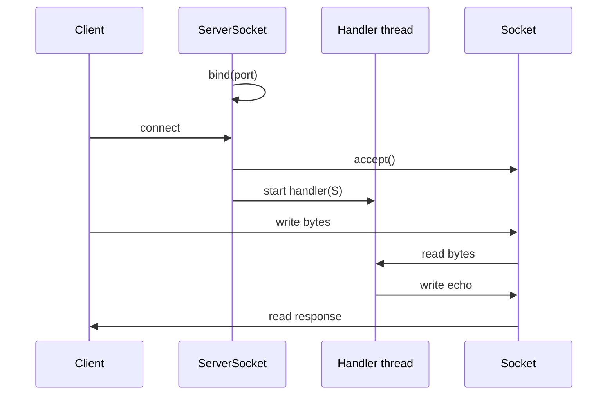

# Sockets and TCP

> **Status:** Completed  
> **Module:** 32 — Networking and HTTP  
> **Target Java version:** 21  
> **Last reviewed:** 2026-11-11  
> **Chapter profile:** Technical  
> **Depth target:** Levels 2–3 (TCP semantics, blocking I/O, ServerSocket flow)  
> **Examples verified with:** Temurin JDK 21.0.12.1 (`tcp-loopback-demo`)

**Section policy:** Omissions in Review Checklist.

## 1. Learning Objectives *(mandatory)*

After completing this chapter, you should be able to:

- Explain **TCP** reliable byte streams vs **UDP** datagrams.
- Use **`ServerSocket`** and **`Socket`** for a minimal echo server/client.
- Understand **blocking I/O** and why high-scale servers add thread pools, NIO, or async layers.
- Relate socket timeouts and resets to production JDBC and HTTP issues.

## 2. Prerequisites *(mandatory)*

- Module **20** — `java.net` survey.
- Module **24** — threads; demo uses a **virtual thread** for the server handler.
- Module **14** — `IOException`, try-with-resources.

## 3. Why This Concept Exists *(mandatory)*

HTTP, JDBC, gRPC-over-HTTP/2, and many message buses ultimately sit on **TCP** (or QUIC, which this module does not cover). Understanding **sockets** explains connection refused, reset by peer, read timeouts, and why **one thread blocked in `read()`** cannot serve other clients without another thread or non-blocking I/O.

Java exposes classic blocking TCP via **`java.net.Socket`** / **`ServerSocket`**; scalable designs use **NIO** channels, **async** stacks, or frameworks (Netty, embedded Tomcat in Module **38**).

## 4. Conceptual Explanation *(mandatory)*

| Concept | Meaning |
|---------|---------|
| IP address | Host on a network (`127.0.0.1` loopback) |
| Port | 16-bit endpoint on host (0–65535; OS assigns ephemeral ports for clients) |
| Socket | Endpoint for sending/receiving bytes |
| `ServerSocket` | Binds port, `accept()` returns connected client `Socket` |
| TCP | Connection-oriented, reliable, ordered byte stream |
| UDP | Connectionless datagrams (`DatagramSocket`)—loss/latency trade-offs |

**Three-way handshake (awareness):** Client SYN → server SYN-ACK → client ACK. **Teardown** with FIN/RST explains half-open states and `SocketException: Connection reset`.

**Blocking I/O:** `InputStream.read()` waits until data, end-of-stream, or timeout/`SoTimeout` IOException.

## 5. Mechanism and Execution Flow *(mandatory)*

### 5.1 Echo server loop



1. Server creates `ServerSocket(port)`, binds, listens.
2. `accept()` blocks until client connects—returns connected `Socket`.
3. Handbook demo starts **virtual thread** to read/write streams while server can accept more (single-client demo still illustrative).
4. Client opens `Socket(host, port)`, writes payload, reads response.
5. `close()` releases port and file descriptors—prefer **try-with-resources**.

### 5.2 Client connect path

`new Socket("127.0.0.1", port)` resolves host, attempts TCP connect—`ConnectException` if nothing listens.

## 6. Terminology *(mandatory)*

| Term | Meaning |
|------|---------|
| Loopback | `127.0.0.1` — traffic stays on host |
| Backlog | Queue length for incoming connects before accept |
| Nagle's algorithm | TCP small-packet buffering (awareness for latency tuning) |
| Half-close | One side shuts down write while read remains |
| BindException | Port already in use |

## 7. Syntax and Language Rules *(include when the topic is language/API surface)*

Server sketch:

```java
try (var server = new ServerSocket(0)) {
    int port = server.getLocalPort();
    try (Socket client = server.accept();
         var in = client.getInputStream();
         var out = client.getOutputStream()) {
        // read/write bytes
    }
}
```

Set read timeout:

```java
socket.setSoTimeout(30_000); // ms
```

## 8. Step-by-Step Examples *(mandatory)*

### 8.1 tcp-loopback-demo

Demo: [tcp-loopback-demo](../../examples/networking/tcp-loopback-demo/).

**Verified output (Temurin JDK 21.0.12.1, 2026-11-11):**

```text
echo=echo:ping
port=19042
```

```bash
cd examples/networking/tcp-loopback-demo
javac TcpLoopbackDemo.java && java TcpLoopbackDemo
```

Client sends `ping`; server echoes `echo:ping`. Server handler uses **`Thread.startVirtualThread`**; client uses blocking streams.

**Important lines:** Fixed port `19042` in output documents configured demo port; if refactor changes port constant, update Verified line accordingly.

### 8.2 Incorrect desktop pattern

**Incorrect:** `accept()` on Swing **EDT** — UI freezes.

**Corrected:** Background executor or virtual thread for accept/handle loop.

### 8.3 Resource leak

**Incorrect:** Close client socket but not `ServerSocket` on shutdown path.

**Corrected:** try-with-resources on both; shutdown hook for graceful stop in servers.

## 9. Real-World Use Cases *(conditional)*

- Load balancer TCP health checks (TLS termination at edge).
- Custom binary protocols before HTTP migration.
- JDBC socket timeouts to PostgreSQL (Module **33**).
- Understanding **connection pools** as reused TCP sessions to DB.

## 10. Internal Behavior *(conditional)*

**OS buffers:** `write()` may return before bytes reach wire—application-level flushing/protocol framing matters.

**Virtual threads:** blocking socket read **pins** carrier during blocking call (JDK behavior evolution—check release notes); still fine for many workloads.

**Not JLS:** Socket implementation is JDK/OS native code interaction.

## 11. Edge Cases and Limitations *(strongly encouraged)*

- **Port in use** — another process or `TIME_WAIT`.
- **Firewall/NAT** — local success ≠ production reachability.
- **One thread per connection** does not scale to millions without NIO/async.
- **Message framing:** TCP is stream, not message—need length prefix or delimiters for multiple messages.

## 12. Common Mistakes *(mandatory)*

### Incorrect

Assume single `read()` returns full application message.

### Corrected

Loop read until buffer full or delimiter/protocol complete.

### Incorrect

Ignore `IOException` on idle timeout as “random network.”

### Corrected

Configure timeouts; retry idempotent operations (Ch.03).

## 13. Best Practices *(include when guidance adds value)*

- try-with-resources for sockets and streams.
- Log **remote address** at accept boundary with correlation ID.
- Set **`SoTimeout`** on blocking reads in request/response servers.
- Separate **accept loop** from **worker** handling for responsiveness.

## 14. Design Trade-offs *(strongly encouraged)*

| Blocking + thread per connection | NIO selector / async |
|-----------------------------------|---------------------|
| Simple code | Complex state machines |
| Fine with virtual threads for moderate concurrency | Needed for extreme fan-in |

Choose based on connection count and framework (Servlet container handles this in Module **38**).

## 15. Revision and Mastery *(Track B / Technical)*

- TCP vs UDP—when is UDP appropriate?
- What does `accept()` block on?
- Why is port `19042` printed in the demo?
- How does stream semantics differ from datagram messages?

## 16. Chapter Summary *(mandatory)*

TCP sockets underpin HTTP and JDBC. The loopback demo shows minimal blocking client/server echo behavior and virtual-thread-based handling—foundation for HttpClient in Ch.02.

## 17. Next Steps

[02-http-and-httpclient.md](02-http-and-httpclient.md)

## 18. TCP connection lifecycle *(conditional)*

| Phase | Java symptom |
|-------|----------------|
| SYN fails | `ConnectException: Connection refused` |
| RST from peer | `SocketException: Connection reset` |
| Peer closes write side | `read()` returns `-1` (EOF) |
| Read timeout | `SocketTimeoutException` |

Teach operators to distinguish **client misconfiguration** (wrong host/port) from **server overload** (accept queue full).

## 19. Backlog and `ServerSocket` tuning *(conditional)*

`new ServerSocket(port, backlog)` sets OS listen queue length. Under burst traffic, clients may see refused connects if backlog + accept rate insufficient—fix with more instances or faster handlers, not infinite backlog alone.

## 20. Framing over byte streams *(conditional)*

TCP does not preserve message boundaries. Protocols use:

- Fixed length prefix (4-byte big-endian size)
- Delimiters (newline for text—careful with binary)
- HTTP Content-Length / chunked encoding (Ch.02)

Handbook echo demo sends one write/read pair—sufficient for teaching.

## 21. UDP contrast *(awareness)*

`DatagramSocket` sends packetized `DatagramPacket`—useful for discovery protocols where loss acceptable. JDBC and HTTP stay on TCP for this curriculum track.

## 22. Performance and Operational Notes *(conditional)*

- Virtual threads improve **blocking** socket scalability vs platform thread pools—still bounded by file descriptors and memory.
- `SO_REUSEADDR` on server bind—common in restarted services; OS specific semantics.

## 23. Security *(conditional)*

Unauthenticated TCP services expose **unencrypted** payloads—use TLS (Ch.03) or private networks for anything beyond localhost demos.

## 24. Compatibility and Version Notes *(conditional)*

NIO `SocketChannel` alternative API exists (Module **20** survey)—blocking `java.net` remains valid for learning.

## 25. FAQ — sockets on the JVM *(mandatory depth)*

**Q: Why does the handbook use port 19042?**  
A: Fixed port simplifies docs and tests; production servers often use `ServerSocket(0)` for an ephemeral port and publish it out-of-band.

**Q: Can two programs bind the same port?**  
A: Not on the same host/IP unless `SO_REUSEADDR` and coordinated lifecycle—otherwise `BindException`.

**Q: Is `InputStream.read()` guaranteed to fill my buffer?**  
A: No—loop until length met, EOF, or timeout.

**Q: Virtual thread vs platform thread for accept loop?**  
A: Virtual threads suit blocking accept/handle patterns; ensure carrier pool sized for your JDK build when mixing with CPU work.

**Q: Relationship to HttpClient?**  
A: HttpClient manages TCP/TLS and HTTP framing; Ch.02 builds on this byte-stream foundation.

**Q: Where does charset fit?**  
A: Handbook demo uses bytes/UTF-8 implicitly via `getBytes`/`String` constructors—specify `StandardCharsets.UTF_8` in production protocols.

**Q: How do I test without flakiness?**  
A: Use loopback `127.0.0.1`, fixed or ephemeral port with try/finally `close`, avoid real network in unit tests.

**Q: JDBC connection is a socket?**  
A: Yes—driver opens TCP to DB host:port; socket read timeout maps to JDBC network timeout (Module **33**).

## Review Checklist

- [x] EXPAND-PRESERVE 2026-11-11 (Technical L2–3)
- [x] Technical profile; accept/handler mechanism
- [x] Verified `tcp-loopback-demo` Temurin 21.0.12.1 (2026-11-11)
- [x] Omissions: NIO selector module (roadmap later)
