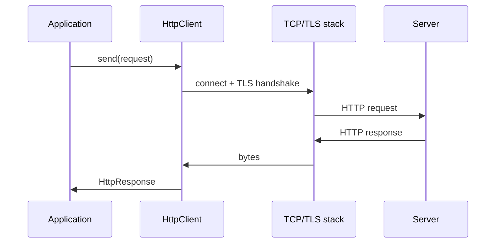

# HTTP and HttpClient

> **Status:** Completed  
> **Module:** 32 — Networking and HTTP  
> **Target Java version:** 21  
> **Last reviewed:** 2026-11-11  
> **Chapter profile:** Technical  
> **Depth target:** Levels 2–3 (HTTP model, HttpClient API, sync/async)  
> **Examples verified with:** Temurin JDK 21.0.12.1 (live HTTPS to example.com, 2026-11-11)

**Section policy:** Omissions in Review Checklist.

## 1. Learning Objectives *(mandatory)*

After completing this chapter, you should be able to:

- Map **HTTP/1.1** request/response structure (method, URI, status, headers, body).
- Build and reuse **`java.net.http.HttpClient`** with timeouts and redirect policy.
- Use synchronous **`send`** and know when **`sendAsync`** fits (virtual threads vs async).
- Choose body handlers (`ofString`, `ofInputStream`, `ofByteArray`) safely for payload size.

## 2. Prerequisites *(mandatory)*

- Ch.01 — TCP connection establishment underlies HTTP.
- Module **14** — `IOException`, HTTP failure handling.

## 3. Why This Concept Exists *(mandatory)*

**HTTP** is the dominant application protocol for APIs and the web. Before Java 11, many teams depended on Apache HttpClient or third-party libraries. The JDK **`HttpClient`** (Java 11+, mature by 21) provides HTTP/1.1 and **HTTP/2** client support with TLS, suitable for microservice calls and tooling without extra dependencies.

## 4. Conceptual Explanation *(mandatory)*

| Piece | Role |
|-------|------|
| Method | Semantics: `GET` (safe/idempotent retrieve), `POST` (submit), `PUT`, `PATCH`, `DELETE`, … |
| URI | Scheme, host, port, path, query |
| Status code | `2xx` success, `3xx` redirect, `4xx` client error, `5xx` server error |
| Headers | Metadata (`Content-Type`, `Accept`, `Authorization`, `User-Agent`) |
| Body | Optional entity (JSON, HTML, bytes) |

**HttpClient** — immutable, thread-safe; configure once, reuse.

**HttpRequest** — per-request builder (method, URI, headers, body publisher, timeout).

**HttpResponse** — status, headers, body via `BodyHandler` choice.

**Connection reuse:** Client maintains connection pool (HTTP/1.1 keep-alive, HTTP/2 multiplexing)—framework/HotSpot JDK behavior.

## 5. Mechanism and Execution Flow *(mandatory)*

### 5.1 Synchronous GET over TLS



1. Build `HttpClient` with `connectTimeout`, optional `redirect`, version preference.
2. Build `HttpRequest` with URI (HTTPS → TLS, Ch.03).
3. `send` blocks calling thread until response headers/body per handler.
4. Parse status; read body string or stream.

On **virtual threads**, blocking `send` is acceptable for many concurrent outbound calls (Module **24**).

### 5.2 Async path

`sendAsync` returns `CompletableFuture<HttpResponse<T>>` — callback or compose stages (Module **24** Ch.03). Use when platform-thread pools are scarce; with virtual threads sync is often simpler.

## 6. Terminology *(mandatory)*

| Term | Meaning |
|------|---------|
| Idempotent | Repeatable without extra side effects (GET, PUT often; POST usually not) |
| Safe method | No server state change intended (GET) |
| Content negotiation | `Accept` header vs `Content-Type` |
| Chunked transfer | Streaming body without fixed Content-Length |
| HTTP/2 | Multiplexed streams on one TLS connection |

## 7. Syntax and Language Rules *(include when the topic is language/API surface)*

```java
HttpClient client = HttpClient.newBuilder()
    .connectTimeout(Duration.ofSeconds(10))
    .followRedirects(HttpClient.Redirect.NORMAL)
    .build();

HttpRequest request = HttpRequest.newBuilder()
    .uri(URI.create("https://example.com"))
    .timeout(Duration.ofSeconds(30))
    .GET()
    .build();

HttpResponse<String> response =
    client.send(request, HttpResponse.BodyHandlers.ofString());
int code = response.statusCode();
String body = response.body();
```

POST JSON (Illustrative structure):

```java
HttpRequest.post(URI.create("https://api.example/v1/items"))
    .header("Content-Type", "application/json")
    .POST(HttpRequest.BodyPublishers.ofString("{\"id\":1}"))
    .build();
```

## 8. Step-by-Step Examples *(mandatory)*

### 8.1 http-client-demo

Demo: [http-client-demo](../../examples/networking/http-client-demo/).

**Verified output (Temurin JDK 21.0.12.1, 2026-11-11):**

```text
status=200
bodyStartsWith=true
headerServer=cloudflare
```

```bash
cd examples/networking/http-client-demo
javac HttpClientDemo.java && java HttpClientDemo
```

`https://example.com` returns HTML; `bodyStartsWith=true` checks `<!doctype html` after case fold/strip. **`headerServer`** reflects live response headers (CDN-specific—not universal across runs or regions).

### 8.2 Timeouts (required for production)

**Incorrect:** Default client with no timeouts—hangs on bad networks.

**Corrected:**

```java
HttpClient.newBuilder()
    .connectTimeout(Duration.ofSeconds(5))
    .build();
// plus HttpRequest.Builder.timeout per call
```

### 8.3 Large body

**Incorrect:** `BodyHandlers.ofString()` on multi-gigabyte download.

**Corrected:** `BodyHandlers.ofInputStream()` and stream to file with bounded buffers.

## 9. Real-World Use Cases *(conditional)*

- Internal REST calls between services (Module **38** servers).
- Webhook delivery with retries (Ch.03 idempotency).
- Fetching OIDC metadata over HTTPS (Module **43** security awareness).

## 10. Internal Behavior *(conditional)*

JDK HttpClient uses internal connection management—HTTP/2 upgrade when server supports. **Redirect** policy `NORMAL` does not upgrade method on 302 for POST (historical HTTP behavior nuances—verify for your API).

## 11. Edge Cases and Limitations *(strongly encouraged)*

- No built-in **retry** with backoff—implement policy (Ch.03).
- Corporate proxy may require `ProxySelector` configuration.
- **Certificate** trust failures → `SSLHandshakeException` (Ch.03).
- **Rate limiting** (`429`) needs respect of `Retry-After` header.

## 12. Common Mistakes *(mandatory)*

### Incorrect

New `HttpClient` per request in hot loop.

### Corrected

Reuse single client instance application-wide.

### Incorrect

Treat all `2xx` as business success without parsing body errors.

### Corrected

Check status and problem JSON schema for APIs.

## 13. Best Practices *(include when guidance adds value)*

- Reuse **one HttpClient** (injection-friendly).
- Set **connect** and **request** timeouts explicitly.
- Set **`Content-Type`** and **`Accept`** on APIs you control.
- Use Jackson (later modules) for JSON—HttpClient delivers bytes/String.

## 14. Design Trade-offs *(strongly encouraged)*

| Sync send | sendAsync |
|-----------|-----------|
| Simple stack traces | Composes with futures |
| Great with virtual threads | Platform thread pool tuning |

## 15. Revision and Mastery *(Track B / Technical)*

- Which methods are idempotent by convention?
- Why is `headerServer` not stable in docs?
- Difference between connect timeout and request timeout?
- When must you use streaming body handlers?

## 16. Chapter Summary *(mandatory)*

HttpClient is the modern JDK HTTP stack. The demo proves live HTTPS GET with status and body checks on real network I/O; Ch.03 adds TLS trust detail and resilience patterns.

## 17. Next Steps

[03-tls-and-resilience-basics.md](03-tls-and-resilience-basics.md)

## 18. HTTP status codes practitioners memorize *(conditional)*

| Code | Meaning | Typical client action |
|------|---------|------------------------|
| 200 | OK | Parse body |
| 201 | Created | Read `Location` header |
| 400 | Bad request | Fix payload |
| 401 | Unauthorized | Refresh auth |
| 403 | Forbidden | Policy issue |
| 404 | Not found | Fix URI |
| 409 | Conflict | Retry with idempotency |
| 429 | Too many requests | Backoff / respect `Retry-After` |
| 500 | Server error | Retry idempotent ops with limit |
| 503 | Unavailable | Backoff; check health |

HttpClient returns codes as `int`—no enum in JDK.

## 19. Headers that matter for APIs *(conditional)*

| Header | Role |
|--------|------|
| `Content-Type` | Body parser selection (`application/json`) |
| `Accept` | Negotiate response format |
| `Authorization` | Bearer tokens (Module **43**) |
| `User-Agent` | Identify client (some APIs require) |
| `Cache-Control` | HTTP caching semantics |

## 20. HTTP/2 and version negotiation *(conditional)*

`HttpClient.newBuilder().version(HttpClient.Version.HTTP_2)` requests HTTP/2 when server supports ALPN during TLS. Multiplexing reduces connection count to same host—JDK manages streams internally.

## 21. Proxy configuration *(conditional)*

```java
HttpClient.newBuilder()
    .proxy(ProxySelector.of(new InetSocketAddress("proxy.corp", 8080)))
    .build();
```

Corporate egress often requires HTTP CONNECT proxy—without it, `example.com` works home but fails office.

## 22. Performance and Operational Notes *(conditional)*

- Reuse client—TLS session resumption saves handshakes.
- `BodyHandlers.discarding()` for fire-and-forget HEAD health checks without parsing body.

## 23. Security *(conditional)*

Never log full `Authorization` headers. Validate TLS before sending secrets (Ch.03).

## 24. Compatibility and Version Notes *(conditional)*

`HttpClient` minimum Java 11; Java 21 handbook assumes no `HttpURLConnection`-only legacy unless maintaining old code.

## 25. FAQ — HttpClient in production *(mandatory depth)*

**Q: Thread-safe client?**  
A: Yes—build once, share; requests are per-call.

**Q: Default HTTP version?**  
A: Negotiates HTTP/2 on HTTPS when supported; else HTTP/1.1.

**Q: Follow redirects automatically?**  
A: Configurable; `Redirect.NORMAL` follows GET redirects—verify POST behavior.

**Q: Why record `headerServer=cloudflare`?**  
A: Proves real response headers vary—never hard-code in app logic.

**Q: Substitute for RestClient / Feign?**  
A: HttpClient is JDK baseline; frameworks add declarative clients (Module **38**+).

**Q: Handle gzip body?**  
A: Client may decompress if `Content-Encoding: gzip`—verify with integration test.

**Q: Client certificates?**  
A: Custom `SSLContext` on builder—Ch.03 mTLS awareness.

## Review Checklist

- [x] EXPAND-PRESERVE 2026-11-11 (Technical L2–3)
- [x] Technical profile; request/response mechanism
- [x] Verified `http-client-demo` Temurin 21.0.12.1 (2026-11-11)
- [x] headerServer labeled environment-specific
- [x] Omissions: HTTP/2 push (optional)
