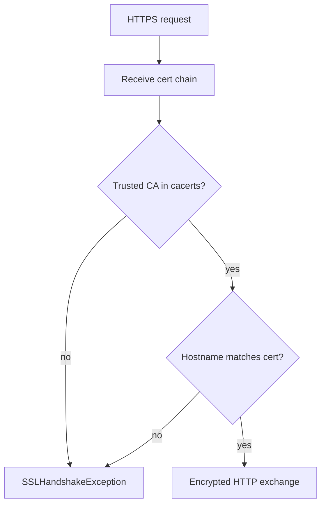
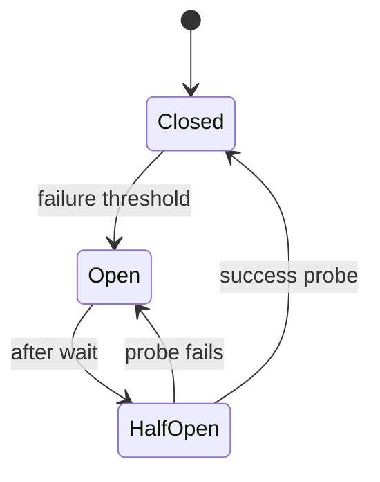

# TLS and Resilience Basics

> **Status:** Completed  
> **Module:** 32 — Networking and HTTP  
> **Target Java version:** 21  
> **Last reviewed:** 2026-11-11  
> **Chapter profile:** Technical  
> **Depth target:** Levels 2–3 (TLS trust path, timeouts, retries, breakers)  
> **Examples verified with:** TLS via https://example.com in http-client-demo (2026-11-11); retry snippet Illustrative

**Section policy:** Omissions in Review Checklist.

## 1. Learning Objectives *(mandatory)*

After completing this chapter, you should be able to:

- Explain **TLS** handshake at a practitioner level (certificates, trust, encryption).
- Connect JVM **trust store** to HTTPS failures and fixing corporate CA imports.
- Apply **resilience** tactics: timeouts, retries with backoff, circuit breakers, bulkheads.
- Know when **not** to retry (non-idempotent POST).

## 2. Prerequisites *(mandatory)*

- Ch.02 — HttpClient timeouts and live HTTPS demo.
- Module **14** — `SSLHandshakeException`, `IOException`.

## 3. Why This Concept Exists *(mandatory)*

Plain TCP sends readable bytes on the wire. **TLS** encrypts and authenticates the server (and optionally the client with mTLS). Production outages also arise from **cascading failures** when callers hammer unhealthy dependencies. Resilience patterns limit blast radius and restore predictable failure modes (fail fast vs hang forever).

## 4. Conceptual Explanation *(mandatory)*

### TLS simplified

| Step | What happens |
|------|----------------|
| 1 | Client connects TCP port (443 for HTTPS). |
| 2 | TLS handshake negotiates version/ciphers. |
| 3 | Server presents **certificate chain** signed by CA. |
| 4 | Client validates chain against **trust store** (`$JAVA_HOME/lib/security/cacerts`). |
| 5 | Session keys encrypt HTTP application data. |

Failures: expired cert, hostname mismatch (SAN), unknown CA, corporate MITM without imported cert → **`SSLHandshakeException`**.

**HTTPS** = HTTP over TLS. JDK HttpClient performs TLS when URI scheme is `https`.

### Resilience patterns

| Pattern | Purpose |
|---------|---------|
| Timeout | Bound wait (connect + request) |
| Retry + backoff | Transient blips (network, 503) |
| Circuit breaker | Fail fast when dependency unhealthy |
| Bulkhead | Cap concurrent calls per dependency |
| Rate limit | Protect server from overload |

Libraries: **Resilience4j**, Failsafe; Spring Cloud CircuitBreaker (Module **36+**). Core Java: compose with HttpClient, `ScheduledExecutorService`, explicit state.

## 5. Mechanism and Execution Flow *(mandatory)*

### 5.1 Trust decision



Custom trust (Illustrative — use only with understood security review):

```java
// Prefer importing corporate CA into trust store over disabling validation
```

### 5.2 Circuit breaker states



**Open:** reject immediately without calling dependency. **Half-open:** trial call. Tune thresholds to avoid flapping.

## 6. Terminology *(mandatory)*

| Term | Meaning |
|------|---------|
| CA | Certificate authority signing server certs |
| SAN | Subject Alternative Name—valid hostnames on cert |
| mTLS | Mutual TLS—client presents cert too |
| Idempotency key | Server deduplicates repeated POSTs |
| Thundering herd | Many clients retry simultaneously |

## 7. Syntax and Language Rules *(include when the topic is language/API surface)*

Import corporate CA (ops task, not app code hot path):

```bash
keytool -importcert -alias corp-ca -file corp-ca.pem -keystore $JAVA_HOME/lib/security/cacerts
```

**Illustrative** — requires admin and change control.

## 8. Step-by-Step Examples *(mandatory)*

### 8.1 Live TLS — http-client-demo

The [http-client-demo](../../examples/networking/http-client-demo/) uses **HTTPS** successfully.

**Verified (Temurin 21.0.12.1, 2026-11-11):**

```text
status=200
bodyStartsWith=true
headerServer=cloudflare
```

JDK trusts the public CA chain for `example.com`—real TLS termination at server/CDN, not a stub.

### 8.2 Retry sketch — Illustrative

```java
for (int attempt = 1; attempt <= 3; attempt++) {
    try {
        HttpResponse<String> response =
            client.send(request, HttpResponse.BodyHandlers.ofString());
        if (response.statusCode() < 500) {
            return response;
        }
    } catch (IOException e) {
        if (attempt == 3) {
            throw e;
        }
    }
    Thread.sleep(100L * attempt);
}
```

Only retry **idempotent** GET/HEAD or operations with **idempotency keys**. Not independently run as handbook demo.

### 8.3 Incorrect retry

**Incorrect:** Retry POST payment on any `IOException` without deduplication.

**Corrected:** Idempotency key at gateway; retry only safe cases.

## 9. Real-World Use Cases *(conditional)*

- mTLS between services in zero-trust networks.
- Exponential backoff for provider HTTP 503 with `Retry-After`.
- Shedding load when DB pool saturated (Module **33**)—breaker returns 503 early.

## 10. Internal Behavior *(conditional)*

**TLS session resumption** reduces handshake cost—JDK manages per implementation.

**SNI** (Server Name Indication) sent in handshake for virtual hosting—required for modern HTTPS.

## 11. Edge Cases and Limitations *(strongly encouraged)*

- Retrying **POST** orders may double-charge without keys.
- **Half-open** circuit flapping—hysteresis and minimum open duration.
- JVM trust store lags new public CAs—patch JDK or import cert.
- **Clock skew** breaks cert validity checks—NTP on servers.

## 12. Common Mistakes *(mandatory)*

### Incorrect

`TrustManager` that accepts all certificates in production.

### Corrected

Proper CA import; never disable hostname verification in prod.

### Incorrect

Infinite retries on 500 without backoff.

### Corrected

Cap attempts; jittered backoff; respect `Retry-After`.

## 13. Best Practices *(include when guidance adds value)*

- **Time-bound** every remote call (Ch.02).
- Monitor breaker state and error budget (Module **31** incidents).
- Test TLS with **staging certs** before prod expiry alerts.
- Combine retries with **bulkheads** so one slow dependency does not exhaust threads.

## 14. Design Trade-offs *(strongly encouraged)*

| Aggressive retry | Fail fast breaker |
|------------------|-------------------|
| Masks transient errors | Protects dependency |
| Can amplify outages (herd) | User sees errors sooner |

Balance using SLO and dependency owner guidance.

## 15. Revision and Mastery *(Track B / Technical)*

- What does `SSLHandshakeException` indicate vs HTTP 401?
- Three conditions for safe automatic retry?
- Circuit breaker vs bulkhead?
- Where is default JVM trust store?

## 16. Chapter Summary *(mandatory)*

TLS secures HttpClient traffic via JDK trust and certificate validation; resilience patterns complement timeouts from Ch.02. Live demo output proves the TLS path; retry/breaker code is educational unless wired into your service with tests.

## 17. Next Steps

Module **33** — Databases and JDBC.

## 18. Certificate chain walkthrough *(conditional)*

Browser trusts `example.com` because:

1. Leaf cert for `example.com` signed by intermediate CA.
2. Intermediate signed by root in trust store.
3. HttpClient validates hostname against SAN list on leaf cert.

Mismatch (`CN=old.example.com` only) fails modern validators even if DNS resolves.

## 19. mTLS overview *(conditional)*

Server requests client certificate during handshake—common in service meshes. `HttpClient` can supply `SSLContext` with client key material—configuration is deployment-specific; test in staging with rotated certs.

## 20. Resilience4j sketch *(awareness — not Verified)*

```java
// Illustrative — requires resilience4j dependency
CircuitBreaker breaker = CircuitBreaker.ofDefaults("payments");
Supplier<HttpResponse<String>> supplier =
    CircuitBreaker.decorateSupplier(breaker, () -> client.send(request, BodyHandlers.ofString()));
```

Maps Ch.03 patterns to library API; integrate with metrics (Module **37** Actuator).

## 21. Bulkhead with semaphores *(conditional)*

Limit concurrent calls to fragile dependency:

```java
var semaphore = new Semaphore(10);
semaphore.acquire();
try {
    return client.send(request, BodyHandlers.ofString());
} finally {
    semaphore.release();
}
```

Combine with timeouts—bulkhead without timeout still wedges threads.

## 22. Performance and Operational Notes *(conditional)*

TLS handshake dominates first request latency—warm connections via pooled HttpClient. Session tickets rotate on server cert renewals—monitor expiry alerts 30 days ahead.

## 23. Security *(conditional)*

Disable deprecated TLS versions at server; clients on JDK 21 refuse weak protocols by default policy—corporate TLS inspection must distribute custom CA intentionally.

## 24. Compatibility and Version Notes *(conditional)*

JDK trust store updates ship with JDK patches—ops must patch JVM for new public CAs, not only app code.

## 25. FAQ — TLS and failures *(mandatory depth)*

**Q: Is example.com demo enough for TLS learning?**  
A: It proves JDK trust path works; corporate MITM and mTLS need staging labs.

**Q: `SSLHandshakeException` vs HTTP 401?**  
A: Handshake fails before HTTP; 401 is application-layer after TLS succeeds.

**Q: Retry POST on timeout?**  
A: Only with idempotency key/server deduplication.

**Q: Where is trust store?**  
A: `$JAVA_HOME/lib/security/cacerts` (default password `changeit`—change in prod images carefully).

**Q: Circuit breaker without library?**  
A: Enum state machine + counters suffices for small services; Resilience4j adds metrics.

**Q: Does HttpClient validate cert hostname?**  
A: Yes for HTTPS by default—do not disable in production.

## Review Checklist

- [x] EXPAND-PRESERVE 2026-11-11 (Technical L2–3)
- [x] Technical profile; TLS trust + breaker mechanisms
- [x] HTTPS demo output re-verified 2026-11-11
- [x] Retry snippet labeled Illustrative
- [x] Omissions: Resilience4j hands-on (backend track)
