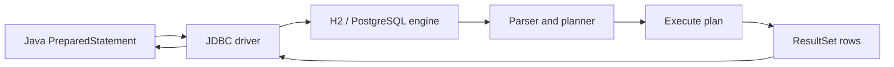

# Relational and SQL Basics

> **Status:** Completed  
> **Module:** 33 — Databases and JDBC  
> **Target Java version:** 21  
> **Last reviewed:** 2026-11-11  
> **Chapter profile:** Technical  
> **Depth target:** Level 3 (relational model, SQL DML/DDL, joins, ACID overview)  
> **Examples verified with:** SQL executed via [h2-jdbc-demo](../../examples/backend/h2-jdbc-demo/) on Temurin JDK 21.0.12.1; H2 2.3.232

## 1. Learning Objectives

After completing this chapter, you should be able to:

- Explain **relational** tables, rows, **primary keys**, **foreign keys**, and **indexes** in terms a JDBC program will touch.
- Write core **DML**: `SELECT`, `INSERT`, `UPDATE`, `DELETE`, with predicates and explicit column lists.
- Write **JOIN** queries that express foreign-key relationships without accidental Cartesian products.
- Describe **ACID** at a transaction overview level (isolation detail in Ch.03).
- Recognize **SQL injection** as a Java concern preview and why parameterized SQL (Ch.02) exists.

## 2. Prerequisites

- Module **12** — collections as an in-memory key/value mental model for maps keyed by id.
- Module **11** — strings and why concatenating user input into commands is unsafe.

**Refresher — set-based logic:** SQL operates on *sets* of rows. A Java `for` loop that updates rows one-by-one is imperative; SQL expresses the rule once and the engine applies it to matching rows.

## 3. Why This Concept Exists

Most enterprise Java persists data in **relational database management systems** (RDBMS): PostgreSQL, MySQL, Oracle, SQL Server, and embedded engines like **H2** for tests. **SQL** (Structured Query Language) is the shared language those engines understand. Your application does not store durable user records only in heap objects; it sends SQL through **JDBC** (Ch.02), and later through **JPA** (Module **35**), which still compiles down to SQL.

Understanding tables, keys, and joins prevents a common failure mode: treating the ORM as a black box and being surprised by duplicate rows, missing constraints, or `NULL` semantics in production queries.

## 4. Conceptual Explanation

### 4.1 The relational model

A **relation** (table) is a named set of rows with a fixed **schema** (column names and types). Each row is a **tuple**; columns are **attributes**.

| Term | Meaning |
|------|---------|
| Table | Named relation with typed columns |
| Row | One record in a table |
| Column | Named attribute with a SQL type (`INT`, `VARCHAR`, `TIMESTAMP`, …) |
| Primary key (PK) | Column(s) that uniquely identify a row within the table |
| Foreign key (FK) | Column(s) referencing another table’s PK (referential integrity) |
| Index | Auxiliary structure (often B-tree) speeding lookups by key columns |
| Constraint | Rule enforced by the DB (`NOT NULL`, `UNIQUE`, `CHECK`, FK) |
| Normalization | Decompose tables to reduce update anomalies; denormalize only when measured |

**Referential integrity:** if `orders.user_id` references `users.id`, the database (when configured) rejects inserts of orphan `user_id` values and may restrict deletes of parents still referenced.

### 4.2 SQL command classes

| Class | Purpose | Examples |
|-------|---------|----------|
| DDL | Define schema | `CREATE TABLE`, `ALTER`, `DROP` |
| DML | Read/write data | `SELECT`, `INSERT`, `UPDATE`, `DELETE` |
| DCL | Permissions | `GRANT`, `REVOKE` |
| TCL | Transactions | `BEGIN`, `COMMIT`, `ROLLBACK` (dialect-specific) |

Java JDBC code most often issues **DML** and reads `ResultSet` rows from `SELECT`.

### 4.3 ACID (overview)

Transactions group statements into **atomic** units (Ch.03):

- **Atomicity** — all statements commit or none do.
- **Consistency** — constraints and invariants hold after commit.
- **Isolation** — concurrent transactions have defined visibility rules (isolation levels in Ch.03).
- **Durability** — committed changes survive process crash (typically write-ahead log on disk).

Embedded H2 in-memory (handbook demos) optimizes for tests; production PostgreSQL/MySQL durability semantics matter for real outages.

## 5. Mechanism and Execution Flow

### 5.1 How a `SELECT` reaches JDBC



1. JDBC sends parameterized SQL text and bind values.
2. The driver encodes the wire protocol (or in-process calls for embedded H2).
3. The engine parses SQL, chooses a plan (index seek vs table scan), executes.
4. Rows stream back; `ResultSet.next()` advances the cursor (Ch.02).

### 5.2 Primary key and index seek

For `SELECT name FROM users WHERE id = ?`, if `id` is the PK, the planner typically uses a **unique index seek**—O(log n) B-tree lookup rather than a full table scan.

### 5.3 Join execution (conceptual)

`JOIN` combines rows from two tables where the **join predicate** matches. An `INNER JOIN` returns only matching pairs; `LEFT JOIN` preserves left-side rows with `NULL` fill for non-matches.

Missing `ON` or `WHERE` join conditions can produce a **Cartesian product** (every left row paired with every right row)—a frequent production incident.

## 6. Terminology

| Term | Meaning |
|------|---------|
| Tuple / row | One record |
| Cardinality | Number of rows returned or in a table (context-dependent) |
| Predicate | Boolean condition in `WHERE`, `ON`, `HAVING` |
| Literal | Constant in SQL (`'Ada'`, `42`) |
| Bind parameter | Placeholder (`?` in JDBC) supplied at execution time |
| Surrogate key | Meaningless integer PK (`IDENTITY`) vs natural key (email, ISBN) |
| DDL | Data definition language |
| DML | Data manipulation language |

## 7. Syntax and Language Rules

### 7.1 DDL example (handbook schema)

```sql
CREATE TABLE IF NOT EXISTS users (
    id INT PRIMARY KEY,
    name VARCHAR(64) NOT NULL
);
```

`IF NOT EXISTS` makes re-runs idempotent in demos; migrations (Module **34**) version DDL instead of ad hoc creates.

### 7.2 DML — insert/upsert pattern used in demo

H2 **`MERGE`** upserts by key (demo uses `KEY(id)`):

```sql
MERGE INTO users KEY(id) VALUES (1, 'Ada');
```

Portable alternative: `INSERT … ON CONFLICT` (PostgreSQL) or application-level select-then-update.

### 7.3 Query with predicate

```sql
SELECT name FROM users WHERE id = 1;
```

Prefer **`?`** in Java (Ch.02), not literal `1` from concatenated strings.

### 7.4 JOIN example (orders schema)

```sql
SELECT u.name, o.total_cents
FROM users u
JOIN orders o ON o.user_id = u.id
WHERE u.id = 1;
```

Run against your schema—the handbook does not invent join result rows without a runnable demo.

## 8. Step-by-Step Examples

**Demo:** [h2-jdbc-demo](../../examples/backend/h2-jdbc-demo/) creates `users`, merges Ada, selects by id, counts rows.

**Verified output (Temurin 21.0.12.1; manual `javac`/`java -cp` with H2 2.3.232):**

```text
name=Ada
rowCount=1
jdbcH2=ok
```

**Important lines in `JdbcH2Demo`:** `CREATE TABLE IF NOT EXISTS` establishes schema; `MERGE INTO users KEY(id)` ensures idempotent demo runs; `PreparedStatement` with `?` for `SELECT` is the injection-safe pattern taught in Ch.02.

### 8.1 Aggregation sketch (reporting)

```sql
SELECT dept, COUNT(*) AS headcount
FROM employees
GROUP BY dept
HAVING COUNT(*) >= 5;
```

`HAVING` filters *groups* after `GROUP BY`; `WHERE` filters rows before grouping.

## 9. Real-World Use Cases

- **OLTP API:** normalized schema (users, orders, line items) with FKs and short transactions.
- **Reporting:** heavier `SELECT` with aggregations, sometimes on read replicas.
- **Migrations:** versioned DDL in Module **34**, not manual `ALTER` in production.

## 10. Internal Behavior

H2 in-memory stores data in the JVM heap for the lifetime of the database process; `DB_CLOSE_DELAY=-1` in the demo URL keeps the in-memory DB alive while connections exist. Production engines page data to disk, buffer pool caches hot pages, and WAL ensures durability.

Identifier case: unquoted identifiers may be uppercased or lowercased depending on DB—quote (`"User"`) only when necessary; JPA uses `@Table(name = "app_user")` to avoid reserved words (Module **35**).

## 11. Edge Cases and Limitations

- **`NULL`:** `NULL = NULL` is *unknown*, not true; use `IS NULL` / `IS NOT NULL`. JDBC `ResultSet.wasNull()` matters after `getInt` on nullable columns.
- **Three-valued logic:** `WHERE` filters keep rows only when the predicate is **true**, not unknown.
- **Dialect differences:** `MERGE`, pagination (`LIMIT`), and `BOOLEAN` types vary—test on target engine.
- **N+1 queries:** ORM loading pattern (Module **35**) issues one query per associated row if fetch plans are wrong—not a SQL syntax bug but a SQL *shape* problem.

## 12. Common Mistakes

### Incorrect

```java
String sql = "SELECT * FROM users WHERE id = " + userId; // SQL injection
```

### Corrected

Use **`PreparedStatement`** with `?` bind parameters (Ch.02). The driver sends parameters separately from SQL text.

### Incorrect

`SELECT *` in public APIs—adding a column changes application mapping silently.

### Corrected

Explicit column lists: `SELECT id, name FROM users …`.

## 13. Best Practices

- **Primary key on every table** (surrogate `BIGINT` or UUID strategy documented at service level).
- **Foreign keys** where the engine supports them—catch orphans at write time.
- **Indexes** on columns used in `WHERE` / join predicates—validate with `EXPLAIN` (Module **34**).
- **Never** build SQL by concatenating untrusted input.

## 14. Design Trade-offs

| Choice | Benefit | Cost |
|--------|---------|------|
| Normalized schema | Fewer update anomalies | More joins for reads |
| Denormalized read models | Faster reads | Redundant data, harder updates |
| Surrogate keys | Stable references | Extra column, no business meaning |
| Natural keys | Meaningful | Harder migrations when format changes |

## 15. Performance Considerations

Indexes speed reads and slow writes (index maintenance). Over-indexing hurts insert throughput. Full table scans on large tables dominate latency—fix schema and queries, not JDBC buffer sizes alone.

## 16. Security Considerations

SQL injection is an application-layer failure: always parameterize. Least-privilege DB users (`SELECT`-only accounts for reporting). Avoid storing secrets in plain text columns.

## 17. Java Version and Compatibility Notes

JDBC is part of Java SE; handbook targets **Java 21**. SQL dialect is engine-specific—H2 approximates other engines but is not a substitute for integration tests on PostgreSQL/MySQL (Testcontainers noted in PROGRESS for Spring modules).

## 18. Revision and Mastery

- Why does `LEFT JOIN` differ from `INNER JOIN` for optional relationships?
- What does a missing join condition do to row counts?
- How does `NULL` behave in `WHERE col = ?` when `col` is NULL?

## 19. Exercises

1. Add an `orders` table with FK to `users`; write a join query returning order ids and user names (H2 or Testcontainers).
2. Write a query using `GROUP BY` and explain what `HAVING` filters.
3. Explain why `MERGE` in the demo is safer than delete-then-insert for idempotent tests.

## 20. Interview Questions

- Difference between clustered and non-clustered index (engine-specific—explain conceptually)?
- What is a foreign key cascade delete and when is it dangerous?

## 21. Solutions

**JOIN:** `INNER` keeps matches only; `LEFT` keeps all left rows. **Cartesian product:** *n×m* rows without predicate. **NULL:** unknown truth value; comparisons with NULL yield unknown.

## 22. Chapter Summary

Relational SQL models durable data Java services access through JDBC. The handbook H2 demo verifies `name=Ada` and `rowCount=1` for concrete `CREATE`, `MERGE`, `SELECT`, and `COUNT` statements. Keys, joins, and ACID set up transactions and ORM chapters.

## 23. Key Terminology

Primary key · foreign key · index · DML · join · ACID · NULL · parameterization

## 24. References and Further Reading

- [JDBC overview (Java 21)](https://docs.oracle.com/en/java/javase/21/docs/api/java.sql/java/sql/package-summary.html)
- [H2 SQL grammar](https://www.h2database.com/html/grammar.html)

## 25. Next Steps

[02-jdbc-fundamentals.md](02-jdbc-fundamentals.md)

## Supplement — Join types and normalization (Level 3 depth)

### Join reference

| Join | Keeps |
|------|-------|
| `INNER JOIN` | Matching rows from both sides |
| `LEFT [OUTER] JOIN` | All left rows; NULLs for non-matching right |
| `RIGHT JOIN` | Mirror of left |
| `FULL OUTER JOIN` | Union of left and right preservation (not all engines) |
| `CROSS JOIN` | Cartesian product—rarely intentional |

### First normal form (practical)

Each column holds atomic values; no repeating groups. Arrays in PostgreSQL JSON columns are a deliberate denormalization—document the trade-off.

### Second / third normal form (intuition)

- **2NF:** no partial dependency of non-key attributes on part of a composite PK.
- **3NF:** no transitive dependency (non-key → non-key).

ORM entities often map one table per class at 3NF; reporting views may denormalize.

### Handbook SQL trace (mental model)

```text
CREATE TABLE users → MERGE id=1 'Ada' → SELECT name WHERE id=1 → COUNT(*)
```

That sequence is exactly what `JdbcH2Demo` runs before printing `jdbcH2=ok`.

### Sample schema for join practice (Illustrative DDL)

```sql
CREATE TABLE orders (
    id INT PRIMARY KEY,
    user_id INT NOT NULL,
    total_cents INT NOT NULL,
    FOREIGN KEY (user_id) REFERENCES users(id)
);
```

Foreign key enforcement depends on engine configuration; H2 supports FK constraints when explicitly declared. Insert order: parent `users` row before child `orders`.

### NULL exercises (three-valued logic)

| Expression | Result when `col` IS NULL |
|----------|---------------------------|
| `col = NULL` | unknown (not true) |
| `col IS NULL` | true |
| `WHERE col = 1` | row excluded |

JDBC: `rs.getString("name")` returns `null` for SQL NULL; distinguish from empty string `''`.

### DELETE and UPDATE predicates

Always scope destructive SQL:

```sql
UPDATE users SET name = ? WHERE id = ?;
DELETE FROM users WHERE id = ?;
```

Missing `WHERE` on `UPDATE`/`DELETE` touches every row—a classic operations incident. Integration tests should assert affected row counts via `executeUpdate()` return value.

### BETWEEN and IN

```sql
SELECT id FROM users WHERE id BETWEEN 1 AND 100;
SELECT id FROM users WHERE id IN (1, 2, 3);
```

Bind IN lists with `PreparedStatement` using expanded placeholders or temporary tables for large sets (engine-specific).

### UNION vs UNION ALL

`UNION` removes duplicates (sort/hash cost); `UNION ALL` concatenates sets. Reporting queries often prefer `UNION ALL` when branches are disjoint by construction.

### Read vs write query temperament

OLTP Java services favor short, indexed point lookups and small-range scans. Analytic `GROUP BY` over full history belongs on replicas or warehouse engines—not mixed blindly into request threads without timeout and resource limits.

### Handbook-to-production bridge

| Demo (H2 mem) | Production analogue |
|---------------|---------------------|
| `CREATE TABLE IF NOT EXISTS` | Flyway `V1__init.sql` |
| `MERGE` idempotent seed | Test fixture or migration seed |
| `sa` empty password | Rotated DB user + secrets manager |
| Single-connection `main` | Pool + one transaction per use case |

### Constraint catalog

- **PRIMARY KEY** — uniqueness + NOT NULL; one per table (typical).
- **UNIQUE** — alternate business keys (`email`).
- **NOT NULL** — required columns; watch ORM nullable defaults.
- **CHECK** — row predicate (`balance >= 0`); support varies.
- **FOREIGN KEY** — referential integrity; `ON DELETE CASCADE` is explicit opt-in.

### Subquery in FROM (derived table)

```sql
SELECT avg_by_dept.dept, avg_by_dept.avg_salary
FROM (
  SELECT dept, AVG(salary) AS avg_salary
  FROM employees
  GROUP BY dept
) AS avg_by_dept
WHERE avg_by_dept.avg_salary > 100000;
```

Derived tables clarify multi-step analytics before JDBC maps final rows.

### SQL injection review questions

1. Does every dynamic predicate use bind parameters?
2. Are sort column names allow-listed (never concatenated from user input)?
3. Are dynamic identifiers quoted with validation?

Ch.02 implements binding; this chapter frames the threat at SQL layer.

### INTEGER and VARCHAR in H2 demo

`users.id INT PRIMARY KEY` maps to JDBC `getInt`; `name VARCHAR(64)` to `getString`. Widening `VARCHAR` later is a migration concern (Module **34**).

### Cross-module verified trail

1. This chapter — SQL semantics and `Ada` row meaning.
2. Ch.02 — JDBC binds producing stdout.
3. Module **34** — `COUNT(*)` aggregation on same table.
4. Module **35** — separate `app_user` entity table in JPA demo (different PU).

Keeping demos small avoids conflating JDBC `users` with JPA `app_user` schemas.

## Review Checklist

- [x] SQL tied to verified JDBC output on Temurin 21.0.12.1
- [x] Mechanism and Execution Flow present
- [x] Chapter profile Technical; depth Level 3
- [x] Preserved verified `Ada` / `rowCount=1` results
- [x] Revision and Mastery included
