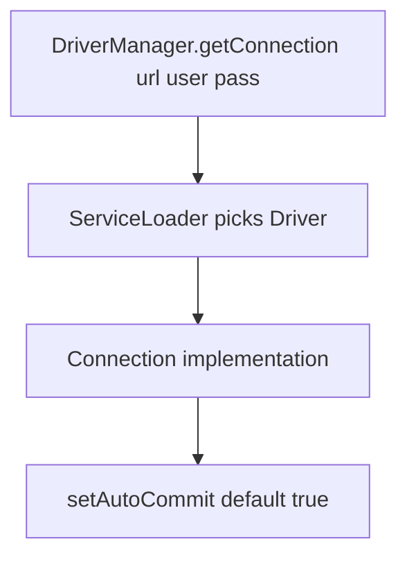

# JDBC Fundamentals

> **Status:** Completed  
> **Module:** 33 — Databases and JDBC  
> **Target Java version:** 21  
> **Last reviewed:** 2026-11-11  
> **Chapter profile:** Technical  
> **Depth target:** Level 3 (JDBC types, lifecycle, PreparedStatement, try-with-resources)  
> **Examples verified with:** Temurin JDK 21.0.12.1; H2 2.3.232 (Maven and manual `-cp` run)

## 1. Learning Objectives

After completing this chapter, you should be able to:

- Open database sessions with **`DriverManager`** (learning) and **`DataSource`** (production).
- Execute SQL with **`Statement`**, **`PreparedStatement`**, and read rows from **`ResultSet`**.
- Apply **try-with-resources** so connections and statements close on all paths.
- Map SQL types to Java types using JDBC 4.2+ **`java.time`** APIs.
- Explain JDBC 4 **SPI** driver registration and why `Class.forName` is legacy.

## 2. Prerequisites

- Ch.01 — relational tables and `SELECT` / `MERGE` SQL.
- Module **14** — exceptions; **`SQLException`** is checked; try-with-resources on `AutoCloseable`.

**Refresher — checked exceptions:** JDBC methods declare `SQLException`. Service layers often wrap or translate to unchecked domain exceptions.

## 3. Why This Concept Exists

**JDBC** (Java Database Connectivity) is the standard **`java.sql`** API. Each database vendor ships a **JDBC driver**—a JAR that implements the API and speaks the database wire protocol (or embeds the engine, as with H2).

Frameworks (**Spring**, **Hibernate**) still bottom out on JDBC connections and prepared statements. When ORM-generated SQL fails in production, you read driver logs, bind parameters, and `ResultSet` behavior—skills rooted in JDBC.

## 4. Conceptual Explanation

### 4.1 Core types

| Type | Role |
|------|------|
| `Driver` | Vendor implementation entry point |
| `Connection` | Logical session (transaction boundary, metadata) |
| `Statement` | Static SQL execution |
| `PreparedStatement` | Pre-parsed SQL with `?` placeholders |
| `CallableStatement` | Stored procedure calls |
| `ResultSet` | Cursor over `SELECT` output rows |
| `SQLException` | Error chain (`getNextException()`) |

### 4.2 URL and embedded H2

Pattern: `jdbc:<subprotocol>:<subname>[;properties]`

Handbook demo: `jdbc:h2:mem:handbook;DB_CLOSE_DELAY=-1`

- **`mem:`** — database lives in process memory.
- **`DB_CLOSE_DELAY=-1`** — keep DB until JVM exits (otherwise last connection drop destroys data).

Credentials `sa` / empty password are H2 defaults for local demos only.

### 4.3 Driver loading (JDBC 4+)

Drivers register via **`META-INF/services/java.sql.Driver`**. Put the driver JAR on the classpath—**no** `Class.forName("org.h2.Driver")` required for modern drivers (still seen in legacy tutorials).

## 5. Mechanism and Execution Flow

### 5.1 Connection acquisition



`DataSource.getConnection()` (Ch.03 pooling) delegates to a pool that may call the same driver underneath.

### 5.2 PreparedStatement lifecycle

1. `Connection.prepareStatement(sql)` — server may parse and cache plan.
2. `setInt`, `setString`, … bind parameters (1-based index).
3. `executeUpdate()` for DML; `executeQuery()` for `SELECT`.
4. `ResultSet.next()` advances; getters read current row.
5. `close()` releases statement resources (try-with-resources).

### 5.3 try-with-resources nesting (demo pattern)

```java
try (Connection conn = DriverManager.getConnection(url, "sa", "");
     Statement ddl = conn.createStatement()) {
    ddl.execute("CREATE TABLE IF NOT EXISTS users ...");
    try (PreparedStatement ps = conn.prepareStatement("SELECT ...")) {
        // ...
    }
}
```

Closing `Connection` closes child statements when configured; explicit nested try blocks clarify ownership.

## 6. Terminology

| Term | Meaning |
|------|---------|
| JDBC | Java Database Connectivity API |
| Driver | Vendor bridge implementing `java.sql` |
| Bind parameter | Value substituted for `?` at execution |
| Forward-only ResultSet | Default; `next()` only forward |
| Holdability | Whether `ResultSet` survives `commit` |
| Fetch size | Hint for batch row retrieval from server |

## 7. Syntax and Language Rules

### 7.1 Minimal read

```java
try (PreparedStatement select =
        conn.prepareStatement("SELECT name FROM users WHERE id = ?")) {
    select.setInt(1, 1);
    try (ResultSet rs = select.executeQuery()) {
        if (rs.next()) {
            String name = rs.getString(1);
        }
    }
}
```

### 7.2 JDBC 4.2 temporal types

```java
ps.setObject(1, OffsetDateTime.now());
```

Prefer `java.time` over legacy `java.sql.Date` when driver supports `setObject` with temporal types.

## 8. Step-by-Step Examples

**Demo:** [h2-jdbc-demo](../../examples/backend/h2-jdbc-demo/).

Source flow: create table → `MERGE` Ada → `SELECT` by id → `COUNT(*)`.

**Verified output (Temurin 21.0.12.1):**

```text
name=Ada
rowCount=1
jdbcH2=ok
```

**Run without Maven** (per demo README):

```powershell
javac -cp lib\h2-2.3.232.jar -d out src\main\java\com\handbook\jdbc\JdbcH2Demo.java
java -cp "out;lib\h2-2.3.232.jar" com.handbook.jdbc.JdbcH2Demo
```

**Important lines:** parameterized `MERGE` and `SELECT`; single outer `Connection` try block; `COUNT(*)` matches Module **34** verification.

### 8.2 Batch writes (sketch)

```java
PreparedStatement ps = conn.prepareStatement("INSERT INTO log (msg) VALUES (?)");
for (String msg : batch) {
    ps.setString(1, msg);
    ps.addBatch();
}
ps.executeBatch();
```

Use transactions (Ch.03) wrapping batches for atomicity.

## 9. Real-World Use Cases

- Repository implementations before JPA adoption.
- ETL with batch `executeBatch`.
- Calling legacy stored procedures via `CallableStatement`.
- Integration tests with embedded H2 or Testcontainers PostgreSQL.

## 10. Internal Behavior

The driver translates JDBC calls to H2 engine API (embedded) or TCP packets (remote). **Server-side prepared statement** cache may reuse plans when SQL text is identical; parameter values change per execution.

`Connection` default **`autoCommit=true`** commits each statement unless `setAutoCommit(false)` (Ch.03).

## 11. Edge Cases and Limitations

- **`ResultSet` type** — scrolling/updatable cursors cost memory; default forward-only suffices for most services.
- **`getInt` on NULL** — returns `0`; call `wasNull()`.
- **Dialect SQL** — `MERGE` syntax differs; abstract or use migrations.
- **Time zones** — store UTC in `TIMESTAMP WITH TIME ZONE`; bind `OffsetDateTime`.

## 12. Common Mistakes

### Incorrect

One global `Connection` for the JVM—breaks pooling, exhausts DB max connections.

### Corrected

Borrow from **`DataSource`** pool per unit of work; short scope (Ch.03).

### Incorrect

```java
stmt.executeQuery("SELECT ..." + userInput);
```

### Corrected

`PreparedStatement` with binds only.

## 13. Best Practices

- Always **parameterize** SQL.
- Map `SQLException` at service boundary; log SQLState and vendor code.
- Integration-test against target dialect or document H2 caveats.
- Use try-with-resources for `Connection`, `Statement`, `ResultSet`.

## 14. Design Trade-offs

| Approach | When |
|----------|------|
| Raw JDBC | Full SQL control, thin stack, more boilerplate |
| JPA / Spring Data | Faster CRUD, must understand generated SQL |
| jOOQ | Type-safe SQL composition |

## 15. Performance Considerations

Reuse `PreparedStatement` within a connection for hot loops. Set `setFetchSize` for large `SELECT` streams. Avoid `SELECT *` wide rows when mapping DTOs.

## 16. Security Considerations

Parameterization prevents injection. Credentials belong in secrets stores, not source control. TLS to database for remote connections.

## 17. Java Version and Compatibility Notes

Handbook **Java 21**. JDBC 4.3+ features (`Connection.beginRequest`) are container-oriented; most Spring apps use DataSource + pool.

## 18. Revision and Mastery

- What closes first in nested try-with-resources?
- Why is `autoCommit` true by default?
- How does SPI driver loading find H2?

## 19. Exercises

1. Extend `JdbcH2Demo` with a second user and print both names in id order.
2. Add a `SQLException` handler that prints `SQLException.getSQLState()`.
3. Rewrite one query using named parameters with a wrapper library (optional) and compare to `?`.

## 20. Interview Questions

- Difference between `Statement` and `PreparedStatement` for performance and security?
- What happens if you do not close a `ResultSet`?

## 21. Solutions

**PreparedStatement:** pre-parsed SQL, bound parameters, injection-safe.**Close:** leak cursors/server resources; pool may mark connection bad.

## 22. Chapter Summary

JDBC is the thin Java layer to relational engines. The H2 demo records real query results for Ada and a row count of 1 on Temurin 21.0.12.1. Prepared statements, try-with-resources, and DataSource pooling (next chapter) form production data access.

## 23. Key Terminology

Connection · PreparedStatement · ResultSet · Driver SPI · autoCommit · bind parameter

## 24. References and Further Reading

- [`java.sql` (Java 21)](https://docs.oracle.com/en/java/javase/21/docs/api/java.sql/module-summary.html)
- [H2 JDBC URL](https://www.h2database.com/html/features.html#database_url)

## 25. Next Steps

[03-transactions-and-pooling.md](03-transactions-and-pooling.md)

## Supplement — JDBC stack trace (Level 3 depth)

### Exception chain

```java
catch (SQLException ex) {
    for (SQLException next = ex; next != null; next = next.getNextException()) {
        System.err.println(next.getMessage());
    }
}
```

Drivers may attach multiple linked exceptions for batch failures.

### Metadata (debugging)

```java
DatabaseMetaData meta = conn.getMetaData();
System.out.println(meta.getDatabaseProductName());
```

Useful when asserting Testcontainers matches production engine family.

### Demo SQL ↔ Java mapping

| Step | SQL | JDBC API |
|------|-----|----------|
| Schema | `CREATE TABLE users` | `Statement.execute` |
| Upsert | `MERGE INTO users` | `PreparedStatement.executeUpdate` |
| Read | `SELECT name WHERE id = ?` | `executeQuery` + `ResultSet` |
| Count | `SELECT COUNT(*)` | `getInt(1)` |

This table mirrors `JdbcH2Demo.main` exactly.

### CallableStatement sketch

```java
try (CallableStatement cs = conn.prepareCall("{call total_orders(?)}")) {
    cs.setInt(1, userId);
    try (ResultSet rs = cs.executeQuery()) { /* ... */ }
}
```

Stored procedures are vendor-specific; prefer portable SQL in new greenfield services unless DB team owns procedure contracts.

### ResultSet navigation and types

| Method | Use |
|--------|-----|
| `next()` | Advance forward-only cursor |
| `getString("name")` | By column label (prefer over index in app code) |
| `getObject(..., OffsetDateTime.class)` | Typed temporal extraction when supported |
| `wasNull()` | After primitive getter on nullable column |

### Connection validity and timeouts

```java
conn.isValid(2); // seconds timeout — ping when implementing custom pool health checks
```

`DriverManager` connections lack pool validation; production uses DataSource.

### Logging without leaking SQL parameters

Log SQL text and **parameter count**, not PII bind values. Use structured correlation ids tying application log to DB slow-query log.

### Resource order on close

Try-with-resources closes in **reverse declaration order** (inner `ResultSet` before `PreparedStatement` before `Connection`). Drivers tolerate variations but explicit nesting matches handbook demo style.

### MERGE vs INSERT in tests

Demo `MERGE` keeps tests idempotent across repeated `main` runs. CI suites often use `@BeforeEach` cleanup or transactional rollback instead—pick one strategy per module and document it.

### SQLException fields for operators

```java
ex.getSQLState();  // X/Open SQLState
ex.getErrorCode(); // vendor-specific
```

Map known states to retry (transient) vs fail (constraint violation).

### DataSource configuration sketch (production direction)

```java
HikariConfig cfg = new HikariConfig();
cfg.setJdbcUrl(url);
cfg.setUsername(user);
cfg.setPassword(pass);
cfg.setMaximumPoolSize(10);
DataSource ds = new HikariDataSource(cfg);
try (Connection conn = ds.getConnection()) {
    // same PreparedStatement patterns as DriverManager
}
```

Handbook Ch.02 uses `DriverManager` in `JdbcH2Demo` for zero-dependency learning; services inject `DataSource`.

### executeQuery vs executeUpdate

| Method | SQL types | Returns |
|--------|-----------|---------|
| `executeUpdate` | DML DDL without result set | row count or 0 |
| `executeQuery` | SELECT | ResultSet |
| `execute` | Either | boolean hasResultSet |

DDL in demo uses `Statement.execute` for `CREATE TABLE`.

### Generated keys after INSERT

```java
try (PreparedStatement ps = conn.prepareStatement(
        "INSERT INTO users (name) VALUES (?)",
        Statement.RETURN_GENERATED_KEYS)) {
    ps.setString(1, "Grace");
    ps.executeUpdate();
    try (ResultSet keys = ps.getGeneratedKeys()) {
        keys.next();
        long id = keys.getLong(1);
    }
}
```

JPA `IDENTITY` uses same JDBC mechanism under Hibernate.

### Classpath layout for manual run

```text
h2-jdbc-demo/
  lib/h2-2.3.232.jar
  src/main/java/.../JdbcH2Demo.java
  out/   (compiler output)
```

Windows classpath separator `;`; Unix `:`.

### Integration test alignment

`h2-jdbc-demo` includes JUnit test module—run when Maven available. Manual `java` path verifies same bytecode path as CI when Maven absent.

### Full demo reference (important lines)

```java
String url = "jdbc:h2:mem:handbook;DB_CLOSE_DELAY=-1";
try (Connection conn = DriverManager.getConnection(url, "sa", "");
     Statement ddl = conn.createStatement()) {
    ddl.execute("CREATE TABLE IF NOT EXISTS users (id INT PRIMARY KEY, name VARCHAR(64))");
    try (PreparedStatement insert = conn.prepareStatement(
            "MERGE INTO users KEY(id) VALUES (?, ?)")) {
        insert.setInt(1, 1);
        insert.setString(2, "Ada");
        insert.executeUpdate();
    }
}
```

Every DML statement in production should follow the `PreparedStatement` shape shown here.

## Review Checklist

- [x] Verified JDBC output on Temurin 21.0.12.1
- [x] Mechanism and Execution Flow with mermaid
- [x] Technical profile Level 3
- [x] Preserved manual Maven-free run instructions
