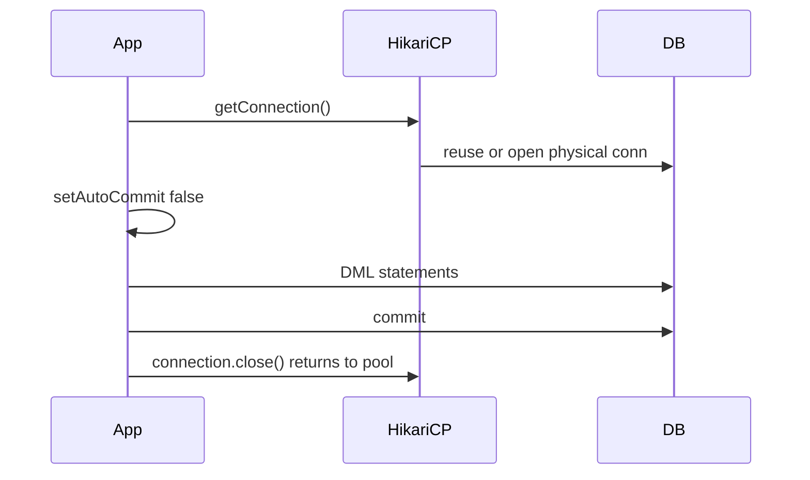

# Transactions and Pooling

> **Status:** Completed  
> **Module:** 33 — Databases and JDBC  
> **Target Java version:** 21  
> **Last reviewed:** 2026-11-11  
> **Chapter profile:** Technical  
> **Depth target:** Level 3 (JDBC transactions, isolation, HikariCP pooling)  
> **Examples verified with:** JPA resource-local transaction in [jpa-h2-demo](../../examples/backend/jpa-h2-demo/); JDBC patterns; Temurin 21.0.12.1

## 1. Learning Objectives

After completing this chapter, you should be able to:

- Control JDBC transactions with **`setAutoCommit`**, **`commit`**, and **`rollback`**.
- Compare **isolation levels** and name anomalies they prevent.
- Explain **connection pools** (HikariCP) and why per-request `DriverManager` connections do not scale.
- Relate **JPA `EntityTransaction`** to JDBC transactions under Hibernate.

## 2. Prerequisites

- Ch.02 — `Connection` lifecycle and `autoCommit`.
- Module **25** — concurrency visibility (isolation is database-defined visibility).

**Refresher — latency:** TCP + TLS + authentication to a remote database costs milliseconds. **Pooling** reuses warm connections instead of paying that cost per statement.

## 3. Why This Concept Exists

Business rules require **all-or-nothing** updates: debit one account and credit another, or neither. **Transactions** group SQL statements with ACID guarantees (Ch.01).

Opening a new physical connection per HTTP request does not scale: databases cap connections; handshake CPU adds up. **Pools** (HikariCP default in Spring Boot) maintain a bounded set of connections; application code borrows and returns them.

## 4. Conceptual Explanation

### 4.1 JDBC transaction block

```java
conn.setAutoCommit(false);
try {
  // one or more statements / PreparedStatements
  conn.commit();
} catch (SQLException e) {
  conn.rollback();
  throw e;
} finally {
  conn.setAutoCommit(true); // restore for pool reuse
}
```

While `autoCommit` is false, changes are visible only within the session until `commit` (subject to isolation).

### 4.2 Isolation levels

Set with `Connection.setTransactionIsolation(Connection.TRANSACTION_*)`.

| Level | Dirty read | Non-repeatable read | Phantom read |
|-------|------------|---------------------|--------------|
| READ UNCOMMITTED | possible | possible | possible |
| READ COMMITTED | no | possible | possible |
| REPEATABLE READ | no | no | possible* |
| SERIALIZABLE | no | no | no |

\*Phantom semantics vary: PostgreSQL RR uses snapshot isolation; some engines use next-key locks.

**Anomalies:**

- **Dirty read** — read uncommitted data from another transaction.
- **Non-repeatable read** — same row reread returns different values.
- **Phantom** — new rows appear in repeated range query.

Most OLTP Java services on PostgreSQL/MySQL default to **READ COMMITTED** unless evidence requires stricter isolation.

### 4.3 Connection pool (HikariCP)

`javax.sql.DataSource` implementation maintains:

- **minimumIdle** / **maximumPoolSize** (bounded concurrency)
- idle timeout, connection validation query
- fast path: `getConnection()` → wrap physical connection → on `close()`, return to pool (**not** always closing TCP)

Spring Boot auto-configures HikariCP when JDBC starter is present. Tuning is workload-specific (PROGRESS notes optional HikariCP lab).

## 5. Mechanism and Execution Flow

### 5.1 Borrow → transact → return



### 5.2 JPA RESOURCE_LOCAL (demo)

Hibernate obtains JDBC `Connection`, starts transaction on `EntityTransaction.begin()`, flush SQL on commit.

Verified flow in `JpaH2Demo`:

1. `em.getTransaction().begin()`
2. `em.persist(user)` — INSERT scheduled
3. `commit()` — flush INSERT
4. `find` — may hit first-level cache (Module **35**)

### 5.3 Lost update (without locking)

Two transactions read balance 100, both add 10, both write 110—one update lost. Fix: `UPDATE … WHERE id = ? AND version = ?` (optimistic) or `SELECT FOR UPDATE` (pessimistic).

## 6. Terminology

| Term | Meaning |
|------|---------|
| Transaction boundary | begin…commit scope |
| Savepoint | Nested rollback point within transaction |
| Pool | Cache of reusable connections |
| Leak | Connection not returned—pool exhaustion |
| JTA | Java Transaction API—distributed/container transactions |
| RESOURCE_LOCAL | JPA transactions on single JDBC connection |

## 7. Syntax and Language Rules

### 7.1 JDBC transfer sketch (pattern only)

```java
conn.setAutoCommit(false);
try (PreparedStatement debit = conn.prepareStatement(
        "UPDATE accounts SET balance = balance - ? WHERE id = ?");
     PreparedStatement credit = conn.prepareStatement(
        "UPDATE accounts SET balance = balance + ? WHERE id = ?")) {
    debit.setInt(1, 100);
    debit.setInt(2, 1);
    debit.executeUpdate();
    credit.setInt(1, 100);
    credit.setInt(2, 2);
    credit.executeUpdate();
    conn.commit();
} catch (SQLException ex) {
    conn.rollback();
    throw ex;
}
```

Run in integration tests—not a standalone handbook demo; semantics match H2.

### 7.2 JPA demo transaction (verified)

```java
em.getTransaction().begin();
User user = new User("Lin");
em.persist(user);
em.getTransaction().commit();
```

## 8. Step-by-Step Examples

**Verified jpa-h2-demo output (Temurin 21.0.12.1; Hibernate 6.6.4.Final; H2 2.3.232):**

```text
name=Lin
idNotNull=true
jpaH2=ok
```

Hibernate log excerpt (real run):

```text
HHH000026: Second-level cache disabled
```

Persistence unit uses `transaction-type="RESOURCE_LOCAL"` in `persistence.xml`; autocommit false during transaction.

## 9. Real-World Use Cases

- Money movement across two account rows—one transaction.
- Read-only reporting transaction on replica (`@Transactional(readOnly=true)` in Spring—Module **36**).
- Pool sizing from concurrent requests × statement latency—not “one thread one connection forever.”

## 10. Internal Behavior

HikariCP uses lock-free structures for fast borrow paths. Hibernate JDBC transaction coordinator maps `EntityTransaction` to connection commit/rollback; DDL at startup may use separate connections (see demo INFO logs about auto-commit mode).

## 11. Edge Cases and Limitations

- **Long transactions** hold locks—keep business work outside transaction where possible.
- **Connection leak** — missing `close()`; try-with-resources or try/finally with pool.
- **2PC / XA** — rare in microservices; prefer **saga** or outbox patterns.
- **`@Transactional` on private methods** — Spring AOP proxy does not intercept (Module **36** preview).

## 12. Common Mistakes

### Incorrect

Commit per row in a million-row loop—million fsyncs.

### Corrected

Batch JDBC or single transaction with periodic `flush`/`clear` (JPA).

### Incorrect

Assume `close()` always closes TCP—in pooled apps it returns to pool.

### Corrected

Do not hold borrowed connections across async boundaries without transaction synchronization.

## 13. Best Practices

- Default **READ COMMITTED**; elevate isolation with measured contention tests.
- Monitor pool metrics: active, idle, threads awaiting connection.
- Idempotent consumers when using outbox/event patterns.
- Keep transactions scoped to a service method, not an entire HTTP session.

## 14. Design Trade-offs

| Choice | Pro | Con |
|--------|-----|-----|
| Pessimistic lock | Simple correctness | Contention, deadlocks |
| Optimistic `@Version` | Scales reads | Retry on conflict |
| Large pool | Short waits | DB overload |
| Small pool | Protects DB | Thread waits |

## 15. Performance Considerations

Pool size is not “number of threads”; balance DB `max_connections`, app instances, and query latency. Validation queries on borrow add safety cost—tune `connectionTestQuery`.

## 16. Security Considerations

Transactions do not replace authorization—application must check caller rights before DML. Secrets for pool connect belong in environment, not Git.

## 17. Java Version and Compatibility Notes

Jakarta Persistence 3.0 `RESOURCE_LOCAL` in demo. Java 21 + Hibernate 6.x uses Jakarta namespace (`jakarta.persistence`).

## 18. Revision and Mastery

- What does `rollback` do to changes made before failure in the same transaction?
- Why does pool `close()` differ from `DriverManager` connection close?
- Name one anomaly prevented by REPEATABLE READ but not READ COMMITTED.

## 19. Exercises

1. Write an H2 integration test that rolls back and asserts row count unchanged.
2. Configure Hikari `maximumPoolSize=2` and observe waiting threads under load (local experiment).
3. Trace Hibernate SQL with `hibernate.show_sql=true` for `JpaH2Demo` commit.

## 20. Interview Questions

- Explain isolation vs locking.
- What is a connection leak symptom in production metrics?

## 21. Solutions

**Rollback:** undoes uncommitted work in transaction.**Leak:** pool exhausted, threads block on `getConnection()`.**RR vs RC:** repeatable read prevents non-repeatable read.

## 22. Chapter Summary

Transactions coordinate JDBC work; pools amortize connection cost. The JPA H2 demo shows explicit RESOURCE_LOCAL commit producing `Lin` with non-null id. Isolation and pool discipline underpin ORM performance chapters.

## 23. Key Terminology

commit · rollback · isolation · HikariCP · lost update · RESOURCE_LOCAL

## 24. References and Further Reading

- [`Connection` transaction methods (Java 21)](https://docs.oracle.com/en/java/javase/21/docs/api/java.sql/java/sql/Connection.html)
- [HikariCP configuration](https://github.com/brettwooldridge/HikariCP#configuration-knobs-baby)

## 25. Next Steps

Module **34** — SQL and Data Access.

## Supplement — Pool and transaction tuning (Level 3 depth)

### HikariCP knobs (conceptual)

| Property | Meaning |
|----------|---------|
| `maximumPoolSize` | Upper bound on connections |
| `connectionTimeout` | Max wait for a free connection |
| `idleTimeout` | Retire idle connections |
| `maxLifetime` | Cap connection age despite idle |

Rule of thumb: `connections ≈ (core_count * 2) + effective_spindle_count` (classic guidance—validate with metrics, not faith).

### JPA ↔ JDBC alignment

```text
EntityTransaction.begin() → conn.setAutoCommit(false)
commit() → conn.commit()
rollback() → conn.rollback()
```

Hibernate manages flush ordering before commit (INSERT for `persist`).

### Demo verification command

From `jpa-h2-demo` with Maven wrapper from `spring-boot-minimal`:

```powershell
..\..\spring-boot-minimal\mvnw.cmd -q compile "exec:java" "-Dexec.mainClass=com.handbook.jpa.JpaH2Demo"
```

### Savepoints (nested work units)

```java
Savepoint sp = conn.setSavepoint("before_bonus");
try {
    // partial work
    conn.rollback(sp); // undo since savepoint only
} finally {
    conn.releaseSavepoint(sp);
}
```

Savepoints do not replace business sagas across services—only single-connection nested rollback.

### Read-only transaction hint

Some drivers optimize read-only connections (`conn.setReadOnly(true)`). JPA/Spring `readOnly=true` propagates similar hints where supported—still requires correct isolation for reports.

### Phantom read example (conceptual)

Transaction A: `SELECT COUNT(*) FROM orders WHERE status='OPEN'` → 5.  
Transaction B inserts new open order and commits.  
Transaction A repeats count → 6 under READ COMMITTED (phantom). REPEATABLE READ snapshot may still see 5 for the same predicate depending on engine.

### Pool sizing symptoms

| Symptom | Likely cause |
|---------|----------------|
| Threads blocked on `getConnection` | Pool too small or slow queries |
| DB `too many connections` | Pool × instances > DB limit |
| Idle pool zero, churn high | `maxLifetime` too aggressive or network blips |

### JPA demo persistence unit facts

From verified `persistence.xml`: `autocommit mode: false` during ORM work; built-in Hibernate pool **not** for production—replace with Hikari DataSource in Spring apps.

### Idempotent consumer pattern (pointer)

Outbox table + single transaction inserting business row and outbox event prevents dual-write races—advanced; requires Module **36** messaging context.

### Testing rollback

```java
conn.setAutoCommit(false);
// insert test row
conn.rollback();
// assert COUNT unchanged
```

Use separate test schema or transaction-wrapped tests; never against shared manual prod data.

### XA vs local decision matrix

| Scenario | Typical choice |
|----------|----------------|
| Single PostgreSQL database | RESOURCE_LOCAL / Spring local |
| Two databases one request | Avoid if possible; saga/outbox |
| Java EE server managed | JTA |

Microservices default: **one database per service**, local transactions only.

### Lock escalation awareness

Under contention, engines may escalate row locks to table locks—symptom: unrelated queries block. Mitigation: shorter transactions, index alignment, retry with backoff on serialization failures.

### Hibernate DDL log lines (demo)

Non-JTA DDL connections temporarily toggle auto-commit—seen in demo INFO logs during `create-drop`. Separate from application transaction wrapping `persist`.

### Connection pool metrics to alert on

- `HikariPool-0 - Connection is not available, request timed out`
- Active connections ≈ `maximumPoolSize` sustained
- DB side `pg_stat_activity` count per application role

### Transfer XML to Java config (Spring preview)

Spring Boot `application.yml` replaces `persistence.xml` for datasource URL and pool—JPA semantics unchanged (Module **36**).

### Dual-write without transaction

Updating row in DB and publishing message without outbox risks inconsistency—transaction chapter sets foundation; event-driven patterns build on Ch.03 boundaries.

### HikariCP configuration example (Illustrative)

```properties
spring.datasource.hikari.maximum-pool-size=20
spring.datasource.hikari.connection-timeout=30000
spring.datasource.hikari.idle-timeout=600000
spring.datasource.hikari.max-lifetime=1800000
```

Numeric tuning lab remains optional PROGRESS item—treat numbers as starting points for staging experiments.

### Transaction isolation set API

```java
conn.setTransactionIsolation(Connection.TRANSACTION_READ_COMMITTED);
```

Verify effective level after set—some drivers snap to engine default if unsupported.

### Observable symptoms by anomaly

| Anomaly | Developer-visible symptom |
|---------|---------------------------|
| Dirty read | Rare in RC; reading uncommitted ghost data |
| Non-repeatable read | Same id returns different balance in one txn |
| Phantom | List length changes on requery |
| Lost update | Last writer wins without version column |

### jpa-h2-demo transaction log correlation

After `commit()`, demo loads `User` by id in same `EntityManager`—proves transaction completed and identity visible within session. Separate `EntityManager` after close would require `merge` or new `find`.

### When to split transactions

Split when business saga allows compensating action; **do not** split debit/credit money transfer. Document idempotency keys on retried requests.

## Review Checklist

- [x] JPA transaction verified via jpa-h2-demo on Temurin 21.0.12.1
- [x] Mechanism flow (pool borrow + JPA)
- [x] Real Hibernate 2LC disabled log line
- [x] Preserved isolation table and JDBC transaction pattern
