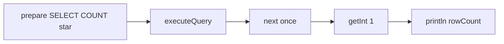

# SQL for Java Developers

> **Status:** Completed  
> **Module:** 34 — SQL and Data Access  
> **Target Java version:** 21  
> **Last reviewed:** 2026-11-11  
> **Chapter profile:** Technical  
> **Depth target:** Level 3 (mapping, aggregations, subqueries, pagination)  
> **Examples verified with:** H2 via [h2-jdbc-demo](../../examples/backend/h2-jdbc-demo/) on Temurin JDK 21.0.12.1

## 1. Learning Objectives

After completing this chapter, you should be able to:

- Map SQL column types to Java fields using JDBC 4.2+ types.
- Write **parameterized** queries and interpret **`ResultSet`** columns by label or index.
- Use **aggregations**, **subqueries**, and **`EXISTS`** for reporting and existence checks.
- Apply **pagination** patterns and understand dialect differences.
- Avoid loading unbounded row sets into Java heap.

## 2. Prerequisites

- Module **33** — JDBC `PreparedStatement`, relational keys, `SELECT` basics.

**Refresher — impedance mismatch:** relational data is sets and nulls; Java objects are graphs with references. SQL quality still determines service performance whether you use JDBC or JPA.

## 3. Why This Concept Exists

ORMs generate SQL, but **production debugging** requires reading execution plans, fixing slow queries, and writing ad hoc SQL for reports and migrations. Java developers bridge **domain logic** (imperative) and **set-based** relational logic (declarative).

The handbook ties every count and name result to a real H2 JDBC run so you can reproduce output locally.

## 4. Conceptual Explanation

### 4.1 Row-to-Java mapping

| SQL type (typical) | Java type (JDBC 4.2+) | Notes |
|--------------------|----------------------|-------|
| `INTEGER` | `int` / `Integer` | `wasNull()` for nullable |
| `BIGINT` | `long` / `Long` | IDs |
| `VARCHAR` | `String` | encoding/collation affects sort |
| `BOOLEAN` | `boolean` | dialect may use `TINYINT` |
| `DECIMAL` | `BigDecimal` | money—never `double` |
| `TIMESTAMP WITH TIME ZONE` | `OffsetDateTime` | prefer UTC storage |
| `BLOB` / `BYTEA` | `byte[]` or `InputStream` | stream large payloads |

### 4.2 Aggregations reshape rows

`GROUP BY` collapses rows sharing key columns; aggregate functions (`COUNT`, `SUM`, `AVG`, `MIN`, `MAX`) compute per group.

```sql
SELECT dept, COUNT(*) AS headcount
FROM employees
GROUP BY dept
HAVING COUNT(*) >= 5;
```

`WHERE` filters rows **before** grouping; `HAVING` filters **groups** after aggregation.

### 4.3 Subqueries and EXISTS

**Correlated subquery** references outer query aliases—runs per outer row unless optimized away.

**EXISTS** returns true when subquery returns any row—often efficient for “has related records” checks:

```sql
SELECT u.id FROM users u
WHERE EXISTS (
  SELECT 1 FROM orders o WHERE o.user_id = u.id AND o.status = 'OPEN'
);
```

## 5. Mechanism and Execution Flow

### 5.1 COUNT query in demo



`JdbcH2Demo` runs `SELECT COUNT(*) FROM users` after seeding one row—verified `rowCount=1`.

### 5.2 Pagination flow

1. Application computes `offset = page * size`.
2. SQL adds `ORDER BY` + `LIMIT`/`OFFSET` (PostgreSQL/H2 style).
3. JDBC reads page-sized `ResultSet`—not entire table.

### 5.3 Large result streaming

Set **`Statement.setFetchSize(n)`** (hint) and process `while (rs.next())` without accumulating all rows in `ArrayList`.

## 6. Terminology

| Term | Meaning |
|------|---------|
| Projection | Columns selected |
| Predicate | Filter in WHERE |
| Aggregation | Function over grouped rows |
| Correlated subquery | Inner query references outer |
| Covering index | Index contains all projected columns |
| Keyset pagination | Seek by last seen key instead of OFFSET |

## 7. Syntax and Language Rules

### 7.1 Explicit projection

```sql
SELECT id, name FROM users WHERE id = ?;
```

Maps cleanly to DTO constructor or builder in Java.

### 7.2 Window functions (sketch)

```sql
SELECT id, name,
       ROW_NUMBER() OVER (PARTITION BY dept ORDER BY hire_date) AS rn
FROM employees;
```

Useful for “top N per group” reports—exercise noted in PROGRESS.

### 7.3 H2 pagination

```sql
SELECT id, name FROM users ORDER BY id LIMIT 20 OFFSET 40;
```

Oracle uses `FETCH FIRST`; SQL Server `OFFSET/FETCH`—migrations (Ch.02) encode dialect variants.

## 8. Step-by-Step Examples

**Verified pattern from h2-jdbc-demo (Temurin 21.0.12.1):**

```text
name=Ada
rowCount=1
jdbcH2=ok
```

`rowCount=1` comes from:

```java
try (PreparedStatement count = conn.prepareStatement("SELECT COUNT(*) FROM users")) {
    try (ResultSet rs = count.executeQuery()) {
        rs.next();
        System.out.println("rowCount=" + rs.getInt(1));
    }
}
```

### 8.2 Bind `java.time` in updates

```java
ps.setObject(1, OffsetDateTime.now(ZoneOffset.UTC));
ps.setString(2, orderId);
ps.executeUpdate();
```

Verify driver + column type on target DB.

## 9. Real-World Use Cases

- Dashboard `GROUP BY` with window functions.
- Bulk update with date predicates bound from `Instant`/`LocalDate`.
- Read replica traffic for heavy `SELECT` workloads.
- Repository methods returning `Optional` via `SELECT … LIMIT 1`.

## 10. Internal Behavior

Optimizer chooses index scan vs sequential scan based on statistics (`ANALYZE` in PostgreSQL). JDBC `getInt(1)` on `COUNT(*)` returns aggregate without second round trip.

## 11. Edge Cases and Limitations

- **Cartesian products** from missing join predicates.
- **Implicit coercion** (`WHERE varchar_col = 123`) may skip indexes.
- **Collation** changes `ORDER BY` on names—test Unicode data.
- **OFFSET** large values scan skipped rows—keyset pagination at scale.

## 12. Common Mistakes

### Incorrect

```java
List<Row> all = new ArrayList<>();
while (rs.next()) { all.add(map(rs)); } // millions of rows → OOME
```

### Corrected

Stream processing, pagination, or server-side cursor with fetch size.

### Incorrect

Using `double` for currency in SQL or Java.

### Corrected

`DECIMAL` / `BigDecimal`.

## 13. Best Practices

- Run **`EXPLAIN`** (or `EXPLAIN ANALYZE`) on target DB for hot queries.
- Version SQL in migration files (Ch.02).
- Name repository SQL methods after business intent.
- Integration-test aggregations against realistic row counts.

## 14. Design Trade-offs

| Strategy | Fits |
|----------|------|
| Hand-written SQL | Reports, tuning, bulk ops |
| ORM JPQL | Entity-centric reads |
| Database views | Stable reporting contracts |
| CQRS read models | Extreme read scaling |

## 15. Performance Considerations

`SELECT *` widens I/O. N+1 at ORM layer is many small queries—fix in Module **35**, but detection starts with SQL logging counts.

## 16. Security Considerations

Parameterized binds only. Row-level security may live in DB (PostgreSQL RLS) or application—know which layer enforces tenancy.

## 17. Java Version and Compatibility Notes

Java 21 with JDBC 4.2 temporal mapping. H2 2.3.232 used in demos; validate on production engine.

## 18. Revision and Mastery

- When is `HAVING` required instead of `WHERE`?
- Why does keyset pagination beat large `OFFSET`?
- What does `EXISTS` return if subquery is empty?

## 19. Exercises

1. Add a second user in H2; verify `rowCount=2`.
2. Write `GROUP BY` query on a sample `employees` table; run `EXPLAIN`.
3. Implement keyset pagination `WHERE id > ? ORDER BY id LIMIT ?`.

## 20. Interview Questions

- Explain N+1 queries at SQL level.
- How do you map `NULL` to `Optional` from JDBC?

## 21. Solutions

**HAVING:** filters aggregates.**Keyset:** seeks index position.**EXISTS:** false if no rows.**NULL/Optional:** `Optional.ofNullable(rs.getString(...))` with `wasNull()` for primitives.

## 22. Chapter Summary

Java services own SQL quality through JDBC binding and set-based thinking. Handbook counts are verified on H2 users table (`rowCount=1`). Aggregations, EXISTS, and pagination patterns prepare query design and migrations.

## 23. Key Terminology

Aggregation · GROUP BY · HAVING · EXISTS · pagination · fetch size · BigDecimal

## 24. References and Further Reading

- [JDBC `ResultSet` (Java 21)](https://docs.oracle.com/en/java/javase/21/docs/api/java.sql/java/sql/ResultSet.html)
- [PostgreSQL EXPLAIN](https://www.postgresql.org/docs/current/sql-explain.html)

## 25. Next Steps

[02-query-design-and-migrations.md](02-query-design-and-migrations.md)

## Supplement — SQL patterns for services (Level 3 depth)

### EXISTS vs IN

`IN (subquery)` materializes lists; `EXISTS` short-circuits at first row—optimizer-dependent, but EXISTS often clearer for presence checks.

### Bulk read with fetch size

```java
stmt.setFetchSize(500);
try (ResultSet rs = stmt.executeQuery("SELECT id, payload FROM events")) {
    while (rs.next()) {
        process(rs.getLong("id"), rs.getString("payload"));
    }
}
```

### Verified demo correlation

| Output line | SQL source |
|-------------|------------|
| `name=Ada` | `SELECT name FROM users WHERE id = ?` |
| `rowCount=1` | `SELECT COUNT(*) FROM users` |

Re-run: `java -cp "out;lib\h2-2.3.232.jar" com.handbook.jdbc.JdbcH2Demo`.

### CTE (Common Table Expression) sketch

```sql
WITH active_users AS (
  SELECT id FROM users WHERE active = TRUE
)
SELECT COUNT(*) FROM active_users;
```

CTEs improve readability for multi-step reports; some engines inline them into plans—still run EXPLAIN.

### LEFT JOIN for optional data

```sql
SELECT u.name, o.id AS order_id
FROM users u
LEFT JOIN orders o ON o.user_id = u.id;
```

Users without orders appear with `order_id` NULL—map to `Optional` or nullable field in Java.

### DISTINCT after joins

```sql
SELECT DISTINCT u.id, u.name
FROM users u
JOIN orders o ON o.user_id = u.id;
```

Duplicates arise when one user has many orders—DISTINCT or aggregate depends on report grain.

### java.time in WHERE clauses

```sql
SELECT id FROM events WHERE created_at >= ? AND created_at < ?;
```

Bind half-open ranges `[start, end)` to avoid double-boundary bugs across DST changes—store UTC.

### Row mapping patterns

| Pattern | When |
|---------|------|
| Manual `rs.get*` in loop | Thin repositories |
| `RowMapper` (Spring) | Reusable mapping |
| Record constructor | Java 16+ immutable rows |

### Anti-pattern: OR in leading column

`WHERE UPPER(email) = ?` may defeat index on `email`—normalize on write or functional index (engine-specific).

### Statement timeout

```java
stmt.setQueryTimeout(30); // seconds — fail long reports instead of stalling pool
```

Dialect support varies; application deadlines also use async cancellation patterns.

### Window function follow-up (PROGRESS exercise)

```sql
SELECT id, name, salary,
       RANK() OVER (PARTITION BY dept ORDER BY salary DESC) AS sal_rank
FROM employees;
```

`RANK` ties share rank with gaps—contrast `DENSE_RANK` and `ROW_NUMBER` for promotion policies.

### EXISTS correlated shape

```sql
SELECT u.id
FROM users u
WHERE EXISTS (
  SELECT 1 FROM orders o
  WHERE o.user_id = u.id AND o.placed_at >= ?
);
```

Correlated `EXISTS` often stops at first match—optimizer may convert to semi-join.

### Parameter list expansion

For `WHERE id IN (?,?,?)`, build placeholder string matching collection size or use temporary table `INSERT INTO temp_ids VALUES (?)` batch for large sets.

### Mapping Optional columns

```java
String email = rs.getString("email");
Optional<String> opt = rs.wasNull() ? Optional.empty() : Optional.of(email);
```

Explicit null handling prevents treating SQL NULL as Java empty string incorrectly.

### Read-only JDBC connection

Reporting microservice credentials may be `SELECT`-only at DB role level—defense in depth beside application authorization.

### Explain analyze interpretation (one metric)

**Actual rows** vs **estimated rows** large divergence → outdated statistics or skew—run `ANALYZE` before adding indexes blindly.

### COUNT(*) vs COUNT(column)

`COUNT(*)` counts rows including those with NULL in any column; `COUNT(email)` ignores rows where `email` IS NULL—pick semantics matching report definition.

### Subquery types recap

| Form | Typical use |
|------|-------------|
| Scalar subquery | Single value in SELECT list |
| `IN (subquery)` | Membership set |
| `EXISTS` | Presence test |
| Derived table | Inline view in FROM |

### Module 33 stdout cross-link

`JdbcH2Demo` prints `rowCount=1` immediately after seeding one user—this chapter interprets that aggregation result in reporting terms.

## Review Checklist

- [x] COUNT output tied to real demo on Temurin 21.0.12.1
- [x] Mechanism section for COUNT flow
- [x] Technical Level 3 depth
- [x] Preserved aggregation and pagination teaching
