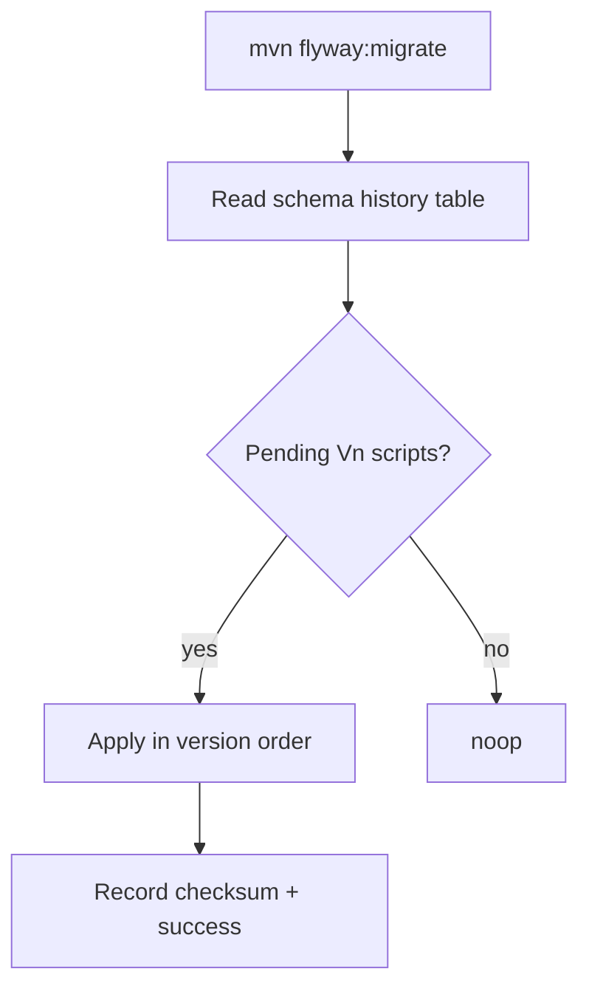

# Query Design and Migrations

> **Status:** Completed  
> **Module:** 34 — SQL and Data Access  
> **Target Java version:** 21  
> **Last reviewed:** 2026-11-11  
> **Chapter profile:** Technical  
> **Depth target:** Level 3 (indexing, EXPLAIN, Flyway/Liquibase, schema lifecycle)  
> **Examples verified with:** `persistence.xml` from [jpa-h2-demo](../../examples/backend/jpa-h2-demo/); JDBC count via Module 33

## 1. Learning Objectives

After completing this chapter, you should be able to:

- Reason about **indexes**, **selectivity**, and OLTP vs OLAP query shapes.
- Read **query plans** at a high level (`index seek` vs `seq scan`).
- Manage schema with **versioned migrations** (Flyway/Liquibase concepts).
- Distinguish **Hibernate `hbm2ddl`** from production migration discipline.
- Name **N+1** as a query-design smell leading into Module **35**.

## 2. Prerequisites

- Ch.01 — aggregations, pagination, JDBC mapping.
- Module **33** Ch.03 — transactions and consistent schema updates.

**Refresher — schema drift:** when application code at commit `N` expects column `email` but production DB never ran migration `V2`, you get runtime SQL exceptions—not Java compile errors.

## 3. Why This Concept Exists

Schema evolves with every release. Manual `ALTER TABLE` in production causes **drift** between environments, failed deploys, and irreversible mistakes. **Migration tools** apply ordered, reviewed SQL with checksum tracking.

**Query design** determines whether JDBC or ORM can meet latency SLOs. No pool tuning fixes a full-table scan on a billion-row table missing an index.

## 4. Conceptual Explanation

### 4.1 Migration tools

| Tool | Model |
|------|-------|
| **Flyway** | Versioned SQL files `V1__init.sql`, checksum in metadata table |
| **Liquibase** | Changelog (XML/YAML/SQL) with changeset ids |
| **Hibernate `hbm2ddl.auto`** | Generate schema from entities—dev/test tool, not prod source of truth |

### 4.2 hbm2ddl in handbook demo

[jpa-h2-demo](../../examples/backend/jpa-h2-demo/) `persistence.xml`:

```xml
<property name="hibernate.hbm2ddl.auto" value="create-drop"/>
```

**Verified from repository file** — drops schema when `EntityManagerFactory` closes. Production uses **`validate`** (fail fast on mismatch) or migrations only—never `create-drop`.

### 4.3 Indexing trade-off

B-tree index on `app_user(email)` speeds login lookup by email; each insert updates the index tree; disk and write latency increase.

**Covering index** includes all columns needed by a query so the engine **index-only scans** without heap access (engine-dependent).

### 4.4 N+1 preview

ORM loads N parent rows, then issues one child query per parent. Fix: join fetch, batch size, or explicit SQL (Module **35**).

## 5. Mechanism and Execution Flow

### 5.1 Flyway migrate pipeline



Forward-only migrations are common; rollbacks often mean **new** migration that reverses data shape, not deleting history rows.

### 5.2 Query plan check

```sql
EXPLAIN SELECT id, name FROM app_user WHERE id = ?;
```

Expect **index seek** on PK. Format differs: H2, PostgreSQL `EXPLAIN (ANALYZE, BUFFERS)`, MySQL `EXPLAIN`.

### 5.3 Expand–contract deploy

1. **Expand:** add nullable column `email`.
2. **Migrate data** backfill job.
3. **Contract:** `SET NOT NULL`, add unique index.
4. **Remove** old code paths—feature flags coordinate (no downtime goal).

## 6. Terminology

| Term | Meaning |
|------|---------|
| Migration | Versioned schema change script |
| Changelog | Ordered list of changesets (Liquibase) |
| Baseline | Flyway starting version on brownfield DB |
| Selectivity | Fraction of rows matching predicate—index usefulness |
| Online DDL | Engine feature reducing lock duration |
| hbm2ddl | Hibernate automatic DDL from mappings |

## 7. Syntax and Language Rules

### 7.1 Example Flyway script (illustrative—not executed in repo)

```sql
-- V2__add_user_email.sql
ALTER TABLE app_user ADD COLUMN email VARCHAR(255);
CREATE UNIQUE INDEX ux_app_user_email ON app_user(email);
```

Run with `mvn flyway:migrate` after datasource configuration in **your** service.

### 7.2 Safe NOT NULL migration

```sql
-- V2a add nullable
ALTER TABLE app_user ADD COLUMN email VARCHAR(255);
-- V2b backfill (application job or UPDATE)
-- V2c enforce
ALTER TABLE app_user ALTER COLUMN email SET NOT NULL;
```

Hibernate `update` adding non-nullable column without default fails on existing rows—common mistake.

### 7.3 Partial index (PostgreSQL sketch)

```sql
CREATE UNIQUE INDEX ux_app_user_email_active
ON app_user(email) WHERE deleted_at IS NULL;
```

## 8. Step-by-Step Examples

**Verified configuration excerpt** — `jpa-h2-demo` persistence unit:

- JDBC URL: `jdbc:h2:mem:jpa;DB_CLOSE_DELAY=-1`
- `hibernate.hbm2ddl.auto=create-drop`
- Table `app_user` created from `@Entity` `User` (reserved `USER` avoided)

**Verified application output (Temurin 21.0.12.1):** `name=Lin`, `idNotNull=true`, `jpaH2=ok` — proves auto-DDL created table and identity column works.

**Module 33 JDBC verification:** `rowCount=1` on separate `users` table in `h2-jdbc-demo`.

## 9. Real-World Use Cases

- Blue/green deploy with backward-compatible migrations.
- Partial indexes for soft-delete filters.
- Materialized views for reporting (refresh strategy documented).
- Multi-tenant schema per tenant vs shared table with `tenant_id` index.

## 10. Internal Behavior

Flyway checksum detects modified scripts after apply—prevents silent divergence. Hibernate `create-drop` runs DDL at SessionFactory startup/shutdown using JDBC metadata and dialect.

## 11. Edge Cases and Limitations

- **Long-running migration** locks table—use online schema change at scale.
- **Rollback scripts** often absent—design forward fixes.
- **Cross-database enums**—store as `VARCHAR` or documented ints.
- **H2 vs PostgreSQL** types in tests may hide production DDL failures—Testcontainers mitigates.

## 12. Common Mistakes

### Incorrect

Rely on Hibernate `update` for prod schema.

### Corrected

Explicit migrations + `validate` in prod.

### Incorrect

`CREATE INDEX` on every column “just in case.”

### Corrected

Index predicates proven by slow query log + EXPLAIN.

## 13. Best Practices

- Peer-review migration SQL like application code.
- Load-test critical queries after index changes.
- Keep `create-drop` confined to local learning (handbook demo).
- Document expand–contract steps in PR template.

## 14. Design Trade-offs

| Approach | Pro | Con |
|----------|-----|-----|
| Flyway SQL | DBA-friendly, explicit | Dialect branching |
| Liquibase XML | Abstraction | Verbosity |
| JPA ddl-auto | Fast local start | Unsafe prod |
| Database views | Decouple reporting | Deployment coupling |

## 15. Performance Considerations

Composite index column order matters: leading column must match common `WHERE` prefixes. Overlapping indexes waste write throughput.

## 16. Security Considerations

Migrations run with elevated DB privileges—audit who can apply them. Avoid storing PII in migration filenames or logs.

## 17. Java Version and Compatibility Notes

Handbook JPA 3.0 / Hibernate 6.6.4 with Java 21. Flyway/Liquibase versions follow Spring Boot BOM when using Boot (Module **36+**).

## 18. Revision and Mastery

- What does Flyway do if you edit an already-applied script?
- Why is `create-drop` incompatible with production data retention?
- Name expand–contract phases.

## 19. Exercises

1. Add a Flyway `V1__init.sql` for `app_user` mirroring JPA entity columns (local project).
2. Run `EXPLAIN` on PK lookup vs `WHERE email = ?` without index—compare plans.
3. Sketch N+1 fix SQL with JOIN for orders and lines.

## 20. Interview Questions

- How do you add a NOT NULL column to a billion-row table safely?
- Index on `(a,b)` vs separate indexes on `a` and `b`?

## 21. Solutions

**Flyway checksum failure** on edited applied scripts—requires repair discipline.**NOT NULL:** nullable → backfill → enforce.**Composite index:** left-prefix rule for `(a,b)`.

## 22. Chapter Summary

Sustainable data access pairs JDBC/ORM with versioned migrations and deliberate indexing. The JPA demo illustrates auto-DDL only for local learning; real services use Flyway/Liquibase and EXPLAIN-driven index design.

## 23. Key Terminology

Migration · Flyway · hbm2ddl · EXPLAIN · covering index · expand–contract · N+1

## 24. References and Further Reading

- [Flyway documentation](https://documentation.red-gate.com/flyway)
- [Hibernate ORM schema generation](https://docs.jboss.org/hibernate.orm/6.6/introduction/html_single/Hibernate_Introduction.html#schema-generation)

## 25. Next Steps

Module **35** — Hibernate and JPA.

## Supplement — Plan reading and migration review (Level 3 depth)

### Reading EXPLAIN (PostgreSQL-style concepts)

| Node type | Interpretation |
|-----------|----------------|
| Seq Scan | Read all rows—may be OK for tiny tables |
| Index Scan | Seek via index |
| Bitmap Index Scan | Combine index matches, then heap fetch |
| Nested Loop | Join driving row-by-row—watch N+1 analog |

### Handbook `persistence.xml` checklist

- `transaction-type="RESOURCE_LOCAL"` — matches programmatic `EntityTransaction`.
- `hibernate.show_sql=false` — clean demo output; enable locally for SQL study.
- Entity `User` → table `app_user` — naming escape for H2.

### Verification cross-reference

| Artifact | Verified fact |
|----------|---------------|
| `persistence.xml` | `create-drop` present |
| `JpaH2Demo` | INSERT into auto-created `app_user` |
| `JdbcH2Demo` | `rowCount=1` independent schema |

### Liquibase changeset id discipline

Each changeset runs once; ids must be unique in changelog. Teams store changelog in Git next to application code—same review process as Java changes.

### Flyway repair vs clean

`repair` fixes checksum metadata after deliberate script fix in unreleased branches—never `clean` against production (drops objects).

### Index composite ordering worked example

Query: `WHERE tenant_id = ? AND created_at > ? ORDER BY created_at DESC`

Index candidate: `(tenant_id, created_at DESC)`—leading `tenant_id` matches equality predicate.

### Statistics and ANALYZE

Planner quality depends on table statistics. After large data migrations, schedule `ANALYZE` (PostgreSQL) or equivalent—otherwise new indexes appear unused in plans.

### Soft delete column pattern

```sql
ALTER TABLE app_user ADD COLUMN deleted_at TIMESTAMP NULL;
CREATE INDEX ix_app_user_active ON app_user(id) WHERE deleted_at IS NULL;
```

Partial indexes reduce size when most queries filter active rows only.

### Backward-compatible rename (expand–contract)

1. Add `display_name` column.
2. Dual-write application fills both.
3. Backfill `display_name` from `name`.
4. Switch reads to `display_name`.
5. Drop `name` in later migration.

### hbm2ddl modes reference

| Value | Behavior |
|-------|----------|
| `create-drop` | Handbook demo—recreate each run |
| `validate` | Fail startup if entity ≠ schema |
| `update` | Diff schema—unsafe prod default |
| `none` | Provider ignores DDL generation |

### Concurrent index build (PostgreSQL pointer)

`CREATE INDEX CONCURRENTLY` reduces write blocking—operations runbook item for large tables.

### Migration code review checklist

- [ ] Idempotent where required (or strictly versioned once-only)?
- [ ] Backfill strategy for NOT NULL / data migrations?
- [ ] Index created **after** large backfill to avoid double write cost?
- [ ] Locks acceptable for table size?
- [ ] Roll-forward plan documented?

### Environment parity

Schema version table in staging must match production ordering before release. Drift detection tools compare live catalog to migration history.

### Denormalized column with trigger (pattern)

Maintain `order_count` on `users` via trigger or application transaction—document single writer to avoid split-brain counts.

### Query smell catalog

| Smell | Fix direction |
|-------|----------------|
| `SELECT *` wide rows | Column list / DTO |
| Function on indexed column | Generated column or expression index |
| OR across columns | UNION of selective queries sometimes |
| Leading wildcard LIKE `'%x'` | Full scan—search engine or trigram index |

### JPA validate vs migration

`validate` ensures entity mappings match DB; migrations ensure DB exists. **Both** in mature pipelines: migrate then start app with `validate`.

### Handbook jpa-h2-demo DDL lifecycle

Startup: Hibernate creates `app_user`. Shutdown `create-drop` drops schema—explains empty H2 after JVM exit unless `DB_CLOSE_DELAY` keeps mem instance.

### Sample Flyway project layout (Illustrative)

```text
src/main/resources/db/migration/
  V1__create_app_user.sql
  V2__add_email.sql
  V3__index_email.sql
```

Spring Boot autoloads `classpath:db/migration` when Flyway starter present—Module **36+** project track may add Flyway sample (PROGRESS outstanding).

### Liquibase vs Flyway trade-off summary

| Factor | Flyway | Liquibase |
|--------|--------|-----------|
| Authoring | SQL-first teams | XML/YAML abstraction fans |
| Rollback | Forward scripts common | Optional rollback blocks |
| Checksum | Per file | Per changeset |

Both beat undocumented `ALTER` in psql session.

### Column type migration hazards

| Change | Risk |
|--------|------|
| `VARCHAR(64)` → `VARCHAR(255)` | Usually safe |
| `INT` → `BIGINT` | Rewrite table on some engines |
| Add `NOT NULL` without default | Fails on existing nulls |
| Change PK type | Almost always multi-step |

### Query store / slow log workflow

1. Collect top N slow queries from APM or `pg_stat_statements`.
2. `EXPLAIN (ANALYZE, BUFFERS)` on staging copy.
3. Propose index or rewrite SQL in migration branch.
4. Load test before merge.

Java developers participate in steps 1–3 even when DBAs own production indexes.

### Materialized view refresh

```sql
REFRESH MATERIALIZED VIEW CONCURRENTLY monthly_sales_summary;
```

Refresh strategy (cron, trigger, CDC) is operational concern—migrations define view DDL.

### Handbook verification matrix (Module 34)

| Claim | Evidence |
|-------|----------|
| `create-drop` in PU | File `persistence.xml` in repo |
| Auto table `app_user` | JPA demo stdout `idNotNull=true` |
| JDBC row counts | `h2-jdbc-demo` `rowCount=1` |

### ORM-generated DDL limitations

Hibernate may omit indexes you would add manually (`email` unique). **Migrations** add indexes even when entities exist—do not assume `hbm2ddl` production parity.

## Review Checklist

- [x] hbm2ddl setting from real persistence.xml
- [x] Mechanism flow for Flyway + EXPLAIN
- [x] Technical Level 3
- [x] No fabricated Flyway execution in handbook repo
