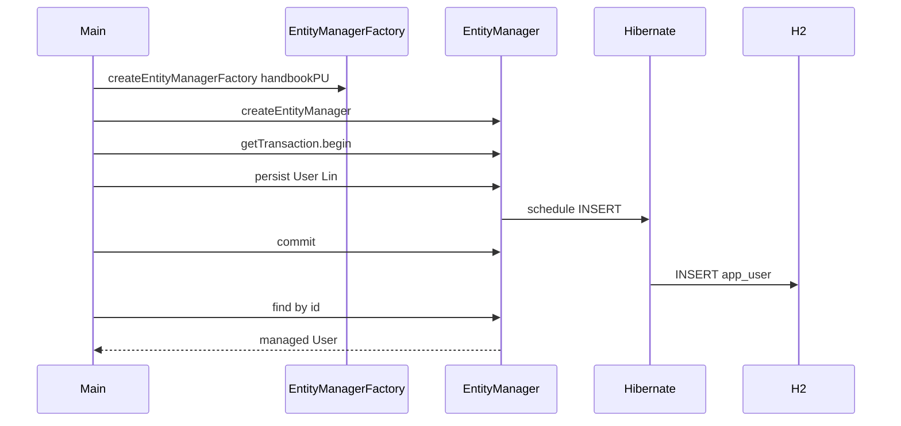

# ORM and Entities

> **Status:** Completed  
> **Module:** 35 — Hibernate and JPA  
> **Target Java version:** 21  
> **Last reviewed:** 2026-11-11  
> **Chapter profile:** Technical  
> **Depth target:** Level 3 (entity lifecycle, persistence context, bootstrap)  
> **Examples verified with:** Temurin JDK 21.0.12.1; Hibernate 6.6.4.Final; H2 2.3.232

## 1. Learning Objectives

After completing this chapter, you should be able to:

- Explain **ORM** goals and limits versus JDBC.
- Annotate a **Jakarta Persistence** entity with `@Entity`, `@Id`, `@GeneratedValue`, `@Table`.
- Bootstrap **`EntityManagerFactory`** from `persistence.xml` and use **`EntityManager`** CRUD APIs.
- Name the four **entity states** and what triggers transitions.
- Contrast **entities** with **records** and DTOs for API layers.

## 2. Prerequisites

- Modules **33–34** — JDBC connections, SQL tables, migrations mindset.
- Module **06** — equals/identity; Module **15** — records vs mutable domain types.

**Refresher — portable mapping:** JPA defines annotations and `EntityManager` API; **Hibernate** is the dominant provider executing SQL. Spring Data JPA (Module **36+**) adds repositories—but the persistence context behavior lives here.

## 3. Why This Concept Exists

Hand-written JDBC row mapping for dozens of tables repeats boilerplate and scatters SQL. **JPA** standardizes **object-relational mapping**: annotations (or XML) declare how fields map to columns; the provider generates SQL, tracks changes, and manages identity.

You still need JDBC mental models: wrong mappings produce wrong SQL, lazy-load exceptions, and duplicate rows.

## 4. Conceptual Explanation

### 4.1 Pieces

| Piece | Role |
|-------|------|
| **Entity** | Mutable class with identity persisted across transactions |
| **EntityManager** | API: `persist`, `find`, `merge`, `remove`, queries |
| **Persistence unit** | Named configuration in `META-INF/persistence.xml` |
| **Provider** | Hibernate, EclipseLink—implements JPA |
| **Persistence context** | First-level cache of managed entities per `EntityManager` |

### 4.2 Entity states

| State | Meaning |
|-------|---------|
| **Transient** | New object, no association with context |
| **Managed** | Associated; changes flush on commit |
| **Detached** | Was managed; `EntityManager` closed |
| **Removed** | Scheduled for delete on flush |

Transitions: `persist` (transient→managed), `commit`/`close` (managed→detached), `remove` (managed→removed).

### 4.3 Entity vs record

`@Entity` classes need **no-arg constructor** (JPA spec), typically **protected** for proxy generation. **Records** are not entities in typical JPA 3 apps—use records as DTOs or projections.

## 5. Mechanism and Execution Flow

### 5.1 Bootstrap and persist



### 5.2 Demo entity mapping

```java
@Entity
@Table(name = "app_user")
public class User {
    @Id
    @GeneratedValue(strategy = GenerationType.IDENTITY)
    private Long id;
    private String name;
    protected User() {}
    public User(String name) { this.name = name; }
}
```

`GenerationType.IDENTITY` uses database identity column—INSERT then JDBC `getGeneratedKeys`.

### 5.3 persistence.xml essentials

Driver, URL, user, password, `hibernate.hbm2ddl.auto=create-drop` for handbook dev lifecycle.

## 6. Terminology

| Term | Meaning |
|------|---------|
| ORM | Object-relational mapping |
| JPA | Jakarta Persistence API specification |
| Provider | Hibernate implementation |
| Flush | Synchronize persistence context to database |
| Identity column | DB-generated PK (`IDENTITY`) |
| PU | Persistence unit name `handbookPU` |

## 7. Syntax and Language Rules

### 7.1 Minimal main (demo)

```java
EntityManagerFactory emf = Persistence.createEntityManagerFactory("handbookPU");
EntityManager em = emf.createEntityManager();
em.getTransaction().begin();
User user = new User("Lin");
em.persist(user);
em.getTransaction().commit();
User loaded = em.find(User.class, user.getId());
```

### 7.2 Column naming

Default: camelCase field `name` → column `name` (dialect-dependent quoting). Override with `@Column(name = "legacy_col")`.

## 8. Step-by-Step Examples

**Demo:** [jpa-h2-demo](../../examples/backend/jpa-h2-demo/).

**Verified output (Temurin 21.0.12.1):**

```text
name=Lin
idNotNull=true
jpaH2=ok
```

**Hibernate versions from log (real run):** ORM **6.6.4.Final**, H2 **2.3.232**, JDBC URL `jdbc:h2:mem:jpa;DB_CLOSE_DELAY=-1`.

**Important lines:** `Persistence.createEntityManagerFactory("handbookPU")` loads XML; `@Table(name = "app_user")` avoids H2 `USER` reserved word; `commit()` triggers INSERT; `find` in same `EntityManager` may use persistence context cache.

## 9. Real-World Use Cases

- CRUD services before REST exposure.
- Mapping legacy tables with explicit `@Column` names.
- `validate` ddl mode failing CI when entity/schema mismatch.

## 10. Internal Behavior (Hibernate)

On `persist`, Hibernate queues entity in persistence context. On `commit`, **flush** orders SQL (INSERT for new entity). **Bytecode enhancement** may lazy-load associations (Ch.02). SQL logging via `hibernate.show_sql` (demo false).

Identity generator: after INSERT, `id` populated from JDBC generated keys.

## 11. Edge Cases and Limitations

- **Reserved SQL identifiers** — use `@Table` / `@Column` rename.
- **No-arg constructor** required; can be `protected`.
- **`equals`/`hashCode`** — do not use uninitialized lazy fields in `hashCode`.
- **Lombok `@Data`** on entities with lazy associations—risky equals/hashCode.

## 12. Common Mistakes

### Incorrect

Treat `merge` like `persist` for new instances—extra SELECT possible.

### Corrected

`persist` for new; `merge` for detached copies.

### Incorrect

Expose entities directly on REST without DTO layer.

### Corrected

DTO projection or mapping layer (serialization and lazy fields).

## 13. Best Practices

- Use `validate` or migrations in prod; keep `create-drop` local.
- Document surrogate PK strategy.
- Integration-test with same dialect family as production when possible.

## 14. Design Trade-offs

| Layer | Strength | Weakness |
|-------|----------|----------|
| JDBC | Control | Boilerplate |
| JPA entities | Productivity | Hidden SQL |
| DTO + query | Explicit reads | More types |

## 15. Performance Considerations

Identity insert one-by-one—batch sequences (`SEQUENCE`) for bulk insert throughput if needed.

## 16. Security Considerations

Entities may contain sensitive fields—exclude from JSON (Module **26+** serialization). Do not log full entities with PII.

## 17. Java Version and Compatibility Notes

Jakarta Persistence **3.0** (`jakarta.persistence` package). Hibernate 6.x requires Jakarta EE 9+ namespace. Java **21** LTS handbook baseline.

## 18. Revision and Mastery

- What state is `User` after `persist` before `commit`?
- Why must entities have no-arg constructor?
- What does `find` return if row missing?

## 19. Exercises

1. Enable `hibernate.show_sql=true`; capture INSERT statement for `Lin`.
2. Add `@Column(nullable = false)` on `name`; observe DDL change with `create-drop`.
3. Close `EntityManager` after commit and attempt `loaded.getName()`—note detached behavior.

## 20. Interview Questions

- Difference between `persist` and `merge`?
- What is a persistence context?

## 21. Solutions

**persist:** makes transient managed; INSERT on flush.**merge:** reattaches detached state.**Context:** session-scoped identity map of managed entities.

## 22. Chapter Summary

JPA entities map objects to tables; Hibernate executes SQL. Demo persists `Lin` with generated id on embedded H2, verified on Temurin 21.0.12.1. Lifecycle states and bootstrap precede relationships and performance tuning.

## 23. Key Terminology

Entity · EntityManager · persist · flush · persistence unit · IDENTITY

## 24. References and Further Reading

- [Jakarta Persistence 3.0](https://jakarta.ee/specifications/persistence/3.0/)
- [Hibernate ORM 6.6 documentation](https://docs.jboss.org/hibernate.orm/6.6/introduction/html_single/Hibernate_Introduction.html)

## 25. Next Steps

[02-relationships-and-fetching.md](02-relationships-and-fetching.md)

## Supplement — Bootstrap and DDL (Level 3 depth)

### persistence.xml structure (handbook)

```xml
<persistence-unit name="handbookPU" transaction-type="RESOURCE_LOCAL">
    <class>com.handbook.jpa.User</class>
    <properties>
        <property name="jakarta.persistence.jdbc.url"
                  value="jdbc:h2:mem:jpa;DB_CLOSE_DELAY=-1"/>
        <property name="hibernate.hbm2ddl.auto" value="create-drop"/>
    </properties>
</persistence-unit>
```

### State transition table

| Action | From | To |
|--------|------|-----|
| `new User()` | — | Transient |
| `persist` | Transient | Managed |
| `commit` / flush | Managed | Managed (DB synced) |
| `em.close()` | Managed | Detached |
| `remove` | Managed | Removed |

### Run verification

```powershell
cd examples\backend\jpa-h2-demo
..\..\spring-boot-minimal\mvnw.cmd -q compile "exec:java" "-Dexec.mainClass=com.handbook.jpa.JpaH2Demo"
```

Expect `idNotNull=true` after identity generation.

### Attribute override and embeddables (sketch)

```java
@Embeddable
public class Address {
    private String city;
}

@Entity
public class Customer {
    @Embedded
    private Address address;
}
```

Embeddables flatten columns into owning table unless `@AttributeOverride` specifies names—useful for value objects without separate tables.

### `merge` flow for detached entities

1. `find` in request one → close EM → detached instance.
2. Client sends DTO → map to detached entity.
3. `merge` returns managed copy; changes flush on commit.

Prefer `find` + mutate managed instance inside single request transaction when possible—fewer surprises than detached graphs.

### `remove` prerequisites

Entity must be **managed**; deleting detached entity requires `merge` first or `remove` after re-fetch.

### Schema validation failure modes

With `validate`, startup throws if column missing or type mismatch—intentional fail-fast before serving traffic.

### `@GeneratedValue` strategies

| Strategy | Characteristic |
|----------|----------------|
| `IDENTITY` | Demo—INSERT-dependent id |
| `SEQUENCE` | Pre-allocate batches—good for bulk insert |
| `TABLE` | Portable but heavier |
| `AUTO` | Provider picks—document outcome in prod |

### Testing entity mapping

Assert table/column names via integration test inserting row and reading via JDBC `PreparedStatement`—cross-check ORM mapping independent of Hibernate only.

### Name collision reserved words

H2, Oracle, and others reserve `USER`, `ORDER`, `GROUP`. Handbook `app_user` pattern is mandatory discipline—do not rely on quoting alone.

### Persistence unit scoping

`<class>com.handbook.jpa.User</class>` lists managed types explicitly in demo—alternative `exclude-unlisted-classes` default in JPA scans entities on classpath in some configurations; explicit list aids minimal PU.

### `find` vs `getReference`

`getReference` returns lazy proxy without immediate SELECT—use when only FK needed. `find` hits DB when not cached.

### Lifecycle callback preview

```java
@PrePersist
void onCreate() { createdAt = Instant.now(); }
```

Callbacks run in persistence provider scope—keep logic minimal; domain events often better in service layer.

### Multi-PU applications

Large systems may define `reportingPU` vs `oltpPU`—separate `EntityManagerFactory` instances, distinct datasources.

### Demo output contract

Tests and docs rely on:

```text
name=Lin
idNotNull=true
jpaH2=ok
```

Any entity rename must update chapter and PROGRESS tables together.

### Provider switching cost

JPA aims portability; Hibernate-specific annotations (`@Formula`, `@SQLInsert`) reduce portability—document vendor lock when used.

### EntityManagerFactory lifecycle

Create **one** `EntityManagerFactory` per persistence unit per application (`static` holder or CDI singleton). Creating factory per request is catastrophic to startup time and metadata parsing.

### Thread safety

`EntityManager` is **not** thread-safe; one instance per thread/request. Factory is thread-safe.

### `persistence.xml` JDBC properties (demo)

| Property | Value |
|----------|-------|
| driver | `org.h2.Driver` |
| url | `jdbc:h2:mem:jpa;DB_CLOSE_DELAY=-1` |
| user | `sa` |
| password | empty |

Matches Hibernate log `Database JDBC URL` line from verified run.

### Mapping inheritance (pointer only)

`@Inheritance` strategies (`SINGLE_TABLE`, `JOINED`) affect schema width and join depth—dedicated enterprise patterns beyond handbook demo scope; know they exist before copying tutorials.

## Review Checklist

- [x] Verified jpa-h2-demo on Temurin 21.0.12.1
- [x] Mechanism sequence diagram
- [x] Technical Level 3
- [x] Preserved `@Table app_user` reserved-word teaching
