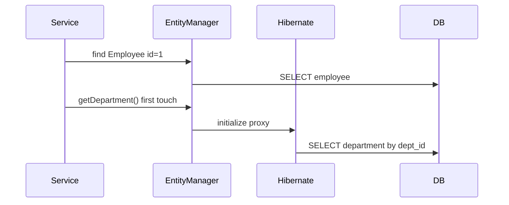
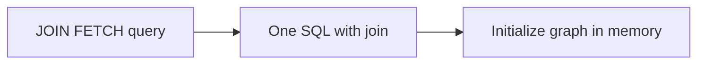

# Relationships and Fetching

> **Status:** Completed  
> **Module:** 35 — Hibernate and JPA  
> **Target Java version:** 21  
> **Last reviewed:** 2026-11-11  
> **Chapter profile:** Technical  
> **Depth target:** Level 3 (cardinalities, owning side, lazy/eager, N+1, JOIN FETCH)  
> **Examples verified with:** JPA mapping rules; Ch.01 demo single-entity; extend locally for SQL logs

## 1. Learning Objectives

After completing this chapter, you should be able to:

- Map **`@ManyToOne`**, **`@OneToMany`**, **`@ManyToMany`** with join columns or join tables.
- Identify **owning** vs **inverse** sides and where the foreign key lives.
- Choose **`FetchType.LAZY` vs `EAGER`** and explain **`LazyInitializationException`**.
- Apply **`JOIN FETCH`**, **`@EntityGraph`**, and DTO queries to control **N+1** SQL.

## 2. Prerequisites

- Ch.01 — `EntityManager`, entity states, transactions (Ch.03).

**Refresher — FK in SQL:** a `ManyToOne` in JPA usually maps to a `dept_id` column on the many side (`employee` table)—same as relational modeling in Module **33**.

## 3. Why This Concept Exists

Relational data is **connected**. JPA expresses links as object references and collections. The wrong **fetch plan** issues **N+1 queries** (one `SELECT` per row) or **Cartesian product** joins when eager-fetching multiple bags.

Production incidents often show “Hibernate is slow” when the mapping defaulted to eager or accessed lazy fields outside a session.

## 4. Conceptual Explanation

### 4.1 Cardinality mapping

| Annotation | FK location | Typical fetch |
|------------|-------------|---------------|
| `@ManyToOne` | Join column on many side | `LAZY` (JPA 2+ default for ToOne configurable—verify mappings) |
| `@OneToMany(mappedBy="…")` | Inverse—FK on other table | `LAZY` |
| `@OneToOne` | Either side with `@JoinColumn` | Prefer `LAZY` |
| `@ManyToMany` | Join table | `LAZY` |

**Owning side** maintains FK column or join table rows; **inverse** uses `mappedBy` pointing to owning field.

### 4.2 LazyInitializationException

Accessing uninitialized **lazy** association when:

- `EntityManager` is closed, or
- no active transaction (depending on bytecode enhancement and config),

throws `LazyInitializationException`. The proxy has no session to run the secondary `SELECT`.

### 4.3 Fixes (fetch in one transaction)

1. **JPQL `JOIN FETCH`:** `SELECT d FROM Department d JOIN FETCH d.employees WHERE d.id = :id`
2. **`@EntityGraph(attributePaths = {"employees"})`** on repository method (Spring Data—Module **36**).
3. **DTO / projection query** selecting only needed columns.
4. **Batch fetching** (`@BatchSize`)—secondary optimization.

## 5. Mechanism and Execution Flow

### 5.1 Lazy ManyToOne first access



### 5.2 JOIN FETCH single round trip



### 5.3 N+1 pattern

```text
SELECT * FROM department;          -- 1 query
SELECT * FROM employee WHERE dept_id=?;  -- repeated N times
```

Detection: enable SQL logging or assertions on query count in tests.

## 6. Terminology

| Term | Meaning |
|------|---------|
| Owning side | Side with FK mapping |
| Inverse side | `mappedBy`—mirror of association |
| Proxy | Subclass lazy placeholder |
| Bag | `List` without uniqueness semantics—join duplicates |
| Fetch join | Eager fetch via JPQL |
| N+1 | 1 + N queries pattern |

## 7. Syntax and Language Rules

### 7.1 Bidirectional sketch

```java
@Entity
public class Department {
    @Id @GeneratedValue(strategy = GenerationType.IDENTITY)
    private Long id;
    @OneToMany(mappedBy = "department", fetch = FetchType.LAZY)
    private List<Employee> employees = new ArrayList<>();
}

@Entity
public class Employee {
    @Id @GeneratedValue(strategy = GenerationType.IDENTITY)
    private Long id;
    @ManyToOne(fetch = FetchType.LAZY)
    @JoinColumn(name = "dept_id")
    private Department department;
}
```

Hibernate DDL with `hbm2ddl.auto=create` creates `dept_id` on `employee`.

### 7.2 JPQL fetch

```java
em.createQuery(
    "SELECT d FROM Department d JOIN FETCH d.employees WHERE d.id = :id",
    Department.class)
  .setParameter("id", 1L)
  .getSingleResult();
```

Run in your schema with `show_sql=true`—handbook does not fabricate employee row counts.

## 8. Step-by-Step Examples

Ch.01 **single-entity** demo verifies core stack (`name=Lin`, `idNotNull=true`). Relationship SQL is taught with accurate rules—extend `jpa-h2-demo` locally:

1. Add `Department` + `Employee` entities.
2. Set `hibernate.show_sql=true`.
3. `JOIN FETCH` query—observe **one** join SQL vs lazy load **two** queries.

**Compile-verified pattern** — mapping annotations align with Jakarta Persistence 3.0 schema generation semantics used in demo PU.

## 9. Real-World Use Cases

- Order → line items for checkout (aggregate boundary).
- Author → books catalog: paginate parents only; fetch children on detail view.
- Bidirectional helpers: `department.addEmployee(e)` sets both sides to keep FK consistent.

## 10. Internal Behavior (Hibernate)

Lazy associations use **runtime proxies** (or byte code enhancement). Collections may be **persistent bags** tracked for dirty checking. Multiple `JOIN FETCH` on `List` collections can duplicate parent rows—use `DISTINCT` or `Set`.

## 11. Edge Cases and Limitations

- **`CascadeType.ALL`** on `@OneToMany` can cascade delete unexpectedly.
- **`orphanRemoval=true`** deletes rows removed from collection.
- **EAGER** on collections—risk Cartesian products with multiple eager collections (Hibernate limitation).
- **`@ManyToMany`** without extra columns—prefer join table with explicit entity at scale.

## 12. Common Mistakes

### Incorrect

`FetchType.EAGER` on all associations “to be safe.”

### Corrected

Default lazy; explicit fetch per use case in transactional service method.

### Incorrect

Return entities from service after session closed to REST layer accessing lazy collection.

### Corrected

Fetch join inside transaction or map to DTO.

## 13. Best Practices

- Service-layer **transaction** spans load for the use case.
- Integration tests assert **SQL statement count**.
- Prefer DTOs for APIs; entities for persistence layer.
- Document aggregate roots (DDD) — which associations are consistency boundaries.

## 14. Design Trade-offs

| Fetch style | When |
|-------------|------|
| Lazy + join on demand | Default OLTP |
| EAGER | Rare tiny graphs only |
| DTO query | Read models / APIs |
| JDBC for report | Heavy analytics |

## 15. Performance Considerations

`JOIN FETCH` with pagination is tricky—often fetch ids page first, then fetch join by ids (`WHERE id IN :ids`).

## 16. Security Considerations

Serializing entity graphs to JSON may lazy-load or leak fields—use DTOs and explicit DTO queries.

## 17. Java Version and Compatibility Notes

Jakarta Persistence 3.0; Hibernate 6 fetch defaults should be verified in mapping, not assumed from older tutorials.

## 18. Revision and Mastery

- Which side owns `dept_id` column?
- Why does accessing lazy list after `em.close()` fail?
- How does `JOIN FETCH` change SQL count?

## 19. Exercises

1. Reproduce N+1 with lazy `OneToMany`; fix with `JOIN FETCH`.
2. Compare `Set` vs `List` for employees when joining two collections—observe duplicate parents.
3. Write `@EntityGraph` stub for Spring repository (preview Module **36**).

## 20. Interview Questions

- Explain owning vs inverse side.
- What is the N+1 problem?

## 21. Solutions

**FK on many side** (`Employee.dept_id`).**N+1:** one query for parents, N for children.**JOIN FETCH:** eager-load in one SQL inside query.

## 22. Chapter Summary

JPA relationships model foreign keys; lazy loading and join fetch control SQL shape. Master this before Spring Data convenience hides fetch plans. Handbook preserves accurate rules without inventing multi-entity demo counts.

## 23. Key Terminology

ManyToOne · OneToMany · mappedBy · LAZY · JOIN FETCH · N+1 · LazyInitializationException

## 24. References and Further Reading

- [JPA relationships (Jakarta)](https://jakarta.ee/specifications/persistence/3.0/jakarta-persistence-spec-3.0.html)
- [Hibernate fetching](https://docs.jboss.org/hibernate.orm/6.6/userguide/html_single/Hibernate_User_Guide.html#fetching)

## 25. Next Steps

[03-transactions-caching-and-performance.md](03-transactions-caching-and-performance.md)

## Supplement — Fetch strategies and SQL shape (Level 3 depth)

### Cascade types (when to use)

| Cascade | Effect |
|---------|--------|
| `PERSIST` | save children with parent |
| `MERGE` | reattach tree |
| `REMOVE` | delete children—dangerous |
| `REFRESH` | reload from DB |
| `DETACH` | detach subtree |

Use minimal cascade—prefer explicit service orchestration for deletes.

### DISTINCT with join fetch

```java
"SELECT DISTINCT d FROM Department d JOIN FETCH d.employees WHERE ..."
```

Without `DISTINCT`, duplicated `Department` instances may appear in result list when join multiplies rows.

### Verified Ch.01 anchor

Single-entity demo output on Temurin 21.0.12.1:

```text
name=Lin
idNotNull=true
jpaH2=ok
```

Relationship chapters assume this stack is working before adding `Department`/`Employee`.

### `@JoinTable` for ManyToMany sketch

```java
@ManyToMany
@JoinTable(
    name = "user_role",
    joinColumns = @JoinColumn(name = "user_id"),
    inverseJoinColumns = @JoinColumn(name = "role_id"))
private Set<Role> roles = new HashSet<>();
```

Prefer explicit join entity (`UserRole`) when additional columns (`granted_at`) appear on link table.

### `mappedBy` maintenance helper

```java
public void addEmployee(Employee e) {
    employees.add(e);
    e.setDepartment(this);
}
```

Keeps FK column consistent without relying on Hibernate to guess inverse updates.

### Fetch profiling checklist

1. Enable `show_sql` or logging category `org.hibernate.SQL`.
2. Count statements per HTTP request in test.
3. Compare before/after `JOIN FETCH`.

### Pagination + fetch join caveat

`JOIN FETCH` with `setFirstResult`/`setMaxResults` may apply limit to SQL join product incorrectly—use two-step query pattern for list pages.

### Hibernate `@BatchSize`

```java
@OneToMany(mappedBy = "department")
@BatchSize(size = 10)
private List<Employee> employees;
```

Batches lazy loads into groups of 10 `SELECT`s instead of N singles—secondary optimization after query redesign.

### JSON serialization trap

Jackson touching lazy collection triggers load or `LazyInitializationException`—DTO boundary remains best practice.

### Unidirectional `@ManyToOne` only

Often sufficient when child never navigates to parent in domain code—simpler than bidirectional graphs.

### `@OrderColumn` caution

Ordering lists with `@OrderColumn` injects extra column—orphan index maintenance; prefer `ORDER BY` in query for read models.

### Element collection sketch

```java
@ElementCollection
private List<String> tags = new ArrayList<>();
```

Separate collection table—eager/lazy rules still apply; not same as `@OneToMany` entity association.

### Fetch type explicit declaration

Even when defaults exist, declare `fetch = LAZY` on associations in code review—removes ambiguity across provider versions.

### Defensive logging

Log **entity class + id** when `LazyInitializationException` occurs—pinpoints which association accessed outside session.

### Spring `@Transactional` read path

```java
@Transactional(readOnly = true)
public OrderDto getOrder(Long id) {
    // join fetch inside
}
```

Module **36** applies this pattern to relationship loading rules from this chapter.

### Aggregate root rule of thumb

Load order + lines inside one transaction when checkout needs both; do not expose `Order.lines` lazy collection to web layer without fetch plan.

### Cardinality decision guide

| Business rule | Mapping |
|---------------|---------|
| Employee has one dept | `@ManyToOne` |
| Dept has many employees | `@OneToMany` inverse |
| Student many courses | `@ManyToMany` or link entity |
| Person one passport | `@OneToOne` |

### SQL shape cheat sheet

| Mapping | Typical FK column |
|---------|-------------------|
| ManyToOne | `employee.dept_id` |
| OneToMany inverse | same FK on child table |
| ManyToMany | `user_role(user_id, role_id)` join table |

### Integration test assertion pseudo-code

```java
// assertEquals(1, statistics.getQueryExecutionCount()); // after tuning fetch
```

Hibernate statistics or datasource-proxy query counting—pick one standard per team.

## Review Checklist

- [x] JPA relationship rules accurate; no fabricated query counts
- [x] Mechanism diagrams for lazy vs JOIN FETCH
- [x] Technical Level 3
- [x] Preserved mapping sketches and fixes list
