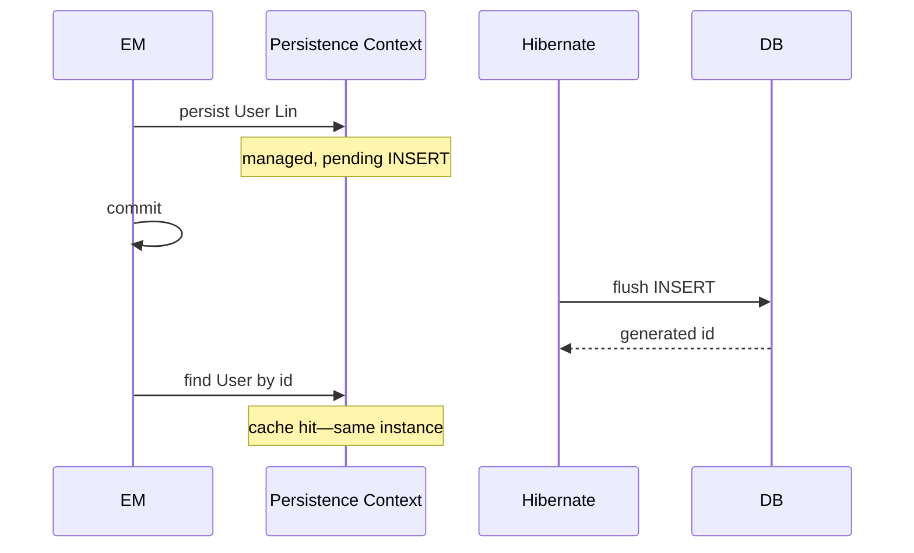

# Transactions, Caching, and Performance

> **Status:** Completed  
> **Module:** 35 — Hibernate and JPA  
> **Target Java version:** 21  
> **Last reviewed:** 2026-11-11  
> **Chapter profile:** Technical  
> **Depth target:** Level 3 (RESOURCE_LOCAL vs JTA, persistence context, flush, 2LC overview, batching)  
> **Examples verified with:** [jpa-h2-demo](../../examples/backend/jpa-h2-demo/) on Temurin 21.0.12.1; Hibernate 6.6.4.Final

## 1. Learning Objectives

After completing this chapter, you should be able to:

- Align **JPA transactions** with JDBC (`RESOURCE_LOCAL` vs **JTA**).
- Explain **first-level cache** (persistence context) and **second-level cache** at overview level.
- Describe **flush** timing, **dirty checking**, and **FlushMode**.
- List performance tactics: **batch inserts**, **stateless session**, **`@Version`** optimistic locking.
- Name **Open Session In View** as an anti-pattern for REST APIs.

## 2. Prerequisites

- Module **33** Ch.03 — JDBC transactions and pools.
- Ch.02 — fetch planning and N+1.

**Refresher — unit of work:** JPA groups database effects per transaction. Long units of work grow persistence context memory and hold DB locks longer.

## 3. Why This Concept Exists

ORM convenience fails when every field change triggers immediate SQL or when sessions span unbounded work. **Transaction boundaries** define consistency units; **caching** reduces read load only when staleness rules are understood.

Teams chasing “enable second-level cache” without measuring often add complexity without latency wins.

## 4. Conceptual Explanation

### 4.1 Transaction types

| `transaction-type` | Use |
|--------------------|-----|
| `RESOURCE_LOCAL` | `EntityTransaction` on one JDBC connection (handbook demo) |
| `JTA` | Container coordinates XA across resources—Java EE / some servers |

Spring **`@Transactional`** (Module **36**) typically binds resource-local or JTA depending on configuration—not magic separate from JDBC commit.

### 4.2 First-level cache

Single **persistence context** per `EntityManager`:

- Repeated `find(User.class, id)` within same context may return same instance without extra SQL.
- Dirty checking at flush compares managed entities to snapshot—issues `UPDATE` for mutated fields.

### 4.3 Second-level cache (overview)

**Shared across** `EntityManager` instances in JVM (when enabled). Regions, eviction, concurrency strategy—provider-specific. Handbook demo log:

```text
HHH000026: Second-level cache disabled
```

Enable only for read-mostly reference data with measured benefit; 2LC tuning is out of handbook scope (PROGRESS note).

### 4.4 Flush modes

| `FlushModeType` | Behavior |
|-----------------|----------|
| `AUTO` | Flush before query if needed (default) |
| `COMMIT` | Flush only on commit—surprises if query expects pending INSERT |

### 4.5 Performance levers

- `hibernate.jdbc.batch_size` — batch INSERT/UPDATE statements.
- **StatelessSession** — bulk ETL without full context tracking.
- `@Version` — optimistic lock column for concurrent updates.
- Query cache (distinct from 2LC)—rarely default-on.

## 5. Mechanism and Execution Flow

### 5.1 persist → commit → find (demo)



### 5.2 Dirty checking flush

```text
transaction begin → mutate managed entity.name → commit → UPDATE emitted if dirty
```

### 5.3 Batch insert path (conceptual)

```text
for each entity: persist → periodic flush/clear at batch_size boundary
```

Prevents persistence context from holding millions of managed instances.

## 6. Terminology

| Term | Meaning |
|------|---------|
| Persistence context | First-level cache + entity state |
| Flush | SQL synchronization point |
| Dirty checking | Detect field changes on flush |
| 2LC | Second-level cache across sessions |
| Optimistic lock | `@Version` column compare on UPDATE |
| OSIV | Open Session In View pattern |

## 7. Syntax and Language Rules

### 7.1 Demo block (verified)

```java
em.getTransaction().begin();
User user = new User("Lin");
em.persist(user);
em.getTransaction().commit();

User loaded = em.find(User.class, user.getId());
System.out.println("name=" + loaded.getName());
System.out.println("idNotNull=" + (loaded.getId() != null));
```

### 7.2 Optimistic locking sketch

```java
@Entity
public class Account {
    @Version
    private long version;
}
```

Failed update throws `OptimisticLockException`.

### 7.3 Batch property (persistence.xml or Spring config)

```xml
<property name="hibernate.jdbc.batch_size" value="25"/>
```

Requires ordered inserts and sometimes `order_inserts=true` for best effect—provider docs.

## 8. Step-by-Step Examples

**Verified output (Temurin 21.0.12.1):**

```text
name=Lin
idNotNull=true
jpaH2=ok
```

**Hibernate startup log (excerpt, real run):**

```text
HHH000412: Hibernate ORM core version 6.6.4.Final
HHH000026: Second-level cache disabled
Database JDBC URL [jdbc:h2:mem:jpa;DB_CLOSE_DELAY=-1]
Database version: 2.3.232
```

`find` after `commit` in same open `EntityManager` demonstrates first-level cache hit and non-null generated id.

## 9. Real-World Use Cases

- `@Transactional` service methods wrapping JPA calls (Spring Module **36**).
- `readOnly=true` hint for query-heavy transactions.
- Reference data cached outside Hibernate (Redis) with TTL when 2LC is too coarse.

## 10. Internal Behavior (Hibernate)

Transaction coordinator flushes before commit. JDBC batching groups `PreparedStatement.addBatch` when enabled. Connection pool warning in demo (`Using built-in connection pool`) reminds that embedded config is not production Hikari setup.

## 11. Edge Cases and Limitations

- **Long session** — memory holds all managed entities until `clear()`.
- **Unintended UPDATE** — mutate managed entity outside intended write path.
- **OSIV** — keeps session open through view rendering; for REST, fetch inside service transaction.
- **2LC staleness** — concurrent writer invalidation required.

## 12. Common Mistakes

### Incorrect

Commit per row in loop—thousands of transactions.

### Corrected

Single transaction + batch flush/clear cycles.

### Incorrect

Enable every cache region without read/write ratio analysis.

### Corrected

Measure; cache reference data; document eviction.

## 13. Best Practices

- Match transaction scope to request/use case.
- Profile SQL in dev (`hibernate.format_sql`—not prod).
- Use pessimistic lock (`PESSIMISTIC_WRITE`) only with proven contention.
- `em.clear()` during bulk imports after flush batches.

## 14. Design Trade-offs

| Approach | Fits |
|----------|------|
| Full ORM | OLTP entity CRUD |
| JDBC/jOOQ | Heavy reporting, bulk |
| Hybrid | Common at scale |

## 15. Performance Considerations

Pool size + transaction duration interact with lock hold time. Batch size vs context memory trade-off. Identity columns may reduce insert batching benefits vs sequences.

## 16. Security Considerations

Long transactions do not substitute authorization. Avoid logging bound parameter values with secrets.

## 17. Java Version and Compatibility Notes

Java 21, Hibernate 6.6.x, Jakarta Persistence 3.0. JTA platform message in demo: `No JTA platform available`—expected for plain `main`.

## 18. Revision and Mastery

- Does second `find` hit DB in same persistence context?
- What triggers flush in `AUTO` mode before a query?
- Why is OSIV problematic for REST?

## 19. Exercises

1. Mutate `loaded.setName` after find; commit in new transaction—observe UPDATE SQL.
2. Run demo with `show_sql=true`; count statements for persist+find.
3. Persist 100 users in one transaction with `batch_size`—compare time to 100 commits (local).

## 20. Interview Questions

- First-level vs second-level cache?
- What is optimistic vs pessimistic locking?

## 21. Solutions

**1LC:** per `EntityManager` identity map.**2LC:** shared process-level entity cache.**Optimistic:** version check on update.**Pessimistic:** `SELECT FOR UPDATE`.

## 22. Chapter Summary

JPA performance is transaction and fetch discipline first, caching second. Demo shows RESOURCE_LOCAL commit on H2 with 2LC disabled and verified `Lin` load. Spring integration and pool tuning continue in Module **36**.

## 23. Key Terminology

Flush · dirty checking · 1LC · 2LC · batch_size · @Version · OSIV · RESOURCE_LOCAL

## 24. References and Further Reading

- [Hibernate batching](https://docs.jboss.org/hibernate.orm/6.6/userguide/html_single/Hibernate_User_Guide.html#batch)
- [`EntityManager` flush modes](https://jakarta.ee/specifications/persistence/3.0/apidocs/jakarta.persistence/jakarta/persistence/FlushModeType.html)

## 25. Next Steps

Module **36** — Spring Framework (DI and `@Transactional` integration).

## Supplement — Unit of work and production checklist (Level 3 depth)

### RESOURCE_LOCAL vs Spring

```text
Plain JPA: em.getTransaction().begin/commit
Spring: @Transactional on service → Thread-bound EntityManager
```

Both end in JDBC `commit` on the borrowed connection from pool (when configured).

### Flush timeline (AUTO)

```text
persist → (pending SQL) → query may trigger flush → commit flush
```

Surprise INSERT before SELECT when query must see new rows—understand ordering.

### Production checklist (conceptual)

- [ ] `hbm2ddl` not `create`/`update` in prod
- [ ] Pool datasource (HikariCP), not DriverManager-only
- [ ] SQL count tests for hot endpoints
- [ ] 2LC off unless measured win
- [ ] No OSIV for JSON REST

### Verification command

```powershell
..\..\spring-boot-minimal\mvnw.cmd -q compile "exec:java" "-Dexec.mainClass=com.handbook.jpa.JpaH2Demo"
```

JDK: **Temurin 21.0.12.1**.

### `em.clear()` during bulk import

After each batch flush, `clear()` evicts managed entities from persistence context—prevents memory climb on million-row imports.

### Pessimistic lock sketch

```java
em.find(Account.class, id, LockModeType.PESSIMISTIC_WRITE);
```

Holds row lock until transaction end—use only with short transactions and evidence of contention.

### Query plan vs ORM

`@Query` native SQL bypasses entity graph when report needs columns not worth mapping—hybrid architecture.

### `hibernate.order_inserts` / `order_updates`

Helps JDBC batching reorder statements for driver batch efficiency—tune with profiling.

### Session metrics (dev)

Hibernate statistics (`hibernate.generate_statistics`) expose session flush counts—dev-only overhead.

### Connection pool warning interpretation

Demo log `Using built-in connection pool` confirms plain JPA bootstrap. Spring Boot replaces with Hikari—different code path, same JDBC commit semantics.

### Transaction boundary smell list

- Remote HTTP call inside `@Transactional`
- File I/O inside transaction holding DB locks
- User think time between service method start and commit

Keep transactions **short** and **local** to database work.

### 2LC when to consider

| Data | Candidate? |
|------|------------|
| Country codes | Maybe |
| User session carts | No |
| Product catalog with frequent price updates | Rarely without invalidation |

### FlushMode COMMIT experiment (local)

Set `em.setFlushMode(FlushModeType.COMMIT)`; run query expecting unseen inserted row in same transaction—observe stale read; reset to AUTO.

### Statement inspection log categories

- `org.hibernate.SQL` — SQL text
- `org.hibernate.orm.jdbc.bind` — bind values (dev only—PII risk)

### StatelessSession pointer

Bulk operations bypass first-level cache entirely—API differs from `EntityManager`; ETL pipelines use Hibernate native stateless API.

### @Transactional propagation preview

`REQUIRES_NEW` suspends outer transaction—nested boundary for audit log writes; Spring Module **36**—requires understanding JDBC commit per boundary.

### Demo re-verify script

From repo root:

```powershell
cd examples\backend\jpa-h2-demo
..\..\spring-boot-minimal\mvnw.cmd -q compile "exec:java" "-Dexec.mainClass=com.handbook.jpa.JpaH2Demo"
```

Filter stdout to `name=`, `idNotNull=`, `jpaH2=` when comparing docs to machine output.

### Performance regression guard

Store expected SQL count per integration test in constants; fail build when ORM mapping change doubles queries silently.

### First-level cache experiment steps

1. Run demo with single `EntityManager`.
2. Call `find` twice for same id—second may skip SQL (log with `show_sql`).
3. Call `em.clear()` then `find`—SQL returns.

### Commit vs flush ordering

`commit()` implicitly flushes pending changes unless rolled back. Failed flush before commit leaves transaction open until `rollback`.

### Resource-local transaction API map

| JPA | JDBC |
|-----|------|
| `em.getTransaction().begin()` | `setAutoCommit(false)` |
| `commit()` | `commit()` |
| `rollback()` | `rollback()` |

### Verified Hibernate versions table

| Component | Version (demo run) |
|-----------|-------------------|
| JDK | Temurin 21.0.12.1 |
| Hibernate ORM | 6.6.4.Final |
| H2 | 2.3.232 |

Record these when re-verifying after dependency bumps.

## Review Checklist

- [x] Real Hibernate log line for 2LC disabled
- [x] Verified transactional persist output
- [x] Mechanism diagrams for persist/commit/find
- [x] Technical Level 3 depth
