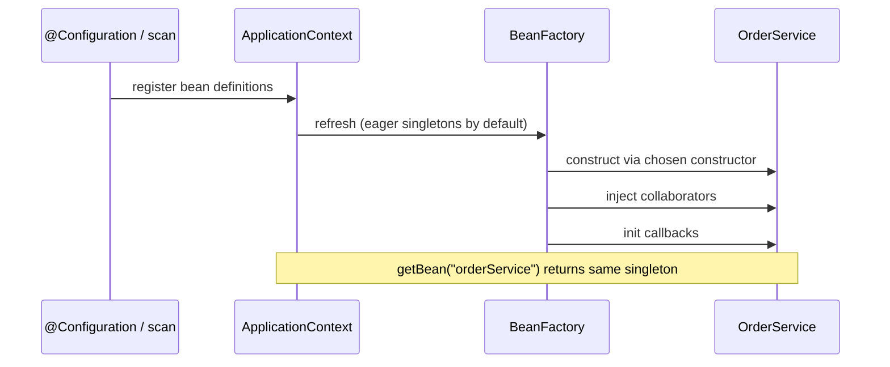

# IoC and Dependency Injection

> **Status:** Completed  
> **Module:** 36 — Spring Framework  
> **Target Java version:** 21  
> **Last reviewed:** 2026-11-11  
> **Chapter profile:** Deep-dive  
> **Depth target:** Level 3 + Level 4 on composition root, bean definitions, and constructor resolution  
> **Examples verified with:** Temurin JDK 21.0.12.1 — [manual-di-container](../../examples/backend/manual-di-container/)

## 1. Learning Objectives

After completing this chapter, you should be able to:

- Explain **Inversion of Control (IoC)** by contrasting normal control flow with framework- or composition-root-controlled assembly.
- Define a **dependency** as a collaborator and walk an **object graph** from a high-level service down to implementations.
- Contrast **tight coupling** with **loose coupling**, and explain why **interfaces alone** do not guarantee good design.
- Place a **composition root**, distinguish it from ordinary `new`, and wire objects with **constructor injection** in plain Java.
- Relate Spring’s **`BeanFactory`**, **`ApplicationContext`**, **bean definitions**, and **component scanning** to that same graph.
- Prefer constructor injection; explain setter/field injection, ambiguity, optional dependencies, and **circular dependencies**.

## 2. Prerequisites

- **Modules 05–07** — classes, interfaces, polymorphism, composition over inheritance. Brief refresher: callers should often depend on an **interface type** so implementations can vary at runtime via dynamic dispatch.
- **Reflection (Module 21 / Module 50)** — containers use `Class`, constructors, and `newInstance`-style calls to build objects. You do not need to master Method Handles here; know that frameworks inspect types at runtime.
- **Module 35** — JPA entities; Spring Data (later in this module) still sits on the same persistence ideas.

## 3. Why This Concept Exists

Large backends contain hundreds of types: repositories, validators, mail senders, payment clients. If each class calls `new ConcreteDependency()` internally:

- You cannot substitute a test double without subclass hacks or static globals.
- Configuration is scattered (`new` appears deep inside business code).
- Swapping implementations (SMTP vs API mail, Stripe vs PayPal) requires editing consumer classes, not only wiring.

**Inversion of Control** means the **framework or composition root** decides which concrete types exist and how they connect, instead of each class hunting down and constructing its own collaborators. **Dependency Injection** is the common IoC style: dependencies are **passed in** (usually via constructor) rather than created inside the consumer.

Spring Framework popularized this style in Java. Under the hood it is still **Java objects, interfaces, and reflection**—not magic reserved for annotations. Pure-Java wiring and the [manual-di-container](../../examples/backend/manual-di-container/) demo teach the same idea Spring automates.

## 4. Conceptual Explanation

### 4.1 What is a dependency?

A **dependency** is an object or service that another class **relies on** to perform its responsibilities. It is often called a **collaborator**.

For example, an `OrderService` may depend on a `PaymentService` to process payments. The `OrderService` does not need to know how the payment system talks to a bank. It only needs a collaborator that provides the payment functionality it requires.

```text
OrderService
    │
    │ needs payment functionality
    ▼
PaymentService  ← dependency / collaborator (often an interface)
    │
    ├── StripePayment   (implementation A)
    └── PaypalPayment   (implementation B)
```

**Constructor injection** lets the application supply either implementation without changing `OrderService`, as long as `OrderService` depends on the **interface** (or a stable abstraction), not on `new StripePayment()` inside its body.

### 4.2 What control is being inverted?

In ordinary application code, **your** code is in charge of both **business steps** and **object construction**:

```java
// Normal control: the service creates its collaborator
public class OrderService {
    private final PaymentService payments = new StripePayment(); // consumer owns creation

    public void place(Order order) {
        payments.charge(order); // consumer also owns the call
    }
}
```

Here two different kinds of “control” are mixed:

| Kind of control | Who decides |
|-----------------|-------------|
| **Business flow** | `OrderService.place` decides when to charge |
| **Object assembly** | `OrderService` also decides *which* payment implementation exists |

**IoC for dependencies** inverts the **assembly** decision: something outside `OrderService` (your `main`, a test, or Spring) chooses `StripePayment` or `PaypalPayment` and **gives** it to `OrderService`. The service still decides **when** to call `charge`; it no longer decides **how payment is implemented**.

```java
// Inverted assembly: collaborator is provided from outside
public class OrderService {
    private final PaymentService payments;

    public OrderService(PaymentService payments) {
        this.payments = payments;
    }

    public void place(Order order) {
        payments.charge(order);
    }
}
```

Frameworks also invert **lifecycle** control (when beans are created, initialized, and destroyed). That is Chapter 02. This chapter focuses on **who builds the object graph**.

### 4.3 Dependency Injection as a process

**Dependency Injection (DI)** means: *dependencies are supplied from the outside* rather than looked up or constructed inside the consumer.

A complete DI process looks like this:

1. Identify types and their required collaborators (`OrderService` needs `PaymentService`; `PaymentService` might need `HttpClient`).
2. Choose concrete implementations for each abstraction (`StripePayment`, a real HTTP client).
3. At a **composition root**, construct leaf objects first, then parents, passing already-built collaborators into constructors.
4. Hand the top-level object (controller, application service) to the rest of the program.
5. In tests, repeat step 3 with fakes instead of production implementations.

**Object graph (step-by-step):**

```text
1. Create StripePayment (leaf)
2. Create OrderService(stripePayment)
3. Create OrderController(orderService)
4. Run the application using the controller
```

Spring automates steps 1–3 from **bean definitions** and reflection. Your brain should still be able to draw the graph; if you cannot, annotations will hide design problems rather than solve them.

### 4.4 Tight coupling vs loose coupling

**Tight coupling** means a class is hard-wired to a specific collaborator type or construction path. Changing the payment vendor forces edits inside `OrderService`.

```java
public class TightOrderService {
    public void place(Order order) {
        StripePayment payments = new StripePayment(); // locked to Stripe + construction details
        payments.charge(order);
    }
}
```

Effects of that design:

- Unit tests must talk to Stripe (or use brittle static mocks).
- A PayPal migration edits business code, not only configuration.
- Construction policy (timeouts, API keys) leaks into the service.

**Loose coupling** means the consumer depends on a **stable abstraction** and receives an implementation from outside:

```java
public class OrderService {
    private final PaymentService payments;
    public OrderService(PaymentService payments) { this.payments = payments; }
}
```

**Interfaces alone do not guarantee good design.** You can still write:

```java
PaymentService payments = new StripePayment(); // interface-typed variable, still tightly constructed here
```

or design a “god” interface that exposes Stripe-specific methods, so every implementor is forced into one vendor’s shape. Loose coupling needs:

- Abstractions that match **use cases**, not vendor APIs
- Injection (or equivalent) so construction lives at the edge of the system
- Substitutable implementations (tests, alternate vendors, local fakes)

### 4.5 Composition root

A **composition root** is the **single place** (or small cluster of configuration classes) responsible for building the object graph for an application or a major subsystem.

| Location | Role |
|----------|------|
| `main` / `SpringApplication.run` | Typical composition roots for apps |
| `@Configuration` classes / component scan results | Spring’s declaration of the graph |
| Test `@BeforeEach` / `@SpringBootTest` setup | Test composition roots |

**Ordinary object creation** inside a domain method is *not* a composition root—it scatters policy. The composition root may call `new` freely; domain services generally should not.

Why it exists:

- One place to see **which** implementations are live (prod vs test vs local).
- Keeps domain code free of infrastructure construction.
- Makes **lifecycle** and **scope** decisions (singleton vs prototype) explicit at the edge.

### 4.6 Injection styles

| Style | How it works | Prefer when |
|-------|--------------|-------------|
| **Constructor** | Required collaborators passed to `new` / constructor | Default for required deps; immutable fields; easy tests |
| **Setter** | Optional collaborators assigned after construction | Truly optional deps; some legacy APIs |
| **Field** | Framework writes directly into fields (`@Autowired` on fields) | Avoid in new code—hides dependencies and complicates plain-Java tests |

Industry default for Spring and plain Java: **constructor injection** for required dependencies.

### 4.7 Spring vocabulary (preview of mechanisms below)

| Term | Meaning |
|------|---------|
| **Bean** | An object **managed** by the Spring container (lifecycle, scope, injection). |
| **Bean definition** | Metadata Spring stores **before** creating instances: type, name, scope, factory method, property values. |
| **`BeanFactory`** | Core SPI that can get beans by name/type; lazy-focused factory abstraction. |
| **`ApplicationContext`** | `BeanFactory` plus application services (events, i18n, environment, resource loading, AOP integration). Most apps use a context. |
| **Component scanning** | Classpath/package scan that finds stereotype-annotated classes and registers bean definitions. |

## 5. Mechanism and Execution Flow

### Context refresh to usable bean



**Constructor resolution (simplified):** When multiple constructors exist, Spring prefers the one annotated with `@Autowired` if present; otherwise it may fail at startup if ambiguity remains. That failure is deliberate—better than guessing which dependency graph to build.

**Scan vs explicit `@Bean`:** Component scanning registers classes annotated with `@Component` stereotypes. `@Configuration` classes additionally register `@Bean` factory methods. Both paths end as **bean definitions** in the same registry; only the registration mechanism differs.

## 6. Terminology

| Term | Meaning |
|------|---------|
| IoC | Externalizing control of object assembly (and often lifecycle) from consumer classes |
| DI | Supplying collaborators from outside the consumer |
| Collaborator / dependency | Object another type needs to do its job |
| Composition root | Place that builds the object graph |
| Wiring | Connecting abstractions to implementations |
| Service locator | Hidden global lookup of dependencies (usually an anti-pattern inside domain code) |

## 7. Step-by-Step Examples

### 6.1 Manual composition (no container)

```java
GreetingService service = new EnglishGreetingService();
GreetingController controller = new GreetingController(service);
String message = controller.greet("Lin");
```

You **explicitly** choose implementations. That is fine for tiny apps and remains the clearest mental model. It scales poorly when graphs are deep and many modules need consistent wiring—then a container helps, but it should still produce the same graph you could draw by hand.

### 6.2 Minimal container (runnable)

Demo: [manual-di-container](../../examples/backend/manual-di-container/).

The `MiniContainer` maps `GreetingService` → `EnglishGreetingService`, then reflects on `GreetingController`’s constructor to inject `GreetingService`.

**Verified (Temurin 21.0.12.1):**

```text
greet=Hello, Lin
diContainer=ok
```

Important lines:

- `container.bind(GreetingService.class, EnglishGreetingService.class)` — registration (type → implementation), analogous to a bean definition’s implementation choice.
- `container.get(GreetingController.class)` — resolves constructor parameters recursively (analogous to Spring autowiring).

What the demo intentionally omits (Spring adds later): singleton caching by default, scopes, `@PostConstruct`, AOP proxies, profiles, and circular-dependency strategies. See Chapter 02 for lifecycle and proxies.

### 6.3 Spring `@Bean` configuration (conceptual—requires Spring on classpath)

```java
@Configuration
public class AppConfig {
    @Bean
    public GreetingService greetingService() {
        return new EnglishGreetingService();
    }

    @Bean
    public GreetingController greetingController(GreetingService service) {
        return new GreetingController(service); // constructor injection at the factory level
    }
}
```

`@Configuration` classes contribute **bean definitions**. Method parameters on `@Bean` methods are resolved from the context—the same idea as constructor injection, expressed as factory methods.

### 6.4 Component scanning and stereotypes (conceptual)

```java
@Service
public class EnglishGreetingService implements GreetingService { ... }

@RestController
public class GreetingController {
    private final GreetingService greetingService;

    public GreetingController(GreetingService greetingService) {
        this.greetingService = greetingService;
    }
}
```

Stereotype annotations (`@Component`, `@Service`, `@Repository`, `@Controller` / `@RestController`) mark types for **component scanning**. Scanning:

1. Examines configured base packages.
2. Finds classes with stereotypes (and meta-annotations).
3. Registers a **bean definition** for each match.
4. Later instantiates and injects according to constructors / annotations.

Spring still ends up calling constructors with resolved dependencies. Scanning is discovery; it does not replace understanding the graph.

## 8. Internal Behavior (Spring, labeled framework)

This is **framework behavior**, not a JLS guarantee.

### 7.1 Bean definitions vs bean instances

Before most objects exist, Spring stores **bean definitions**: name, type, scope (`singleton` / `prototype` / …), whether lazy, constructor argument values, factory bean/method, and so on. Think of a definition as a **recipe**; a bean instance is a **cooked dish**.

Multiple definitions can share a type (with different names/qualifiers). Getting a bean by type alone then requires disambiguation.

### 7.2 `BeanFactory` vs `ApplicationContext`

| API | Responsibility |
|-----|----------------|
| `BeanFactory` | Core get-bean operations; definitions; basic lifecycle hooks |
| `ApplicationContext` | Extends that model with environment/profiles, internationalization, event publication, resource patterns, integration with AOP and Boot |

Application code typically depends on `ApplicationContext` or, better, on **your interfaces** injected into constructors—not on looking up beans repeatedly (service locator style).

### 7.3 Rough refresh sequence (assembly focus)

On context refresh, Spring roughly:

1. Loads configuration (`@Configuration`, component scan, possibly XML/Groovy historically).
2. Registers **bean definitions**.
3. Instantiates beans in dependency order (for singletons, usually eagerly unless lazy).
4. Injects collaborators / populates properties.
5. Applies **BeanPostProcessors** (proxy wrapping and other enhancements—Chapter 02).

Your `MiniContainer` demonstrates steps analogous to 2–4 without the full lifecycle.

### 7.4 Constructor resolution, multiple constructors, ambiguity

When Spring creates a bean:

1. It selects a constructor (the single constructor; or `@Autowired` / `@Inject` on one constructor; or a primary/default strategy depending on version and configuration).
2. For each parameter type, it looks up a matching bean (by type, then qualifier/name).
3. If **zero** candidates for a required parameter → failure at startup (good: fail fast).
4. If **multiple** candidates → ambiguity unless `@Primary`, `@Qualifier`, or parameter name / `@Bean` name resolves it.

**Optional dependencies:** prefer `Optional<Collaborator>`, `@Autowired(required = false)` on setters, or nullable constructor parameters only with clear team conventions. Required business collaborators should not be optional “to silence errors.”

### 7.5 Circular dependencies

A **circular dependency** exists when A needs B and B needs A (directly or through a longer cycle).

**Constructor injection exposes cycles early:** Spring cannot finish constructing A without B, nor B without A. Startup fails. That is usually a **design smell**—split the cycle (extract a third type, use events, or rethink responsibilities).

Setter or `@Lazy` injection can sometimes mask cycles by creating a partial object first. Prefer fixing the design over hiding the cycle. Chapter 02 revisits proxies and lazy references.

## 9. Real-World Use Cases

- Testable services: pass `Clock`, `PaymentService`, or repository fakes via constructors.
- Profile-specific beans (`@Profile("prod")`) in Module 37—still DI, with environment choosing bindings.
- Hexagonal / clean architecture: domain depends on ports (interfaces); infrastructure adapters are bound at the composition root (Module 40).

## 10. Edge Cases and Limitations

- **Too many constructor parameters** — often a Single Responsibility problem (Module 41); split the type.
- **Static singletons / service locators** — hide dependencies; harder to test than constructor injection.
- **Request-scoped identity in singletons** — DI does not make this safe; see security note below and Modules 37–39.
- **Field injection in tests** — encourages Spring-only tests; prefer constructors so plain unit tests work.

## 11. Common Mistakes

### Incorrect — service locator inside business code

```java
public class OrderService {
    public void place(Order o) {
        PaymentClient pay = ServiceRegistry.get(PaymentClient.class); // hidden global
        pay.charge(o);
    }
}
```

### Corrected — constructor injection

```java
public class OrderService {
    private final PaymentClient paymentClient;

    public OrderService(PaymentClient paymentClient) {
        this.paymentClient = paymentClient;
    }
}
```

### Incorrect — `new` for every dependency inside a `@Service`

Duplicates configuration and prevents interface substitution without editing the service.

### Corrected — bind once at the composition root / Spring configuration; inject the abstraction.

### Incorrect — assuming an interface automatically means loose coupling

```java
private final PaymentService payments = new StripePayment();
```

Still tightly coupled to construction and vendor.

### Corrected — inject `PaymentService`; bind `StripePayment` only at the composition root.

## 12. Design Trade-offs

| Approach | Pros | Cons |
|----------|------|------|
| Manual `new` in `main` | Simple, explicit, easy to debug | Does not scale across large graphs |
| DIY container (demo) | Teaches mechanics | Not production-grade (scopes, proxies, etc.) |
| Spring / Micronaut / CDI | Mature lifecycle and ecosystem | Learning curve; startup cost; magic if misused |

## 13. Security Considerations

DI does not fix security. **Do not** inject request-scoped user identity into singleton beans without scoped proxies—risk of **cross-request data leakage**. Use explicit request/session scope and security context patterns (Modules 37–39).

## 14. Best Practices

- Prefer **constructor injection** and `final` fields for required collaborators.
- Depend on **abstractions** that match use cases; bind implementations at the composition root.
- Fail fast on missing or ambiguous beans rather than silently creating `new` inside domain code.
- Keep `@Configuration` / scan base packages intentional—over-broad scanning pulls unexpected components.
- Treat circular dependencies as design bugs first.

## 15. Revision and Mastery

**What you should already understand:** interfaces, polymorphism, why `new ConcreteX()` inside domain logic hurts tests.

**Common gaps:**

- Confusing **DI** with “using Spring.” DI is a pattern; Spring is one implementation.
- Confusing **DI** with the **factory pattern** alone—factories help create objects; DI is about **who calls** creation and **who receives** the result (usually the composition root / container).
- Assuming `@Autowired` on fields is required—**a single constructor** is enough for Spring to inject (Spring Framework 4.3+ style constructor injection).
- Believing interfaces alone equal loose coupling.

**Questions you should answer:**

- What exactly is inverted in IoC for dependencies?
- Walk an object graph of Controller → Service → Repository with two repository implementations.
- Where should the composition root live in a CLI app vs a Spring Boot web app?
- How do bean definitions differ from bean instances?
- Why does constructor injection expose circular dependencies earlier than setter injection?
- How do `@Primary` and `@Qualifier` resolve ambiguity?

## 16. Exercises

1. Extend `MiniContainer` to cache **singleton** instances per type after first `get`.
2. Add a second `GreetingService` implementation; rebind without changing `GreetingController`.
3. Sketch a three-layer graph: Controller → Service → Repository interface; write a `main` composition root that wires fake vs JDBC-shaped implementations (interfaces only is fine).
4. Deliberately create a constructor cycle between two classes and observe that a naive recursive container stack-overflows or fails—then redesign to remove the cycle.

## 17. Chapter Summary

A **dependency** is a collaborator a type needs to do its job. **IoC** moves object-graph decisions to a **composition root** or container; **DI** passes collaborators in—especially via **constructors**. **Loose coupling** needs good abstractions **and** external wiring; interfaces alone are not enough. Spring’s `ApplicationContext` stores **bean definitions**, discovers types via **component scanning**, and builds instances with reflection—the same graph `MiniContainer` demonstrates in pure Java. Understand plain wiring first; annotations describe that wiring.

## 18. Key Terminology

IoC, DI, dependency/collaborator, composition root, bean, bean definition, `BeanFactory`, `ApplicationContext`, component scanning, stereotype, constructor/setter/field injection, circular dependency, `@Primary`, `@Qualifier`.

## 19. References and Further Reading

- Spring Framework documentation — Core Technologies / IoC container (match the Spring version you use; Boot 3.x uses Spring Framework 6.x).
- Handbook: Modules 05–08 (OOP/interfaces), Module 21/50 (reflection), Chapter 02 (lifecycle and AOP).

## 20. Next Steps

[02-bean-lifecycle-and-aop.md](02-bean-lifecycle-and-aop.md) — when beans are created, initialized, proxied, and destroyed; how AOP and `@Transactional` use those proxies.

## Review Checklist

- [x] Mandatory Depth Review: Level 3 + Level 4 on composition root, definitions, constructor resolution
- [x] Expand-preserve: kept manual DI demo, Spring conceptual snippets, mistakes, trade-offs
- [x] Verified `manual-di-container` on Temurin 21.0.12.1 (`greet=Hello, Lin`, `diContainer=ok`)
- [x] Spring snippets labeled conceptual without requiring Maven for this chapter
