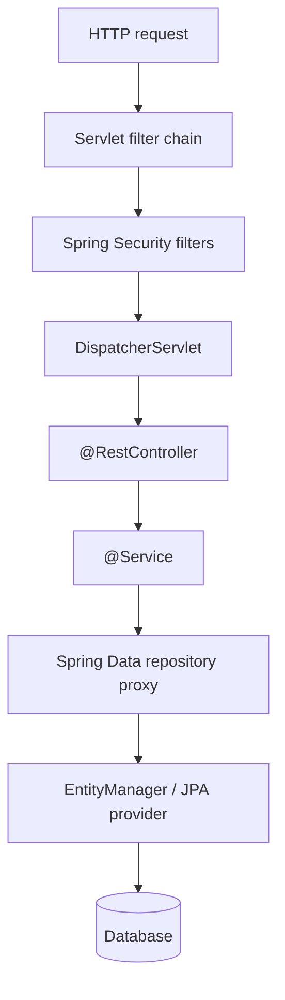

# Spring Data, MVC, and Security Overview

> **Status:** Completed  
> **Module:** 36 — Spring Framework  
> **Target Java version:** 21  
> **Last reviewed:** 2026-11-11  
> **Chapter profile:** Deep-dive  
> **Depth target:** Level 3 (Spring Data, MVC pipeline, DTO/OSIV, security overview); Level 4 preview on repository proxy generation and filter ordering  
> **Examples verified with:** Temurin JDK 21.0.12.1 — [rest-httpserver-demo](../../examples/backend/rest-httpserver-demo/); Ch.01–02 [manual-di-container](../../examples/backend/manual-di-container/), [jdk-dynamic-proxy-demo](../../examples/backend/jdk-dynamic-proxy-demo/)

## 1. Learning Objectives

After completing this chapter, you should be able to:

- Explain why **Spring Data** repository interfaces work without you writing a `UserRepositoryImpl` class, and how that relates to **JDK dynamic proxies** from Chapter 02.
- Contrast **Spring Data** access with hand-written **`EntityManager`** code from Module 35 (control, transactions, query ownership).
- Trace one HTTP request through **Servlet filters → Spring Security → `DispatcherServlet` → controller → service → repository → JDBC/JPA**.
- Distinguish **JPA entities** from **API DTOs** and explain why returning entities from REST controllers is risky.
- Describe **Open Session In View (OSIV)** and how it interacts with lazy loading and transaction boundaries.
- Contrast **HTTP filter-chain security** with **method security** (`@PreAuthorize`) and know when each runs relative to `@GetMapping`.

## 2. Prerequisites

- **Module 35 — JPA:** entities, `EntityManager`, persistence context, lazy collections, `@Transactional` service boundaries. Refreshers: a **persistence context** tracks loaded entities for the duration of a transaction (or longer if OSIV is on). **Lazy loading** fetches related rows only when the association is read—and only while the session is open.
- **Module 32 — HTTP:** verbs, status codes, headers. A **REST** API exposes resources over HTTP with predictable URLs and representations (often JSON).
- **Chapters 01–02:** beans, `ApplicationContext`, **proxies** for AOP and Spring Data.

## 3. Why This Concept Exists

Enterprise backends repeat the same three problems on almost every service:

1. **Persist domain data** (users, orders, invoices) without drowning in JDBC boilerplate.
2. **Expose HTTP APIs** that map URLs and JSON to Java methods with correct status codes.
3. **Authenticate callers** and **authorize** actions before business logic runs.

The **Spring Framework** ships focused modules—**Spring Data**, **Spring Web MVC** (often called Spring MVC), and **Spring Security**—that integrate with the same **IoC container** you learned in Chapter 01. They are not a different language: they are **Java interfaces, servlet APIs, JPA, and filter chains** assembled by configuration and runtime-generated proxies.

This chapter teaches enough to read and reason about a typical layered service. Modules **38** (REST design) and **39** (security depth) go further on contracts and token flows; you should not need them merely to understand *what happens* on each request.

## 4. Conceptual Explanation

### 4.1 Layered request handling (big picture)

A common production layout keeps responsibilities separated:

```text
HTTP client
    │
    ▼
Servlet container (Tomcat, etc.)
    │
    ▼
Filter chain ─────────────────── Spring Security lives here (authn/authz)
    │
    ▼
DispatcherServlet ─────────────── Spring MVC front controller
    │
    ▼
@RestController ──────────────── HTTP mapping, status, JSON view
    │
    ▼
@Service ──────────────────────── business rules, @Transactional boundaries
    │
    ▼
Spring Data repository ─────── proxy → EntityManager → database
```



| Layer | Primary question it answers |
|-------|----------------------------|
| Filters / Security | Is this caller allowed to reach the controller at all? |
| `DispatcherServlet` | Which controller method handles this URL and verb? |
| Controller | What HTTP status and body represent this outcome? |
| Service | What business rules and transaction boundary apply? |
| Repository | How do we load and store rows for this aggregate? |

### 4.2 Terminology

| Term | Meaning |
|------|---------|
| **Repository** | Abstraction for persistence operations (find, save, delete) |
| **`DispatcherServlet`** | Spring MVC servlet that dispatches requests to `@RequestMapping` methods |
| **DTO (Data Transfer Object)** | Immutable or simple type shaped for the API contract, not the database schema |
| **OSIV** | Keeps a JPA `EntityManager` session open for the whole HTTP request so lazy loads work in the view layer |
| **Filter chain** | Ordered servlet `Filter` instances; each may proceed or short-circuit the response |
| **Method security** | Authorization annotations enforced by AOP around method calls (often on services) |

## 5. Mechanism and Execution Flow — Spring Data, MVC, and Security

### 5.1 What Spring Data promises

**Spring Data JPA** lets you declare persistence as a **Java interface** extending `JpaRepository<Entity, Id>` (or similar). At runtime Spring registers a **bean** that implements that interface—even though you never wrote `class UserRepositoryImpl`.

That implementation is a **proxy** (same family of mechanism as AOP in Chapter 02): when you call `users.findById(1L)`, the proxy delegates to framework code that:

1. Obtains an `EntityManager` (or uses a shared template).
2. Builds and runs the appropriate query (derived from the method name, `@Query`, or custom fragment).
3. Maps rows to your entity type and returns `Optional`, `List`, `Page`, etc.

```java
public interface UserRepository extends JpaRepository<User, Long> {
    Optional<User> findByEmail(String email);
}
```

**Derived query methods:** `findByEmail` is parsed into something equivalent to “select … where email = ?”. That is fast for CRUD but **limited** by naming conventions; awkward queries need `@Query` or a custom implementation.

### 5.2 When you still use `EntityManager`

Spring Data does **not** remove JPA semantics from Module 35. Under the proxy you still have:

- A **persistence context** and lazy loading rules.
- **Flush** and **dirty checking** at transaction commit.
- The option to drop down with `@PersistenceContext EntityManager em` for dynamic queries, bulk updates, or criteria APIs.

| Approach | You own | Spring owns |
|----------|---------|-------------|
| **`EntityManager` in `@Repository` class** | Every query string, mapping, exception translation | Little beyond DI of `EntityManager` |
| **Spring Data interface** | Method names / `@Query`, entity mapping | Proxy, query derivation, default CRUD, `Pageable` |

**Trade-off:** Spring Data accelerates standard repositories; complex reporting or native SQL may stay clearer in an explicit `@Repository` using `EntityManager` or `JdbcClient` (Module 35 / JDBC chapters).

### 5.3 Transactions and the service boundary

Repository methods participate in the **caller's transaction** when one exists. In layered apps, **`@Transactional` on the service** is the usual boundary:

```java
@Service
public class UserService {
    private final UserRepository users;

    public UserService(UserRepository users) {
        this.users = users;
    }

    @Transactional(readOnly = true)
    public UserDto getById(long id) {
        User user = users.findById(id)
            .orElseThrow(() -> new UserNotFoundException(id));
        // Eagerly touch needed associations HERE while session is open
        return UserDto.from(user);
    }
}
```

If the transaction ends before the controller serializes JSON, **lazy** associations are not loadable unless OSIV extends the session (next section).

### 5.4 Internal behavior (labeled: Spring Data JPA / Hibernate)

Spring Data JPA repository interfaces are implemented by **`SimpleJpaRepository`** (default) wrapped in a **JDK dynamic proxy** (or subclass-based proxy for some cases). Query methods are handled by **`PartTreeJpaQuery`** or similar parsers that build JPA queries from method names.

Exact class names vary by Spring Data version; the durable lesson is: **interface method call → proxy → framework query → `EntityManager`**.

## 6. Spring MVC: Request Path in Detail

### 6.1 From socket to controller method

Once filters allow the request through, **`DispatcherServlet`** (registered like any servlet) becomes the MVC entry point:

1. **Handler mapping** — match request URI template and HTTP method to a `@GetMapping` / `@PostMapping` method.
2. **Handler adapter** — invoke the method with resolved arguments (`@PathVariable`, `@RequestBody`, etc.).
3. **Return value handling** — convert the return type to HTTP (status, headers, body).

For JSON APIs, `@RestController` combines `@Controller` + `@ResponseBody` on class methods, so return values go through **message converters** (typically **Jackson**) instead of view names.

```java
@RestController
@RequestMapping("/api/users")
public class UserController {
    private final UserService userService;

    public UserController(UserService userService) {
        this.userService = userService;
    }

    @GetMapping("/{id}")
    public ResponseEntity<UserDto> get(@PathVariable long id) {
        return ResponseEntity.ok(userService.getById(id));
    }
}
```

- **`@PathVariable`** binds `id` from `/api/users/42`.
- **`ResponseEntity`** carries both **status** (200, 404, …) and **body** explicitly.

### 6.2 Plain-Java parallel (verified)

The [rest-httpserver-demo](../../examples/backend/rest-httpserver-demo/) implements the same *HTTP contract* without Spring:

**Verified (Temurin 21.0.12.1):**

```text
GET /users/1 status=200 body={"id":1,"name":"Lin"}
POST /users status=201
restDemo=ok
```

There, your code manually parses paths and sets status codes. Spring MVC automates binding and conversion but **does not change HTTP semantics**: 404 still means “resource not found,” 201 still means “created.”

### 6.3 DTO vs entity at the web boundary

A **JPA entity** mirrors tables, relationships, and lazy graphs. An API **DTO** (often a Java **record**) mirrors what clients need and **nothing else**:

```java
public record UserDto(long id, String email, String displayName) {
    public static UserDto from(User user) {
        return new UserDto(user.getId(), user.getEmail(), user.getDisplayName());
    }
}
```

| Return type from REST | Risk |
|------------------------|------|
| **Entity** | Jackson may serialize lazy proxies unpredictably; schema leaks to clients; renaming a column becomes an API break |
| **DTO / projection** | Stable contract; you load exactly what you expose |

**Incorrect — entity as JSON:**

```java
@GetMapping("/{id}")
public User get(@PathVariable long id) {
    return users.findById(id).orElseThrow(); // couples API to persistence model
}
```

**Corrected — DTO at the edge:**

```java
@GetMapping("/{id}")
public UserDto get(@PathVariable long id) {
    return userService.getById(id); // service returns DTO
}
```

### 6.4 Open Session In View (OSIV)

By default, **`spring.jpa.open-in-view=true`** (common in Spring Boot) keeps the JPA session open **until the MVC layer finishes rendering the response**. That allows lazy associations to load during JSON serialization—**even after the service `@Transactional` method returned**.

**Why teams disable it for APIs** (`spring.jpa.open-in-view=false`):

- Hidden **N+1 queries** during serialization (performance surprises).
- **Leaky domain model**—controllers accidentally trigger lazy loads instead of services declaring data needs.
- **Blurry transaction boundary**—read-only work appears to succeed outside the service transaction.

**Correct pattern without OSIV:** fetch required data inside the transactional service (join fetch, entity graph, or DTO query) so the controller only sees fully materialized DTOs.

## 7. Spring Security: Filter Chain vs Method Security

### 7.1 Authentication and authorization

- **Authentication** — establish **who** is calling (credentials, JWT, session cookie).
- **Authorization** — decide **what** they may do (roles, scopes, authorities).

Both can appear in configuration, but they run at different **stages** of request processing.

### 7.2 Filter chain (web layer)

**Spring Security** installs servlet **filters** ahead of `DispatcherServlet`. A simplified order:

```text
Request
  → SecurityContextPersistenceFilter (establishes/clears context)
  → LogoutFilter
  → UsernamePasswordAuthenticationFilter / BearerTokenAuthenticationFilter (etc.)
  → AuthorizationFilter (HttpSecurity rules: permitAll, authenticated, hasRole)
  → ... other security filters ...
  → DispatcherServlet → controller
```

Example **HTTP authorize** rules:

```java
@Configuration
@EnableWebSecurity
public class SecurityConfig {

    @Bean
    SecurityFilterChain filterChain(HttpSecurity http) throws Exception {
        return http
            .authorizeHttpRequests(auth -> auth
                .requestMatchers("/actuator/health").permitAll()
                .requestMatchers("/api/admin/**").hasRole("ADMIN")
                .anyRequest().authenticated())
            .oauth2ResourceServer(oauth -> oauth.jwt(Customizer.withDefaults()))
            .build();
    }
}
```

If authorization fails here, the client receives **401 Unauthorized** or **403 Forbidden** and the **controller never runs**. That is **fail-fast at the edge**—good for coarse URL protection.

### 7.3 Method security (service / controller layer)

**Method security** applies **after** the request reaches a Spring bean, via **AOP proxies** (Chapter 02):

```java
@Service
public class OrderService {

    @PreAuthorize("hasAuthority('orders:read')")
    public OrderDto getOrder(long id) {
        // business logic
    }
}
```

Enable with `@EnableMethodSecurity` (Boot 3 / Spring Security 6).

| Mechanism | Runs where | Typical use |
|-----------|------------|-------------|
| **HTTP `authorizeHttpRequests`** | Servlet filters, before dispatcher | Public health, `/api/admin/**` role gates |
| **`@PreAuthorize` / `@Secured`** | Around method invocation | Fine-grained rules on service methods, ownership checks with `#id` SpEL |

They **compose**: filters may require authentication for `/api/**` while `@PreAuthorize` enforces `orders:write` only on dangerous service methods. Module **39** deepens JWT validation, session fixation, and CSRF; you should already understand that **filters are not optional**—they are the servlet-standard interception point that Spring Security extends.

### 7.4 Common security mistakes

**Incorrect — relying only on hiding URLs:** security by obscurity; scanners still hit endpoints.

**Incorrect — `@PreAuthorize` on controllers without enabling method security:** annotation silently ignored (depending on configuration).

**Corrected — defense in depth:** authenticate at the edge, authorize URLs for coarse rules, enforce sensitive operations on services with method security and tests.

## 8. Step-by-Step Examples

### 8.1 Minimal stack (mental model)

```text
GET /api/users/7
  1. Tomcat accepts TCP connection, builds HttpServletRequest
  2. Security filters validate JWT → populate SecurityContext
  3. AuthorizationFilter allows authenticated access to /api/users/**
  4. DispatcherServlet maps to UserController.get(7)
  5. UserService.getById(7) @Transactional loads User, maps UserDto
  6. Jackson writes JSON; 200 OK
```

### 8.2 Pagination (Spring Data)

```java
Page<User> findByLastName(String lastName, Pageable pageable);
```

Controller passes `Pageable` from `@RequestParam` defaults; Spring Data translates to **limit/offset** (or keyset in advanced setups).

## 9. Real-World Use Cases

- **CRUD microservice:** `User` entity, `UserDto`, `UserRepository`, role-protected admin routes.
- **B2B API:** JWT resource server + scope-based `@PreAuthorize` on invoice exports.
- **Read-heavy dashboard:** disable OSIV; repository `@Query` with DTO projection to avoid loading full entity graphs.

## 10. Edge Cases and Limitations

- **Derived query explosion:** dozens of `findByXAndYAndZ` methods become hard to navigate—introduce specifications or explicit queries.
- **`Optional` in controller vs service:** returning empty `Optional` from a service is fine; map to 404 in the controller or use a domain exception + `@ControllerAdvice` (Module 37).
- **Lazy `ManyToOne` in DTO mapping:** without fetch plan, mapping triggers extra queries—address in the transaction, not in the view.

## 11. Common Mistakes

### Incorrect — returning JPA entities directly from REST

Exposes lazy graphs, couples API to schema, and risks `LazyInitializationException` when OSIV is off.

### Corrected — map to DTO or projection in the service layer.

### Incorrect — treating Spring Data as “no SQL needed ever”

Complex reports, bulk migrations, and performance tuning still require understanding SQL and `EntityManager`.

### Incorrect — authorization only in the UI

Every service endpoint must enforce rules server-side.

## 12. Design Trade-offs

| Choice | Benefit | Cost |
|--------|---------|------|
| Spring Data derived queries | Rapid CRUD | Naming limits; opaque SQL until you log queries |
| Entity in API | Less mapping code | Fragile contract; leakage |
| OSIV on | Lazy loads “just work” in controllers | N+1 risk; muddy layering |
| Security as filters | Central enforcement | Debugging indirection; ordering matters |
| Method security | Fine-grained | SpEL complexity; must test with security context |

## 13. Revision and Mastery

1. What Java mechanism implements `UserRepository` without a hand-written class?
2. In what order do Security filters and `DispatcherServlet` run?
3. Where should lazy associations be initialized if OSIV is disabled?
4. When would you choose `@PreAuthorize` over `requestMatchers().hasRole()`?
5. How does `findByEmail` differ from `em.createQuery(...)` you would write manually?

## 14. Exercises

1. Write a `UserDto` record and a static `from(User)` mapper that touches only scalar fields.
2. List three `requestMatchers` rules for a fictional billing API (public quote, authenticated pay, admin refunds).
3. Narrate one HTTP GET from socket accept to SQL `select` for `findById` (include transaction boundary).
4. Sketch configuration to set `spring.jpa.open-in-view=false` and move fetching into `UserService`.

## 15. References

- [Spring Data JPA — Reference Documentation](https://docs.spring.io/spring-data/jpa/reference/html/)
- [Spring Framework — Web MVC](https://docs.spring.io/spring-framework/reference/web/webmvc.html)
- [Spring Security — Servlet Architecture](https://docs.spring.io/spring-security/reference/servlet/architecture.html)

## 16. Chapter Summary

Spring Data, MVC, and Security layer **declarative configuration** over JPA, servlets, and filters. Repositories are **proxied interfaces**; HTTP flows through **filters then `DispatcherServlet`**; **DTOs** protect your API contract; **OSIV** trades convenience for hidden queries; **security** belongs in the filter chain *and* at method boundaries where appropriate. Master Module 35 and plain HTTP first—Spring organizes the same building blocks.

## 17. Next Steps

- Module **37** — Spring Boot autoconfiguration, externalized config, production packaging ([spring-boot-minimal](../../examples/backend/spring-boot-minimal/) demo).
- Module **38** — REST design, error envelopes, contract testing.
- Module **39** — Security architecture, OAuth2, JWT validation depth.

## Review Checklist

- [x] Mandatory Depth Review Levels 1–4 applied; core topics at Level 3
- [x] Repository proxy vs `EntityManager` taught, not listed
- [x] Full MVC + security pipeline with DTO and OSIV pitfalls
- [x] Modules 38–39 linked for depth, not as substitutes for explanation
