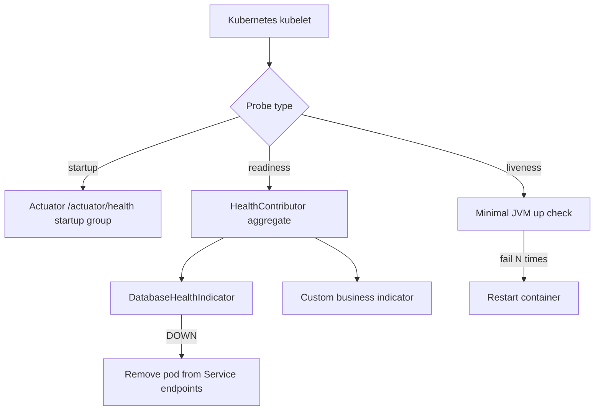

# Actuator, Testing, and Production

> **Status:** Completed  
> **Module:** 37 — Spring Boot  
> **Target Java version:** 21  
> **Last reviewed:** 2026-11-11  
> **Chapter profile:** Technical  
> **Depth target:** Level 3 (actuator exposure, slice vs full tests, production pitfalls)  
> **Examples verified with:** Temurin JDK 21.0.12.1 — [spring-boot-minimal](../../examples/backend/spring-boot-minimal/) (`@WebMvcTest`, `mvnw test`); Module 30 testing foundations

## 1. Learning Objectives

After completing this chapter, you should be able to:

- Enable **Spring Boot Actuator** and explain **health**, **metrics**, and **info** endpoints.
- Apply a **security posture** for actuator in production (exposure, authentication, network placement).
- Choose among **`@WebMvcTest`**, **`@DataJpaTest`**, and **`@SpringBootTest`** for a sensible test pyramid.
- Use **`MockMvc`** and `@MockBean` to test MVC + security rules without a full manual server.
- Apply production practices: **graceful shutdown**, logging, JVM/container settings, and common packaging pitfalls.

## 2. Prerequisites

- **Module 30** — JUnit 5, test doubles, test pyramid.
- **Module 31** — diagnostics mindset (logs, metrics).
- **Chapters 01–03** — autoconfig, configuration, web layer.

## 3. Why This Concept Exists

Shipping a Boot JAR is only the beginning. Operations teams need **health** signals for orchestrators, **metrics** for alerting, and **automated tests** that catch broken wiring—not just broken algorithms.

Actuator exposes operational endpoints over the same embedded server (or a separate management port). Boot Test annotations load **controlled slices** of the `ApplicationContext` so CI stays fast while still exercising real Spring MVC binding.

## 4. Spring Boot Actuator

### 4.1 Dependency and basics

Add **`spring-boot-starter-actuator`**. Endpoints are exposed over HTTP (and JMX) when configured.

| Endpoint | Purpose |
|----------|---------|
| `/actuator/health` | **Liveness/readiness** style signal; components (DB, disk, custom) |
| `/actuator/metrics` | **Micrometer** metrics (JVM, HTTP, custom) |
| `/actuator/info` | Static/custom build info |

By default, Boot 2+ exposes only **`health`** on the web port unless you widen exposure—**do not** expose everything in production.

```properties
management.endpoints.web.exposure.include=health,info
management.endpoint.health.show-details=when_authorized
```

**Boot 3 security defaults (caution):** even when an endpoint is “enabled,” it is **not necessarily exposed over HTTP**. Only ids listed in `management.endpoints.web.exposure.include` (or `*`) are reachable on the web base path (`/actuator` by default). Adding `spring-boot-starter-security` without custom rules often leaves **all actuator paths authenticated**—health probes must be explicitly permitted for unauthenticated kubelet checks where policy allows.

**JMX vs web:** many endpoints are available via JMX when `spring.jmx.enabled=true`; disable JMX in constrained containers if unused—reduces attack surface.

#### Endpoint exposure matrix (reference)

Base path: `/actuator/{id}` unless `management.endpoints.web.base-path` changes.

| Endpoint id | Typical production HTTP expose? | Sensitivity | Notes |
|-------------|--------------------------------|-------------|-------|
| `health` | **Yes** (minimal) | Low–medium | Use `show-details=never` or `when_authorized` on public networks |
| `info` | Optional | Low | Build/git metadata only |
| `metrics` | Internal / auth | Medium | Useful for Prometheus scrape behind auth |
| `prometheus` | Internal scrape | Medium | Micrometer registry export |
| `loggers` | Rarely | Medium | Can change levels at runtime—powerful |
| `env` | **No** | **High** | Reveals env vars and property values |
| `configprops` | **No** | **High** | Bound `@ConfigurationProperties` trees |
| `beans` | **No** | High | Full wiring graph |
| `heapdump` | **No** | **Critical** | Full memory snapshot |
| `threaddump` | Diagnostic only | High | Threads may show secrets in stack locals |
| `shutdown` | **No** (default disabled) | Critical | Must enable endpoint + exposure deliberately |
| `mappings` | Dev / internal | Medium | All MVC routes exposed to scanners |

**`management.endpoints.access.*` (Boot 3.4+):** layer additional access rules beyond exposure—consult current reference when hardening.

**Incorrect — enabling `shutdown` on a public port:** remote unauthenticated shutdown if exposure and security are misconfigured.

```properties
# Safe pattern: enable shutdown only on internal management port + auth
management.server.port=18081
management.endpoint.shutdown.enabled=true
management.endpoints.web.exposure.include=health,shutdown
# + Spring Security: ADMIN role for non-health endpoints
```

**Separate management port** (optional):

```properties
management.server.port=18081
```

Keeps metrics off the public application port.

### 4.2 Health indicators

```java
@Component
public class DatabaseHealthIndicator implements HealthIndicator {

    private final DataSource dataSource;

    public DatabaseHealthIndicator(DataSource dataSource) {
        this.dataSource = dataSource;
    }

    @Override
    public Health health() {
        try (Connection c = dataSource.getConnection()) {
            return Health.up().build();
        } catch (SQLException ex) {
            return Health.down().withDetail("db", ex.getMessage()).build();
        }
    }
}
```

**Kubernetes:**

- **Liveness** — restart if app is deadlocked (careful: don’t include flaky external deps).
- **Readiness** — remove from load balancer when DB is unavailable.

Split checks via `management.health.group` (Boot 2.6+) when you need different probe semantics.

**Example — separate liveness and readiness groups:**

```properties
management.endpoint.health.group.liveness.include=livenessState
management.endpoint.health.group.readiness.include=readinessState,db
management.endpoints.web.path-mapping.health=liveness
```

Kubernetes:

- Liveness probe → `/actuator/health/liveness` (process up; no external DB)
- Readiness probe → `/actuator/health/readiness` (includes `db` indicator)

This prevents kubelet from restarting the pod when PostgreSQL blips while still removing the pod from Service load balancing.

**Custom indicator registration:** any `@Component` implementing `HealthIndicator` or `ReactiveHealthIndicator` contributes to the composite; name appears as a key under `components` in the JSON response when details are visible.

### 4.3 Actuator security posture

| Risk | Mitigation |
|------|------------|
| Public `/actuator/env` dumps secrets | Never expose `env`, `beans`, `configprops` publicly |
| Unauthenticated `/actuator/health` details | `show-details=when_authorized` or network policy |
| Scanners probing known paths | Firewall, mTLS, or management port on internal network only |

Integrate with **Spring Security** (Module 36/39): permit health for probes, require auth for metrics.

**Incorrect — `management.endpoints.web.exposure.include=*` on the internet.**

**Corrected — minimal exposure + Security filter rules + separate management listener if needed.

### 4.4 Micrometer and custom metrics (production awareness)

Actuator **`/actuator/metrics`** exposes **Micrometer** meters registered in the context. Common JVM and Tomcat meters appear automatically; business metrics use `MeterRegistry`:

```java
@Service
public class PaymentService {
    private final Counter paymentsProcessed;

    public PaymentService(MeterRegistry registry) {
        this.paymentsProcessed = registry.counter("payments.processed", "result", "success");
    }

    public void complete(Payment p) {
        // business logic
        paymentsProcessed.increment();
    }
}
```

**Alerting:** export to Prometheus/Grafana/StatsD via registry implementation dependency—actuator is the **read window**, not long-term storage.

**Cardinality trap:** unbounded tags (`userId` as a tag on every counter) explode time-series cost—use logging or tracing for high-cardinality dimensions.

## 5. Mechanism and Execution Flow — Health and Liveness Probes



**Liveness vs readiness:** **Readiness** failing removes the pod from load balancing while the process keeps running—use for transient DB blips. **Liveness** failing restarts the container—use only for deadlocks or wedged JVM states, not for slow dependencies, or you amplify outages.

## 6. Testing with Boot

### 5.1 Test pyramid with Spring

| Layer | Boot tool | Context size |
|-------|-----------|--------------|
| Pure unit | JUnit + Mockito, no Spring | None |
| Web slice | `@WebMvcTest` | MVC + one controller (+ advised beans) |
| Data slice | `@DataJpaTest` | JPA + in-memory DB |
| Integration | `@SpringBootTest` | Full or near-full context |

Full **`@SpringBootTest`** is powerful but **slow**—reserve for wiring that slices cannot cover.

#### Choosing `@WebMvcTest` vs `@DataJpaTest` vs `@SpringBootTest` (why, not just what)

| Annotation | What loads | What is excluded / mocked | Choose when |
|------------|------------|---------------------------|-------------|
| `@WebMvcTest` | `Web` layer slice: `DispatcherServlet`, Jackson, validation, one controller (or explicit set), `@ControllerAdvice` in scope | Full `@Service` / `@Repository` beans → use `@MockBean` | You need HTTP status codes, JSON shape, validation errors, and security filter behavior **without** database |
| `@DataJpaTest` | JPA + in-memory DB (often H2), `TestEntityManager`, `@Repository` beans | **No** MVC, **no** full security graph unless `@AutoConfigureTestDatabase` combined manually | Repository queries, `@Query`, entity mapping, transactional rollback per test |
| `@SpringBootTest` | Entire application context (or custom `@ImportAutoConfiguration` subset) | Nothing by default—real wiring unless `@MockBean` | End-to-end confidence: real beans, profile-specific config, actuator, scheduled tasks |

**Why `@WebMvcTest` is faster:** it does not start Hibernate metamodel scan, connection pools, or every `@Service` dependency—typically **hundreds of fewer beans**. A suite of 50 controller tests at full context can exceed CI time budgets.

**Why `@DataJpaTest` does not replace controller tests:** it never exercises `MockMvc` or request binding; a perfect repository test still allows a broken `@PostMapping` path.

**Why `@SpringBootTest` still matters:** slices can miss **conditional autoconfig** interactions (custom security filter order + actuator + your `@ControllerAdvice`). One or two full tests per service catch “bean not created in prod profile” failures.

**`@SpringBootTest(webEnvironment = NONE)`:** loads full context without servlet container—useful for batch/scheduling wiring tests without HTTP overhead.

**`@JdbcTest` / `@JsonTest` / `@RestClientTest`:** additional slices for JDBC/Jackson/RestClient boundaries—prefer the narrowest slice that still reproduces the failure class.

### 5.2 `@WebMvcTest` + `MockMvc` (verified pattern)

From [spring-boot-minimal](../../examples/backend/spring-boot-minimal/):

```java
@WebMvcTest(HelloController.class)
class HelloControllerTest {

    @Autowired
    private MockMvc mvc;

    @Test
    void helloReturnsOk() throws Exception {
        mvc.perform(get("/hello"))
            .andExpect(status().isOk())
            .andExpect(content().string("{\"message\":\"bootMinimal=ok\"}"));
    }
}
```

**Verified:** `Tests run: 1, Failures: 0, Errors: 0`.

When the controller needs collaborators:

```java
@WebMvcTest(UserController.class)
class UserControllerTest {

    @Autowired
    private MockMvc mvc;

    @MockBean
    private UserService userService;

    @Test
    void getReturns404WhenMissing() throws Exception {
        when(userService.getById(99L)).thenThrow(new UserNotFoundException(99L));
        mvc.perform(get("/api/v1/users/99"))
            .andExpect(status().isNotFound());
    }
}
```

- **`@MockBean`** registers a Mockito mock **in the Spring test context**, replacing the real bean.
- **`MockMvc`** simulates dispatcher servlet dispatch without opening a TCP port (faster, deterministic).

### 5.3 `@MockBean` vs plain Mockito

| Pure `@ExtendWith(MockitoExtension.class)` | `@WebMvcTest` + `@MockBean` |
|---------------------------------------------|-----------------------------|
| Tests class in isolation | Tests Spring MVC mapping, JSON, validation, security filters |
| No `ApplicationContext` cost | Small context startup cost |

Prefer **plain unit tests** for heavy domain logic; use **slice tests** for HTTP contract and framework integration.

### 5.4 Full integration tests

```java
@SpringBootTest(webEnvironment = SpringBootTest.WebEnvironment.RANDOM_PORT)
class OrderApiIT {

    @Autowired
    private TestRestTemplate rest;

    @Test
    void createOrder() {
        // hits real embedded server
    }
}
```

Use sparingly; consider **Testcontainers** for real PostgreSQL instead of H2 when SQL dialect matters.

#### Test context caching

Spring Test **caches** `ApplicationContext` across test classes when configuration is identical (`@DirtiesContext` forces rebuild). Symptom: “first test class slow, rest fast.”

| Practice | Reason |
|----------|--------|
| Reuse same `@Import` / profile in slice tests | Maximizes cache hits |
| `@DirtiesContext` only when mutating global state | Avoid unnecessary reloads |
| `@MockBean` in a `@SpringBootTest` base class | Can invalidate cache if definitions differ per subclass |

**Flaky tests:** static mutable state between tests without `@DirtiesContext` pollutes later tests—prefer instance state in beans under test.

### 5.5 Security rule tests

```java
@SpringBootTest
@AutoConfigureMockMvc
class SecurityIT {

    @Autowired
    private MockMvc mvc;

    @Test
    @WithMockUser(roles = "ADMIN")
    void adminEndpointAllowed() throws Exception {
        mvc.perform(get("/api/admin/stats")).andExpect(status().isOk());
    }
}
```

**Incorrect — no tests for security rules:** regressions ship easily.

## 7. Production Checklist

- **JVM/container memory:** align heap with cgroup limits (Module 27 ergonomics); avoid OOMKill loops in Kubernetes.
- **Structured logging:** JSON logs with **correlation IDs** from a servlet filter; ship to centralized logging.
- **Graceful shutdown:**

  ```properties
  server.shutdown=graceful
  spring.lifecycle.timeout-per-shutdown-phase=30s
  ```

  Allows in-flight HTTP requests to complete during rolling deploys.

#### Graceful shutdown and health during rollouts (mechanism)

**Trigger path:** SIGTERM to the JVM (Kubernetes pod termination) → Spring Boot registers shutdown hooks → **`SmartLifecycle`** beans stop in phases → embedded Tomcat stops accepting **new** connections while finishing active requests (within timeout).

| Phase | Behavior |
|-------|----------|
| Pre-stop hook (K8s optional) | Delay SIGTERM until LB drains |
| Graceful period | Existing HTTP workers complete; thread pool quiesces |
| Timeout exceeded | Forced shutdown—clients may see reset connections |
| Context close | Beans destroyed; DB pools closed |

**Probe interaction:** set **readiness** to fail when shutting down so the Service endpoints remove the pod **before** SIGTERM if your platform supports `preStop` sleep + readiness coordination. **Liveness** should not flip on brief DB slowness during drain.

**Actuator `/actuator/health` during shutdown:** depending on Boot version and lifecycle state, aggregate health may report **DOWN**—configure probes to tolerate transitional states or use separate liveness/readiness groups (`management.health.group.readiness.include=readinessState,db`).

**Load balancer:** align `terminationGracePeriodSeconds` ≥ `spring.lifecycle.timeout-per-shutdown-phase` plus buffer for slow clients.

- **Externalized config only** (Ch.02); secrets from env/vault.
- **Disable devtools** and verbose SQL logging in prod.
- **Actuator exposure** minimized; health for probes only on public interfaces.

### 6.1 Packaging pitfalls

| Pitfall | Symptom |
|---------|---------|
| Running wrong JAR (thin vs repackaged) | `ClassNotFoundException` for dependencies |
| Missing `spring-boot-maven-plugin` `repackage` | Same |
| Wrong `main` manifest | JVM exits immediately |
| Fat JAR + duplicate signed libs | Rare security/build issues—prefer BOM versions |

**Verified fat JAR:** [spring-boot-minimal](../../examples/backend/spring-boot-minimal/) `java -jar target/*.jar` serves Tomcat on configured port.

## 8. Edge Cases

- **Slow CI:** too many `@SpringBootTest` classes—rebalance toward slices.
- **Context failure:** use `--debug` condition report; read `FailureAnalyzer` messages.
- **Flaky health:** external dependency in liveness probe causes restart storms—move to readiness group.
- **Mockito agent warnings on JDK 21+:** follow Mockito docs for inline mock maker agent if required in future JDKs (seen in minimal demo test log).

## 9. Common Mistakes

### Incorrect — exposing all actuator endpoints publicly

Attackers harvest `/actuator/env` and `/actuator/heapdump`.

### Incorrect — `@SpringBootTest` for every controller test

Minutes-long CI suites.

### Incorrect — health check hits slow third-party API in liveness

Unnecessary pod restarts.

## 10. Design Trade-offs

| Many slice tests | Many full integration tests |
|------------------|----------------------------|
| Fast feedback | High confidence, slow CI |

| Actuator on app port | Separate management port |
|----------------------|---------------------------|
| Simpler networking | Clearer security boundary |

## 11. Revision and Mastery

1. Liveness vs readiness for a payment API with external fraud scorer?
2. When is `@MockBean` preferable to testing the controller with plain Mockito?
3. Which endpoints would you expose to the public internet?
4. What does graceful shutdown change during a Kubernetes rollout?
5. How does `MockMvc` differ from `TestRestTemplate` with `RANDOM_PORT`?

## 12. Exercises

1. List three Micrometer metrics you would alert on for a payment API (latency, error rate, …).
2. Write a test plan: how many slice vs full tests for a new service with one controller and one repository?
3. Document shutdown sequence for in-flight HTTP requests with `server.shutdown=graceful`.
4. Design actuator security: roles, paths, and management port decision.

## 13. References

- [Spring Boot Actuator](https://docs.spring.io/spring-boot/reference/actuator/index.html)
- [Spring Boot Testing](https://docs.spring.io/spring-boot/reference/testing/index.html)
- [Micrometer](https://micrometer.io/docs)

## 14. Chapter Summary

Actuator turns operational concerns into **HTTP endpoints**—with real **security** obligations. Boot test annotations implement a **test pyramid** over the same context machinery you use in production. Production readiness still depends on JVM tuning, configuration discipline, and security beyond what Boot automates.

## 15. Next Steps

Module **38** — REST API design and contract testing.

## Review Checklist

- [x] Level 3: actuator security, slices, production pitfalls taught
- [x] spring-boot-minimal test output verified
