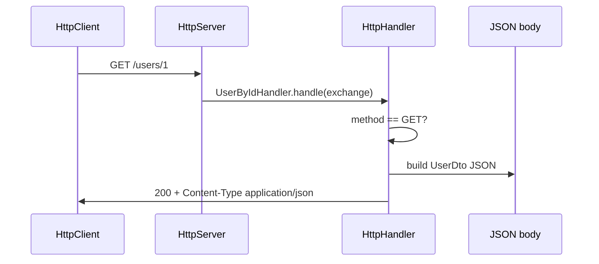

# REST Design

> **Status:** Completed  
> **Module:** 38 — REST API Development  
> **Target Java version:** 21  
> **Last reviewed:** 2026-11-11  
> **Chapter profile:** Technical  
> **Depth target:** Levels 2–3 (HTTP resource semantics, status codes, JDK handler flow)  
> **Examples verified with:** Temurin JDK 21.0.12.1 (2026-11-11) — [rest-httpserver-demo](../../examples/backend/rest-httpserver-demo/)

**Section policy:** Omissions recorded in Review Checklist.

## 1. Learning Objectives *(mandatory)*

- Apply **REST** constraints: resources, uniform interface, statelessness.
- Choose **HTTP methods** and **status codes** deliberately.
- Design **resource-oriented URLs** and idempotency rules.
- Relate REST to JDK `HttpServer` and Spring MVC controllers.

## 2. Prerequisites *(mandatory)*

- Module **32** — HTTP request/response model, `HttpClient` (synchronous client calls in the demo).
- Module **15** — records for compact JSON-friendly DTO shapes.
- Module **37** (optional background) — `@RestController` maps the same decisions to annotations; this chapter proves semantics without Spring on the classpath.

## 3. Why This Concept Exists *(mandatory)*

Integrations scale when clients use **standard HTTP** against **named resources** instead of custom RPC endpoints per feature. REST (in the practical Richardson sense used in industry) gives conventions for CRUD, caching, and error semantics that proxies, CDNs, and API gateways understand.

## 4. Conceptual Explanation *(mandatory)*

**REST** in industry practice (Richardson maturity model levels 0–3) usually means **resource-oriented HTTP**: nouns in URLs, verbs in methods, representations in bodies, and **stateless** request handling. Level 3 adds **HATEOAS** hypermedia links; many internal Java APIs stop at level 2 with stable JSON and clear status codes—that is still “RESTful enough” when documented in OpenAPI (Ch.03).

| Principle | Practice |
|-----------|----------|
| **Resources** | Nouns (`/users`, `/orders/{id}`) not verbs (`/getUser`) |
| **Representations** | JSON (common), XML, etc. |
| **Statelessness** | Server does not store client session in the resource layer (auth tokens aside) |
| **Uniform interface** | GET/POST/PUT/PATCH/DELETE with standard semantics |

### Method semantics

| Method | Safe | Idempotent | Typical use |
|--------|------|------------|-------------|
| GET | Yes | Yes | Read |
| POST | No | No | Create, actions |
| PUT | No | Yes | Replace entire resource |
| PATCH | No | No* | Partial update |
| DELETE | No | Yes | Remove |

*PATCH idempotency depends on patch format—document behavior.

### Status codes (selection)

| Code | Meaning |
|------|---------|
| 200 | OK with body |
| 201 | Created; `Location` header |
| 204 | Success, no body |
| 400 | Client malformed input |
| 401 | Not authenticated |
| 403 | Authenticated but forbidden |
| 404 | Resource not found |
| 409 | Conflict (duplicate, stale version) |
| 422 | Semantically invalid (optional) |
| 500 | Server fault |

## 5. Mechanism and Execution Flow *(mandatory)*

### 5.1 Request dispatch in the JDK demo



1. **`HttpServer.createContext`** registers path prefixes; longest match wins for `/users/` vs `/users`.
2. **`HttpExchange`** carries method, headers, request URI, and response channel.
3. Handler enforces **allowed methods** first (405 if wrong verb)—before business logic.
4. **Status and body** are written via `sendResponseHeaders` then response stream—mirrors servlet filter → controller → response commit in Spring.

### 5.2 Mapping to Spring MVC (Illustrative)

| JDK demo step | Spring equivalent |
|---------------|-------------------|
| `createContext("/users", …)` | `@RequestMapping("/users")` on controller |
| Method guard in handler | `@GetMapping` / `@PostMapping` |
| Manual JSON string | `ResponseEntity<UserDto>` + Jackson |
| 201 on POST | `ResponseEntity.status(HttpStatus.CREATED)` |

Spring adds **content negotiation**, validation, and security filters (Modules **37**, **39**); the **HTTP contract** (method, status, representation) remains yours.

### 5.3 Idempotency and safe retries

**Safe** methods (`GET`, `HEAD`, `OPTIONS`) must not change server state by convention—caches and CDNs may replay them.

**Idempotent** methods (`PUT`, `DELETE`, many `GET`) can be retried without creating duplicate side effects when implemented correctly—for example, `DELETE /users/1` twice may return 404 on the second call but must not delete a different resource.

**POST** creates or triggers actions; retries without an **idempotency key** may duplicate orders—use `Idempotency-Key` header pattern for payment APIs (Module **44** Ch.03).

## 6. Terminology *(mandatory)*

| Term | Meaning |
|------|---------|
| Resource | Named thing exposed at a URI (`User`, `Order`) |
| Representation | JSON/XML bytes returned for a resource state |
| Statelessness | Each request carries enough context; server does not rely on in-memory client session for the resource API |
| Safe method | HTTP method not intended to change resource state |
| Idempotent | Repeated identical requests have same effect as one |
| Richardson levels | Maturity model for HTTP API style (0=RPC tunnel, 3=HATEOAS) |

## 7. Runnable minimal API *(mandatory)*

Demo: [rest-httpserver-demo](../../examples/backend/rest-httpserver-demo/).

**Verified output:**

```text
GET /users/1 status=200 body={"id":1,"name":"Lin"}
POST /users status=201
restDemo=ok
```

Handlers enforce method allow-lists and return JSON with appropriate status—same decisions you make in `@RestController`.

**Compile and run (Verified):**

```bash
cd examples/backend/rest-httpserver-demo
javac -d out -source 21 -target 21 src/main/java/com/handbook/rest/*.java
java -cp out com.handbook.rest.RestHttpServerDemo
```

Important lines: `HttpServer.create(new InetSocketAddress(0), 0)` binds an **ephemeral port** so the self-test avoids collisions; `HttpClient` in `main` exercises the server like an integration test without external dependencies.

## 8. Real-World Use Cases *(conditional)*

- **Pagination:** `GET /users?page=0&size=20&sort=lastName,asc` or cursor tokens.
- **Filtering:** `GET /orders?status=SHIPPED` with indexed columns.
- **HATEOAS** (optional): links in JSON for discoverability—less common in pure mobile backends.

## 9. Edge Cases and Limitations *(strongly encouraged)*

- **GET with body** — discouraged; proxies may strip it.
- **Long-running POST** — return `202 Accepted` + status URL.
- **Soft delete** — expose `DELETE` or `PATCH` with `active=false`; document.

## 10. Common Mistakes *(mandatory)*

### Incorrect — `GET /deleteUser?id=1`

Non-idempotent action on safe method; breaks caches and retries.

### Incorrect — always `200` with `{error: ...}` inside body

Clients and monitors rely on status codes.

## 11. Design Trade-offs *(strongly encouraged)*

| RPC style (`POST /userSearch`) | REST resources |
|--------------------------------|----------------|
| Flexible query in one call | Cacheable reads, predictable URLs |
| Harder HTTP semantics | More endpoints |

## 12. Progressive examples — resource design *(mandatory)*

### 12.1 Minimal — one resource, two methods

The demo exposes `GET /users/1` and `POST /users`. The handler returns fixed JSON for id `1` and allocates ids on POST—enough to teach **status selection** without a database.

### 12.2 Realistic — orders with sub-resources

```text
GET    /api/v1/orders/{orderId}
GET    /api/v1/orders/{orderId}/lines
POST   /api/v1/orders/{orderId}/cancel
```

Sub-resources are **nouns** (`lines`, not `getLines`). Actions that are not pure CRUD often become **sub-resource POST** (`.../cancel`) or **state transition PATCH** (`{"status":"CANCELLED"}`)—document idempotency of cancel.

### 12.3 Advanced — multi-status error modeling

| Scenario | Status | Body |
|----------|--------|------|
| Unknown route | 404 | ProblemDetail |
| Wrong HTTP method | 405 | ProblemDetail + `Allow` header |
| Validation failure | 400 or 422 | Field errors array (Ch.02) |
| Auth missing | 401 | No internal details |
| Wrong role | 403 | ProblemDetail |

### Incorrect — verb in URL

```http
POST /api/deleteOrder?orderId=99
```

**Corrected:**

```http
DELETE /api/v1/orders/99
```

### Incorrect — `200 OK` with `{ "success": false }`

Monitors and HTTP caches treat 2xx as success.

**Corrected:** `409 Conflict` or `422` with ProblemDetail `detail` message.

## 13. Cache and conditional requests *(conditional)*

`GET` responses may include `ETag` or `Last-Modified`. Clients send `If-None-Match` / `If-Modified-Since`; server returns **304 Not Modified** with empty body—saves bandwidth. Spring `ShallowEtagHeaderFilter` (Illustrative) automates weak ETags; JDK demo can set `exchange.getResponseHeaders().set("ETag", "\"v1\"")` manually.

## 14. Content negotiation *(conditional)*

`Accept: application/json` vs `application/xml` selects representation format. Default to JSON for new Java APIs; document supported `Content-Type` on `POST`/`PUT`. Reject unsupported types with **415 Unsupported Media Type** when strict.

## 15. Pagination and collection resources *(conditional)*

| Style | Example | Notes |
|-------|---------|-------|
| Offset | `?page=2&size=20` | Simple; slow on large offsets |
| Cursor | `?after=eyJpZCI6MTIzfQ` | Stable under concurrent inserts |
| Keyset | `?lastId=100&limit=20` | Requires indexed sort column |

Return **200** with wrapper `{ "items": [...], "nextCursor": "..." }` or RFC 8288 `Link` headers—pick one policy and keep OpenAPI in sync (Ch.03).

## 16. Performance and operational notes *(conditional)*

- **Compression:** gzip JSON at reverse proxy for large list endpoints; set `Vary` correctly.
- **Rate limiting:** return **429** with `Retry-After`; clients use exponential backoff (Module **32** Ch.03).
- **Correlation:** accept `X-Request-Id` or generate one; echo in logs (Module **47**).

## 17. Security *(conditional)*

REST resources are **authorization boundaries**—`GET /users/{id}` must verify the caller may read that user (Module **39** IDOR). Never expose internal ids without access checks. Use HTTPS for all mutating methods.

## 18. Internal Behavior *(conditional)*

`com.sun.net.httpserver` is part of the **JDK** (not a separate artifact). It uses a **default executor** (single-threaded unless you set one)—production services use embedded Tomcat/Jetty or reactive stacks. The demo’s threading model is **educational**: handlers should still avoid blocking forever.

## 19. Revision and Mastery *(Track B / Technical)*

- When is POST idempotent anyway (still “no” by definition but why do retries hurt)?
- Difference between 401 and 403?

## 20. Exercises

1. Redesign `RPC /api/cancelOrder` as RESTful routes.
2. Choose status for duplicate email on signup.
3. Extend demo with `PUT /users/1` returning 204.

## 21. FAQ — REST design in production *(mandatory depth)*

**Q: Must every API be pure REST?**  
A: No—use resource semantics where they help caching and clarity; RPC-style `POST /search` is acceptable when documented and not advertised as safe GET.

**Q: PUT vs PATCH?**  
A: `PUT` replaces the entire resource representation; `PATCH` applies partial updates (JSON Merge Patch or JSON Patch—document which). Many teams standardize on PATCH for partial updates.

**Q: When is 204 vs 200 with body?**  
A: **204** when success needs no representation (delete, update without echo); **200** when client needs updated resource state.

**Q: Why 409 for version conflicts?**  
A: Optimistic locking stale writes are a **state conflict**, not malformed syntax (400)—clients can refresh and retry (Ch.02).

**Q: JSON in URL query strings?**  
A: Avoid large encoded JSON in query; use `POST` with body or structured query parameters.

**Q: Does Spring change HTTP semantics?**  
A: No—it maps Java methods to the same status/method rules; misconfigured `@ResponseStatus` still yields wrong contracts.

## 22. Compatibility notes *(conditional)*

RFC 9110 defines modern HTTP semantics (successor to RFC 7231). Java 21 `HttpClient` and `HttpServer` follow standard status/method rules. Legacy clients may mishandle `PATCH`—document supported methods in OpenAPI.

## 23. Chapter Summary *(mandatory)*

REST maps business entities to HTTP resources with standard methods and status codes. The JDK demo proves the semantics; Spring MVC adds binding and validation ergonomics.

## 24. Production handoff checklist *(conditional)*

- Document allowed methods per resource in OpenAPI.
- Confirm monitoring alerts on 5xx rate and latency SLO.
- Verify AuthZ integration tests for representative resources.
- Record Temurin 21.0.12.1 demo output in `PROGRESS.md` after each handbook release.

## 25. Next Steps

[02-dtos-errors-and-versioning.md](02-dtos-errors-and-versioning.md)

## Review Checklist

- [x] EXPAND-PRESERVE 2026-11-11 (Technical L3)
- [x] Chapter profile Technical; mechanism flow + mermaid
- [x] Verified `rest-httpserver-demo` Temurin 21.0.12.1 (2026-11-11)
- [x] Spring snippets labeled Illustrative
- [x] Omissions: full HATEOAS tutorial (optional pattern)
