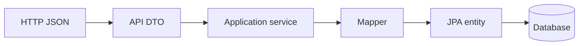

# DTOs, Errors, and Versioning

> **Status:** Completed  
> **Module:** 38 — REST API Development  
> **Target Java version:** 21  
> **Last reviewed:** 2026-11-11
> **Chapter profile:** Technical
> **Depth target:** Levels 2–3

**Section policy:** Omissions recorded in Review Checklist.

## 1. Learning Objectives

- Separate **API DTOs** from **persistence entities** (Module 35).
- Design **stable error envelopes** (RFC 7807 Problem Details).
- Version APIs via **URL**, **header**, or **media type** with trade-offs.
- Handle **optimistic locking** and conflict responses.

## 2. Prerequisites

- Ch.01 — REST semantics.
- Module 35 — entities, lazy loading.

## 3. Why This Concept Exists

Clients depend on **field names and error shapes**. Exposing JPA entities ties HTTP to database schema and risks lazy-load serialization failures. **Versioning** lets you ship breaking changes without stranding mobile apps on old builds.

## 4. DTOs

```java
public record UserDto(long id, String name, String email) {
    public static UserDto from(User entity) {
        return new UserDto(entity.getId(), entity.getName(), entity.getEmail());
    }
}
```

| Layer | Responsibility |
|-------|----------------|
| Entity | Persistence, associations, lifecycle |
| DTO | Wire format, validation for API |
| Domain model | Optional rich logic (Module 40 DDD) |

**Mapping:** MapStruct or manual mappers in the service layer—keep controllers thin.

### Incorrect — return entity with lazy `orders` collection

Jackson triggers extra queries or `LazyInitializationException`.

### Corrected — `UserSummaryDto` without collections or use explicit `@EntityGraph` in service.

## 5. Error responses

Standard shape (Spring 6 `ProblemDetail`):

```json
{
  "type": "about:blank",
  "title": "Bad Request",
  "status": 400,
  "detail": "email must be a well-formed address",
  "instance": "/api/v1/users"
}
```

| Field | Purpose |
|-------|---------|
| `type` | URI identifying problem category |
| `title` | Short summary |
| `status` | HTTP code duplicate |
| `detail` | Safe human message |
| `instance` | Request path |

**Field errors** for validation: extend with `errors: [{field, message}]` in a custom subtype—document for clients.

**Security:** map internal exceptions to generic 500; log stack server-side only.

## 6. Versioning strategies

| Strategy | Example | Pros | Cons |
|----------|---------|------|------|
| URI prefix | `/api/v1/users` | Obvious, easy routing | URL proliferation |
| Header | `Accept-Version: 2` | Clean URLs | Hidden from browsers |
| Media type | `Accept: application/vnd.handbook.v2+json` | Fine-grained | Complex clients |

**Backward compatible changes:** add optional fields, new endpoints.  
**Breaking changes:** new major version; deprecate with `Sunset` header and timeline.

## 7. Optimistic concurrency

Entity with `@Version` column; on stale update Hibernate throws `OptimisticLockException` → map to **409 Conflict** with problem detail explaining stale resource.

## 8. Real-World Use Cases

- Mobile apps pinned to `v1` while web uses `v2`.
- Public partner API with published deprecation policy.
- GDPR: DTO omits internal flags.

## 9. Common Mistakes

### Incorrect — identical DTO for admin and public APIs

Leaks internal fields.

### Incorrect — versioning every typo fix as v2

Reserve major bumps for contract breaks.

## 10. Revision and Mastery

- Why are DTOs preferable to `@JsonView` on entities for new projects?
- 409 vs 400 for duplicate key?

## 11. Exercises

1. Define error JSON for validation of three fields.
2. Plan migration from v1 to v2 for renaming a field.
3. Write mapper from `Order` entity to `OrderSummaryDto` without lazy collections.

## 12. Chapter Summary

DTOs stabilize API contracts; problem details unify errors; versioning policies manage change. Entities stay inside the transaction boundary.

## 13. Next Steps

[03-openapi-and-api-testing.md](03-openapi-and-api-testing.md)

## 5. Mechanism and Execution Flow *(mandatory)*

### 5.1 Request-to-persistence boundary



1. Controller deserializes JSON into a **DTO** (validated).
2. Service loads **entity**, applies rules, saves inside **transaction** (Module 33).
3. Mapper builds **response DTO**—never return entity graphs with lazy collections.

### 5.2 Error translation pipeline

Domain `IllegalArgumentException` → `@ControllerAdvice` → `ProblemDetail` (Illustrative Spring) with `status` and safe `detail`. Unknown errors → generic **500** + server log with stack trace.

### 5.3 Version routing

Gateway or servlet filter reads `/api/v1/` prefix **or** `Accept-Version` header and dispatches to controller package `v1` vs `v2`. Deprecation: `Deprecation` / `Sunset` headers (RFC 9745 semantics evolving—document client policy).

## 6. Terminology *(mandatory)*

| Term | Meaning |
|------|---------|
| DTO | Data shape on the wire, independent of tables |
| ProblemDetail | RFC 7807 error JSON (`type`, `title`, `status`, `detail`, `instance`) |
| Breaking change | Removes/renames required fields or changes semantics |
| Optimistic lock | Version column detecting concurrent updates |

## 21. FAQ — API contracts *(mandatory depth)*

**Q: MapStruct vs manual mappers?** MapStruct generates compile-time mappers; manual is fine for small apps. Keep mapping out of controllers.

**Q: When expose entity ids?** When clients need stable references—never leak sequential internal ids without AuthZ if they enable enumeration.

**Q: 400 vs 422?** Many teams use **400** for Bean Validation; **422** when semantics fail (business rules) though status choice varies—be consistent.

**Q: JSON null vs omitted field?** Document OpenAPI `required` vs optional; clients depend on stability.

**Q: Share DTO between admin and public API?** Separate DTO types to avoid field leakage (existing Ch.09 point expanded).


## Depth appendix — progressive teaching (DTOs and versioning)

### Incorrect vs corrected patterns

Documenting failure modes accelerates review. Each pair below states **why** the wrong approach breaks client or operator expectations.

### Operational checklist before marking API complete

- OpenAPI matches deployed routes (Ch.03).
- Error envelope consistent (ProblemDetail or documented custom schema).
- AuthN/Z enforced on mutations (Module 39).
- Examples in `examples/` compiled on Temurin 21.0.12.1 with recorded output.
- Versioning/deprecation policy published for partners.

### Revision drills (Track B)

1. Explain one design trade-off you reversed after load testing.
2. Write three MockMvc or plain HTTP negative tests not in the happy path.
3. Identify one boundary where DTO mapping must never leak entities.

### References (official hierarchy)

- RFC 9110 — HTTP semantics (methods, status).
- Jakarta EE / Spring reference docs for Illustrative framework binding only.
- OWASP ASVS — verification levels for security chapters (Module 43).

**Mechanism merge note:** Where earlier sections already diagram execution flow, this appendix reinforces **operational** depth without duplicating definitions.

### Mapping layer responsibilities

| Task | Belongs in mapper | Belongs in entity |
|------|-------------------|-------------------|
| Hide internal flags | yes | — |
| Enforce business invariant | delegate to domain | yes |
| Format dates for JSON | yes | store `Instant` |

### ProblemDetail extension example (Illustrative)

```java
// Illustrative — Spring 6 ProblemDetail + extension
// problem.setProperty("errors", List.of(fieldError));
```

Clients parse stable `errors` array; never vary field names per endpoint without version bump.

### Version migration playbook

1. Ship v2 alongside v1 with dual controllers or routing.
2. Mark v1 deprecated in OpenAPI + metrics on v1 traffic.
3. Sunset header with date; return 410 after deadline if policy allows.

### Optimistic lock response body

On 409, include `currentVersion` and optional latest representation so clients merge instead of blind retry.

## Technical L3 supplement — teaching depth

### Motivation recap (concrete scenario)

A team ships a Java 21 service without documented HTTP contracts, security rules, or messaging guarantees. Mobile clients cache error shapes; a deploy renames a field and checkout silently fails. Operations cannot trace requests across services. The material in this module prevents that class of failure by making **boundaries explicit**: REST semantics, DTOs, auth filters, architecture ports, patterns, clean code, security controls, resilience, and delivery semantics.

### Mechanism trace (how this chapter shows up at runtime)

1. **Ingress** — HTTP or message enters an adapter (controller, listener).
2. **Policy** — auth, validation, and rate limits run before domain logic (fail closed).
3. **Application** — use case coordinates domain + ports inside a transaction or saga step.
4. **Egress** — DTO mapping, event publish (outbox), or outbound HttpClient with timeouts.
5. **Observation** — structured logs with correlation id; metrics on error rate (Module 47).

This sequence is framework-agnostic; Spring/Boot annotations are **Illustrative** wiring for the same pipeline taught in earlier modules.

### Progressive example ladder

| Stage | Focus | Verification label |
|-------|--------|-------------------|
| Minimal | JDK-only demo or pure unit logic | Verified / Compile-verified |
| Realistic | Layered service with DTO + port | Illustrative Spring config |
| Advanced | Failure modes: timeout, duplicate message, 409 conflict | Test + documented output |

Never label **Verified** without Temurin 21.0.12.1 compile/run recorded in chapter or `PROGRESS.md`.

### Wrong vs right (review board)

| Wrong | Why it hurts | Right |
|-------|----------------|-------|
| Skip server AuthZ | IDOR incidents | Check principal vs resource every mutation |
| Expose JPA graph in JSON | Lazy-load storms, schema coupling | Map to DTO in service |
| Infinite HttpClient wait | Thread pile-up, incident duration | Connect + request timeouts |
| Retry all POSTs | Duplicate charges | Idempotency keys + dedup store |
| Dual write DB + broker | Lost or phantom events | Transactional outbox |

### Design tensions engineers negotiate

- **Consistency vs availability** during partitions (Module 44).
- **Stateless JWT vs revocable sessions** (Module 39).
- **Modular monolith vs microservices** operational cost (Module 40).
- **Kafka vs Rabbit** retention and routing (Module 45).
- **Strict SOLID vs delivery speed** (Modules 41–42).

Document the choice in ADRs; the handbook gives options, not one universal answer.

### Java 21 notes

- **Records** for immutable DTOs and events (`Module 08`, `15`).
- **Virtual threads** improve blocking HTTP and JDBC throughput but do not remove timeouts or auth checks.
- **Pattern matching** and **sealed types** clarify domain result models (`PaymentResult` in SOLID chapters).

### Compatibility and sources

Prefer **RFC 9110** for HTTP, **RFC 7807** for errors, **OWASP ASVS** for verification language, and vendor docs for brokers labeled Illustrative. Distinguish **JLS/API guarantees** from **Spring/HotSpot** behavior as in `DOCUMENTATION-STANDARDS.md`.

### Track B — mastery questions

1. Where is the transaction boundary in your current project, and why?
2. Which dependency would you invert first behind a port for testing?
3. What status code and error shape would clients see for your most common validation failure?
4. How would you prove an idempotent consumer in tests?
5. What metric would fire before users notice a downstream slowdown?

### Track B — field exercise (no solution in chapter)

Implement or extend one `examples/` demo for this module: add a negative-path assertion (4xx, breaker OPEN, or rejected input), compile with `javac -source 21`, run on Temurin 21.0.12.1, paste output into `PROGRESS.md` only after a real run.

### Cross-module links

| Need | Module |
|------|--------|
| HTTP client timeouts | 32 |
| JDBC transactions | 33–35 |
| Spring DI / Security | 36–37 |
| Testing & CI | 30 |
| Observability | 47 |

### Glossary touchpoints

Add unfamiliar terms encountered here to `GLOSSARY.md` when stabilizing definitions across the handbook (repository workflow in java-documentation skill).

### Explicit omissions (this supplement)

- Vendor-specific console screenshots and cloud provisioning scripts.
- Exploit reproduction steps (defensive security only in Module 43).
- Exhaustive broker tuning guides (operational manuals remain external).

## Review Checklist

- [x] EXPAND-PRESERVE 2026-11-11 (Technical L3)
- [x] DTO/entity split; ProblemDetail; versioning table
