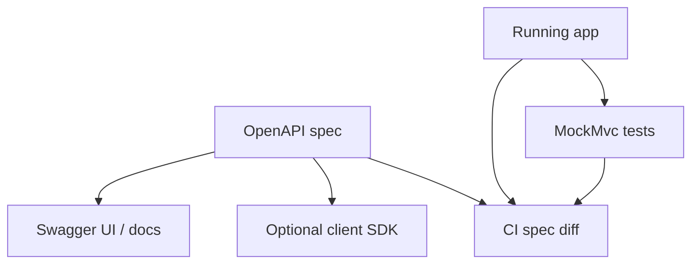

# OpenAPI and API Testing

> **Status:** Completed  
> **Module:** 38 — REST API Development  
> **Target Java version:** 21  
> **Last reviewed:** 2026-11-11
> **Chapter profile:** Technical
> **Depth target:** Levels 2–3

**Section policy:** Omissions recorded in Review Checklist.

## 1. Learning Objectives

- Author and consume **OpenAPI 3** documents as the API contract.
- Generate or document Spring controllers with **springdoc-openapi** (conceptual).
- Test APIs with **contract tests**, `MockMvc`, and manual tools (curl, Postman).
- Tie contract tests to CI governance (Module 30).

## 2. Prerequisites

- Ch.01–02 — REST, DTOs, errors.
- Module 30 — automated testing.

## 3. Why This Concept Exists

Without a machine-readable contract, frontend and backend teams **drift**: renamed fields break clients silently. **OpenAPI** describes paths, schemas, and responses so you can generate docs, client SDKs, and **contract verification** in CI.

## 4. OpenAPI essentials

```yaml
openapi: 3.0.3
info:
  title: Handbook Users API
  version: 1.0.0
paths:
  /api/v1/users/{id}:
    get:
      summary: Get user by id
      parameters:
        - name: id
          in: path
          required: true
          schema: { type: integer, format: int64 }
      responses:
        '200':
          description: OK
          content:
            application/json:
              schema:
                $ref: '#/components/schemas/UserDto'
        '404':
          description: Not found
components:
  schemas:
    UserDto:
      type: object
      required: [id, name]
      properties:
        id: { type: integer, format: int64 }
        name: { type: string }
```

**Single source of truth:** either generate OpenAPI from annotations or write YAML first and generate stubs—pick one team policy.

### springdoc (conceptual)

Add `springdoc-openapi-starter-webmvc-ui` → `/swagger-ui.html` and `/v3/api-docs`. Annotations like `@Operation` enrich generated spec.

## 5. Testing pyramid for APIs

| Level | Tool | Validates |
|-------|------|-----------|
| Unit | JUnit + mocks | Service rules |
| Web slice | `MockMvc` | Status, JSON shape, security |
| Contract | OpenAPI + Dredd/Schemathesis/Postman | Spec vs running app |
| E2E | Test against deployed env | Real infra |

**MockMvc example (conceptual):**

```java
mvc.perform(get("/api/v1/users/1"))
   .andExpect(status().isOk())
   .andExpect(jsonPath("$.name").value("Lin"));
```

Align `jsonPath` with OpenAPI schema fields.

## 6. Plain-Java contract discipline

Even [rest-httpserver-demo](../../examples/backend/rest-httpserver-demo/) benefits from a checked mini-spec: expected status 200 body fields `id`, `name`. Document in README next to runnable output—**executable documentation**.

## 7. Consumer-driven contracts (overview)

Clients publish expected interactions (e.g. Pact). Provider verifies in CI—prevents breaking partners when you rename fields.

## 8. Common Mistakes

### Incorrect — OpenAPI generated once and never updated in CI

Spec lies; use diff checks on PR.

### Incorrect — testing only happy paths

Include 400, 401, 404, 409 cases from OpenAPI `responses`.

## 9. Security in API tests

- Never commit bearer tokens; use test fixtures and ephemeral realms.
- Validate auth-required endpoints return 401 without credentials.

## 10. Revision and Mastery

- Difference between contract test and `@WebMvcTest`?
- How does OpenAPI relate to JSON Schema in `components`?

## 11. Exercises

1. Write OpenAPI for POST `/users` with validation error 400 schema.
2. List five `MockMvc` assertions for pagination response.
3. Propose CI step failing when undocumented endpoint appears.

## 12. Chapter Summary

OpenAPI makes REST contracts explicit and testable; combine generated docs with MockMvc and contract tools. JDK demos can still carry minimal spec + verified output when Spring is not on the classpath.

## 13. Next Steps

Module **39** — authentication and authorization.

## 5. Mechanism and Execution Flow *(mandatory)*



CI fails when controller returns fields **not** in spec or spec documents removed endpoints still deployed.

### Contract test execution

1. Start app (Testcontainers or `@SpringBootTest`).
2. Schemathesis or Dredd walks paths from YAML.
3. Compare response schema to `components.schemas`.

Spring/OpenAPI snippets in this chapter remain **Illustrative** unless your project runs springdoc in CI.

## 21. FAQ — OpenAPI and testing *(mandatory depth)*

**Q: Spec-first or code-first?** Pick one team policy; mixing causes drift.

**Q: MockMvc enough for production confidence?** No—add slice/integration tests + contract tests for partner APIs.

**Q: Test 401/403?** Required—security regressions are common.

**Q: Version OpenAPI file?** Tag `info.version` with API release; store in git.

**Q: Plain JDK demo spec?** Maintain minimal YAML beside `rest-httpserver-demo` README assertions.


## Depth appendix — progressive teaching (OpenAPI and testing)

### Incorrect vs corrected patterns

Documenting failure modes accelerates review. Each pair below states **why** the wrong approach breaks client or operator expectations.

### Operational checklist before marking API complete

- OpenAPI matches deployed routes (Ch.03).
- Error envelope consistent (ProblemDetail or documented custom schema).
- AuthN/Z enforced on mutations (Module 39).
- Examples in `examples/` compiled on Temurin 21.0.12.1 with recorded output.
- Versioning/deprecation policy published for partners.

### Revision drills (Track B)

1. Explain one design trade-off you reversed after load testing.
2. Write three MockMvc or plain HTTP negative tests not in the happy path.
3. Identify one boundary where DTO mapping must never leak entities.

### References (official hierarchy)

- RFC 9110 — HTTP semantics (methods, status).
- Jakarta EE / Spring reference docs for Illustrative framework binding only.
- OWASP ASVS — verification levels for security chapters (Module 43).

**Mechanism merge note:** Where earlier sections already diagram execution flow, this appendix reinforces **operational** depth without duplicating definitions.

### CI pipeline sketch

```text
mvn test
  → springdoc generates openapi.json artifact
  → diff against committed spec OR fail on drift
  → schemathesis run --base-url=http://localhost:PORT
```

### MockMvc negative matrix (Illustrative)

| Case | Expected |
|------|----------|
| Missing auth | 401 |
| Wrong role | 403 |
| Invalid JSON | 400 |
| Unknown id | 404 |

### Consumer-driven contract overview

Provider verifies Pact files from consumers in CI—catches renamed fields before mobile release.

### Documenting plain JDK demos

For `rest-httpserver-demo`, maintain a three-line mini OpenAPI in README: paths, methods, status codes—executable contract without Spring.

## Technical L3 supplement — teaching depth

### Motivation recap (concrete scenario)

A team ships a Java 21 service without documented HTTP contracts, security rules, or messaging guarantees. Mobile clients cache error shapes; a deploy renames a field and checkout silently fails. Operations cannot trace requests across services. The material in this module prevents that class of failure by making **boundaries explicit**: REST semantics, DTOs, auth filters, architecture ports, patterns, clean code, security controls, resilience, and delivery semantics.

### Mechanism trace (how this chapter shows up at runtime)

1. **Ingress** — HTTP or message enters an adapter (controller, listener).
2. **Policy** — auth, validation, and rate limits run before domain logic (fail closed).
3. **Application** — use case coordinates domain + ports inside a transaction or saga step.
4. **Egress** — DTO mapping, event publish (outbox), or outbound HttpClient with timeouts.
5. **Observation** — structured logs with correlation id; metrics on error rate (Module 47).

This sequence is framework-agnostic; Spring/Boot annotations are **Illustrative** wiring for the same pipeline taught in earlier modules.

### Progressive example ladder

| Stage | Focus | Verification label |
|-------|--------|-------------------|
| Minimal | JDK-only demo or pure unit logic | Verified / Compile-verified |
| Realistic | Layered service with DTO + port | Illustrative Spring config |
| Advanced | Failure modes: timeout, duplicate message, 409 conflict | Test + documented output |

Never label **Verified** without Temurin 21.0.12.1 compile/run recorded in chapter or `PROGRESS.md`.

### Wrong vs right (review board)

| Wrong | Why it hurts | Right |
|-------|----------------|-------|
| Skip server AuthZ | IDOR incidents | Check principal vs resource every mutation |
| Expose JPA graph in JSON | Lazy-load storms, schema coupling | Map to DTO in service |
| Infinite HttpClient wait | Thread pile-up, incident duration | Connect + request timeouts |
| Retry all POSTs | Duplicate charges | Idempotency keys + dedup store |
| Dual write DB + broker | Lost or phantom events | Transactional outbox |

### Design tensions engineers negotiate

- **Consistency vs availability** during partitions (Module 44).
- **Stateless JWT vs revocable sessions** (Module 39).
- **Modular monolith vs microservices** operational cost (Module 40).
- **Kafka vs Rabbit** retention and routing (Module 45).
- **Strict SOLID vs delivery speed** (Modules 41–42).

Document the choice in ADRs; the handbook gives options, not one universal answer.

### Java 21 notes

- **Records** for immutable DTOs and events (`Module 08`, `15`).
- **Virtual threads** improve blocking HTTP and JDBC throughput but do not remove timeouts or auth checks.
- **Pattern matching** and **sealed types** clarify domain result models (`PaymentResult` in SOLID chapters).

### Compatibility and sources

Prefer **RFC 9110** for HTTP, **RFC 7807** for errors, **OWASP ASVS** for verification language, and vendor docs for brokers labeled Illustrative. Distinguish **JLS/API guarantees** from **Spring/HotSpot** behavior as in `DOCUMENTATION-STANDARDS.md`.

### Track B — mastery questions

1. Where is the transaction boundary in your current project, and why?
2. Which dependency would you invert first behind a port for testing?
3. What status code and error shape would clients see for your most common validation failure?
4. How would you prove an idempotent consumer in tests?
5. What metric would fire before users notice a downstream slowdown?

### Track B — field exercise (no solution in chapter)

Implement or extend one `examples/` demo for this module: add a negative-path assertion (4xx, breaker OPEN, or rejected input), compile with `javac -source 21`, run on Temurin 21.0.12.1, paste output into `PROGRESS.md` only after a real run.

### Cross-module links

| Need | Module |
|------|--------|
| HTTP client timeouts | 32 |
| JDBC transactions | 33–35 |
| Spring DI / Security | 36–37 |
| Testing & CI | 30 |
| Observability | 47 |

### Glossary touchpoints

Add unfamiliar terms encountered here to `GLOSSARY.md` when stabilizing definitions across the handbook (repository workflow in java-documentation skill).

### Explicit omissions (this supplement)

- Vendor-specific console screenshots and cloud provisioning scripts.
- Exploit reproduction steps (defensive security only in Module 43).
- Exhaustive broker tuning guides (operational manuals remain external).

## Review Checklist

- [x] EXPAND-PRESERVE 2026-11-11 (Technical L3)
- [x] OpenAPI sample; testing layers; CI mention
