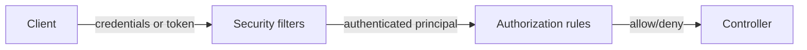

# Authentication and Authorization Basics

> **Status:** Completed  
> **Module:** 39 — Authentication and Authorization  
> **Target Java version:** 21  
> **Last reviewed:** 2026-11-10

## 1. Learning Objectives

- Distinguish **authentication (AuthN)** and **authorization (AuthZ)**.
- Model **principals**, **credentials**, **roles**, and **permissions**.
- Place **filter chains** before controllers (Spring Security) and fail closed.
- Recognize **threat basics**: credential stuffing, session fixation, IDOR.

## 2. Prerequisites

- Module 32 — HTTP headers, TLS awareness.
- Module 36 — Security filter overview.

## 3. Why This Concept Exists

APIs must know **who** is calling and **what** they may do. Mixing the two leads to bugs like checking roles in the client only or treating “logged in” as “may access any id in URL.”

## 4. Conceptual Explanation

| Term | Meaning |
|------|---------|
| **Authentication** | Proving identity (password, certificate, token) |
| **Authorization** | Deciding if identity may perform action on resource |
| **Principal** | Represents authenticated identity (`Authentication` in Spring) |
| **Authority / Role** | Granted permission (`ROLE_ADMIN`, `orders:write`) |



**Fail closed:** default deny; explicitly permit public routes (`/health`, login).

## 5. Patterns at the edge

| Pattern | AuthN mechanism | Typical use |
|---------|-----------------|-------------|
| Session cookie | Server session store | Browser apps |
| Bearer JWT | Signed token | SPAs, mobile, service-to-service |
| API key | Shared secret header | Scripts, partners (weaker) |
| mTLS | Client certificate | Service mesh, high trust |

Credentials must travel over **HTTPS** (Module 32).

## 6. Authorization models

- **RBAC** — roles (`ADMIN`, `USER`).
- **ABAC** — attributes (department, resource owner).
- **Scope-based** — OAuth scopes (`read:orders`).

Check **authorization at the resource**: `order.userId == principal.id` prevents **IDOR** (insecure direct object reference).

## 7. Plain-Java mindset

Before Spring, imagine a servlet **filter** that:

```java
if (path.startsWith("/api/") && !isAuthenticated(request)) {
    response.setStatus(401);
    return;
}
chain.doFilter(request, response);
```

Spring Security’s `SecurityFilterChain` is a structured, configurable version of this pipeline with CSRF, headers, and OAuth support.

## 8. Real-World Use Cases

- Multi-tenant SaaS: tenant id in token claims validated on every query.
- Admin API separated by role + network policy.
- Audit log storing principal id on mutations.

## 9. Common Mistakes

### Incorrect — authorization only in UI

Always enforce server-side.

### Incorrect — trusting client-sent `userId` in JSON

Derive identity from server-validated token/session.

## 10. Security Considerations

- Store password hashes with **slow algorithms** (bcrypt, Argon2)—never reversible encryption.
- Rate-limit login; generic error messages (“Invalid credentials”).
- Log security events without leaking secrets.

## 11. Revision and Mastery

- AuthN vs AuthZ with one API example each.
- What is IDOR and one defense?

## 12. Exercises

1. List public vs authenticated routes for a todo API.
2. Design authority strings for CRUD on `Report` resource.
3. Sketch filter order: TLS termination → auth → MVC.

## 13. Chapter Summary

Authentication establishes identity; authorization enforces policy on each request. Spring Security centralizes servlet filters; core rules are fail-closed validation before business logic.

## 14. Next Steps

[02-sessions-jwt-and-oauth.md](02-sessions-jwt-and-oauth.md)

## Review Checklist

- [x] AuthN/AuthZ; IDOR; filter mental model
