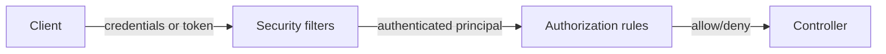
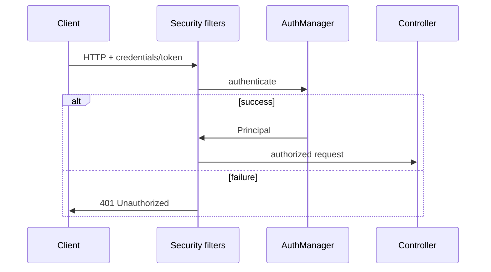

# Authentication and Authorization Basics

> **Status:** Completed  
> **Module:** 39 — Authentication and Authorization  
> **Target Java version:** 21  
> **Last reviewed:** 2026-11-11
> **Chapter profile:** Technical
> **Depth target:** Levels 2–3

**Section policy:** Omissions recorded in Review Checklist.

## 1. Learning Objectives

- Distinguish **authentication (AuthN)** and **authorization (AuthZ)**.
- Model **principals**, **credentials**, **roles**, and **permissions**.
- Place **filter chains** before controllers (Spring Security) and fail closed.
- Recognize **threat basics**: credential stuffing, session fixation, IDOR.

## 2. Prerequisites

- Module 32 — HTTP headers, TLS awareness.
- Module 36 — Security filter overview.

## 3. Why This Concept Exists

APIs must know **who** is calling and **what** they may do. Mixing the two leads to bugs like checking roles in the client only or treating “logged in” as “may access any id in URL.”

## 4. Conceptual Explanation

| Term | Meaning |
|------|---------|
| **Authentication** | Proving identity (password, certificate, token) |
| **Authorization** | Deciding if identity may perform action on resource |
| **Principal** | Represents authenticated identity (`Authentication` in Spring) |
| **Authority / Role** | Granted permission (`ROLE_ADMIN`, `orders:write`) |



**Fail closed:** default deny; explicitly permit public routes (`/health`, login).

## 5. Patterns at the edge

| Pattern | AuthN mechanism | Typical use |
|---------|-----------------|-------------|
| Session cookie | Server session store | Browser apps |
| Bearer JWT | Signed token | SPAs, mobile, service-to-service |
| API key | Shared secret header | Scripts, partners (weaker) |
| mTLS | Client certificate | Service mesh, high trust |

Credentials must travel over **HTTPS** (Module 32).

## 6. Authorization models

- **RBAC** — roles (`ADMIN`, `USER`).
- **ABAC** — attributes (department, resource owner).
- **Scope-based** — OAuth scopes (`read:orders`).

Check **authorization at the resource**: `order.userId == principal.id` prevents **IDOR** (insecure direct object reference).

## 7. Plain-Java mindset

Before Spring, imagine a servlet **filter** that:

```java
if (path.startsWith("/api/") && !isAuthenticated(request)) {
    response.setStatus(401);
    return;
}
chain.doFilter(request, response);
```

Spring Security’s `SecurityFilterChain` is a structured, configurable version of this pipeline with CSRF, headers, and OAuth support.

## 8. Real-World Use Cases

- Multi-tenant SaaS: tenant id in token claims validated on every query.
- Admin API separated by role + network policy.
- Audit log storing principal id on mutations.

## 9. Common Mistakes

### Incorrect — authorization only in UI

Always enforce server-side.

### Incorrect — trusting client-sent `userId` in JSON

Derive identity from server-validated token/session.

## 10. Security Considerations

- Store password hashes with **slow algorithms** (bcrypt, Argon2)—never reversible encryption.
- Rate-limit login; generic error messages (“Invalid credentials”).
- Log security events without leaking secrets.

## 11. Revision and Mastery

- AuthN vs AuthZ with one API example each.
- What is IDOR and one defense?

## 12. Exercises

1. List public vs authenticated routes for a todo API.
2. Design authority strings for CRUD on `Report` resource.
3. Sketch filter order: TLS termination → auth → MVC.

## 13. Chapter Summary

Authentication establishes identity; authorization enforces policy on each request. Spring Security centralizes servlet filters; core rules are fail-closed validation before business logic.

## 14. Next Steps

[02-sessions-jwt-and-oauth.md](02-sessions-jwt-and-oauth.md)

## 5. Mechanism and Execution Flow *(mandatory)*



Authorization runs **after** authentication: map principal to authorities, evaluate route and object-level policy.

### Fail-closed default

Unmatched paths should **deny**; explicitly `permitAll` health and login. Servlet filter pseudo-code in Ch.07 is the minimal JDK mental model—Spring Security chains many filters (csrf, logout, bearer) in declared order.

## 21. FAQ — AuthN vs AuthZ *(mandatory depth)*

**Q: Example of each for `DELETE /orders/1`?** AuthN: who is the caller? AuthZ: may they delete order 1?

**Q: API key vs JWT?** API keys are shared secrets—rotation pain; JWT validates with keys and TTL.

**Q: mTLS when?** Service mesh internal east-west traffic; browsers use HTTPS + OAuth.

**Q: IDOR defense?** Compare resource owner to principal id from token, never from request body.

**Q: Log successful auth?** Audit security events without logging secrets.


## Depth appendix — progressive teaching (Authentication / authorization)

### Incorrect vs corrected patterns

Documenting failure modes accelerates review. Each pair below states **why** the wrong approach breaks client or operator expectations.

### Operational checklist before marking API complete

- OpenAPI matches deployed routes (Ch.03).
- Error envelope consistent (ProblemDetail or documented custom schema).
- AuthN/Z enforced on mutations (Module 39).
- Examples in `examples/` compiled on Temurin 21.0.12.1 with recorded output.
- Versioning/deprecation policy published for partners.

### Revision drills (Track B)

1. Explain one design trade-off you reversed after load testing.
2. Write three MockMvc or plain HTTP negative tests not in the happy path.
3. Identify one boundary where DTO mapping must never leak entities.

### References (official hierarchy)

- RFC 9110 — HTTP semantics (methods, status).
- Jakarta EE / Spring reference docs for Illustrative framework binding only.
- OWASP ASVS — verification levels for security chapters (Module 43).

**Mechanism merge note:** Where earlier sections already diagram execution flow, this appendix reinforces **operational** depth without duplicating definitions.

### Threat modeling prompts

- Credential stuffing → rate limit + MFA policy.
- Session fixation → rotate session id after login.
- Token theft → short TTL, refresh rotation, detect reuse.

### Audit fields

Store `createdBy` / `modifiedBy` from principal on mutations; support incident investigation (Module 47).

### Multi-tenant isolation

Every repository query includes `tenant_id` predicate derived from token—not from request body parameters.

## Technical L3 supplement — teaching depth

### Motivation recap (concrete scenario)

A team ships a Java 21 service without documented HTTP contracts, security rules, or messaging guarantees. Mobile clients cache error shapes; a deploy renames a field and checkout silently fails. Operations cannot trace requests across services. The material in this module prevents that class of failure by making **boundaries explicit**: REST semantics, DTOs, auth filters, architecture ports, patterns, clean code, security controls, resilience, and delivery semantics.

### Mechanism trace (how this chapter shows up at runtime)

1. **Ingress** — HTTP or message enters an adapter (controller, listener).
2. **Policy** — auth, validation, and rate limits run before domain logic (fail closed).
3. **Application** — use case coordinates domain + ports inside a transaction or saga step.
4. **Egress** — DTO mapping, event publish (outbox), or outbound HttpClient with timeouts.
5. **Observation** — structured logs with correlation id; metrics on error rate (Module 47).

This sequence is framework-agnostic; Spring/Boot annotations are **Illustrative** wiring for the same pipeline taught in earlier modules.

### Progressive example ladder

| Stage | Focus | Verification label |
|-------|--------|-------------------|
| Minimal | JDK-only demo or pure unit logic | Verified / Compile-verified |
| Realistic | Layered service with DTO + port | Illustrative Spring config |
| Advanced | Failure modes: timeout, duplicate message, 409 conflict | Test + documented output |

Never label **Verified** without Temurin 21.0.12.1 compile/run recorded in chapter or `PROGRESS.md`.

### Wrong vs right (review board)

| Wrong | Why it hurts | Right |
|-------|----------------|-------|
| Skip server AuthZ | IDOR incidents | Check principal vs resource every mutation |
| Expose JPA graph in JSON | Lazy-load storms, schema coupling | Map to DTO in service |
| Infinite HttpClient wait | Thread pile-up, incident duration | Connect + request timeouts |
| Retry all POSTs | Duplicate charges | Idempotency keys + dedup store |
| Dual write DB + broker | Lost or phantom events | Transactional outbox |

### Design tensions engineers negotiate

- **Consistency vs availability** during partitions (Module 44).
- **Stateless JWT vs revocable sessions** (Module 39).
- **Modular monolith vs microservices** operational cost (Module 40).
- **Kafka vs Rabbit** retention and routing (Module 45).
- **Strict SOLID vs delivery speed** (Modules 41–42).

Document the choice in ADRs; the handbook gives options, not one universal answer.

### Java 21 notes

- **Records** for immutable DTOs and events (`Module 08`, `15`).
- **Virtual threads** improve blocking HTTP and JDBC throughput but do not remove timeouts or auth checks.
- **Pattern matching** and **sealed types** clarify domain result models (`PaymentResult` in SOLID chapters).

### Compatibility and sources

Prefer **RFC 9110** for HTTP, **RFC 7807** for errors, **OWASP ASVS** for verification language, and vendor docs for brokers labeled Illustrative. Distinguish **JLS/API guarantees** from **Spring/HotSpot** behavior as in `DOCUMENTATION-STANDARDS.md`.

### Track B — mastery questions

1. Where is the transaction boundary in your current project, and why?
2. Which dependency would you invert first behind a port for testing?
3. What status code and error shape would clients see for your most common validation failure?
4. How would you prove an idempotent consumer in tests?
5. What metric would fire before users notice a downstream slowdown?

### Track B — field exercise (no solution in chapter)

Implement or extend one `examples/` demo for this module: add a negative-path assertion (4xx, breaker OPEN, or rejected input), compile with `javac -source 21`, run on Temurin 21.0.12.1, paste output into `PROGRESS.md` only after a real run.

### Cross-module links

| Need | Module |
|------|--------|
| HTTP client timeouts | 32 |
| JDBC transactions | 33–35 |
| Spring DI / Security | 36–37 |
| Testing & CI | 30 |
| Observability | 47 |

### Glossary touchpoints

Add unfamiliar terms encountered here to `GLOSSARY.md` when stabilizing definitions across the handbook (repository workflow in java-documentation skill).

### Explicit omissions (this supplement)

- Vendor-specific console screenshots and cloud provisioning scripts.
- Exploit reproduction steps (defensive security only in Module 43).
- Exhaustive broker tuning guides (operational manuals remain external).

## Review Checklist

- [x] EXPAND-PRESERVE 2026-11-11 (Technical L3)
- [x] AuthN/AuthZ; IDOR; filter mental model
