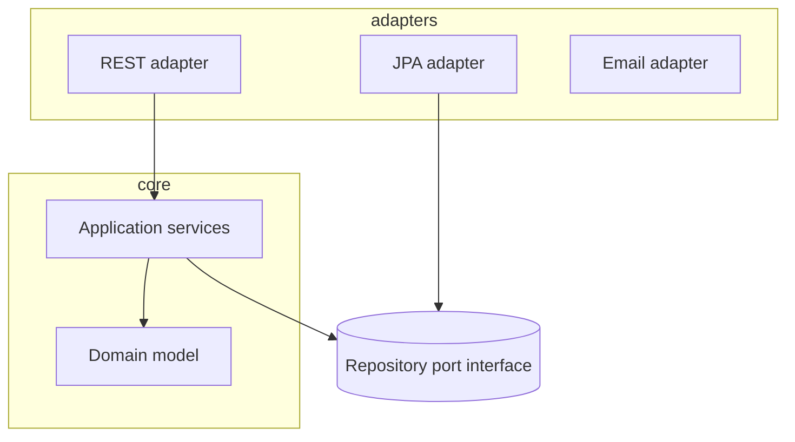

# Layered and Hexagonal Architecture

> **Status:** Completed  
> **Module:** 40 — Backend Architecture  
> **Target Java version:** 21  
> **Last reviewed:** 2026-11-10

## 1. Learning Objectives

- Compare **layered (n-tier)** architecture with **hexagonal (ports and adapters)**.
- Assign **dependencies**: domain inward, infrastructure outward.
- Map Spring packages (`web`, `service`, `repository`) to layers without anemic domain traps.
- Use **interfaces as ports** (Module 36 DI) for testability.

## 2. Prerequisites

- Modules 05–07 — OOP, interfaces.
- Module 36 — DI; Module 38 — DTOs.

## 3. Why This Concept Exists

Without structure, controllers call JDBC directly and business rules scatter. **Layers** separate concerns; **hexagonal** emphasizes that **domain** does not depend on web or database—adapters plug in through **ports**.

## 4. Layered architecture

```text
Presentation (REST) → Application/Service → Domain → Infrastructure (JPA, HTTP clients)
```

Rules:

- **Downward dependencies only** (presentation knows service, not vice versa).
- **Domain** holds entities/value objects and rules (Module 40 Ch.02).
- **Infrastructure** implements repositories defined as interfaces in domain or application layer.

Spring typical packages:

| Package | Layer |
|---------|-------|
| `...web` | Controllers, DTO mapping |
| `...application` | Use cases, orchestration |
| `...domain` | Entities, domain services |
| `...infrastructure` | JPA, messaging adapters |

### Anemic domain smell

Entities only getters/setters; all logic in `UserService`. Better: rich methods on aggregates where appropriate (`order.cancel(reason)`).

## 5. Hexagonal (ports & adapters)



**Port** — interface the application needs (`OrderRepository`, `PaymentGateway`).  
**Adapter** — concrete technology (`JpaOrderRepository`, `StripeClient`).

DI container wires adapter to port (Module 36 `MiniContainer` or Spring `@Bean`).

## 6. Real-World Use Cases

- Swap H2 in tests for `OrderRepository` port with in-memory fake.
- Add Kafka consumer adapter without changing use case class.
- Gradual strangler: new hexagon around legacy module.

## 7. Edge Cases

- **Shared DTOs** leaking into domain — map at boundaries.
- **Transactional boundary** — usually application service method (`@Transactional`).

## 8. Common Mistakes

### Incorrect — domain importing `jakarta.persistence.Entity`

Couples rules to JPA; use domain model + mapper in adapter.

### Incorrect — circular module dependencies

Extract shared kernel or events.

## 9. Design Trade-offs

| Layered only | Hexagonal |
|--------------|-----------|
| Familiar in Spring tutorials | Clearer test ports |
| Risk of “everything in service” | More interfaces upfront |

## 10. Revision and Mastery

- Where should `@RestController` depend—domain entity or application service?
- Name one port and two adapters for a payment flow.

## 11. Exercises

1. Draw layers for user registration (email verification).
2. Refactor pseudo-code: move validation from controller to domain.
3. List dependencies for `com.app.domain` package (should be minimal).

## 12. Chapter Summary

Layered and hexagonal architectures keep business rules independent of Spring and JDBC through inward dependencies and port interfaces—DI binds adapters at the composition root.

## 13. Next Steps

[02-ddd-basics.md](02-ddd-basics.md)

## Review Checklist

- [x] Layers, ports/adapters, anemic domain warning
