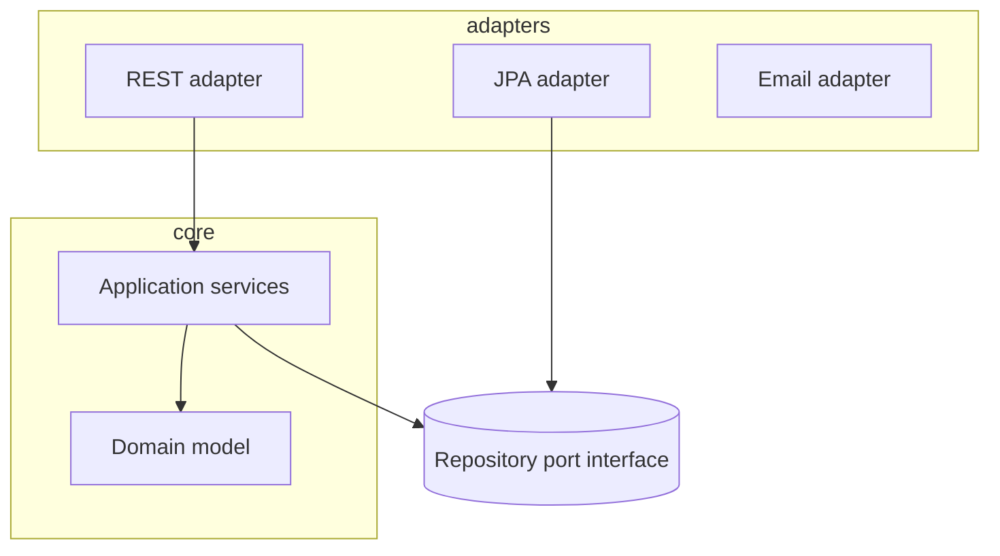
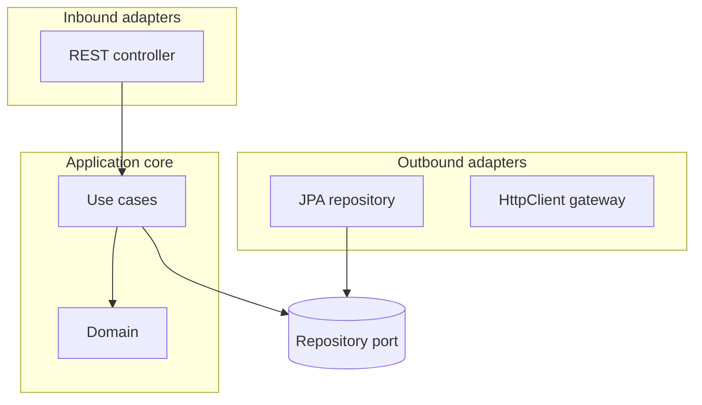

# Layered and Hexagonal Architecture

> **Status:** Completed  
> **Module:** 40 — Backend Architecture  
> **Target Java version:** 21  
> **Last reviewed:** 2026-11-11
> **Chapter profile:** Technical
> **Depth target:** Levels 2–3

**Section policy:** Omissions recorded in Review Checklist.

## 1. Learning Objectives

- Compare **layered (n-tier)** architecture with **hexagonal (ports and adapters)**.
- Assign **dependencies**: domain inward, infrastructure outward.
- Map Spring packages (`web`, `service`, `repository`) to layers without anemic domain traps.
- Use **interfaces as ports** (Module 36 DI) for testability.

## 2. Prerequisites

- Modules 05–07 — OOP, interfaces.
- Module 36 — DI; Module 38 — DTOs.

## 3. Why This Concept Exists

Without structure, controllers call JDBC directly and business rules scatter. **Layers** separate concerns; **hexagonal** emphasizes that **domain** does not depend on web or database—adapters plug in through **ports**.

## 4. Layered architecture

```text
Presentation (REST) → Application/Service → Domain → Infrastructure (JPA, HTTP clients)
```

Rules:

- **Downward dependencies only** (presentation knows service, not vice versa).
- **Domain** holds entities/value objects and rules (Module 40 Ch.02).
- **Infrastructure** implements repositories defined as interfaces in domain or application layer.

Spring typical packages:

| Package | Layer |
|---------|-------|
| `...web` | Controllers, DTO mapping |
| `...application` | Use cases, orchestration |
| `...domain` | Entities, domain services |
| `...infrastructure` | JPA, messaging adapters |

### Anemic domain smell

Entities only getters/setters; all logic in `UserService`. Better: rich methods on aggregates where appropriate (`order.cancel(reason)`).

## 5. Hexagonal (ports & adapters)



**Port** — interface the application needs (`OrderRepository`, `PaymentGateway`).  
**Adapter** — concrete technology (`JpaOrderRepository`, `StripeClient`).

DI container wires adapter to port (Module 36 `MiniContainer` or Spring `@Bean`).

## 6. Real-World Use Cases

- Swap H2 in tests for `OrderRepository` port with in-memory fake.
- Add Kafka consumer adapter without changing use case class.
- Gradual strangler: new hexagon around legacy module.

## 7. Edge Cases

- **Shared DTOs** leaking into domain — map at boundaries.
- **Transactional boundary** — usually application service method (`@Transactional`).

## 8. Common Mistakes

### Incorrect — domain importing `jakarta.persistence.Entity`

Couples rules to JPA; use domain model + mapper in adapter.

### Incorrect — circular module dependencies

Extract shared kernel or events.

## 9. Design Trade-offs

| Layered only | Hexagonal |
|--------------|-----------|
| Familiar in Spring tutorials | Clearer test ports |
| Risk of “everything in service” | More interfaces upfront |

## 10. Revision and Mastery

- Where should `@RestController` depend—domain entity or application service?
- Name one port and two adapters for a payment flow.

## 11. Exercises

1. Draw layers for user registration (email verification).
2. Refactor pseudo-code: move validation from controller to domain.
3. List dependencies for `com.app.domain` package (should be minimal).

## 12. Chapter Summary

Layered and hexagonal architectures keep business rules independent of Spring and JDBC through inward dependencies and port interfaces—DI binds adapters at the composition root.

## 13. Next Steps

[02-ddd-basics.md](02-ddd-basics.md)

## 5. Mechanism and Execution Flow *(mandatory)*



**Dependency rule:** domain packages import only JDK + domain types. Adapters depend inward.

### Request lifecycle

HTTP DTO → use case method → domain invariants → port call → adapter maps to SQL. Transactions anchor on use case (application layer).

## 21. FAQ — Layering *(mandatory depth)*

**Q: Where do DTOs live?** Web package or dedicated `api` module—not domain.

**Q: Can domain use Spring annotations?** Avoid `@Entity` in pure domain; dual mapping is common.

**Q: Hexagonal vs clean architecture?** Same dependency direction; naming differs.

**Q: Anemic domain fix?** Move invariants into aggregate methods incrementally.

**Q: ArchUnit?** Encode “domain must not depend on web” as CI rule.


## Depth appendix — progressive teaching (Architecture)

### Incorrect vs corrected patterns

Documenting failure modes accelerates review. Each pair below states **why** the wrong approach breaks client or operator expectations.

### Operational checklist before marking API complete

- OpenAPI matches deployed routes (Ch.03).
- Error envelope consistent (ProblemDetail or documented custom schema).
- AuthN/Z enforced on mutations (Module 39).
- Examples in `examples/` compiled on Temurin 21.0.12.1 with recorded output.
- Versioning/deprecation policy published for partners.

### Revision drills (Track B)

1. Explain one design trade-off you reversed after load testing.
2. Write three MockMvc or plain HTTP negative tests not in the happy path.
3. Identify one boundary where DTO mapping must never leak entities.

### References (official hierarchy)

- RFC 9110 — HTTP semantics (methods, status).
- Jakarta EE / Spring reference docs for Illustrative framework binding only.
- OWASP ASVS — verification levels for security chapters (Module 43).

**Mechanism merge note:** Where earlier sections already diagram execution flow, this appendix reinforces **operational** depth without duplicating definitions.

### Package dependency sketch

```text
com.app.domain        → (no spring, no jakarta.persistence)
com.app.application   → domain + ports
com.app.infrastructure → jpa, kafka, http clients
com.app.web           → controllers, dtos
```

### Transaction boundary rule

One incoming use case = one transaction unless documented saga (Module 44). Do not span transactions across REST calls inside monolith without reason.

### Extraction checklist

Before splitting a microservice: stable API, independent data, team ownership, observability SLO, failure isolation tested in staging.

## Technical L3 supplement — teaching depth

### Motivation recap (concrete scenario)

A team ships a Java 21 service without documented HTTP contracts, security rules, or messaging guarantees. Mobile clients cache error shapes; a deploy renames a field and checkout silently fails. Operations cannot trace requests across services. The material in this module prevents that class of failure by making **boundaries explicit**: REST semantics, DTOs, auth filters, architecture ports, patterns, clean code, security controls, resilience, and delivery semantics.

### Mechanism trace (how this chapter shows up at runtime)

1. **Ingress** — HTTP or message enters an adapter (controller, listener).
2. **Policy** — auth, validation, and rate limits run before domain logic (fail closed).
3. **Application** — use case coordinates domain + ports inside a transaction or saga step.
4. **Egress** — DTO mapping, event publish (outbox), or outbound HttpClient with timeouts.
5. **Observation** — structured logs with correlation id; metrics on error rate (Module 47).

This sequence is framework-agnostic; Spring/Boot annotations are **Illustrative** wiring for the same pipeline taught in earlier modules.

### Progressive example ladder

| Stage | Focus | Verification label |
|-------|--------|-------------------|
| Minimal | JDK-only demo or pure unit logic | Verified / Compile-verified |
| Realistic | Layered service with DTO + port | Illustrative Spring config |
| Advanced | Failure modes: timeout, duplicate message, 409 conflict | Test + documented output |

Never label **Verified** without Temurin 21.0.12.1 compile/run recorded in chapter or `PROGRESS.md`.

### Wrong vs right (review board)

| Wrong | Why it hurts | Right |
|-------|----------------|-------|
| Skip server AuthZ | IDOR incidents | Check principal vs resource every mutation |
| Expose JPA graph in JSON | Lazy-load storms, schema coupling | Map to DTO in service |
| Infinite HttpClient wait | Thread pile-up, incident duration | Connect + request timeouts |
| Retry all POSTs | Duplicate charges | Idempotency keys + dedup store |
| Dual write DB + broker | Lost or phantom events | Transactional outbox |

### Design tensions engineers negotiate

- **Consistency vs availability** during partitions (Module 44).
- **Stateless JWT vs revocable sessions** (Module 39).
- **Modular monolith vs microservices** operational cost (Module 40).
- **Kafka vs Rabbit** retention and routing (Module 45).
- **Strict SOLID vs delivery speed** (Modules 41–42).

Document the choice in ADRs; the handbook gives options, not one universal answer.

### Java 21 notes

- **Records** for immutable DTOs and events (`Module 08`, `15`).
- **Virtual threads** improve blocking HTTP and JDBC throughput but do not remove timeouts or auth checks.
- **Pattern matching** and **sealed types** clarify domain result models (`PaymentResult` in SOLID chapters).

### Compatibility and sources

Prefer **RFC 9110** for HTTP, **RFC 7807** for errors, **OWASP ASVS** for verification language, and vendor docs for brokers labeled Illustrative. Distinguish **JLS/API guarantees** from **Spring/HotSpot** behavior as in `DOCUMENTATION-STANDARDS.md`.

### Track B — mastery questions

1. Where is the transaction boundary in your current project, and why?
2. Which dependency would you invert first behind a port for testing?
3. What status code and error shape would clients see for your most common validation failure?
4. How would you prove an idempotent consumer in tests?
5. What metric would fire before users notice a downstream slowdown?

### Track B — field exercise (no solution in chapter)

Implement or extend one `examples/` demo for this module: add a negative-path assertion (4xx, breaker OPEN, or rejected input), compile with `javac -source 21`, run on Temurin 21.0.12.1, paste output into `PROGRESS.md` only after a real run.

### Cross-module links

| Need | Module |
|------|--------|
| HTTP client timeouts | 32 |
| JDBC transactions | 33–35 |
| Spring DI / Security | 36–37 |
| Testing & CI | 30 |
| Observability | 47 |

### Glossary touchpoints

Add unfamiliar terms encountered here to `GLOSSARY.md` when stabilizing definitions across the handbook (repository workflow in java-documentation skill).

### Explicit omissions (this supplement)

- Vendor-specific console screenshots and cloud provisioning scripts.
- Exploit reproduction steps (defensive security only in Module 43).
- Exhaustive broker tuning guides (operational manuals remain external).

## Review Checklist

- [x] EXPAND-PRESERVE 2026-11-11 (Technical L3)
- [x] Layers, ports/adapters, anemic domain warning
