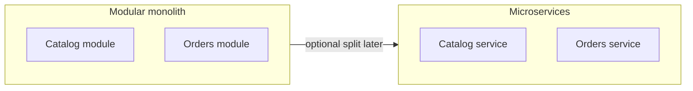

# Modular Monolith versus Microservices

> **Status:** Completed  
> **Module:** 40 — Backend Architecture  
> **Target Java version:** 21  
> **Last reviewed:** 2026-11-10

## 1. Learning Objectives

- Define **modular monolith** and **microservices** and when each fits.
- Apply **module boundaries** (Java modules or package rules) inside one deployable.
- Understand **distributed costs**: latency, consistency, observability.
- Plan **extraction** from monolith without premature splitting.

## 2. Prerequisites

- Ch.01–02 — layering, bounded contexts.
- Module 29 — JPMS awareness.

## 3. Why This Concept Exists

Teams split services for **independent scaling** and **team autonomy**, but pay **network**, **data**, and **operations** tax. A **well-modularized monolith** often delivers faster with simpler transactions until boundaries are proven.

## 4. Definitions

| Style | Description |
|-------|-------------|
| **Monolith** | Single deployable contains most functionality |
| **Modular monolith** | Enforced module boundaries, one runtime |
| **Microservices** | Independently deployable services around business capabilities |

## 5. Comparison

| Factor | Modular monolith | Microservices |
|--------|------------------|---------------|
| Transactions | Local `@Transactional` ACID | Sagas, eventual consistency |
| Deploy | One artifact | Many pipelines |
| Failure blast | Process crash | Cascading dependencies |
| Team scaling | Package ownership | Service ownership |
| Testing | In-process integration | Contract + E2E env |

## 6. Modular monolith tactics

- **Package-private** + ArchUnit rules: `..domain..` does not depend on `..web..`.
- **Spring Modulith** (optional): documents modules and events in one Boot app.
- **Database per module** logically (schemas/tables prefixed) even in one DB—eases later split.

## 7. Microservices when justified

- Different **scale profiles** (CPU-heavy image service).
- **Independent release cadence** with stable APIs between teams.
- **Regulatory isolation** for payment PCI scope.

Requires: **API gateway**, **service discovery**, **centralized tracing** (Module 46+ topics), **idempotent consumers**.

## 8. Data consistency patterns

- **Saga** — choreographed or orchestrated steps with compensations.
- **Outbox** — reliable event publish with DB commit.
- **CQRS** (optional) — separate read models for heavy queries.

Avoid **distributed monolith**: many services, one shared database, tight coupling.

## 9. Common Mistakes

### Incorrect — microservices for 5-person team day one

Operational load exceeds benefit.

### Incorrect — splitting on technical layers (separate “DAO service”)

Split on **business capabilities** aligned to bounded contexts.

## 10. Revision and Mastery

- Name three costs of microservices microservices do not eliminate.
- What is a strangler fig pattern?

## 11. Exercises

1. Decide monolith vs service for notifications feature with rationale.
2. Write ArchUnit-style rule sentence for module dependencies.
3. Sketch saga for `PlaceOrder` with payment failure compensation.

## 12. Chapter Summary

Start with clear modules inside one deployable; extract services when scaling, team, or isolation needs outweigh distributed complexity. Java packages, JPMS, and DDD contexts prepare boundaries without mandating microservices.

## 13. Next Steps

Module **41** — design patterns and SOLID.

## Review Checklist

- [x] Trade-offs; modular tactics; distributed pitfalls
