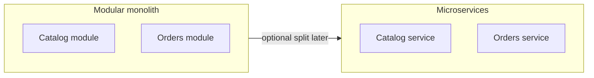

# Modular Monolith versus Microservices

> **Status:** Completed  
> **Module:** 40 — Backend Architecture  
> **Target Java version:** 21  
> **Last reviewed:** 2026-11-11
> **Chapter profile:** Technical
> **Depth target:** Levels 2–3

**Section policy:** Omissions recorded in Review Checklist.

## 1. Learning Objectives

- Define **modular monolith** and **microservices** and when each fits.
- Apply **module boundaries** (Java modules or package rules) inside one deployable.
- Understand **distributed costs**: latency, consistency, observability.
- Plan **extraction** from monolith without premature splitting.

## 2. Prerequisites

- Ch.01–02 — layering, bounded contexts.
- Module 29 — JPMS awareness.

## 3. Why This Concept Exists

Teams split services for **independent scaling** and **team autonomy**, but pay **network**, **data**, and **operations** tax. A **well-modularized monolith** often delivers faster with simpler transactions until boundaries are proven.

## 4. Definitions

| Style | Description |
|-------|-------------|
| **Monolith** | Single deployable contains most functionality |
| **Modular monolith** | Enforced module boundaries, one runtime |
| **Microservices** | Independently deployable services around business capabilities |



## 5. Comparison

| Factor | Modular monolith | Microservices |
|--------|------------------|---------------|
| Transactions | Local `@Transactional` ACID | Sagas, eventual consistency |
| Deploy | One artifact | Many pipelines |
| Failure blast | Process crash | Cascading dependencies |
| Team scaling | Package ownership | Service ownership |
| Testing | In-process integration | Contract + E2E env |

## 6. Modular monolith tactics

- **Package-private** + ArchUnit rules: `..domain..` does not depend on `..web..`.
- **Spring Modulith** (optional): documents modules and events in one Boot app.
- **Database per module** logically (schemas/tables prefixed) even in one DB—eases later split.

## 7. Microservices when justified

- Different **scale profiles** (CPU-heavy image service).
- **Independent release cadence** with stable APIs between teams.
- **Regulatory isolation** for payment PCI scope.

Requires: **API gateway**, **service discovery**, **centralized tracing** (Module 46+ topics), **idempotent consumers**.

## 8. Data consistency patterns

- **Saga** — choreographed or orchestrated steps with compensations.
- **Outbox** — reliable event publish with DB commit.
- **CQRS** (optional) — separate read models for heavy queries.

Avoid **distributed monolith**: many services, one shared database, tight coupling.

## 9. Common Mistakes

### Incorrect — microservices for 5-person team day one

Operational load exceeds benefit.

### Incorrect — splitting on technical layers (separate “DAO service”)

Split on **business capabilities** aligned to bounded contexts.

## 10. Revision and Mastery

- Name three costs of microservices microservices do not eliminate.
- What is a strangler fig pattern?

## 11. Exercises

1. Decide monolith vs service for notifications feature with rationale.
2. Write ArchUnit-style rule sentence for module dependencies.
3. Sketch saga for `PlaceOrder` with payment failure compensation.

## 12. Chapter Summary

Start with clear modules inside one deployable; extract services when scaling, team, or isolation needs outweigh distributed complexity. Java packages, JPMS, and DDD contexts prepare boundaries without mandating microservices.

## 13. Next Steps

Module **41** — design patterns and SOLID.

## 5. Mechanism and Execution Flow *(mandatory)*

### Modular monolith deploy

```text
gradle build → single bootJar → one Kubernetes Deployment
  internal: package/module boundaries enforced by compiler or ArchUnit
```

### Microservice split deploy

```text
catalog-service.jar + orders-service.jar → separate releases
  integration: HTTP/events only; no shared tables
```

**Strangler fig:** route `/new-checkout` to new service; legacy monolith handles old URLs until cutover.

## 21. FAQ — Modularity vs microservices *(mandatory depth)*

**Q: Sign microservices are premature?** Few users, one team, no scale divergence.

**Q: Shared library anti-pattern?** Shared kernel for stable types ok; shared mutable DB is not.

**Q: Spring Modulith?** Documents modules/events in one Boot app—Illustrative tooling.

**Q: Saga when?** Multi-service business processes without 2PC.

**Q: Data per service?** Ideal; schema-per-service is stepping stone.


## Depth appendix — progressive teaching (Architecture)

### Incorrect vs corrected patterns

Documenting failure modes accelerates review. Each pair below states **why** the wrong approach breaks client or operator expectations.

### Operational checklist before marking API complete

- OpenAPI matches deployed routes (Ch.03).
- Error envelope consistent (ProblemDetail or documented custom schema).
- AuthN/Z enforced on mutations (Module 39).
- Examples in `examples/` compiled on Temurin 21.0.12.1 with recorded output.
- Versioning/deprecation policy published for partners.

### Revision drills (Track B)

1. Explain one design trade-off you reversed after load testing.
2. Write three MockMvc or plain HTTP negative tests not in the happy path.
3. Identify one boundary where DTO mapping must never leak entities.

### References (official hierarchy)

- RFC 9110 — HTTP semantics (methods, status).
- Jakarta EE / Spring reference docs for Illustrative framework binding only.
- OWASP ASVS — verification levels for security chapters (Module 43).

**Mechanism merge note:** Where earlier sections already diagram execution flow, this appendix reinforces **operational** depth without duplicating definitions.

### Package dependency sketch

```text
com.app.domain        → (no spring, no jakarta.persistence)
com.app.application   → domain + ports
com.app.infrastructure → jpa, kafka, http clients
com.app.web           → controllers, dtos
```

### Transaction boundary rule

One incoming use case = one transaction unless documented saga (Module 44). Do not span transactions across REST calls inside monolith without reason.

### Extraction checklist

Before splitting a microservice: stable API, independent data, team ownership, observability SLO, failure isolation tested in staging.

## Technical L3 supplement — teaching depth

### Motivation recap (concrete scenario)

A team ships a Java 21 service without documented HTTP contracts, security rules, or messaging guarantees. Mobile clients cache error shapes; a deploy renames a field and checkout silently fails. Operations cannot trace requests across services. The material in this module prevents that class of failure by making **boundaries explicit**: REST semantics, DTOs, auth filters, architecture ports, patterns, clean code, security controls, resilience, and delivery semantics.

### Mechanism trace (how this chapter shows up at runtime)

1. **Ingress** — HTTP or message enters an adapter (controller, listener).
2. **Policy** — auth, validation, and rate limits run before domain logic (fail closed).
3. **Application** — use case coordinates domain + ports inside a transaction or saga step.
4. **Egress** — DTO mapping, event publish (outbox), or outbound HttpClient with timeouts.
5. **Observation** — structured logs with correlation id; metrics on error rate (Module 47).

This sequence is framework-agnostic; Spring/Boot annotations are **Illustrative** wiring for the same pipeline taught in earlier modules.

### Progressive example ladder

| Stage | Focus | Verification label |
|-------|--------|-------------------|
| Minimal | JDK-only demo or pure unit logic | Verified / Compile-verified |
| Realistic | Layered service with DTO + port | Illustrative Spring config |
| Advanced | Failure modes: timeout, duplicate message, 409 conflict | Test + documented output |

Never label **Verified** without Temurin 21.0.12.1 compile/run recorded in chapter or `PROGRESS.md`.

### Wrong vs right (review board)

| Wrong | Why it hurts | Right |
|-------|----------------|-------|
| Skip server AuthZ | IDOR incidents | Check principal vs resource every mutation |
| Expose JPA graph in JSON | Lazy-load storms, schema coupling | Map to DTO in service |
| Infinite HttpClient wait | Thread pile-up, incident duration | Connect + request timeouts |
| Retry all POSTs | Duplicate charges | Idempotency keys + dedup store |
| Dual write DB + broker | Lost or phantom events | Transactional outbox |

### Design tensions engineers negotiate

- **Consistency vs availability** during partitions (Module 44).
- **Stateless JWT vs revocable sessions** (Module 39).
- **Modular monolith vs microservices** operational cost (Module 40).
- **Kafka vs Rabbit** retention and routing (Module 45).
- **Strict SOLID vs delivery speed** (Modules 41–42).

Document the choice in ADRs; the handbook gives options, not one universal answer.

### Java 21 notes

- **Records** for immutable DTOs and events (`Module 08`, `15`).
- **Virtual threads** improve blocking HTTP and JDBC throughput but do not remove timeouts or auth checks.
- **Pattern matching** and **sealed types** clarify domain result models (`PaymentResult` in SOLID chapters).

### Compatibility and sources

Prefer **RFC 9110** for HTTP, **RFC 7807** for errors, **OWASP ASVS** for verification language, and vendor docs for brokers labeled Illustrative. Distinguish **JLS/API guarantees** from **Spring/HotSpot** behavior as in `DOCUMENTATION-STANDARDS.md`.

### Track B — mastery questions

1. Where is the transaction boundary in your current project, and why?
2. Which dependency would you invert first behind a port for testing?
3. What status code and error shape would clients see for your most common validation failure?
4. How would you prove an idempotent consumer in tests?
5. What metric would fire before users notice a downstream slowdown?

### Track B — field exercise (no solution in chapter)

Implement or extend one `examples/` demo for this module: add a negative-path assertion (4xx, breaker OPEN, or rejected input), compile with `javac -source 21`, run on Temurin 21.0.12.1, paste output into `PROGRESS.md` only after a real run.

### Cross-module links

| Need | Module |
|------|--------|
| HTTP client timeouts | 32 |
| JDBC transactions | 33–35 |
| Spring DI / Security | 36–37 |
| Testing & CI | 30 |
| Observability | 47 |

### Glossary touchpoints

Add unfamiliar terms encountered here to `GLOSSARY.md` when stabilizing definitions across the handbook (repository workflow in java-documentation skill).

### Explicit omissions (this supplement)

- Vendor-specific console screenshots and cloud provisioning scripts.
- Exploit reproduction steps (defensive security only in Module 43).
- Exhaustive broker tuning guides (operational manuals remain external).

## Extraction readiness checklist *(conditional)*

| Gate | Question |
|------|----------|
| API | Stable REST/events with contract tests? |
| Data | Schema owned by one module? |
| Ops | Tracing/metrics per deployable? |
| Team | Dedicated owner for extracted service? |

## Review Checklist

- [x] EXPAND-PRESERVE 2026-11-11 (Technical L3)
- [x] Trade-offs; modular tactics; distributed pitfalls
