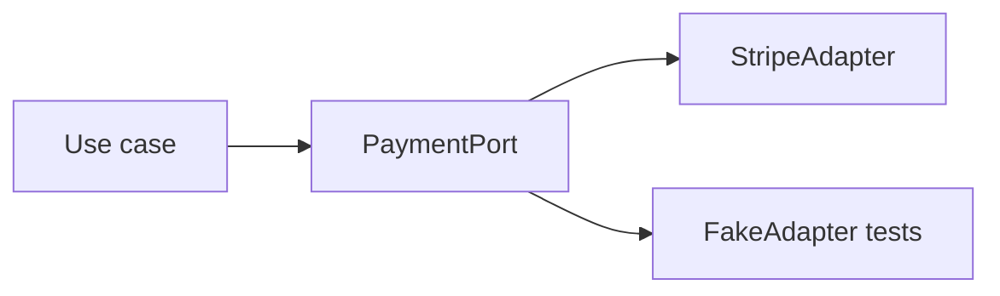

# SOLID and Principles

> **Status:** Completed  
> **Module:** 41 — Design Patterns  
> **Target Java version:** 21  
> **Last reviewed:** 2026-11-11
> **Chapter profile:** Technical
> **Depth target:** Levels 2–3

**Section policy:** Omissions recorded in Review Checklist.

## 1. Learning Objectives

- Apply **SOLID** principles with Java examples.
- Relate **composition over inheritance** and **program to interfaces** to Module 36 DI.
- Recognize **DRY**, **KISS**, **YAGNI** as balance, not dogma.
- Connect **LSP** to Module 07 dynamic dispatch.

## 2. Prerequisites

- Modules 05–07 — OOP, inheritance, interfaces.
- Module 36 — dependency injection.

## 3. Why This Concept Exists

Codebases rot when classes **do too much**, **depend on concrete details**, or **subtypes break callers**. SOLID and related principles give **review vocabulary** and design heuristics for maintainable Java services.

## 4. SOLID

| Letter | Principle | Java sketch |
|--------|-----------|-------------|
| **S** | Single Responsibility | `InvoicePdfRenderer` separate from `InvoiceCalculator` |
| **O** | Open/Closed | Add `PricingStrategy` impl without editing `Checkout` (see patterns demo) |
| **L** | Liskov Substitution | Subtypes honor superclass contracts; no surprising exceptions |
| **I** | Interface Segregation | Split fat `Repository` into `UserQueries` + `UserCommands` if needed |
| **D** | Dependency Inversion | High-level `OrderService` depends on `PaymentPort`, not `StripeClient` |

### Dependency Inversion ↔ Spring

Module 36: bind `PaymentPort` → `StripeAdapter` in container. **D** is the principle; **DI** is the technique.

### LSP example

If `List` subclass throws on `add` where callers expect mutability, substitutability breaks—prefer composition or document constraints.

## 5. Other principles

- **DRY** — one authoritative rule; duplicated validation invites drift.
- **KISS** — simplest design meeting requirements.
- **YAGNI** — do not build abstract factories for one implementation today (patterns in Ch.02–03 when earned).

## 6. Real-World Use Cases

- Extract class when service exceeds ~300 lines or mixed concerns (HTTP + SQL + email).
- Ports/adapters (Module 40) embody **D** and **O**.

## 7. Common Mistakes

### Incorrect — interface per class “for SOLID”

Unnecessary indirection; introduce ports at stability boundaries.

### Incorrect — inheritance for code reuse only

Favors fragile base classes; use composition.

## 8. Design Trade-offs

| Strict SRP | Pragmatic merge |
|------------|-----------------|
| Many small types | Fewer files for CRUD |

Tune to team and domain complexity.

## 9. Revision and Mastery

- Give LSP violation example from JDK or your code.
- How does OCP show up in `ExporterFactory` demo?

## 10. Exercises

1. Refactor pseudo `GodService` into three responsibilities.
2. Identify which SOLID principle a `@MockBean` test double supports.
3. Explain D vs S in one sentence each.

## 11. Chapter Summary

SOLID guides cohesive, replaceable Java designs; DI and hexagonal architecture are structural expressions of Dependency Inversion and Open/Closed discipline.

## 12. Next Steps

[02-creational-patterns.md](02-creational-patterns.md)

## 5. Mechanism and Execution Flow *(mandatory)*

SOLID guides **change vectors**: when tax law changes, only `InvoiceCalculator` edits (SRP). When export format added, new `Exporter` class registers in factory (OCP). `OrderService` depends on `PaymentPort` interface—tests inject fake (DIP).



## 21. FAQ — SOLID *(mandatory depth)*

**Q: Interface every class?** No—invert at volatile dependencies.

**Q: LSP in JDK?** `Stack` extending `Vector` historically surprised callers—composition preferred.

**Q: YAGNI vs OCP?** Don't build factories until second implementation.

**Q: SOLID vs patterns?** Principles explain why patterns help.

**Q: Records and SRP?** Records = data; behavior stays elsewhere.


## Depth appendix — progressive teaching (Design patterns)

### Incorrect vs corrected patterns

Documenting failure modes accelerates review. Each pair below states **why** the wrong approach breaks client or operator expectations.

### Operational checklist before marking API complete

- OpenAPI matches deployed routes (Ch.03).
- Error envelope consistent (ProblemDetail or documented custom schema).
- AuthN/Z enforced on mutations (Module 39).
- Examples in `examples/` compiled on Temurin 21.0.12.1 with recorded output.
- Versioning/deprecation policy published for partners.

### Revision drills (Track B)

1. Explain one design trade-off you reversed after load testing.
2. Write three MockMvc or plain HTTP negative tests not in the happy path.
3. Identify one boundary where DTO mapping must never leak entities.

### References (official hierarchy)

- RFC 9110 — HTTP semantics (methods, status).
- Jakarta EE / Spring reference docs for Illustrative framework binding only.
- OWASP ASVS — verification levels for security chapters (Module 43).

**Mechanism merge note:** Where earlier sections already diagram execution flow, this appendix reinforces **operational** depth without duplicating definitions.

### Pattern selection heuristic

| Symptom | Consider |
|---------|----------|
| Switch on type grows | Strategy or factory |
| Legacy API mismatch | Adapter |
| Cross-cutting concern | Decorator or AOP (Module 36) |
| One-to-many notification | Observer or events (Module 45) |

### Testing patterns

Fakes implement ports (DIP) without heavyweight pattern names—tests stay readable.

### Anti-pattern: pattern slurry

Three patterns in one 40-line class—simplify first, name pattern in review after clarity exists.

## Technical L3 supplement — teaching depth

### Motivation recap (concrete scenario)

A team ships a Java 21 service without documented HTTP contracts, security rules, or messaging guarantees. Mobile clients cache error shapes; a deploy renames a field and checkout silently fails. Operations cannot trace requests across services. The material in this module prevents that class of failure by making **boundaries explicit**: REST semantics, DTOs, auth filters, architecture ports, patterns, clean code, security controls, resilience, and delivery semantics.

### Mechanism trace (how this chapter shows up at runtime)

1. **Ingress** — HTTP or message enters an adapter (controller, listener).
2. **Policy** — auth, validation, and rate limits run before domain logic (fail closed).
3. **Application** — use case coordinates domain + ports inside a transaction or saga step.
4. **Egress** — DTO mapping, event publish (outbox), or outbound HttpClient with timeouts.
5. **Observation** — structured logs with correlation id; metrics on error rate (Module 47).

This sequence is framework-agnostic; Spring/Boot annotations are **Illustrative** wiring for the same pipeline taught in earlier modules.

### Progressive example ladder

| Stage | Focus | Verification label |
|-------|--------|-------------------|
| Minimal | JDK-only demo or pure unit logic | Verified / Compile-verified |
| Realistic | Layered service with DTO + port | Illustrative Spring config |
| Advanced | Failure modes: timeout, duplicate message, 409 conflict | Test + documented output |

Never label **Verified** without Temurin 21.0.12.1 compile/run recorded in chapter or `PROGRESS.md`.

### Wrong vs right (review board)

| Wrong | Why it hurts | Right |
|-------|----------------|-------|
| Skip server AuthZ | IDOR incidents | Check principal vs resource every mutation |
| Expose JPA graph in JSON | Lazy-load storms, schema coupling | Map to DTO in service |
| Infinite HttpClient wait | Thread pile-up, incident duration | Connect + request timeouts |
| Retry all POSTs | Duplicate charges | Idempotency keys + dedup store |
| Dual write DB + broker | Lost or phantom events | Transactional outbox |

### Design tensions engineers negotiate

- **Consistency vs availability** during partitions (Module 44).
- **Stateless JWT vs revocable sessions** (Module 39).
- **Modular monolith vs microservices** operational cost (Module 40).
- **Kafka vs Rabbit** retention and routing (Module 45).
- **Strict SOLID vs delivery speed** (Modules 41–42).

Document the choice in ADRs; the handbook gives options, not one universal answer.

### Java 21 notes

- **Records** for immutable DTOs and events (`Module 08`, `15`).
- **Virtual threads** improve blocking HTTP and JDBC throughput but do not remove timeouts or auth checks.
- **Pattern matching** and **sealed types** clarify domain result models (`PaymentResult` in SOLID chapters).

### Compatibility and sources

Prefer **RFC 9110** for HTTP, **RFC 7807** for errors, **OWASP ASVS** for verification language, and vendor docs for brokers labeled Illustrative. Distinguish **JLS/API guarantees** from **Spring/HotSpot** behavior as in `DOCUMENTATION-STANDARDS.md`.

### Track B — mastery questions

1. Where is the transaction boundary in your current project, and why?
2. Which dependency would you invert first behind a port for testing?
3. What status code and error shape would clients see for your most common validation failure?
4. How would you prove an idempotent consumer in tests?
5. What metric would fire before users notice a downstream slowdown?

### Track B — field exercise (no solution in chapter)

Implement or extend one `examples/` demo for this module: add a negative-path assertion (4xx, breaker OPEN, or rejected input), compile with `javac -source 21`, run on Temurin 21.0.12.1, paste output into `PROGRESS.md` only after a real run.

### Cross-module links

| Need | Module |
|------|--------|
| HTTP client timeouts | 32 |
| JDBC transactions | 33–35 |
| Spring DI / Security | 36–37 |
| Testing & CI | 30 |
| Observability | 47 |

### Glossary touchpoints

Add unfamiliar terms encountered here to `GLOSSARY.md` when stabilizing definitions across the handbook (repository workflow in java-documentation skill).

### Explicit omissions (this supplement)

- Vendor-specific console screenshots and cloud provisioning scripts.
- Exploit reproduction steps (defensive security only in Module 43).
- Exhaustive broker tuning guides (operational manuals remain external).

## Kotlin interop and API stability *(conditional)*

Java service APIs consumed by Kotlin callers benefit from **nullable annotations** (`@Nullable` / `@NotNull`) and stable package names—SOLID **ISP** keeps surfaced types small for multi-language clients.

## Extended SOLID walkthrough — checkout service

| Principle | Checkout manifestation |
|-----------|------------------------|
| SRP | `TaxCalculator` separate from `PaymentClient` |
| OCP | New `LoyaltyDiscount` implements `PricingStrategy` |
| LSP | `InMemoryPaymentPort` substitutes in tests |
| ISP | `PaymentPort.charge` only—no unrelated report methods |
| DIP | `CheckoutService` constructor takes `PaymentPort` |

### Sealed results (Java 21)

```java
public sealed interface ChargeResult permits Approved, Declined {
    record Approved(String authId) implements ChargeResult { }
    record Declined(String reason) implements ChargeResult { }
}
```

Exhaustive `switch` on `ChargeResult` documents all outcomes without default abuse.

## Review Checklist

- [x] EXPAND-PRESERVE 2026-11-11 (Technical L3)
- [x] All five SOLID; links to DI/LSP
