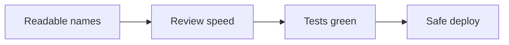

# Clean Code Practices

> **Status:** Completed  
> **Module:** 42 — Clean Code and SOLID  
> **Target Java version:** 21  
> **Last reviewed:** 2026-11-11
> **Chapter profile:** Technical
> **Depth target:** Levels 2–3

**Section policy:** Omissions recorded in Review Checklist.

## 1. Learning Objectives

- Apply **naming**, **functions**, **comments**, and **formatting** rules that survive code review.
- Refactor toward **small, intention-revealing** types without premature abstraction.
- Connect clean code to **testability** (Module 30) and **hexagonal boundaries** (Module 40).
- Run the [readability demo](../../examples/clean-code/readability-demo/).

## 2. Prerequisites

- Modules 02–07 — types, methods, OOP.
- Module 41 — SOLID vocabulary (this module deepens application).
- Module 30 — tests as safety net for refactors.

## 3. Why This Concept Exists

Readable code **reduces defects** and **onboarding time**. “Works on my machine” code that only the author understands becomes a liability when requirements change. Clean code is not aesthetic preference—it is **risk management**: names and structure document intent when original authors are unavailable.

## 4. Conceptual Explanation

**Clean code** means code another professional can **read, change, and test** without guessing. In Java this shows up as:

| Practice | What it means | Why it matters |
|----------|---------------|----------------|
| **Intention-revealing names** | `calculateInvoiceTotal` not `calc` | Searchability and reviews |
| **Small functions** | One level of abstraction per method | Easier tests and reuse |
| **Few arguments** | Prefer objects over long parameter lists | Fewer permutations of bugs |
| **No surprising side effects** | `findUser` should not send email | Callers reason locally |
| **Consistent formatting** | Project formatter (IDE) | Diffs show logic, not whitespace |
| **Meaningful errors** | Domain exceptions + context | Faster incident response |

Clean code complements **SOLID** (Ch.02): SRP keeps classes cohesive; clean naming makes violations visible in review.

## 5. Terminology

| Term | Meaning |
|------|---------|
| **Code smell** | Surface sign that design may need change (not always wrong immediately) |
| **Refactoring** | Behavior-preserving structural improvement (tests green before/after) |
| **Technical debt** | Shortcuts that speed today but slow tomorrow |
| **Boy Scout rule** | Leave code slightly cleaner than you found it |

## 6. Naming in Java

### Types and packages

- **Classes:** nouns (`InvoiceService`, `Money`).
- **Methods:** verbs (`cancelOrder`, `toDto`).
- **Booleans:** `isActive`, `hasStock`—not `flag`.
- **Packages:** lowercase, no underscores (`com.acme.billing`).

### Constants

Use `static final` with screaming snake case only for true constants (`MAX_RETRY_COUNT`).

### Incorrect — cryptic domain leakage

```java
void proc(Map<String, Object> m) { /* ... */ }
```

### Correct — domain language

```java
void applyDiscount(Quote quote, DiscountPolicy policy) { /* ... */ }
```

See [ReadabilityDemo](../../examples/clean-code/readability-demo/ReadabilityDemo.java): `Money` and `InvoiceLine` encode units and rounding in one place.

## 7. Functions and methods

Rules of thumb for services and domain code:

1. **≤ 20–30 lines** visible logic before extracting (guideline, not law).
2. **Extract** when a block needs a comment explaining *what* it does.
3. **Prefer pure functions** in domain math (deterministic, no I/O).
4. **`Optional` return** documents absence; avoid sentinel `null` for “not found.”

### Incorrect — boolean flag parameters

```java
void exportReport(boolean asCsv, boolean asPdf, boolean sendEmail) { }
```

### Correct — strategy or command object

```java
void exportReport(ExportFormat format, DeliveryTarget target) { }
```

## 8. Comments and documentation

- **Good comments:** legal headers, `//` explaining *why* a non-obvious constraint exists.
- **Bad comments:** restating the code (`// increment i`).
- **Javadoc:** public API surfaces and framework extension points—not every private helper.

Use Module 38 **OpenAPI** for HTTP contracts; do not duplicate endpoint shapes only in comments.

## 9. Error handling and flow

- **Fail fast** on invalid inputs at boundaries (see Module 43 input validation).
- **Do not swallow** exceptions without logging context (Module 47).
- **Guard clauses** reduce nesting:

```java
public Invoice finalize(Quote quote) {
    if (quote == null) throw new IllegalArgumentException("quote");
    if (!quote.isApproved()) throw new IllegalStateException("not approved");
  // happy path at low indentation
}
```

## 10. Real-World Use Cases

- **Payment service:** isolate `Money` type; never use `double` for currency.
- **REST layer:** thin controllers; no SQL in `@RestController`.
- **Legacy lift:** rename fields when module boundaries are clear; pair with characterization tests.

## 11. Internal Behavior

The JVM does not care about names—**developers and tooling** do. IDEs rename-refactor across modules; meaningful names make **static analysis** (Module 30) and **security scanners** reports actionable.

## 12. Edge Cases and Limitations

- **Over-abstraction:** three similar lines do not always need a framework.
- **Premature micro-types:** `EmailAddressString` value object is useful in email-heavy domains; noise elsewhere.
- **Generated code:** Lombok, MapStruct—review generated shape in PRs.

## 13. Common Mistakes

### Incorrect — magic numbers

```java
if (status == 3) { /* shipped */ }
```

### Correct

```java
if (status == OrderStatus.SHIPPED) { }
```

### Incorrect — large God class

`OrderService` with 40 methods mixing PDF, SMTP, and JDBC—split by responsibility (SRP).

## 14. Best Practices

- Enforce **Checkstyle/SpotBugs** in CI (Module 30).
- **Code review checklist:** naming, tests, boundaries, logging on errors.
- Align with **module structure** in modular monoliths (Module 40).

## 15. Design Trade-offs

| Strict clean code | Pragmatic legacy |
|-------------------|------------------|
| More types and files | Faster hotfix in one class |
| Easier long-term change | Short-term copy-paste |

Balance with team size and release pressure; never skip tests on refactors.

## 16. Java Version Notes

Java 21 **records** (`record Money(BigDecimal amount)`) reduce boilerplate for value objects—use when immutability fits (Module 08).

## 17. Revision and Mastery

- When is a comment justified vs deleting it?
- How does `Money` improve clean code vs `BigDecimal` everywhere?
- Name three smells in a recent PR you reviewed.

## 18. Exercises

1. Refactor a 80-line method into three named methods (preserve tests).
2. Replace two `boolean` parameters with an enum or small type.
3. Run `ReadabilityDemo` and extend with tax calculation on `Money`.

## 19. Interview Questions

- Difference between clean code and SOLID?
- How do tests enable refactoring?
- When would you *not* extract a method?

## 20. Chapter Summary

Clean code makes Java systems maintainable through intentional naming, small cohesive units, honest error handling, and reviews backed by tests—not through dogmatic rules.

## 21. Key Terminology

Code smell, refactoring, technical debt, intention-revealing name, guard clause.

## 22. References

- Joshua Bloch, *Effective Java* (3rd ed.) — Items on naming and APIs.
- Robert C. Martin, *Clean Code* — habits (adapt to Java idioms).

## 23. Next Steps

[02-solid-deep-dive.md](02-solid-deep-dive.md)

## 5. Mechanism and Execution Flow *(mandatory)*

Clean code affects **change cost**: reviewer reads `calculateInvoiceTotal` and locates tax rules; IDE refactor renames across modules; tests fail on behavior change during extract-method refactors.



**Verified (Temurin 21.0.12.1, 2026-11-11):** `readability=ok` from `examples/clean-code/readability-demo`.

## 21. FAQ — Clean code *(mandatory depth)*

**Q: Line length rules?** Formatter consistency beats debates.

**Q: Comments on why not what?** Non-obvious business constraints deserve comments.

**Q: Clean vs clever?** Prefer boring code in payment paths.

**Q: Lombok?** Review generated equals/hash for entities.

**Q: Boy Scout rule scope?** Touch nearby smells only in focused PRs.


## Depth appendix — progressive teaching (Clean code)

### Incorrect vs corrected patterns

Documenting failure modes accelerates review. Each pair below states **why** the wrong approach breaks client or operator expectations.

### Operational checklist before marking API complete

- OpenAPI matches deployed routes (Ch.03).
- Error envelope consistent (ProblemDetail or documented custom schema).
- AuthN/Z enforced on mutations (Module 39).
- Examples in `examples/` compiled on Temurin 21.0.12.1 with recorded output.
- Versioning/deprecation policy published for partners.

### Revision drills (Track B)

1. Explain one design trade-off you reversed after load testing.
2. Write three MockMvc or plain HTTP negative tests not in the happy path.
3. Identify one boundary where DTO mapping must never leak entities.

### References (official hierarchy)

- RFC 9110 — HTTP semantics (methods, status).
- Jakarta EE / Spring reference docs for Illustrative framework binding only.
- OWASP ASVS — verification levels for security chapters (Module 43).

**Mechanism merge note:** Where earlier sections already diagram execution flow, this appendix reinforces **operational** depth without duplicating definitions.

### Refactoring recipe

1. Characterization test on legacy method.
2. Extract pure function for calculation.
3. Rename for domain language.
4. Run SpotBugs/Checkstyle in CI (Module 30).

### Naming review questions

- Does the name encode units (`Money`, `Duration`)?
- Would a new hire guess side effects from the method name?
- Are booleans `is/has` prefixed consistently?

## Technical L3 supplement — teaching depth

### Motivation recap (concrete scenario)

A team ships a Java 21 service without documented HTTP contracts, security rules, or messaging guarantees. Mobile clients cache error shapes; a deploy renames a field and checkout silently fails. Operations cannot trace requests across services. The material in this module prevents that class of failure by making **boundaries explicit**: REST semantics, DTOs, auth filters, architecture ports, patterns, clean code, security controls, resilience, and delivery semantics.

### Mechanism trace (how this chapter shows up at runtime)

1. **Ingress** — HTTP or message enters an adapter (controller, listener).
2. **Policy** — auth, validation, and rate limits run before domain logic (fail closed).
3. **Application** — use case coordinates domain + ports inside a transaction or saga step.
4. **Egress** — DTO mapping, event publish (outbox), or outbound HttpClient with timeouts.
5. **Observation** — structured logs with correlation id; metrics on error rate (Module 47).

This sequence is framework-agnostic; Spring/Boot annotations are **Illustrative** wiring for the same pipeline taught in earlier modules.

### Progressive example ladder

| Stage | Focus | Verification label |
|-------|--------|-------------------|
| Minimal | JDK-only demo or pure unit logic | Verified / Compile-verified |
| Realistic | Layered service with DTO + port | Illustrative Spring config |
| Advanced | Failure modes: timeout, duplicate message, 409 conflict | Test + documented output |

Never label **Verified** without Temurin 21.0.12.1 compile/run recorded in chapter or `PROGRESS.md`.

### Wrong vs right (review board)

| Wrong | Why it hurts | Right |
|-------|----------------|-------|
| Skip server AuthZ | IDOR incidents | Check principal vs resource every mutation |
| Expose JPA graph in JSON | Lazy-load storms, schema coupling | Map to DTO in service |
| Infinite HttpClient wait | Thread pile-up, incident duration | Connect + request timeouts |
| Retry all POSTs | Duplicate charges | Idempotency keys + dedup store |
| Dual write DB + broker | Lost or phantom events | Transactional outbox |

### Design tensions engineers negotiate

- **Consistency vs availability** during partitions (Module 44).
- **Stateless JWT vs revocable sessions** (Module 39).
- **Modular monolith vs microservices** operational cost (Module 40).
- **Kafka vs Rabbit** retention and routing (Module 45).
- **Strict SOLID vs delivery speed** (Modules 41–42).

Document the choice in ADRs; the handbook gives options, not one universal answer.

### Java 21 notes

- **Records** for immutable DTOs and events (`Module 08`, `15`).
- **Virtual threads** improve blocking HTTP and JDBC throughput but do not remove timeouts or auth checks.
- **Pattern matching** and **sealed types** clarify domain result models (`PaymentResult` in SOLID chapters).

### Compatibility and sources

Prefer **RFC 9110** for HTTP, **RFC 7807** for errors, **OWASP ASVS** for verification language, and vendor docs for brokers labeled Illustrative. Distinguish **JLS/API guarantees** from **Spring/HotSpot** behavior as in `DOCUMENTATION-STANDARDS.md`.

### Track B — mastery questions

1. Where is the transaction boundary in your current project, and why?
2. Which dependency would you invert first behind a port for testing?
3. What status code and error shape would clients see for your most common validation failure?
4. How would you prove an idempotent consumer in tests?
5. What metric would fire before users notice a downstream slowdown?

### Track B — field exercise (no solution in chapter)

Implement or extend one `examples/` demo for this module: add a negative-path assertion (4xx, breaker OPEN, or rejected input), compile with `javac -source 21`, run on Temurin 21.0.12.1, paste output into `PROGRESS.md` only after a real run.

### Cross-module links

| Need | Module |
|------|--------|
| HTTP client timeouts | 32 |
| JDBC transactions | 33–35 |
| Spring DI / Security | 36–37 |
| Testing & CI | 30 |
| Observability | 47 |

### Glossary touchpoints

Add unfamiliar terms encountered here to `GLOSSARY.md` when stabilizing definitions across the handbook (repository workflow in java-documentation skill).

### Explicit omissions (this supplement)

- Vendor-specific console screenshots and cloud provisioning scripts.
- Exploit reproduction steps (defensive security only in Module 43).
- Exhaustive broker tuning guides (operational manuals remain external).

## Review Checklist

- [x] EXPAND-PRESERVE 2026-11-11 (Technical L3)
- [x] Depth gate; demo linked and verified Temurin 21.0.12.1
- [x] Revision and Mastery; exercises without inline solutions
