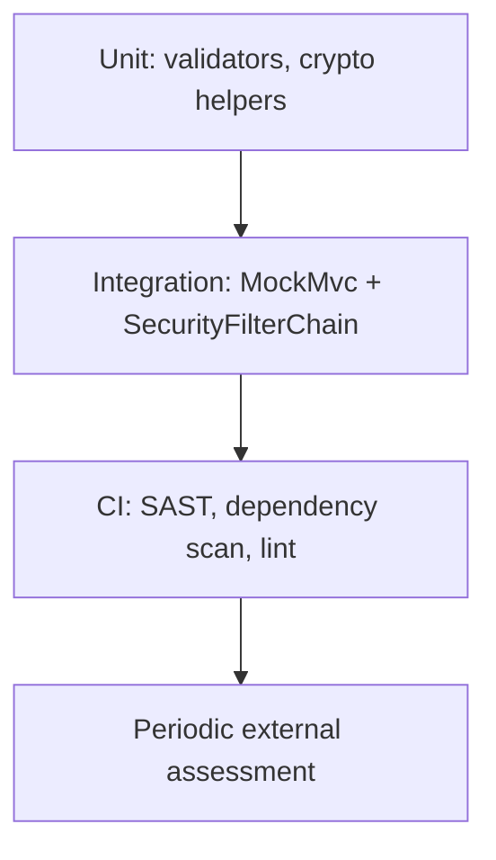

# Security Testing

> **Status:** Completed  
> **Module:** 43 — Security  
> **Target Java version:** 21  
> **Last reviewed:** 2026-11-11
> **Chapter profile:** Technical
> **Depth target:** Levels 2–3

**Section policy:** Omissions recorded in Review Checklist.

## 1. Learning Objectives

- Build a **security test pyramid**: unit, integration, CI checks.
- Write tests for **AuthZ**, validation, and **security headers** without offensive tooling tutorials.
- Integrate **SAST/DAST/dependency** scans in CI (Module 30).
- Plan **remediation** workflows from findings.

## 2. Prerequisites

- Module 30 — JUnit, Mockito, CI.
- Module 39 — Spring Security patterns.
- Chapters 01–02 in this module.

## 3. Why This Concept Exists

Functional tests prove features work; **security tests** prove **unauthorized and malformed** use is rejected. They catch regressions when developers add endpoints without filter rules.

## 4. Layers of security testing



## 5. Unit tests — validation and policy

Test pure validators and domain rules:

```java
@Test
void rejectsInvalidUserId() {
    assertThrows(IllegalArgumentException.class, () -> UserIds.require("bad;id"));
}
```

Test **authorization helpers**:

```java
@Test
void nonOwnerCannotCancel() {
    var order = new Order("owner-1", OrderStatus.PLACED);
    assertThrows(AccessDeniedException.class, () -> order.cancelAs("other-user"));
}
```

## 6. Integration tests — Spring Security

`@WebMvcTest` or `@SpringBootTest` + `MockMvc`:

```java
@Test
void anonymousCannotDeleteOrder() throws Exception {
    mockMvc.perform(delete("/api/orders/{id}", orderId))
            .andExpect(status().isUnauthorized());
}

@Test
void userCannotDeleteOthersOrder() throws Exception {
    mockMvc.perform(delete("/api/orders/{id}", orderId)
            .with(user("alice").roles("USER")))
            .andExpect(status().isForbidden());
}
```

Use **test fixtures** with known users; never real production credentials.

## 7. Contract and regression tests

- **OpenAPI** examples + status codes for 401/403 (Module 38).
- **CSRF** enabled for browser session apps—assert bad token rejected.

## 8. CI automation

| Tool class | Purpose |
|------------|---------|
| **Dependency scan** | Known CVEs in libraries |
| **SAST** (SpotBugs, Semgrep) | Injection, weak crypto patterns |
| **Secret scan** | Prevent committing keys |
| **Container scan** | Base image vulnerabilities |

Fail build on **critical** CVEs with documented exceptions.

## 9. DAST and penetration testing

**DAST** probes running environments (often in staging). **Pen tests** are human-led, periodic complements—not substitutes for unit AuthZ tests.

This handbook does not teach running exploit frameworks; coordinate with security team and scope.

## 10. Real-World Use Cases

- Fintech: every payment endpoint has forbidden cross-tenant tests in CI.
- OAuth resource server: tests for expired and wrong-audience tokens.
- File upload: reject disallowed MIME and size in tests.

## 11. Edge Cases

- **Test data leakage:** use synthetic PII only.
- **Flaky security tests:** clock for JWT exp—use fixed `Clock` bean in tests.

## 12. Common Mistakes

| Mistake | Fix |
|---------|-----|
| Only happy-path MockMvc | Matrix of roles and resources |
| Disabled security in tests | `@Import(SecurityConfig.class)` |
| Ignoring CI CVE noise | Prioritize reachable dependencies |

## 13. Best Practices

- **Security acceptance criteria** per story.
- Map tests to **OWASP categories** (Ch.01) in test plan spreadsheet.
- Post-incident: add regression test.

## 14. Revision and Mastery

- Difference between SAST and dependency scan?
- Minimum AuthZ tests for CRUD resource?
- When is external pen test appropriate?

## 15. Exercises

1. Write MockMvc tests for public `/health` vs protected `/api/**`.
2. Add ArchUnit rule: controllers must not import JDBC.
3. Document CI gate for Critical CVEs.

## 16. Chapter Summary

Security testing in Java combines fast unit policy tests, secured integration tests, and automated CI scanners—plus periodic professional assessment for defense in depth.

## 5. Mechanism and Execution Flow *(mandatory)*

```text
PR opens → unit security tests → MockMvc matrix → dependency scan → merge
Periodic → external pen test / DAST in staging
```

Spring test snippets **Illustrative**—plain Java tests validate validators and crypto helpers without framework.

## 21. FAQ — Security testing *(mandatory depth)*

**Q: SAST vs DAST?** SAST scans code; DAST probes running app.

**Q: `@WithMockUser` limits?** Does not replace full OAuth integration tests.

**Q: Negative tests?** Malformed JSON, oversize payloads, wrong content-type.

**Q: CI secrets?** Use ephemeral credentials in pipeline vault.

**Q: Remediation SLA?** Critical CVE vs high—define team policy.


## Depth appendix — progressive teaching (Security)

### Incorrect vs corrected patterns

Documenting failure modes accelerates review. Each pair below states **why** the wrong approach breaks client or operator expectations.

### Operational checklist before marking API complete

- OpenAPI matches deployed routes (Ch.03).
- Error envelope consistent (ProblemDetail or documented custom schema).
- AuthN/Z enforced on mutations (Module 39).
- Examples in `examples/` compiled on Temurin 21.0.12.1 with recorded output.
- Versioning/deprecation policy published for partners.

### Revision drills (Track B)

1. Explain one design trade-off you reversed after load testing.
2. Write three MockMvc or plain HTTP negative tests not in the happy path.
3. Identify one boundary where DTO mapping must never leak entities.

### References (official hierarchy)

- RFC 9110 — HTTP semantics (methods, status).
- Jakarta EE / Spring reference docs for Illustrative framework binding only.
- OWASP ASVS — verification levels for security chapters (Module 43).

**Mechanism merge note:** Where earlier sections already diagram execution flow, this appendix reinforces **operational** depth without duplicating definitions.

## Technical L3 supplement — teaching depth

### Motivation recap (concrete scenario)

A team ships a Java 21 service without documented HTTP contracts, security rules, or messaging guarantees. Mobile clients cache error shapes; a deploy renames a field and checkout silently fails. Operations cannot trace requests across services. The material in this module prevents that class of failure by making **boundaries explicit**: REST semantics, DTOs, auth filters, architecture ports, patterns, clean code, security controls, resilience, and delivery semantics.

### Mechanism trace (how this chapter shows up at runtime)

1. **Ingress** — HTTP or message enters an adapter (controller, listener).
2. **Policy** — auth, validation, and rate limits run before domain logic (fail closed).
3. **Application** — use case coordinates domain + ports inside a transaction or saga step.
4. **Egress** — DTO mapping, event publish (outbox), or outbound HttpClient with timeouts.
5. **Observation** — structured logs with correlation id; metrics on error rate (Module 47).

This sequence is framework-agnostic; Spring/Boot annotations are **Illustrative** wiring for the same pipeline taught in earlier modules.

### Progressive example ladder

| Stage | Focus | Verification label |
|-------|--------|-------------------|
| Minimal | JDK-only demo or pure unit logic | Verified / Compile-verified |
| Realistic | Layered service with DTO + port | Illustrative Spring config |
| Advanced | Failure modes: timeout, duplicate message, 409 conflict | Test + documented output |

Never label **Verified** without Temurin 21.0.12.1 compile/run recorded in chapter or `PROGRESS.md`.

### Wrong vs right (review board)

| Wrong | Why it hurts | Right |
|-------|----------------|-------|
| Skip server AuthZ | IDOR incidents | Check principal vs resource every mutation |
| Expose JPA graph in JSON | Lazy-load storms, schema coupling | Map to DTO in service |
| Infinite HttpClient wait | Thread pile-up, incident duration | Connect + request timeouts |
| Retry all POSTs | Duplicate charges | Idempotency keys + dedup store |
| Dual write DB + broker | Lost or phantom events | Transactional outbox |

### Design tensions engineers negotiate

- **Consistency vs availability** during partitions (Module 44).
- **Stateless JWT vs revocable sessions** (Module 39).
- **Modular monolith vs microservices** operational cost (Module 40).
- **Kafka vs Rabbit** retention and routing (Module 45).
- **Strict SOLID vs delivery speed** (Modules 41–42).

Document the choice in ADRs; the handbook gives options, not one universal answer.

### Java 21 notes

- **Records** for immutable DTOs and events (`Module 08`, `15`).
- **Virtual threads** improve blocking HTTP and JDBC throughput but do not remove timeouts or auth checks.
- **Pattern matching** and **sealed types** clarify domain result models (`PaymentResult` in SOLID chapters).

### Compatibility and sources

Prefer **RFC 9110** for HTTP, **RFC 7807** for errors, **OWASP ASVS** for verification language, and vendor docs for brokers labeled Illustrative. Distinguish **JLS/API guarantees** from **Spring/HotSpot** behavior as in `DOCUMENTATION-STANDARDS.md`.

### Track B — mastery questions

1. Where is the transaction boundary in your current project, and why?
2. Which dependency would you invert first behind a port for testing?
3. What status code and error shape would clients see for your most common validation failure?
4. How would you prove an idempotent consumer in tests?
5. What metric would fire before users notice a downstream slowdown?

### Track B — field exercise (no solution in chapter)

Implement or extend one `examples/` demo for this module: add a negative-path assertion (4xx, breaker OPEN, or rejected input), compile with `javac -source 21`, run on Temurin 21.0.12.1, paste output into `PROGRESS.md` only after a real run.

### Cross-module links

| Need | Module |
|------|--------|
| HTTP client timeouts | 32 |
| JDBC transactions | 33–35 |
| Spring DI / Security | 36–37 |
| Testing & CI | 30 |
| Observability | 47 |

### Glossary touchpoints

Add unfamiliar terms encountered here to `GLOSSARY.md` when stabilizing definitions across the handbook (repository workflow in java-documentation skill).

### Explicit omissions (this supplement)

- Vendor-specific console screenshots and cloud provisioning scripts.
- Exploit reproduction steps (defensive security only in Module 43).
- Exhaustive broker tuning guides (operational manuals remain external).

## Review Checklist

- [x] EXPAND-PRESERVE 2026-11-11 (Technical L3)
- [x] Defensive testing only; MockMvc patterns; CI table
