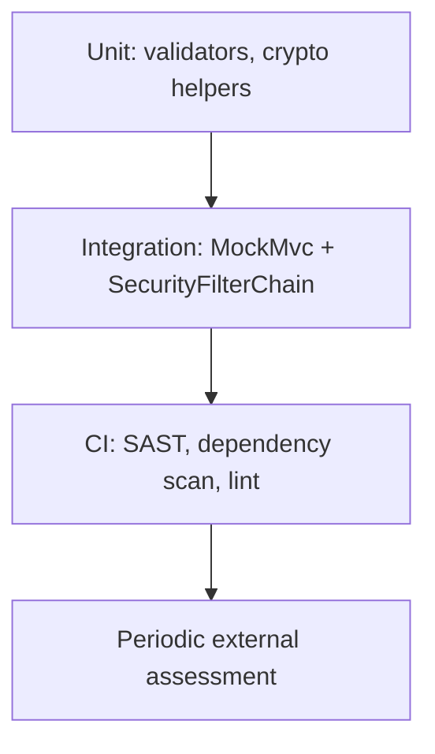

# Security Testing

> **Status:** Completed  
> **Module:** 43 — Security  
> **Target Java version:** 21  
> **Last reviewed:** 2026-11-10

## 1. Learning Objectives

- Build a **security test pyramid**: unit, integration, CI checks.
- Write tests for **AuthZ**, validation, and **security headers** without offensive tooling tutorials.
- Integrate **SAST/DAST/dependency** scans in CI (Module 30).
- Plan **remediation** workflows from findings.

## 2. Prerequisites

- Module 30 — JUnit, Mockito, CI.
- Module 39 — Spring Security patterns.
- Chapters 01–02 in this module.

## 3. Why This Concept Exists

Functional tests prove features work; **security tests** prove **unauthorized and malformed** use is rejected. They catch regressions when developers add endpoints without filter rules.

## 4. Layers of security testing



## 5. Unit tests — validation and policy

Test pure validators and domain rules:

```java
@Test
void rejectsInvalidUserId() {
    assertThrows(IllegalArgumentException.class, () -> UserIds.require("bad;id"));
}
```

Test **authorization helpers**:

```java
@Test
void nonOwnerCannotCancel() {
    var order = new Order("owner-1", OrderStatus.PLACED);
    assertThrows(AccessDeniedException.class, () -> order.cancelAs("other-user"));
}
```

## 6. Integration tests — Spring Security

`@WebMvcTest` or `@SpringBootTest` + `MockMvc`:

```java
@Test
void anonymousCannotDeleteOrder() throws Exception {
    mockMvc.perform(delete("/api/orders/{id}", orderId))
            .andExpect(status().isUnauthorized());
}

@Test
void userCannotDeleteOthersOrder() throws Exception {
    mockMvc.perform(delete("/api/orders/{id}", orderId)
            .with(user("alice").roles("USER")))
            .andExpect(status().isForbidden());
}
```

Use **test fixtures** with known users; never real production credentials.

## 7. Contract and regression tests

- **OpenAPI** examples + status codes for 401/403 (Module 38).
- **CSRF** enabled for browser session apps—assert bad token rejected.

## 8. CI automation

| Tool class | Purpose |
|------------|---------|
| **Dependency scan** | Known CVEs in libraries |
| **SAST** (SpotBugs, Semgrep) | Injection, weak crypto patterns |
| **Secret scan** | Prevent committing keys |
| **Container scan** | Base image vulnerabilities |

Fail build on **critical** CVEs with documented exceptions.

## 9. DAST and penetration testing

**DAST** probes running environments (often in staging). **Pen tests** are human-led, periodic complements—not substitutes for unit AuthZ tests.

This handbook does not teach running exploit frameworks; coordinate with security team and scope.

## 10. Real-World Use Cases

- Fintech: every payment endpoint has forbidden cross-tenant tests in CI.
- OAuth resource server: tests for expired and wrong-audience tokens.
- File upload: reject disallowed MIME and size in tests.

## 11. Edge Cases

- **Test data leakage:** use synthetic PII only.
- **Flaky security tests:** clock for JWT exp—use fixed `Clock` bean in tests.

## 12. Common Mistakes

| Mistake | Fix |
|---------|-----|
| Only happy-path MockMvc | Matrix of roles and resources |
| Disabled security in tests | `@Import(SecurityConfig.class)` |
| Ignoring CI CVE noise | Prioritize reachable dependencies |

## 13. Best Practices

- **Security acceptance criteria** per story.
- Map tests to **OWASP categories** (Ch.01) in test plan spreadsheet.
- Post-incident: add regression test.

## 14. Revision and Mastery

- Difference between SAST and dependency scan?
- Minimum AuthZ tests for CRUD resource?
- When is external pen test appropriate?

## 15. Exercises

1. Write MockMvc tests for public `/health` vs protected `/api/**`.
2. Add ArchUnit rule: controllers must not import JDBC.
3. Document CI gate for Critical CVEs.

## 16. Chapter Summary

Security testing in Java combines fast unit policy tests, secured integration tests, and automated CI scanners—plus periodic professional assessment for defense in depth.

## Review Checklist

- [x] Defensive testing only; MockMvc patterns; CI table
