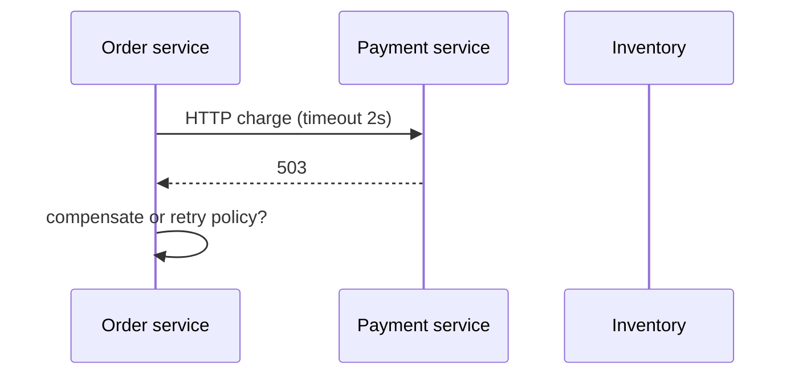

# Distributed Fundamentals

> **Status:** Completed  
> **Module:** 44 — Microservices and Distributed Systems  
> **Target Java version:** 21  
> **Last reviewed:** 2026-11-11
> **Chapter profile:** Technical
> **Depth target:** Levels 2–3

**Section policy:** Omissions recorded in Review Checklist.

## 1. Learning Objectives

- Explain **CAP**, **network partitions**, and **latency** in distributed Java systems.
- Compare **monolith**, **modular monolith**, and **microservices** (Module 40).
- Model **synchronous** vs **asynchronous** integration trade-offs.
- Identify **failure modes**: timeouts, partial failures, cascading errors.

## 2. Prerequisites

- Modules 32, 40 — HTTP, architecture.
- Module 14 — concurrency basics.

## 3. Why This Concept Exists

Splitting a system across processes and networks **removes single-machine assumptions**. Transactions, exceptions, and stack traces no longer span one JVM. Fundamentals prevent designing **distributed monoliths** that are harder than one well-structured deployable.

## 4. Conceptual Explanation

**Distributed system:** independent nodes communicate via messages (HTTP, gRPC, queues) without shared memory.

| Property | Single JVM | Distributed |
|----------|------------|-------------|
| **Consistency** | Strong within one DB transaction (often) | Requires explicit protocol |
| **Failure detection** | Exception | Timeout, ambiguous result |
| **Latency** | Microseconds–ms | Milliseconds–seconds + tail latency |

## 5. CAP (practical framing)

In a **partition**, choose between **availability** and **strong consistency** for a given operation—not a license to ignore both.

Most product services pick:

- **AP** for reads with eventual consistency (catalog cache).
- **CP** for financial ledger writes (reject or queue during partition).

Java services implement this via **database choice**, **read models**, and **sagas** (Ch.03)—not magic in Spring.

## 6. Fallacies of distributed computing

1. The network is reliable.
2. Latency is zero.
3. Bandwidth is infinite.
4. The topology does not change.
5. There is one administrator.
6. Transport cost is zero.
7. The network is homogeneous.

Every HTTP client needs **timeouts**, **retries with caps**, and **idempotency** keys for writes.

## 7. Integration styles

| Style | Pros | Cons |
|-------|------|------|
| **Sync REST/gRPC** | Simple mental model | Couples availability; tail latency stacks |
| **Async messaging** | Decouples peaks | Delivery semantics complexity (Module 45) |
| **Shared database** | Easy queries | Tight coupling—anti-pattern across services |

## 8. Service boundaries

Align with **bounded contexts** (Module 40). Bad boundary: “UserService” split by technical layer. Better: **Billing** vs **Shipping** with owned data stores.

**Database per service** is ideal; **schema per service** on shared cluster is a stepping stone.

## 9. Observability requirement

Distributed systems need **correlation ids** across calls (Module 47). Without them, incidents are unreadable.

## 10. Real-World Use Cases

- E-commerce: order service owns orders; inventory service owns stock counts.
- Read replicas for product search; write master for checkout.
- Feature team autonomy with independent release cadence.

## 11. Edge Cases

- **Dual writes** without saga: inconsistent inventory and payment.
- **Clock skew:** do not rely on `Instant.now()` across nodes for ordering—use DB or logical clocks.

## 12. Common Mistakes

- Microservices before **modular monolith** discipline exists.
- No **timeout** on `HttpClient.send`.
- Distributed **2PC** without operational maturity.

## 13. Revision and Mastery

- Why can’t a thrown exception prove remote rollback?
- CAP during network partition—example product choice?
- Sync vs async for order confirmation email?

## 14. Exercises

1. Diagram three services with owned databases and one anti-pattern shared DB.
2. List timeouts for a checkout fan-out of four HTTP calls.
3. Map Module 40 modular monolith packages to potential service cuts.

## 15. Chapter Summary

Distributed Java backends trade local simplicity for explicit consistency, failure, and latency handling—bounded contexts and messaging choices matter more than deployment count.

## 16. Next Steps

[02-resilience-patterns.md](02-resilience-patterns.md)

## 5. Mechanism and Execution Flow *(mandatory)*

Sync call chain: `OrderController` → `HttpClient.send` → Inventory service → JDBC. Each hop adds latency variance; failure anywhere returns timeout or partial success without distributed transaction rollback.

## 21. FAQ — Distribution *(mandatory depth)*

**Q: CAP in practice?** Choose per operation during partition, not globally.

**Q: Shared database smell?** Two services, one schema, tight coupling.

**Q: Correlation id propagation?** Pass header through HttpClient (Module 47).

**Q: Clock skew?** Use DB or logical clocks for ordering events.

**Q: When modular monolith enough?** Until proven scaling/team boundaries hurt.

## Depth appendix — progressive teaching (Distributed systems)

### Incorrect vs corrected patterns

Documenting failure modes accelerates review. Each pair below states **why** the wrong approach breaks client or operator expectations.

### Operational checklist before marking API complete

- OpenAPI matches deployed routes (Ch.03).
- Error envelope consistent (ProblemDetail or documented custom schema).
- AuthN/Z enforced on mutations (Module 39).
- Examples in `examples/` compiled on Temurin 21.0.12.1 with recorded output.
- Versioning/deprecation policy published for partners.

### Revision drills (Track B)

1. Explain one design trade-off you reversed after load testing.
2. Write three MockMvc or plain HTTP negative tests not in the happy path.
3. Identify one boundary where DTO mapping must never leak entities.

### References (official hierarchy)

- RFC 9110 — HTTP semantics (methods, status).
- Jakarta EE / Spring reference docs for Illustrative framework binding only.
- OWASP ASVS — verification levels for security chapters (Module 43).

**Mechanism merge note:** Where earlier sections already diagram execution flow, this appendix reinforces **operational** depth without duplicating definitions.

### Timeout budget table (example checkout)

| Hop | Timeout ms |
|-----|------------|
| Client → edge | 5000 |
| Edge → order | 2000 |
| Order → payment | 1500 |
| Order → inventory | 1500 |

Sum of serial calls must stay under client deadline.

### Observability minimum

Trace id in logs, metrics on outbound 5xx rate per dependency, SLO on p99 latency (Module 47).

## Technical L3 supplement — teaching depth

### Motivation recap (concrete scenario)

A team ships a Java 21 service without documented HTTP contracts, security rules, or messaging guarantees. Mobile clients cache error shapes; a deploy renames a field and checkout silently fails. Operations cannot trace requests across services. The material in this module prevents that class of failure by making **boundaries explicit**: REST semantics, DTOs, auth filters, architecture ports, patterns, clean code, security controls, resilience, and delivery semantics.

### Mechanism trace (how this chapter shows up at runtime)

1. **Ingress** — HTTP or message enters an adapter (controller, listener).
2. **Policy** — auth, validation, and rate limits run before domain logic (fail closed).
3. **Application** — use case coordinates domain + ports inside a transaction or saga step.
4. **Egress** — DTO mapping, event publish (outbox), or outbound HttpClient with timeouts.
5. **Observation** — structured logs with correlation id; metrics on error rate (Module 47).

This sequence is framework-agnostic; Spring/Boot annotations are **Illustrative** wiring for the same pipeline taught in earlier modules.

### Progressive example ladder

| Stage | Focus | Verification label |
|-------|--------|-------------------|
| Minimal | JDK-only demo or pure unit logic | Verified / Compile-verified |
| Realistic | Layered service with DTO + port | Illustrative Spring config |
| Advanced | Failure modes: timeout, duplicate message, 409 conflict | Test + documented output |

Never label **Verified** without Temurin 21.0.12.1 compile/run recorded in chapter or `PROGRESS.md`.

### Wrong vs right (review board)

| Wrong | Why it hurts | Right |
|-------|----------------|-------|
| Skip server AuthZ | IDOR incidents | Check principal vs resource every mutation |
| Expose JPA graph in JSON | Lazy-load storms, schema coupling | Map to DTO in service |
| Infinite HttpClient wait | Thread pile-up, incident duration | Connect + request timeouts |
| Retry all POSTs | Duplicate charges | Idempotency keys + dedup store |
| Dual write DB + broker | Lost or phantom events | Transactional outbox |

### Design tensions engineers negotiate

- **Consistency vs availability** during partitions (Module 44).
- **Stateless JWT vs revocable sessions** (Module 39).
- **Modular monolith vs microservices** operational cost (Module 40).
- **Kafka vs Rabbit** retention and routing (Module 45).
- **Strict SOLID vs delivery speed** (Modules 41–42).

Document the choice in ADRs; the handbook gives options, not one universal answer.

### Java 21 notes

- **Records** for immutable DTOs and events (`Module 08`, `15`).
- **Virtual threads** improve blocking HTTP and JDBC throughput but do not remove timeouts or auth checks.
- **Pattern matching** and **sealed types** clarify domain result models (`PaymentResult` in SOLID chapters).

### Compatibility and sources

Prefer **RFC 9110** for HTTP, **RFC 7807** for errors, **OWASP ASVS** for verification language, and vendor docs for brokers labeled Illustrative. Distinguish **JLS/API guarantees** from **Spring/HotSpot** behavior as in `DOCUMENTATION-STANDARDS.md`.

### Track B — mastery questions

1. Where is the transaction boundary in your current project, and why?
2. Which dependency would you invert first behind a port for testing?
3. What status code and error shape would clients see for your most common validation failure?
4. How would you prove an idempotent consumer in tests?
5. What metric would fire before users notice a downstream slowdown?

### Track B — field exercise (no solution in chapter)

Implement or extend one `examples/` demo for this module: add a negative-path assertion (4xx, breaker OPEN, or rejected input), compile with `javac -source 21`, run on Temurin 21.0.12.1, paste output into `PROGRESS.md` only after a real run.

### Cross-module links

| Need | Module |
|------|--------|
| HTTP client timeouts | 32 |
| JDBC transactions | 33–35 |
| Spring DI / Security | 36–37 |
| Testing & CI | 30 |
| Observability | 47 |

### Glossary touchpoints

Add unfamiliar terms encountered here to `GLOSSARY.md` when stabilizing definitions across the handbook (repository workflow in java-documentation skill).

### Explicit omissions (this supplement)

- Vendor-specific console screenshots and cloud provisioning scripts.
- Exploit reproduction steps (defensive security only in Module 43).
- Exhaustive broker tuning guides (operational manuals remain external).

## Platform readiness checklist *(conditional)*

- Service catalog with owners and SLOs.
- Standard HttpClient timeout/retry policy documented.
- No shared-database coupling between deployables.

## Review Checklist

- [x] EXPAND-PRESERVE 2026-11-11 (Technical L3)
- [x] CAP, fallacies, integration table; links Module 40
