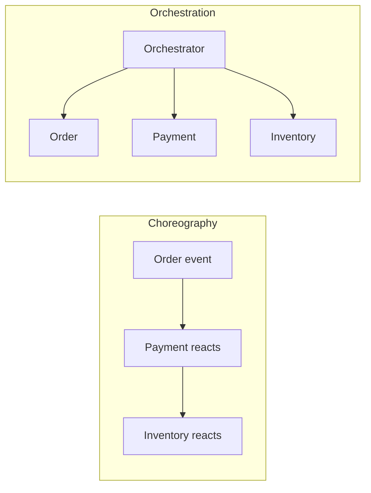

# Consistency and Sagas

> **Status:** Completed  
> **Module:** 44 — Microservices and Distributed Systems  
> **Target Java version:** 21  
> **Last reviewed:** 2026-11-10

## 1. Learning Objectives

- Contrast **ACID** local transactions (Module 33) with **eventual consistency** across services.
- Design **saga** workflows: **choreography** vs **orchestration**.
- Apply **idempotency** and **compensating transactions**.
- Connect to **outbox** pattern (Module 45 Ch.03).

## 2. Prerequisites

- Modules 33–35 — transactions, JPA.
- Chapters 01–02 this module; Module 45 messaging overview helpful.

## 3. Why This Concept Exists

No single `EntityManager` transaction spans Order, Payment, and Inventory microservices. **Sagas** coordinate multi-step business processes with **compensations** instead of one global 2PC.

## 4. Consistency spectrum

| Model | Example | Trade-off |
|-------|---------|-----------|
| **Strong (single DB)** | `place order` + lines in one `@Transactional` | Simple; monolith boundary |
| **Read-your-writes** | Sticky session or routing to primary | UX after own mutation |
| **Eventual** | Search index catches up via events | Stale reads possible |
| **Causal** | Order of related events preserved | Requires careful design |

## 5. Saga pattern

**Saga:** sequence of **local transactions**; each publishes an event or calls next step; on failure, run **compensating** steps.

**Example — place order:**

1. Order service: create `PENDING` order.
2. Payment service: charge card.
3. Inventory service: reserve stock.
4. Order service: mark `CONFIRMED`.

Failure after charge → **compensate**: refund payment, cancel order.

## 6. Choreography vs orchestration



| Style | Pros | Cons |
|-------|------|------|
| **Choreography** | Loose coupling | Harder to trace flow |
| **Orchestration** | Central visibility | Orchestrator availability critical |

Java: orchestrator = state machine class or workflow engine; choreography = Kafka topics per step.

## 7. Idempotency

Consumers must handle **duplicate messages**:

```java
public void onPaymentCompleted(PaymentEvent event) {
    if (processedIds.contains(event.idempotencyKey())) return;
    confirmOrder(event.orderId());
    processedIds.store(event.idempotencyKey());
}
```

Store keys in DB with unique constraint.

## 8. Compensating transactions

Not always literal “undo”—semantic reversal:

- `cancelReservation(stockId)`
- `issueRefund(paymentId)`

Compensations can **fail** too—design **manual intervention** queue and alerts (Module 47).

## 9. Two-phase commit (2PC)

XA transactions across DBs exist in Java (`javax.transaction`) but are **fragile** operationally. Most microservice stacks prefer **sagas + outbox**.

## 10. Real-World Use Cases

- Travel booking: flight + hotel saga with compensate on partial failure.
- Wallet transfer: ledger entries per service with idempotent consumers.
- Module 45 **outbox** ensures event published iff DB commit succeeds.

## 11. Edge Cases

- **Poison message** infinite retry—dead letter queue (Module 45).
- **Ordering:** partition by `orderId` in Kafka for per-order sequence.

## 12. Common Mistakes

| Mistake | Fix |
|---------|-----|
| Dual HTTP write without saga | Define owner + events |
| No compensation path | Stuck `PENDING` forever |
| Same idempotency key for different operations | Scope keys per operation type |

## 13. Revision and Mastery

- ACID vs saga for checkout?
- Choreography debugging tools?
- What outbox solves?

## 14. Exercises

1. Write saga steps and compensations for order+payment.
2. Design idempotency table schema.
3. Choose orchestration vs choreography for team of three.

## 15. Chapter Summary

Cross-service consistency in Java uses sagas with local transactions, idempotent handlers, compensations, and reliable event publication—not distributed two-phase commit by default.

## Review Checklist

- [x] Saga types; idempotency; link Module 45 outbox
