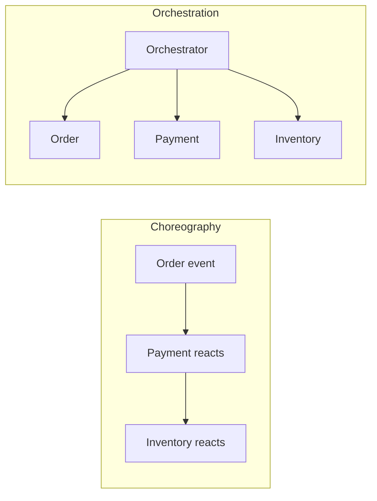

# Consistency and Sagas

> **Status:** Completed  
> **Module:** 44 — Microservices and Distributed Systems  
> **Target Java version:** 21  
> **Last reviewed:** 2026-11-11
> **Chapter profile:** Technical
> **Depth target:** Levels 2–3

**Section policy:** Omissions recorded in Review Checklist.

## 1. Learning Objectives

- Contrast **ACID** local transactions (Module 33) with **eventual consistency** across services.
- Design **saga** workflows: **choreography** vs **orchestration**.
- Apply **idempotency** and **compensating transactions**.
- Connect to **outbox** pattern (Module 45 Ch.03).

## 2. Prerequisites

- Modules 33–35 — transactions, JPA.
- Chapters 01–02 this module; Module 45 messaging overview helpful.

## 3. Why This Concept Exists

No single `EntityManager` transaction spans Order, Payment, and Inventory microservices. **Sagas** coordinate multi-step business processes with **compensations** instead of one global 2PC.

## 4. Consistency spectrum

| Model | Example | Trade-off |
|-------|---------|-----------|
| **Strong (single DB)** | `place order` + lines in one `@Transactional` | Simple; monolith boundary |
| **Read-your-writes** | Sticky session or routing to primary | UX after own mutation |
| **Eventual** | Search index catches up via events | Stale reads possible |
| **Causal** | Order of related events preserved | Requires careful design |

## 5. Saga pattern

**Saga:** sequence of **local transactions**; each publishes an event or calls next step; on failure, run **compensating** steps.

**Example — place order:**

1. Order service: create `PENDING` order.
2. Payment service: charge card.
3. Inventory service: reserve stock.
4. Order service: mark `CONFIRMED`.

Failure after charge → **compensate**: refund payment, cancel order.

## 6. Choreography vs orchestration



| Style | Pros | Cons |
|-------|------|------|
| **Choreography** | Loose coupling | Harder to trace flow |
| **Orchestration** | Central visibility | Orchestrator availability critical |

Java: orchestrator = state machine class or workflow engine; choreography = Kafka topics per step.

## 7. Idempotency

Consumers must handle **duplicate messages**:

```java
public void onPaymentCompleted(PaymentEvent event) {
    if (processedIds.contains(event.idempotencyKey())) return;
    confirmOrder(event.orderId());
    processedIds.store(event.idempotencyKey());
}
```

Store keys in DB with unique constraint.

## 8. Compensating transactions

Not always literal “undo”—semantic reversal:

- `cancelReservation(stockId)`
- `issueRefund(paymentId)`

Compensations can **fail** too—design **manual intervention** queue and alerts (Module 47).

## 9. Two-phase commit (2PC)

XA transactions across DBs exist in Java (`javax.transaction`) but are **fragile** operationally. Most microservice stacks prefer **sagas + outbox**.

## 10. Real-World Use Cases

- Travel booking: flight + hotel saga with compensate on partial failure.
- Wallet transfer: ledger entries per service with idempotent consumers.
- Module 45 **outbox** ensures event published iff DB commit succeeds.

## 11. Edge Cases

- **Poison message** infinite retry—dead letter queue (Module 45).
- **Ordering:** partition by `orderId` in Kafka for per-order sequence.

## 12. Common Mistakes

| Mistake | Fix |
|---------|-----|
| Dual HTTP write without saga | Define owner + events |
| No compensation path | Stuck `PENDING` forever |
| Same idempotency key for different operations | Scope keys per operation type |

## 13. Revision and Mastery

- ACID vs saga for checkout?
- Choreography debugging tools?
- What outbox solves?

## 14. Exercises

1. Write saga steps and compensations for order+payment.
2. Design idempotency table schema.
3. Choose orchestration vs choreography for team of three.

## 15. Chapter Summary

Cross-service consistency in Java uses sagas with local transactions, idempotent handlers, compensations, and reliable event publication—not distributed two-phase commit by default.

## 5. Mechanism and Execution Flow *(mandatory)*

Saga step: local TX commits → event/command next step → on failure **compensating** TX (refund, cancel reservation).

Choreography: services react to events; orchestration: central coordinator issues commands—choose observability vs coupling trade-off.

Outbox ties publish to same DB commit (Module 45 Ch.03).

## 21. FAQ — Sagas *(mandatory depth)*

**Q: 2PC why rare?** Blocking, ops complexity across teams.

**Q: Idempotent consumers?** Required for at-least-once delivery.

**Q: Compensate not undo?** Business meaning matters (credit note vs delete row).

**Q: Read-your-writes?** Route reads to primary after mutation.

**Q: Saga state store?** Persist step status for crash recovery.


## Depth appendix — progressive teaching (Distributed systems)

### Incorrect vs corrected patterns

Documenting failure modes accelerates review. Each pair below states **why** the wrong approach breaks client or operator expectations.

### Operational checklist before marking API complete

- OpenAPI matches deployed routes (Ch.03).
- Error envelope consistent (ProblemDetail or documented custom schema).
- AuthN/Z enforced on mutations (Module 39).
- Examples in `examples/` compiled on Temurin 21.0.12.1 with recorded output.
- Versioning/deprecation policy published for partners.

### Revision drills (Track B)

1. Explain one design trade-off you reversed after load testing.
2. Write three MockMvc or plain HTTP negative tests not in the happy path.
3. Identify one boundary where DTO mapping must never leak entities.

### References (official hierarchy)

- RFC 9110 — HTTP semantics (methods, status).
- Jakarta EE / Spring reference docs for Illustrative framework binding only.
- OWASP ASVS — verification levels for security chapters (Module 43).

**Mechanism merge note:** Where earlier sections already diagram execution flow, this appendix reinforces **operational** depth without duplicating definitions.

### Timeout budget table (example checkout)

| Hop | Timeout ms |
|-----|------------|
| Client → edge | 5000 |
| Edge → order | 2000 |
| Order → payment | 1500 |
| Order → inventory | 1500 |

Sum of serial calls must stay under client deadline.

### Observability minimum

Trace id in logs, metrics on outbound 5xx rate per dependency, SLO on p99 latency (Module 47).

## Technical L3 supplement — teaching depth

### Motivation recap (concrete scenario)

A team ships a Java 21 service without documented HTTP contracts, security rules, or messaging guarantees. Mobile clients cache error shapes; a deploy renames a field and checkout silently fails. Operations cannot trace requests across services. The material in this module prevents that class of failure by making **boundaries explicit**: REST semantics, DTOs, auth filters, architecture ports, patterns, clean code, security controls, resilience, and delivery semantics.

### Mechanism trace (how this chapter shows up at runtime)

1. **Ingress** — HTTP or message enters an adapter (controller, listener).
2. **Policy** — auth, validation, and rate limits run before domain logic (fail closed).
3. **Application** — use case coordinates domain + ports inside a transaction or saga step.
4. **Egress** — DTO mapping, event publish (outbox), or outbound HttpClient with timeouts.
5. **Observation** — structured logs with correlation id; metrics on error rate (Module 47).

This sequence is framework-agnostic; Spring/Boot annotations are **Illustrative** wiring for the same pipeline taught in earlier modules.

### Progressive example ladder

| Stage | Focus | Verification label |
|-------|--------|-------------------|
| Minimal | JDK-only demo or pure unit logic | Verified / Compile-verified |
| Realistic | Layered service with DTO + port | Illustrative Spring config |
| Advanced | Failure modes: timeout, duplicate message, 409 conflict | Test + documented output |

Never label **Verified** without Temurin 21.0.12.1 compile/run recorded in chapter or `PROGRESS.md`.

### Wrong vs right (review board)

| Wrong | Why it hurts | Right |
|-------|----------------|-------|
| Skip server AuthZ | IDOR incidents | Check principal vs resource every mutation |
| Expose JPA graph in JSON | Lazy-load storms, schema coupling | Map to DTO in service |
| Infinite HttpClient wait | Thread pile-up, incident duration | Connect + request timeouts |
| Retry all POSTs | Duplicate charges | Idempotency keys + dedup store |
| Dual write DB + broker | Lost or phantom events | Transactional outbox |

### Design tensions engineers negotiate

- **Consistency vs availability** during partitions (Module 44).
- **Stateless JWT vs revocable sessions** (Module 39).
- **Modular monolith vs microservices** operational cost (Module 40).
- **Kafka vs Rabbit** retention and routing (Module 45).
- **Strict SOLID vs delivery speed** (Modules 41–42).

Document the choice in ADRs; the handbook gives options, not one universal answer.

### Java 21 notes

- **Records** for immutable DTOs and events (`Module 08`, `15`).
- **Virtual threads** improve blocking HTTP and JDBC throughput but do not remove timeouts or auth checks.
- **Pattern matching** and **sealed types** clarify domain result models (`PaymentResult` in SOLID chapters).

### Compatibility and sources

Prefer **RFC 9110** for HTTP, **RFC 7807** for errors, **OWASP ASVS** for verification language, and vendor docs for brokers labeled Illustrative. Distinguish **JLS/API guarantees** from **Spring/HotSpot** behavior as in `DOCUMENTATION-STANDARDS.md`.

### Track B — mastery questions

1. Where is the transaction boundary in your current project, and why?
2. Which dependency would you invert first behind a port for testing?
3. What status code and error shape would clients see for your most common validation failure?
4. How would you prove an idempotent consumer in tests?
5. What metric would fire before users notice a downstream slowdown?

### Track B — field exercise (no solution in chapter)

Implement or extend one `examples/` demo for this module: add a negative-path assertion (4xx, breaker OPEN, or rejected input), compile with `javac -source 21`, run on Temurin 21.0.12.1, paste output into `PROGRESS.md` only after a real run.

### Cross-module links

| Need | Module |
|------|--------|
| HTTP client timeouts | 32 |
| JDBC transactions | 33–35 |
| Spring DI / Security | 36–37 |
| Testing & CI | 30 |
| Observability | 47 |

### Glossary touchpoints

Add unfamiliar terms encountered here to `GLOSSARY.md` when stabilizing definitions across the handbook (repository workflow in java-documentation skill).

### Explicit omissions (this supplement)

- Vendor-specific console screenshots and cloud provisioning scripts.
- Exploit reproduction steps (defensive security only in Module 43).
- Exhaustive broker tuning guides (operational manuals remain external).

## Review Checklist

- [x] EXPAND-PRESERVE 2026-11-11 (Technical L3)
- [x] Saga types; idempotency; link Module 45 outbox
