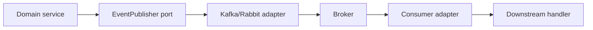

# Messaging Fundamentals

> **Status:** Completed  
> **Module:** 45 — Messaging and Event-Driven Systems  
> **Target Java version:** 21  
> **Last reviewed:** 2026-11-11
> **Chapter profile:** Technical
> **Depth target:** Levels 2–3

**Section policy:** Omissions recorded in Review Checklist.

## 1. Learning Objectives

- Distinguish **message queue**, **topic**, **event**, and **command**.
- Compare **point-to-point** vs **pub/sub** semantics.
- Map messaging to **hexagonal adapters** (Module 40).
- Understand **brokers** as external infrastructure (conceptual when not installed).

## 2. Prerequisites

- Module 44 — distributed fundamentals.
- Module 14 — concurrency.

## 3. Why This Concept Exists

**Asynchronous messaging** decouples producers and consumers in time and scale. Order placement returns quickly while email, analytics, and inventory catch up via messages.

## 4. Conceptual Explanation

| Term | Meaning |
|------|---------|
| **Producer** | Publishes a message |
| **Consumer** | Processes a message |
| **Broker** | Stores and routes (Kafka, RabbitMQ, etc.) |
| **Topic/queue** | Named channel |
| **Partition** | Ordered sub-log within topic (Kafka) |
| **Consumer group** | Cooperating consumers sharing load |

**Command message:** one consumer should handle (`ChargePayment`).
**Event message:** something happened (`OrderPlaced`); many subscribers may react.

## 5. Point-to-point vs pub/sub

| Model | Routing | Use |
|-------|---------|-----|
| **Queue** | One consumer per message (competing consumers) | Work distribution |
| **Topic** | All subscribers receive copy | Notifications, audit |

Java integration: **JMS** (javax.jakarta.jms) API; Spring `JmsTemplate` / `@KafkaListener` as adapters.

## 6. Message shape in Java

Prefer **versioned schema** (JSON with schema registry, Avro, or protobuf):

```java
public record OrderPlacedEvent(String eventId, String orderId, Instant occurredAt) {}
```

Include **metadata**: `correlationId`, `causationId`, `tenantId` for tracing (Module 47).

## 7. Adapter pattern

```java
public interface OrderEventPublisher {
    void publish(OrderPlacedEvent event);
}

// KafkaOrderEventPublisher implements adapter — broker is infrastructure
```

Domain depends on port; broker client is adapter.

## 8. Real-World Use Cases

- **Order placed** → email, warehouse, fraud scoring.
- **CDC** (change data capture) streams DB rows to search index.
- **Dead letter** queue for poison messages.

## 9. Edge Cases

- **Ordering:** global order impossible at scale; partition by key.
- **Poison message:** failing deserialization—DLQ after N attempts.

## 10. Common Mistakes

| Mistake | Fix |
|---------|-----|
| Giant JSON blob without version | `schemaVersion` field + migrations |
| Business logic in listener only | Core handler testable without broker |
| No correlation id | Propagate from HTTP header |

## 11. Performance

Batching producer sends; consumer **prefetch** tuning; avoid massive messages—reference by id.

## 12. Revision and Mastery

- Command vs event example?
- Why partition by `orderId`?
- Where does hexagonal port sit?

## 13. Exercises

1. Design events for order lifecycle.
2. Sketch adapter interface for in-memory test broker fake.
3. List metadata fields for cross-service trace.

## 14. Chapter Summary

Messaging fundamentals separate commands and events, use brokers as infrastructure adapters, and prepare for delivery guarantees in later chapters.

## 15. Next Steps

[02-kafka-and-rabbitmq.md](02-kafka-and-rabbitmq.md)

## 5. Mechanism and Execution Flow *(mandatory)*



Producer does not know consumer count in pub/sub; queue delivers to one competitor consumer.

## 21. FAQ — Messaging basics *(mandatory depth)*

**Q: Command vs event naming?** Past tense events (`OrderPlaced`); imperatives for commands.

**Q: Fat vs skinny messages?** Prefer ids + metadata; fetch details via API if needed.

**Q: Message versioning?** `schemaVersion` field + registry policy.

**Q: In-process EventBus vs broker?** Bus for single JVM; broker for cross service.

**Q: Poison message?** DLQ after N failures with alert.


## Depth appendix — progressive teaching (Messaging)

### Incorrect vs corrected patterns

Documenting failure modes accelerates review. Each pair below states **why** the wrong approach breaks client or operator expectations.

### Operational checklist before marking API complete

- OpenAPI matches deployed routes (Ch.03).
- Error envelope consistent (ProblemDetail or documented custom schema).
- AuthN/Z enforced on mutations (Module 39).
- Examples in `examples/` compiled on Temurin 21.0.12.1 with recorded output.
- Versioning/deprecation policy published for partners.

### Revision drills (Track B)

1. Explain one design trade-off you reversed after load testing.
2. Write three MockMvc or plain HTTP negative tests not in the happy path.
3. Identify one boundary where DTO mapping must never leak entities.

### References (official hierarchy)

- RFC 9110 — HTTP semantics (methods, status).
- Jakarta EE / Spring reference docs for Illustrative framework binding only.
- OWASP ASVS — verification levels for security chapters (Module 43).

**Mechanism merge note:** Where earlier sections already diagram execution flow, this appendix reinforces **operational** depth without duplicating definitions.

### Message envelope template

```json
{
  "schemaVersion": 1,
  "eventId": "uuid",
  "occurredAt": "2026-11-11T00:00:00Z",
  "correlationId": "uuid",
  "payload": { }
}
```

### Handler idempotency store

```sql
CREATE TABLE processed_events (idempotency_key VARCHAR PRIMARY KEY, processed_at TIMESTAMP);
```

Insert before side effects; duplicate delivery becomes no-op.

### Broker operations

Monitor consumer lag, DLQ depth, disk usage on Kafka brokers; Rabbit queue depth and unacked messages.

## Technical L3 supplement — teaching depth

### Motivation recap (concrete scenario)

A team ships a Java 21 service without documented HTTP contracts, security rules, or messaging guarantees. Mobile clients cache error shapes; a deploy renames a field and checkout silently fails. Operations cannot trace requests across services. The material in this module prevents that class of failure by making **boundaries explicit**: REST semantics, DTOs, auth filters, architecture ports, patterns, clean code, security controls, resilience, and delivery semantics.

### Mechanism trace (how this chapter shows up at runtime)

1. **Ingress** — HTTP or message enters an adapter (controller, listener).
2. **Policy** — auth, validation, and rate limits run before domain logic (fail closed).
3. **Application** — use case coordinates domain + ports inside a transaction or saga step.
4. **Egress** — DTO mapping, event publish (outbox), or outbound HttpClient with timeouts.
5. **Observation** — structured logs with correlation id; metrics on error rate (Module 47).

This sequence is framework-agnostic; Spring/Boot annotations are **Illustrative** wiring for the same pipeline taught in earlier modules.

### Progressive example ladder

| Stage | Focus | Verification label |
|-------|--------|-------------------|
| Minimal | JDK-only demo or pure unit logic | Verified / Compile-verified |
| Realistic | Layered service with DTO + port | Illustrative Spring config |
| Advanced | Failure modes: timeout, duplicate message, 409 conflict | Test + documented output |

Never label **Verified** without Temurin 21.0.12.1 compile/run recorded in chapter or `PROGRESS.md`.

### Wrong vs right (review board)

| Wrong | Why it hurts | Right |
|-------|----------------|-------|
| Skip server AuthZ | IDOR incidents | Check principal vs resource every mutation |
| Expose JPA graph in JSON | Lazy-load storms, schema coupling | Map to DTO in service |
| Infinite HttpClient wait | Thread pile-up, incident duration | Connect + request timeouts |
| Retry all POSTs | Duplicate charges | Idempotency keys + dedup store |
| Dual write DB + broker | Lost or phantom events | Transactional outbox |

### Design tensions engineers negotiate

- **Consistency vs availability** during partitions (Module 44).
- **Stateless JWT vs revocable sessions** (Module 39).
- **Modular monolith vs microservices** operational cost (Module 40).
- **Kafka vs Rabbit** retention and routing (Module 45).
- **Strict SOLID vs delivery speed** (Modules 41–42).

Document the choice in ADRs; the handbook gives options, not one universal answer.

### Java 21 notes

- **Records** for immutable DTOs and events (`Module 08`, `15`).
- **Virtual threads** improve blocking HTTP and JDBC throughput but do not remove timeouts or auth checks.
- **Pattern matching** and **sealed types** clarify domain result models (`PaymentResult` in SOLID chapters).

### Compatibility and sources

Prefer **RFC 9110** for HTTP, **RFC 7807** for errors, **OWASP ASVS** for verification language, and vendor docs for brokers labeled Illustrative. Distinguish **JLS/API guarantees** from **Spring/HotSpot** behavior as in `DOCUMENTATION-STANDARDS.md`.

### Track B — mastery questions

1. Where is the transaction boundary in your current project, and why?
2. Which dependency would you invert first behind a port for testing?
3. What status code and error shape would clients see for your most common validation failure?
4. How would you prove an idempotent consumer in tests?
5. What metric would fire before users notice a downstream slowdown?

### Track B — field exercise (no solution in chapter)

Implement or extend one `examples/` demo for this module: add a negative-path assertion (4xx, breaker OPEN, or rejected input), compile with `javac -source 21`, run on Temurin 21.0.12.1, paste output into `PROGRESS.md` only after a real run.

### Cross-module links

| Need | Module |
|------|--------|
| HTTP client timeouts | 32 |
| JDBC transactions | 33–35 |
| Spring DI / Security | 36–37 |
| Testing & CI | 30 |
| Observability | 47 |

### Glossary touchpoints

Add unfamiliar terms encountered here to `GLOSSARY.md` when stabilizing definitions across the handbook (repository workflow in java-documentation skill).

### Explicit omissions (this supplement)

- Vendor-specific console screenshots and cloud provisioning scripts.
- Exploit reproduction steps (defensive security only in Module 43).
- Exhaustive broker tuning guides (operational manuals remain external).

## Messaging operations gate *(conditional)*

- DLQ alerts configured with consumer lag SLO.
- Schema/version field mandatory on new events.
- Idempotency store migration reviewed.

## Review Checklist

- [x] EXPAND-PRESERVE 2026-11-11 (Technical L3)
- [x] Terminology; adapters; conceptual broker note
