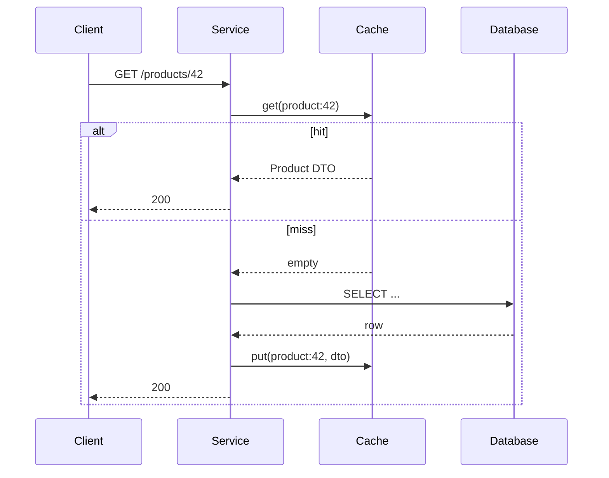
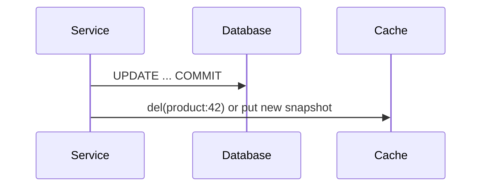

# Caching Strategies

> **Status:** Completed  
> **Module:** 46 — Caching and Performance Engineering  
> **Target Java version:** 21  
> **Last reviewed:** 2026-11-11  
> **Chapter profile:** Technical  
> **Depth target:** Levels 2–3  
> **Examples verified with:** Temurin JDK 21.0.12.1 — [in-memory-cache-demo](../../examples/caching/in-memory-cache-demo/)

## 1. Learning Objectives

- Choose **cache-aside**, **read-through**, **write-through**, and **write-behind** patterns for read-heavy Java services.
- Explain **TTL**, **staleness**, **eviction**, and **thundering herd** with mitigation tactics.
- Run [InMemoryCacheDemo](../../examples/caching/in-memory-cache-demo/) and interpret LRU eviction output.
- Relate application caching to JPA **second-level cache** awareness (Module 35) without treating the cache as source of truth.

## 2. Prerequisites

- **Module 33–35** — JDBC/JPA, connection pooling, and when the database is authoritative.
- **Module 14** — concurrency (`synchronized`, visibility) when multiple threads share a cache.
- **Module 44** — resilience mindset: timeouts and degradation when cache or DB fails.

**Refresher:** A **cache** is a faster, smaller store that holds copies of data owned elsewhere (usually a database). The application remains responsible for **consistency** between cache and origin unless the cache library implements a stricter contract (write-through).

## 3. Why This Concept Exists

Repeated identical reads—product catalogs, reference data, feature flags, rendered fragments—waste database CPU and add latency on every miss. Caches trade **memory** and **staleness risk** for **speed** and **downstream protection**. Without an explicit strategy, teams either skip caching (slow at scale) or cache ad hoc (stale prices, thundering herds on deploy, unbounded `HashMap` growth leading to **OutOfMemoryError**).

## 4. Conceptual Explanation

Caching is not “put a `Map` in the service.” Each pattern assigns **who loads on miss**, **who writes on update**, and **what happens on crash**:

| Pattern | Who loads on miss | Who writes on update | Consistency | Typical Java use |
|---------|-------------------|----------------------|-------------|------------------|
| **Cache-aside** | Application | Application writes DB, then updates or invalidates cache | Weakest unless disciplined invalidation | Spring `@Cacheable`, hand-rolled maps |
| **Read-through** | Cache provider | Same as cache-aside for writes | Provider guarantees load path | Caffeine `LoadingCache`, Ehcache |
| **Write-through** | N/A for reads | Cache and DB updated synchronously in one step | Stronger | Distributed caches with sync write |
| **Write-behind** | Application | Cache first; async flush to DB | Weakest on crash | High-ingest analytics (risk-aware) |

| Term | Meaning |
|------|---------|
| **Hit** | Key present and returned from cache |
| **Miss** | Key absent; origin load required |
| **TTL** | Time-to-live: entry expires after duration even if unchanged in DB |
| **Eviction** | Entry removed due to capacity or policy (LRU, LFU, size) |
| **Staleness** | Cache value differs from DB until invalidation or expiry |

**What to cache:** read-heavy data that tolerates bounded staleness, expensive queries, stable reference data.

**What to avoid caching without care:** security decisions, rapidly mutating inventory without invalidation, large mutable graphs shared across threads.

## 5. Mechanism and Execution Flow

### Cache-aside read path

The application owns orchestration: check cache, on miss load origin, then populate.



### Cache-aside write path (typical)

Update **database first** (or within a transaction), then **invalidate** or **overwrite** cache. Writing cache before DB without a transaction invites readers to see uncommitted data.



### Read-through vs cache-aside

With **read-through**, the cache API accepts a `CacheLoader` and calls the loader on miss internally. The application still usually owns **invalidation on write** unless using write-through on a distributed cache.

### Thundering herd on a hot miss

Many threads miss the same key at once (cold start, TTL expiry, deploy). Each may hit the database.

**Mitigations:**

- **Single-flight** (only one loader per key; others wait or get stale value).
- **Jittered TTL** so keys do not expire simultaneously.
- **Probabilistic early refresh** before hard expiry.
- **Request coalescing** in libraries such as Caffeine.

## 6. Terminology

| Term | Meaning |
|------|---------|
| **Origin** | Authoritative store (usually relational DB) |
| **Hit ratio** | Hits / (hits + misses); primary cache SLO input |
| **Negative caching** | Caching “not found” briefly to protect DB from scans |
| **Stampede** | Many parallel misses on one key (thundering herd) |
| **Second-level cache** | JPA/Hibernate shared cache across persistence context (Module 35) |

## 7. Examples

### 7.1 Cache-aside (Illustrative)

```java
Optional<Product> getProduct(String id) {
    return cache.get(id).or(() -> {
        Product p = repository.findById(id);
        if (p != null) {
            cache.put(id, p);
        }
        return Optional.ofNullable(p);
    });
}
```

Important lines:

- `or(() -> …)` runs the loader only on miss (Java 11+ `Optional` pattern).
- Store **immutable DTOs** or defensive copies if entities are mutable JPA objects (incorrect pattern below).

### 7.2 Runnable demo — **Verified (Temurin 21.0.12.1)**

From `examples/caching/in-memory-cache-demo/`:

```bash
javac InMemoryCacheDemo.java LruCache.java
java InMemoryCacheDemo
```

**Verified output:**

```text
size=2
user:1=alice
user:2=miss
in-memory-cache=ok
```

Interpretation: capacity is **2**. After `user:1` and `user:3`, inserting `user:2` **evicts** the least-recently-used key (`user:3`), so `user:2` is a **miss** (not present after eviction sequence in demo). The marker line `in-memory-cache=ok` confirms the harness completed.

### 7.3 Incorrect — shared mutable entity in cache

Caching a JPA-managed entity instance that later changes in another thread can return **stale fields** or observe half-updated state.

### 7.4 Corrected — cache immutable DTO or versioned snapshot

Map to a record/DTO at cache boundary; invalidate on update events (Module 45).

## 8. TTL and Invalidation

| Approach | Mechanism | Trade-off |
|----------|-----------|-----------|
| **TTL only** | Entry expires after `setex` duration | Simple; stale window until expiry |
| **Explicit invalidation** | `DEL` / `cache.invalidate` on write | Accurate; must cover all keys and L1/L2 tiers |
| **Versioned keys** | `product:123:v5` after bump | No race on delete/reload |

## 9. Real-World Use Cases

- CDN + application cache for product metadata and image URLs.
- Reference data (`country codes`) with 24h TTL and weekly deploy invalidation.
- Spring `@Cacheable` on idempotent read services with Redis L2 across pods (Module 46 Ch.02).

## 10. Edge Cases

- **Null caching:** cache short-lived “not found” to prevent repeated full-table probes.
- **Large values:** memory pressure—store IDs only and lazy-load heavy fields.
- **Transactional visibility:** do not expose cached writes before commit.

## 11. Common Mistakes

| Mistake | Effect |
|---------|--------|
| Cache without eviction or TTL | `OutOfMemoryError` on unbounded growth |
| Shared mutable objects in cache | Race corruption or surprise mutations |
| No hit/miss metrics | Silent low hit rate; DB still overloaded |
| Cache-aside write: update cache before DB | Readers see uncommitted data |

## 12. Design Trade-offs

| Strong consistency | High hit rate + low latency |
|--------------------|-----------------------------|
| Shorter TTL, write-through, less caching | Longer TTL, cache-aside, eventual staleness |

| In-process cache (Caffeine) | Distributed cache (Redis, Ch.02) |
|-----------------------------|----------------------------------|
| Microseconds; per-JVM | Milliseconds; shared across instances |

## 13. Revision and Mastery

- When is **write-behind** acceptable, and what fails if the JVM crashes before flush?
- Explain demo LRU eviction and why `user:2=miss` appears.
- Name three thundering herd mitigations and when single-flight is insufficient (e.g., origin still slow).

## 14. Exercises

1. Add a TTL map wrapper around `LruCache` in the demo; measure hit ratio with scripted access.
2. Design invalidation on `ProductUpdated` event (Module 45) for cache-aside.
3. Estimate memory for 100k cached DTOs (~500 bytes each) and set JVM heap headroom.

## 15. Chapter Summary

Caching strategies assign responsibility for loads, writes, and eviction. **Cache-aside** is the default for Java services: database remains authoritative, the application invalidates or TTL-bounds staleness, and hot-key protection avoids stampedes. Measure hit ratio under load (Ch.03) before trusting latency wins.

## 16. Next Steps

[02-redis-and-invalidation.md](02-redis-and-invalidation.md)

## Review Checklist

- [x] Chapter profile Technical L2–3; mechanism flows; pattern catalog preserved
- [x] `in-memory-cache-demo` Verified Temurin 21.0.12.1 (`user:2=miss`, `in-memory-cache=ok`)
- [x] Incorrect/corrected mutable cache entry; trade-offs; exercises
