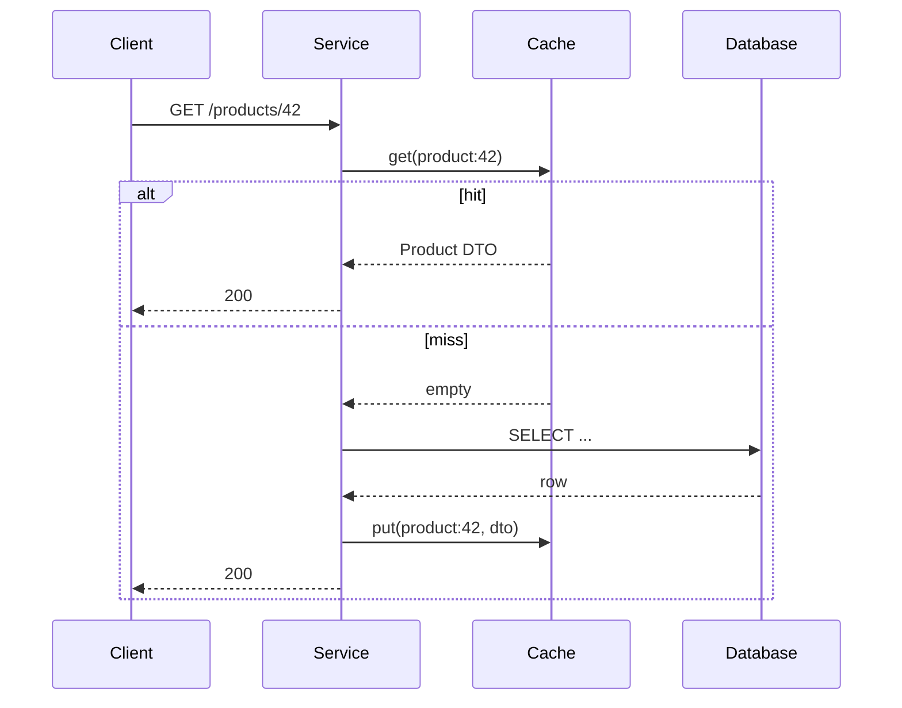
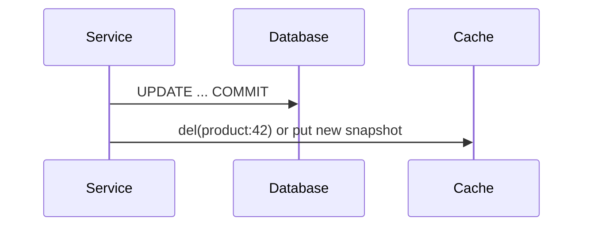
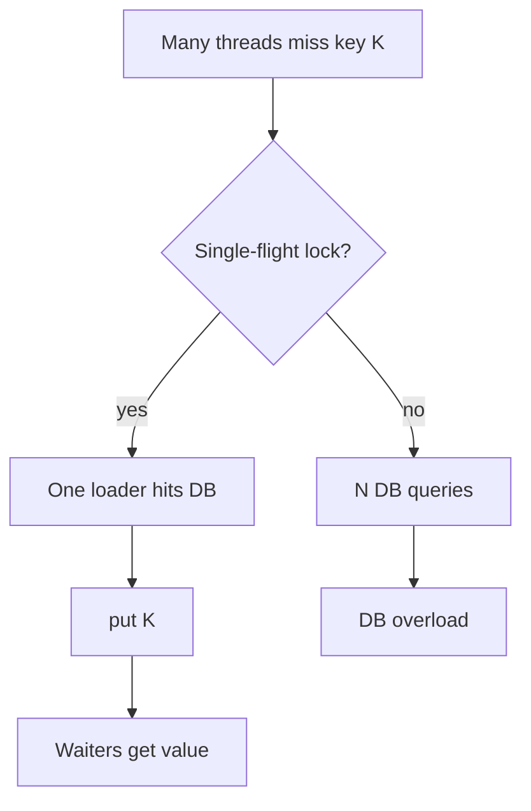

# Caching Strategies

> **Status:** Completed  
> **Module:** 46 — Caching and Performance Engineering  
> **Target Java version:** 21  
> **Last reviewed:** 2026-11-11  
> **Chapter profile:** Technical  
> **Depth target:** Levels 2–3  
> **Examples verified with:** Oracle JDK 21.0.9 (re-run 2026-11-11; matches prior Temurin 21.0.12.1 baseline) — [in-memory-cache-demo](../../examples/caching/in-memory-cache-demo/)

## 1. Learning Objectives

After completing this chapter, you should be able to:

- Choose **cache-aside**, **read-through**, **write-through**, and **write-behind** patterns for read-heavy Java services.
- Explain **TTL**, **staleness**, **eviction**, and **thundering herd** with concrete mitigation tactics.
- Run [InMemoryCacheDemo](../../examples/caching/in-memory-cache-demo/) and interpret LRU eviction output on JDK 21.
- Relate application caching to JPA **second-level cache** awareness (Module 35) without treating the cache as source of truth.
- Measure **hit ratio** and reason about memory cost of cached DTOs under concurrency constraints (Module 14).

## 2. Prerequisites

- **Modules 33–35** — JDBC/JPA, connection pooling, and when the database is authoritative.
- **Module 14** — concurrency (`synchronized`, visibility) when multiple threads share a cache.
- **Module 44** — resilience mindset: timeouts and degradation when cache or DB fails.
- **Module 28 (helpful)** — microbenchmarks vs system latency; caching wins are system-level, not JMH micro-wins alone.

**Refresher:** A **cache** is a faster, smaller store that holds **copies** of data owned elsewhere (usually a database). The application remains responsible for **consistency** between cache and origin unless the cache library implements a stricter contract (write-through). Caching does not change ownership: the DB (or another system of record) remains authoritative for business truth.

## 3. Why This Concept Exists

Repeated identical reads—product catalogs, reference data, feature flags, rendered fragments—waste database CPU and add latency on every miss. Caches trade **memory** and **staleness risk** for **speed** and **downstream protection**.

Without an explicit strategy, teams either:

1. Skip caching → slow at scale, DB becomes the bottleneck during traffic spikes.
2. Cache ad hoc → stale prices, thundering herds on deploy, unbounded `HashMap` growth leading to **OutOfMemoryError**.
3. Cache security decisions → wrong authorization until TTL expires.

A strategy answers four questions up front: **who loads on miss**, **who writes on update**, **how entries die**, and **what happens when the cache is wrong or down**.

## 4. Conceptual Explanation

### 4.1 Caching is responsibility assignment

Caching is not “put a `Map` in the service.” Each pattern assigns **who loads on miss**, **who writes on update**, and **what happens on crash**:

| Pattern | Who loads on miss | Who writes on update | Consistency | Typical Java use |
|---------|-------------------|----------------------|-------------|------------------|
| **Cache-aside** | Application | Application writes DB, then updates or invalidates cache | Weakest unless disciplined invalidation | Spring `@Cacheable`, hand-rolled maps |
| **Read-through** | Cache provider | Same as cache-aside for writes unless write-through | Provider guarantees load path | Caffeine `LoadingCache`, Ehcache |
| **Write-through** | N/A for reads | Cache and DB updated synchronously in one step | Stronger | Distributed caches with sync write |
| **Write-behind** | Application | Cache first; async flush to DB | Weakest on crash | High-ingest analytics (risk-aware) |

### 4.2 Core terms (hit path vocabulary)

| Term | Meaning |
|------|---------|
| **Hit** | Key present and returned from cache |
| **Miss** | Key absent; origin load required |
| **TTL** | Time-to-live: entry expires after duration even if unchanged in DB |
| **Eviction** | Entry removed due to capacity or policy (LRU, LFU, size) |
| **Staleness** | Cache value differs from DB until invalidation or expiry |
| **Origin** | Authoritative store (usually relational DB) |

### 4.3 What to cache vs what to avoid

**Good candidates:**

- Read-heavy data that tolerates **bounded** staleness (catalog metadata, country codes, feature-flag snapshots).
- Expensive queries (multi-join reports) where result size is small enough for memory.
- Computed fragments that are pure functions of stable inputs.

**Avoid without care:**

- Security decisions (AuthZ results) unless invalidation is immediate and tested.
- Rapidly mutating inventory without event-driven invalidation.
- Large mutable object graphs shared across threads (especially JPA-managed entities).
- Secrets, PAN, passwords (encrypt or do not cache; Module 43).

### 4.4 Why cache-aside dominates Java services

Most Spring services already own the repository call. **Cache-aside** keeps that ownership: the service checks cache, loads DB on miss, then `put`. Invalidation stays in the write path you already maintain. Read-through is preferable when many call sites must share one loader and you want library-level single-flight; write-through/write-behind appear when a distributed cache product owns sync/async durability contracts you deliberately adopt.

## 5. Mechanism and Execution Flow

### 5.1 Cache-aside read path

The application owns orchestration: check cache, on miss load origin, then populate.



**Prose walkthrough:** On a hit, the DB is never touched—latency is cache RTT (in-process microseconds; Redis milliseconds). On a miss, you pay origin latency **plus** the put. If many threads miss the same key simultaneously, each may pay origin cost unless you add single-flight (below).

### 5.2 Cache-aside write path (typical)

Update **database first** (or within a transaction), then **invalidate** or **overwrite** cache. Writing cache before DB without a transaction invites readers to see uncommitted data.



**Invalidate vs overwrite:** Invalidation (`del`) is safer when multiple derived keys exist (`product:42`, `product:42:summary`). Overwrite is faster when you already hold the new DTO and a single key maps 1:1.

### 5.3 Read-through vs cache-aside

With **read-through**, the cache API accepts a `CacheLoader` and calls the loader on miss internally. The application still usually owns **invalidation on write** unless using write-through on a distributed cache. Caffeine’s `LoadingCache.get(key)` is the common Java form.

### 5.4 Write-through and write-behind

| Mode | Mechanism | Failure mode |
|------|-----------|--------------|
| **Write-through** | Sync write to cache and DB in the same logical step | Higher write latency; clearer durability |
| **Write-behind** | Write cache immediately; queue async DB flush | Crash before flush → lost updates unless durable queue |

**When write-behind is acceptable:** analytics counters, non-critical aggregates, workloads with an outbox/durable queue behind the flush. **Never** for payment capture or inventory decrement without additional durability guarantees.

### 5.5 Thundering herd on a hot miss

Many threads miss the same key at once (cold start, TTL expiry, deploy). Each may hit the database.

**Mitigations:**

- **Single-flight** — only one loader per key; others wait or get stale value.
- **Jittered TTL** — keys do not expire simultaneously.
- **Probabilistic early refresh** — refresh before hard expiry for hot keys.
- **Request coalescing** — libraries such as Caffeine `LoadingCache` / `refreshAfterWrite`.



## 6. Terminology

| Term | Meaning |
|------|---------|
| **Hit ratio** | Hits / (hits + misses); primary cache SLO input |
| **Negative caching** | Caching “not found” briefly to protect DB from scans |
| **Stampede** | Many parallel misses on one key (thundering herd) |
| **Second-level cache** | JPA/Hibernate shared cache across persistence contexts (Module 35) |
| **L1 / L2** | In-process vs distributed tiers (Ch.02) |
| **Soft TTL / hard TTL** | Soft = refresh preferred; hard = must reload |

## 7. Step-by-Step Examples

### 7.1 Minimal — cache-aside (Illustrative)

```java
Optional<Product> getProduct(String id) {
    return cache.get(id).or(() -> {
        Product p = repository.findById(id);
        if (p != null) {
            cache.put(id, p);
        }
        return Optional.ofNullable(p);
    });
}
```

Important lines:

- `or(() -> …)` runs the loader only on miss (Java 11+ `Optional` pattern).
- Store **immutable DTOs** or defensive copies if entities are mutable JPA objects (see incorrect pattern below).

### 7.2 Runnable demo — **Verified (Oracle JDK 21.0.9)**

From `examples/caching/in-memory-cache-demo/`:

```bash
javac InMemoryCacheDemo.java LruCache.java
java InMemoryCacheDemo
```

**Verified output** (re-run 2026-11-11 on Oracle JDK 21.0.9; identical to prior Temurin baseline):

```text
size=2
user:1=alice
user:2=miss
in-memory-cache=ok
```

**Mechanism in the demo:**

1. Capacity is **2**. Put `user:1`, `user:2`.
2. `get("user:1")` marks `user:1` as most recently used (`LinkedHashMap` access-order).
3. Put `user:3` → evicts least-recently-used `user:2`.
4. `get("user:2")` returns empty → printed as `miss`.

`LruCache` uses `LinkedHashMap(..., true)` access-order and `removeEldestEntry` when `size() > maxEntries`. Methods are `synchronized` for demo safety; production prefers Caffeine or ConcurrentHashMap-based designs with clearer concurrency contracts.

### 7.3 Incorrect — shared mutable entity in cache

```java
// Incorrect: cache a managed JPA entity
cache.put(id, entityManager.find(Product.class, id));
// later another transaction mutates the same instance graph
```

Caching a JPA-managed entity that later changes can return **stale fields**, observe half-updated state, or trigger lazy-load exceptions outside a persistence context.

### 7.4 Corrected — immutable DTO / versioned snapshot

```java
ProductDto dto = ProductDto.from(entity); // record or immutable fields
cache.put(id, dto);
// on ProductUpdated event: cache.invalidate(id);
```

Map to a record/DTO at the cache boundary; invalidate on update events (Module 45).

### 7.5 Spring Cache Abstraction (Illustrative)

```java
@Cacheable(value = "products", key = "#id")
public ProductDto getProduct(String id) {
    return repository.findById(id).map(ProductDto::from).orElseThrow();
}

@CacheEvict(value = "products", key = "#id")
public void updateProduct(String id, ProductDto dto) {
    repository.save(dto.toEntity(id));
}
```

**Mechanism:** Spring wraps the bean in a **proxy** (Module 36). `@Cacheable` consults the configured `CacheManager` before invoking the method; on miss, the method runs and the return value is stored. **Self-invocation** skips the proxy—same trap as `@Transactional`.

| Concern | Practice |
|---------|----------|
| Null results | `unless = "#result == null"` to avoid caching absent keys forever |
| Exception on miss | Do not cache thrown exceptions unless using an explicit error cache |
| Sync mode | `@Cacheable(sync = true)` approximates single-flight per key |

### 7.6 Caffeine loading cache (read-through)

```java
LoadingCache<String, ProductDto> cache = Caffeine.newBuilder()
    .maximumSize(10_000)
    .expireAfterWrite(Duration.ofMinutes(10))
    .build(id -> loadFromDb(id));
```

**Read-through** at the library layer: `cache.get(id)` invokes the loader on miss internally—fewer races than hand-rolled `if (!map.containsKey)` under concurrency.

## 8. TTL and Invalidation

| Approach | Mechanism | Trade-off |
|----------|-----------|-----------|
| **TTL only** | Entry expires after duration | Simple; stale window until expiry |
| **Explicit invalidation** | `DEL` / `cache.invalidate` on write | Accurate; must cover all keys and L1/L2 tiers |
| **Versioned keys** | `product:123:v5` after bump | No race on delete/reload; old keys expire via TTL |

**Practical rule:** use TTL as a **backstop** even when you invalidate on write—missed invalidations and crashed writers still converge.

## 9. Real-World Use Cases

- CDN + application cache for product metadata and image URLs.
- Reference data (`country codes`) with 24h TTL and weekly deploy invalidation.
- Spring `@Cacheable` on idempotent read services with Redis L2 across pods (Ch.02).
- Negative cache of “sku not found” for 30s to blunt scrapers hammering missing IDs.

## 10. Edge Cases and Limitations

- **Null caching:** cache short-lived “not found” to prevent repeated full-table probes; always TTL-bound negative entries.
- **Large values:** memory pressure—store IDs only and lazy-load heavy fields; measure DTO size × entry count.
- **Transactional visibility:** do not expose cached writes before commit; invalidate after successful commit.
- **Key design:** include tenant id when multi-tenant (`tenant:{t}:product:{id}`) or you leak data across tenants.
- **JPA L2:** enabling second-level cache without understanding region eviction can surprise teams who already run application caches—coordinate layers.

## 11. Common Mistakes

| Mistake | Effect |
|---------|--------|
| Cache without eviction or TTL | `OutOfMemoryError` on unbounded growth |
| Shared mutable objects in cache | Race corruption or surprise mutations |
| No hit/miss metrics | Silent low hit rate; DB still overloaded |
| Cache-aside write: update cache before DB | Readers see uncommitted data |
| Self-invocation of `@Cacheable` method | Proxy skipped; always hits DB |

### Incorrect

```java
Map<String, Product> cache = new HashMap<>(); // unbounded, not concurrent
```

### Corrected

Use bounded Caffeine/`LruCache` with TTL, or Spring Cache with a sized manager; prefer concurrent structures when multi-threaded.

## 12. Design Trade-offs

| Strong consistency | High hit rate + low latency |
|--------------------|-----------------------------|
| Shorter TTL, write-through, less caching | Longer TTL, cache-aside, eventual staleness |

| In-process cache (Caffeine) | Distributed cache (Redis, Ch.02) |
|-----------------------------|----------------------------------|
| Microseconds; per-JVM | Milliseconds; shared across instances |

| Write-behind throughput | Durability |
|-------------------------|------------|
| Fast ingest | Crash can lose buffered writes |

## 13. Performance Considerations

Expose metrics: `cache_hits`, `cache_misses`, `cache_evictions`. Alert when hit ratio drops below SLO (e.g. 85%) for 15 minutes—often signals deploy cold start, wrong TTL, or key churn after schema change.

**Memory estimate:** 100k DTOs × ~500 bytes ≈ 50 MB of live data **before** JVM object headers, maps, and GC overhead—budget 2–3× and leave heap headroom (Module 48 container limits).

Under load tests (Ch.03), measure hit ratio in the **same window** as latency percentiles; a “fast” service with 40% hit ratio may still crush the DB.

## 14. Security Considerations

- Do not cache credentials, session tokens, or PAN in plaintext process memory longer than necessary.
- Multi-tenant keys must include tenant scope; missing scope is a data-leak class bug.
- Cache poisoning via user-controlled keys: validate/normalize keys; never use raw request URLs as unbounded key spaces without cardinality controls.

## 15. Revision and Mastery

**Track B gaps:**

- When is **write-behind** acceptable, and what fails if the JVM crashes before flush?
- Explain demo LRU eviction and why `user:2=miss` appears.
- Name three thundering herd mitigations and when single-flight is insufficient (e.g., origin still slow).
- Why does `@Cacheable` fail on self-invocation, and how does that relate to Spring proxies?

## 16. Exercises

1. Add a TTL map wrapper around `LruCache` in the demo; measure hit ratio with scripted access patterns.
2. Design invalidation on `ProductUpdated` event (Module 45) for cache-aside across two keys (`detail` and `summary`).
3. Estimate memory for 100k cached DTOs (~500 bytes each) and set JVM heap headroom for a 512m container.
4. Sketch incorrect vs correct ordering for “update price then refresh cache” under a failed DB commit.

## 17. Worked Scenario — Catalog Read Path Under Deploy

Imagine three Spring Boot pods behind a load balancer after a rolling deploy. Every L1 Caffeine cache is empty. Traffic is 2 000 RPS of `GET /products/{id}` with a 90% hot-key skew toward 50 SKUs.

| Without mitigation | With mitigation |
|--------------------|-----------------|
| ~2 000 DB queries/s until caches fill | Single-flight / Caffeine loader coalesces hot keys |
| DB CPU spikes; p99 breaches SLO | Miss traffic ≈ unique keys × refresh rate |
| Engineers blame “DB slow” | Hit-ratio panel shows cold-start window |

**Mechanism:** each unique key needs one origin load; coalescing ensures waiters share that load. Jittered TTL later prevents synchronized expiry of the same 50 keys.

**Contrast — wrong approach:** unbounded `ConcurrentHashMap` “cache” with no TTL. After deploy it fills forever; a week later the JVM OOMs and the postmortem finds millions of keys including typos and bot scans.

## 18. Compatibility and Library Notes

| Layer | Notes for Java 21 path |
|-------|------------------------|
| Spring Cache | Proxy-based; works with Boot 3.x `CacheManager` beans |
| Caffeine | Common L1; `LoadingCache` / `AsyncLoadingCache` for coalescing |
| JPA L2 | Separate from application cache—coordinate regions (Module 35) |
| JDK collections | `LinkedHashMap` LRU demo only; not a production distributed cache |

No language preview features are required for these patterns on JDK 21.

## 19. Chapter Summary

Caching strategies assign responsibility for loads, writes, and eviction. **Cache-aside** is the default for Java services: the database remains authoritative, the application invalidates or TTL-bounds staleness, and hot-key protection avoids stampedes. Prefer immutable DTOs at the cache boundary, measure hit ratio under load (Ch.03), and treat Redis L2 as the next layer when multiple JVMs must share hot entries (Ch.02).

## 20. Next Steps

[02-redis-and-invalidation.md](02-redis-and-invalidation.md)

## Review Checklist

- [x] Chapter profile Technical L2–3; Mandatory Depth Review Levels 1–3 on patterns, herd, Spring cache
- [x] Mechanism flows (read/write/herd); progressive examples; incorrect/corrected
- [x] `in-memory-cache-demo` Verified Oracle JDK 21.0.9 (`user:2=miss`, `in-memory-cache=ok`)
- [x] Conditional Security/Performance included; Language comparisons omitted (not needed)
- [x] Worked deploy cold-start scenario; compatibility notes
- [x] Fourth EXPAND-PRESERVE deepen pass 2026-11-11
