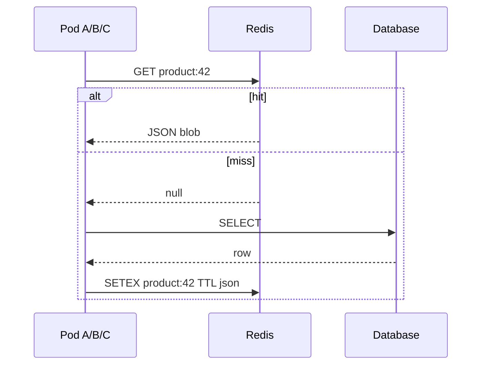
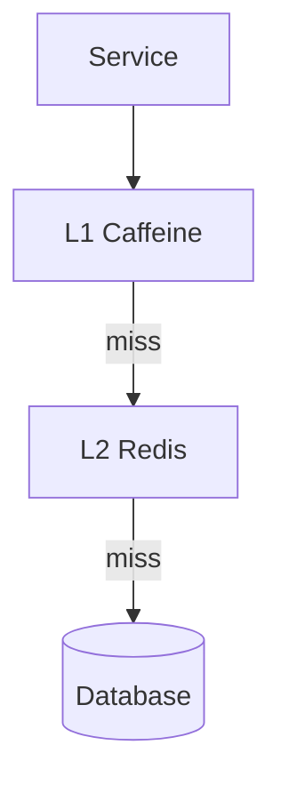
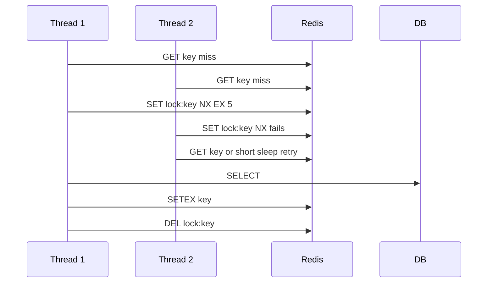

# Redis and Invalidation

> **Status:** Completed  
> **Module:** 46 — Caching and Performance Engineering  
> **Target Java version:** 21  
> **Last reviewed:** 2026-11-11  
> **Chapter profile:** Technical  
> **Depth target:** Levels 2–3

**Note:** Runnable Redis examples require a Redis server and client library (Lettuce/Jedis); command shapes below are **reference** for staging labs—not fabricate local scrape/session output.

## 1. Learning Objectives

- Use **Redis** as distributed cache, session store, and rate-limit counter for clustered Java services.
- Compare **Redis** to in-process **Caffeine** caches and design **two-level** L1/L2 hierarchies.
- Design **invalidation** across app instances and **cache stampede** controls tied to Ch.01 patterns.
- Apply **security** basics: AUTH, TLS, no sensitive data without encryption (Module 43).

## 2. Prerequisites

- [01-caching-strategies.md](01-caching-strategies.md) — cache-aside, TTL, thundering herd.
- **Module 39** — session vs stateless JWT trade-offs (optional).
- **Module 45** — event-driven invalidation consumers (optional).

## 3. Why This Concept Exists

In-process caches (Caffeine, `ConcurrentHashMap`) do not **share** entries across JVMs. Each pod has its own hit ratio; after deploy, every instance is **cold**. **Redis** (remote in-memory data store) centralizes hot entries, session state, and coordination primitives (locks, counters) for horizontal scale—at the cost of network latency, operational ownership, and **split-brain** behavior if treated as authoritative without a database behind it.

## 4. Conceptual Explanation

### Redis as a cache backend

Redis is **not** a replacement for PostgreSQL: it is a **fast tier** with optional durability (RDB/AOF) tuned for different goals. For handbook-style Spring services, treat Redis cache as **derivable** from DB unless you explicitly model Redis-native structures (counters, leaderboards).

### Java client landscape

| Client | Model | Notes |
|--------|-------|-------|
| **Lettuce** | Async/reactive, Netty | Default in Spring Data Redis |
| **Jedis** | Blocking pool | Mature; tune pool size |
| **Spring Data Redis** | `RedisTemplate`, cache abstraction | Hides command details |

Nothing in the JDK speaks Redis; dependencies are explicit.

### Redis data structures (usage)

| Structure | Use |
|-----------|-----|
| **String** | Serialized JSON blob, counters |
| **Hash** | Fielded objects |
| **Set / ZSet** | Tags, leaderboards |
| **List** | Queues (with care; not Kafka) |
| **Pub/Sub** | Cache invalidation fanout (not durable log) |

```java
// Conceptual — requires lettuce on classpath
// redis.setex("product:42", 3600, json);
// redis.get("product:42");
```

## 5. Mechanism and Execution Flow

### Distributed cache-aside (same logic as Ch.01)



On **update**, application commits DB then **DEL** keys or publishes an invalidation event so all pods drop L1 and L2.

### Two-level L1 + L2

| Tier | Latency | Scope |
|------|---------|-------|
| **L1 Caffeine** | Microseconds | Single JVM |
| **L2 Redis** | Milliseconds | Cluster-wide |



**Write path:** invalidate **both** L1 (local) and L2 (Redis) on authoritative DB update, or rely on versioned keys so stale L1 cannot serve wrong semantics.

### Invalidation strategies

| Strategy | Mechanism | When |
|----------|-----------|------|
| **TTL only** | `SETEX` | Reference data; bounded staleness OK |
| **Delete on write** | `DEL product:42` | Stronger; must list all derived keys |
| **Version in key** | `product:42:v7` | Avoid delete races |
| **Pub/Sub `invalidate`** | All nodes drop local L1 | After L2 delete |

Event-driven: `ProductUpdated` consumer deletes keys (Module 45).

### Stampede lock pattern (conceptual)



Only the lock holder loads origin; others wait or serve stale with `max-stale` policy if product allows.

### Spring Data Redis cache manager knobs

| Property | Effect |
|----------|--------|
| `spring.cache.redis.time-to-live` | Default TTL |
| `spring.cache.redis.cache-null-values` | Whether to cache negative results |
| Lettuce pool max | Caps concurrent Redis commands per pod |

Tune pool with expected RPS × commands per request—Redis RTT dominates when pool starved.

### Sessions and rate limiting

- **Session store:** Spring Session Redis for sticky-less scaling; serializable session attributes only.
- **Rate limit:** `INCR` + TTL bucket per client id at API gateway or servlet filter.

Never store raw passwords or PAN in Redis; encrypt sensitive payloads if required.

## 6. Terminology

| Term | Meaning |
|------|---------|
| **SETEX** | Set string with seconds TTL |
| **SCAN** | Cursor-based key iteration (production-safe vs `KEYS *`) |
| **Single-flight** | One loader per key (Ch.01); can be Redis `SETNX` lock |
| **Split brain** | Redis and DB diverge after partial failure |

## 7. Real-World Use Cases

- Flash sale: Redis holds inventory counters with Lua atomic decrement.
- Feature flags cached per tenant with 60s TTL.
- JWT blocklist (logout) with TTL = token expiration.

## 8. Edge Cases

- **Redis unavailable:** degrade to DB (circuit breaker, Module 44) or fail closed for security reads—product decision, not library default.
- **Large values:** multi-megabyte JSON is the wrong tool—use object store for blobs.
- **Hot keys:** single Redis shard saturation; consider local L1 or key splitting.

## 9. Common Mistakes

| Mistake | Fix |
|---------|-----|
| `KEYS *` in production | `SCAN` with pattern |
| No connection pooling | Shared Lettuce connection / pool config |
| Same TTL for hot and cold data | Tiered TTL by access pattern |
| Redis as sole source of truth for orders | DB authoritative; Redis derivable |

## 10. Conceptual Note

This chapter does not require a running Redis instance for handbook completion. Validate command shapes and client timeouts in **staging** with real topology (replicas, Sentinel, cluster mode).

## 11. Design Trade-offs

| Caffeine only | Redis only | L1 + L2 |
|---------------|------------|---------|
| Simplest ops | Shared cache | Best hit rate; complex invalidation |

| Spring Session Redis | Stateless JWT |
|----------------------|---------------|
| Revocable server sessions | No central session store |

## 12. Revision and Mastery

- When is **Caffeine alone** enough vs when is Redis required?
- Invalidation vs TTL for price updates during a sale?
- Session in Redis vs JWT for a B2B API with instant revocation?

## 13. Operational Playbook (Redis unavailable)

| Phase | Application behavior |
|-------|------------------------|
| Detect | Circuit breaker open after N failures / high latency |
| Degrade | Skip L2; optional skip L1 for security-sensitive reads |
| Recover | Half-open probe; gradual traffic; watch stampede on refill |

Log **cache bypass rate** metric during incident; postmortem asks whether TTL jitter would have softened the spike.

## 14. Exercises

1. Key naming convention for tenant-scoped cache (`tenant:{id}:product:{id}`).
2. Invalidation flow diagram for product update API (DB commit → bus → consumers).
3. Failure mode doc when Redis partition occurs (read path, write path).

## 15. Serialization Formats at the Cache Boundary

| Format | Pros | Cons |
|--------|------|------|
| JSON (String value) | Human-debuggable in `redis-cli` | Larger, slower parse |
| JDK serialization | Easy with `RedisTemplate` default | Fragile across class versions; security risk |
| Protocol Buffers / Avro | Compact, schema evolution | Extra codegen pipeline |

Prefer **versioned DTO + JSON** for handbook-style services; never cache JPA entities verbatim (Ch.01).

## 16. Chapter Summary

Redis centralizes distributed caching and coordination; pair with clear **invalidation**, **TTL discipline**, and **safe failure modes**—not as silent source of truth without database backing.

## 17. Next Steps

[03-load-testing-and-capacity.md](03-load-testing-and-capacity.md)

## Review Checklist

- [x] Technical L2–3; mechanism flows (cache-aside, L1/L2)
- [x] Redis conceptual; invalidation; security note; no fabricated Redis output
- [x] Preserved pattern catalog and exercises; stampede lock deepen pass 2026-11-11
